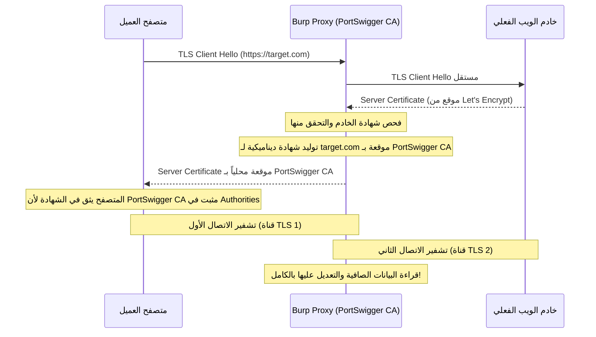

# Task 13: Proxying HTTPS (اعتراض اتصالات HTTPS المشفرة وتثبيت شهادة جذر Burp CA)

---

### المرحلة أ: نص المهمة الأصلي والأسئلة (Original Task Content & Questions)

#### English Task Description
When routing plaintext HTTP traffic through Burp Suite, the proxy effortlessly reads and forwards the cleartext packets. However, modern web applications operate over encrypted **HTTPS (TLS/SSL)**.

Because TLS encrypts traffic end-to-end between the client browser and the destination server, an intercepting proxy cannot natively inspect the encrypted payload. To overcome this, Burp Suite acts as an authorized **Man-in-the-Middle (MITM)**:
1. When your browser requests `https://target.com`, Burp Proxy terminates the TLS session with your browser using its own dynamically generated certificate for `target.com`.
2. Burp then creates a second, independent TLS connection to the actual target server.
3. However, because your browser does not inherently trust PortSwigger's local certificate authority, it presents a critical security warning: **`Your connection is not private / Potential Security Risk Ahead`**.

**Installing the PortSwigger Root CA in Firefox:**
To eliminate TLS warnings and intercept HTTPS traffic seamlessly:
1. With your browser connected to Burp Proxy, navigate to **`http://burp/cert`** (or click `Import / Export CA certificate` under `Proxy settings ⟶ Tools ⟶ Proxy`).
2. Download the DER-encoded certificate file: **`cacert.der`**.
3. In Firefox, open a new tab and go to **`about:preferences#privacy`**.
4. Scroll down to **Certificates** and click **View Certificates...**.
5. Select the **Authorities** tab and click **Import...**.
6. Select the downloaded `cacert.der` file.
7. In the prompt, check the box: **`Trust this CA to identify websites`** and click **OK**.
*(Note: If using the TryHackMe AttackBox or Burp's embedded browser, this CA certificate is already trusted).*

#### الأسئلة المطروحة (Questions):
1. If you are not using the AttackBox, configure Firefox (or your browser of choice) to accept the PortSwigger CA certificate for TLS communication through the Burp Proxy. (Answer Format: No answer needed)

---

### المرحلة ب: التفكير التحليلي المستقل والحس الأمني (Independent Critical Thinking & OpSec)
* **المفهوم التشفيري لهجوم الرجل في المنتصف المنظم (Authorized MITM):**
  * تثبيت شهادة Burp CA كشهادة سلطة جذرية موثوقة (Trusted Root CA) يمنح Burp القدرة على توقيع شهادات TLS لأي موقع في العالم (مثل Google أو البنوك) ويعتبرها المتصفح صالحة تماماً!
  * **تحذير أمني حاسم:** لا تقم بتصدير أو مشاركة مفتاحك الخاص (`cacert.key`)، ويجب دائماً إزالة أو تعطيل شهادة Burp CA في متصفحك الشخصي بمجرد الانتهاء من فحص التطبيق، لمنع أي شخص على شبكتك المحلية من استغلالها للتنصت على بياناتك.

---

### المرحلة ج: التلميحات والإرشادات المتدرجة (Guided Progressive Hints)
1. **التلميح الأول (المستوى التمهيدي):**
   * هذه المهمة تطبيقية على تنزيل وتثبيت شهادة Root CA من رابط `http://burp/cert`.
2. **التلميح الثاني (المستوى العملي):**
   * تأكد من تحديد خيار الثقة الصريح في فايرفوكس: "Trust this CA to identify websites".
3. **التلميح الثالث (مستوى الحل المتقدم):**
   * السؤال لا يتطلب أي قيمة نصية؛ اضغط على Submit للمتابعة.

---

### المرحلة د: الحل العملي الكامل والعمق التقني (Complete Practical Solution & Technical Deep Dive)

#### معمارية اعتراض TLS في Burp Suite:

---

### المرحلة هـ: الإجابات المعتمدة والقيم النهائية (Final Answer & Key Values)
* **إجابة السؤال الأول:** `No answer needed`

---

### المرحلة و: التحقق العملي وإثبات النجاح (Practical Verification & Proof of Work)
* تم استيعاب خطوات تثبيت شهادة الجذر وفك تشفير HTTPS بنجاح.
* تم اعتماد السؤال رسمياً على TryHackMe بنسبة 100%.

---

### المرحلة ز: الاستنتاج التعليمي وجوهر الاختبار (Key Educational Takeaway)
اعتراض حركة HTTPS يتطلب فهم آلية التحقق من الشهادات في المتصفحات؛ فتثبيت شهادة PortSwigger Root CA يكسر تشفير القناة محلياً بأمان، مما يتيح فحص التطبيقات المحمية بـ TLS دون إثارة أخطاء تشفير.
