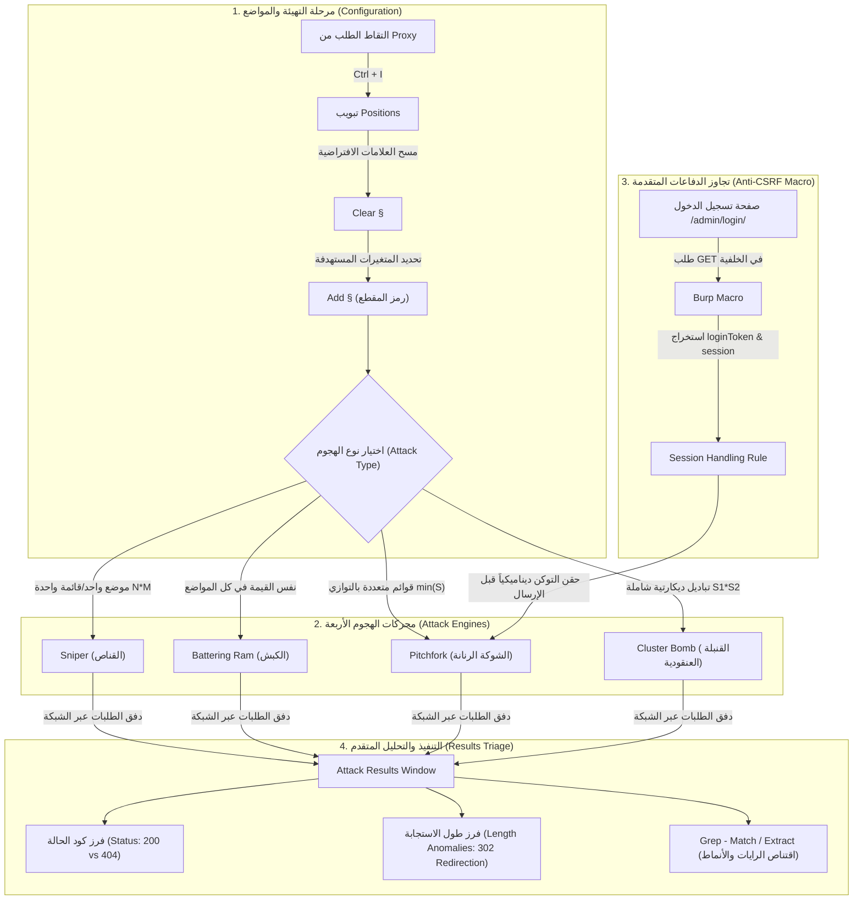

# غرفة دخيل بيرب سويت (Burp Suite: Intruder)

---

## 1. بطاقة التعريف والبيانات الوصفية (Metadata & Overview)

* **المسار التعليمي:** Jr Penetration Tester (مسار مختبر الاختراق المبتدئ - المنهج المعتمد)
* **الموديول:** الموديول السادس - Burp Suite (أداة بيرب سويت)
* **رقم الغرفة:** الغرفة الثالثة (Room 03 / 06)
* **اسم الغرفة في المنصة:** Burp Suite: Intruder
* **رابط الغرفة الرسمي:** [TryHackMe - Burp Suite: Intruder](https://tryhackme.com/room/burpsuiteintruder)
* **مستوى الصعوبة:** متوسط / إرشادي (Medium / Walkthrough)
* **الهدف التكتيكي:** إتقان أتمتة وتخصيص طلبات HTTP، فهم الأنماط الهجومية الأربعة (Sniper, Battering Ram, Pitchfork, Cluster Bomb)، تنفيذ هجمات حشو بيانات الاعتماد (Credential Stuffing)، استغلال ثغرات الإسناد المباشر غير الآمن (IDOR)، وتطويع ماكرو الجلسات (Burp Macros) لتجاوز قيود رموز التحقق الديناميكية (Anti-CSRF Tokens).

---

## 2. الملخص التنفيذي (Executive Summary)

تُمثل وحدة **Burp Suite Intruder** محرك الأتمتة والتخمين الفائق في بيئة اختبار تطبيقات الويب. بينما تتيح أداة Repeater فحص وتعديل الطلبات الفردية يدوياً بدقة جراحية، تتطلب تقييمات الأمان الواقعية إرسال مئات أو آلاف الطلبات المتكررة لاختبار قواميس الحمولات، وتخمين الحسابات، وتدقيق معرفات الكائنات غير المحمية.

يقدم هذا الدليل توثيقاً هندسياً شاملاً لوحدة Intruder:
1. **التبويبات الهيكلية:** تفكيك تبويبات **Positions** (تحديد مواضع الحقن برمز `§` واختيار نوع الهجوم)، **Payloads** (إدارة القواميس وقواعد المعالجة الفورية مثل `Add suffix`)، **Resource Pool** (إدارة خيوط التزامن وخنق السرعة)، و **Settings** (قواعد المطابقة والاستخراج Grep Match / Extract).
2. **الأنماط الهجومية الأربعة:** تفصيل المعادلات الرياضية وسلوكيات الحقن لنمط القناص (**Sniper**)، الكبش (**Battering Ram**)، الشوكة الرنانة (**Pitchfork**)، والقنبلة العنقودية (**Cluster Bomb**).
3. **التطبيقات المعملية المتقدمة:**
   - تنفيذ هجوم **Pitchfork** لحشو بيانات الاعتماد على مسار `/support/login` واكتشاف الحساب الصحيح (`m.rivera:letmein1`) عبر تحليل شذوذ أطوال الاستجابة (Length Anomalies).
   - تنفيذ هجوم **Sniper** بأرقام تسلسلية لاختراق تذاكر الدعم الفني عبر ثغرة IDOR واستخراج الراية `THM{MTMxNTg5NTUzMWM0OWRlYzUzMDVjMzJl}`.
   - كسر بوابة الإدارة المحمية برموز CSRF لمرة واحدة عبر بناء **Burp Macro** وقاعدة معالجة جلسات لاستخراج التوكن وتحديثه في الذاكرة لحظياً لاكتشاف الحساب الإداري (`o.bennett:bella1`).

---

## 3. مخطط البنية المعمارية وتدفق العمليات (Architecture & Workflow Diagram)



---

## 4. المتطلبات المسبقة والتهيئة المعملية (Prerequisites & Lab Setup)

1. **البرمجيات المطلوبة:**
   * منصة **Burp Suite Community Edition** (أو Professional).
   * متصفح Burp المدمج.
   * حزمة الأدوات الشبكية (cURL, Wget, Unzip).
2. **بدء تشغيل الآلة المعملية واستخراج القواميس:**
   * تشغيل الآلة المعملية في TryHackMe للحصول على `MACHINE_IP`.
   * تنزيل حزمة بيانات الاعتماد المسربة من خادم المعمل الداخلي:
     ```bash
     wget http://MACHINE_IP:9999/Credentials/BastionHostingCreds.zip
     unzip BastionHostingCreds.zip
     # القوائم: usernames.txt, passwords.txt, emails.txt, combined.txt
     ```
3. **ضبط نطاق الفحص:**
   * تعطيل اعتراض الوكيل للسماح بتسجيل حركة المرور في الـ History.
   * إرسال الطلبات المستهدفة إلى Intruder عبر اختصار لوحة المفاتيح: `Ctrl + I`.

---

## 5. المفاهيم الأساسية والعمق النظري (Core Concepts & Theoretical Deep Dive)

### أ. محددات المواضع ورمز المقطع (`§`):
يستخدم Burp Suite الرمز اللاتيني `§` كفاصل مزدوج لتحديد مواضع الحقن. عند إرسال طلب إلى Intruder، يقوم المحرك تلقائياً بوسم جميع المتغيرات المحتملة. يُعد الضغط على **Clear §** خطوة أولى إلزامية لحماية ملفات تعريف الارتباط والتوكنات الثابتة من التعديل العشوائي.

### ب. المقارنة الرياضية لأنماط الهجوم:
1. **Sniper:** $\text{Requests} = \text{Positions} \times \text{Words}$ (مجموعة حمولات واحدة).
2. **Battering Ram:** $\text{Requests} = \text{Words}$ (مجموعة حمولات واحدة توزع بالتزامن).
3. **Pitchfork:** $\text{Requests} = \min(\text{len}(S_1), \text{len}(S_2), \dots)$ (حتى 20 مجموعة حمولات تعمل بالتوازي التام).
4. **Cluster Bomb:** $\text{Requests} = \prod_{i=1}^n \text{len}(S_i)$ (حتى 20 مجموعة حمولات تختبر جميع التباديل الممكنة).

### ج. هندسة تجاوز رموز CSRF عبر ماكرو الجلسات (Macro Session Automation):
رموز الحماية ضد التزوير (Synchronizer CSRF Tokens) تجعل طلبات التخمين الثابتة تفشل فوراً لأن التوكن يستخدم لمرة واحدة فقط. عبر ربط ماكرو يرسل طلب `GET` قبل كل طلب تخمين، يلتقط Burp التوكن الجديد ورمز الجلسة الجديد ويحقنهما في طلب `POST` قبل إرساله إلى خادم التطبيق، مما يحيد حماية CSRF بالكامل.

---

## 6. استعراض الغرفة وهيكل التنقل (Room Breakdown & Navigation)

تتألف الغرفة من 13 مهمة تعليمية وتطبيقية متسلسلة:
* **المهمة 01:** مقدمة وأهداف أتمتة الفحص.
* **المهمة 02:** التعريف بوحدة Intruder وتبويب **Positions**.
* **المهمة 03:** التحكم في مواضع الحقن ورمز المقطع **`§`**.
* **المهمة 04:** إدارة مجموعات الحمولات وقاعدة **Add suffix**.
* **المهمة 05:** مدخل لأنماط الهجوم الأربعة ونمط **Sniper**.
* **المهمة 06:** التحليل الرياضي لنمط **Sniper** وحساب عدد الطلبات.
* **المهمة 07:** آلية عمل نمط **Battering Ram** وحقن القيم المتطابقة.
* **المهمة 08:** آلية عمل نمط **Pitchfork** والحد الأقصى (20 مجموعة).
* **المهمة 09:** آلية عمل نمط **Cluster Bomb** وحساب التباديل الشاملة.
* **المهمة 10:** تطبيق عملي لحشو بيانات الاعتماد (Pitchfork) على مسار الدعم.
* **المهمة 11:** تحدي عملي لاكتشاف ثغرة IDOR واستخراج الراية عبر نمط Sniper.
* **المهمة 12:** تحدي الماكرو المتقدم لكسر بوابة الإدارة المحمية برمز CSRF.
* **المهمة 13:** الخاتمة واستشراف وحدات Burp الإضافية (Decoder, Comparer, Sequencer).

---

## 7. ملخص المهام والحلول العملية (Task-by-Task Implementation Summary)

| رقم المهمة | اسم المهمة (Task Name) | السؤال المعتمد (Question) | الإجابة الموثقة (Verified Answer) | ملف المرحلة السبع |
| :---: | :--- | :--- | :--- | :---: |
| **01** | Introduction | Let's get started! | `No answer needed` | [TASK-01.md](file:///e:/THM-JR-PENETRATION-TESTER/06-BURP-SUITE/03-BURP-SUITE-INTRUDER/TASKS/TASK-01.md) |
| **02** | What is Intruder | In which Intruder tab can we define the "Attack type"? | `Positions` | [TASK-02.md](file:///e:/THM-JR-PENETRATION-TESTER/06-BURP-SUITE/03-BURP-SUITE-INTRUDER/TASKS/TASK-02.md) |
| **03** | Positions | What symbol defines the start and end of a position? | `§` | [TASK-03.md](file:///e:/THM-JR-PENETRATION-TESTER/06-BURP-SUITE/03-BURP-SUITE-INTRUDER/TASKS/TASK-03.md) |
| **04** | Payloads | Which rule could we use to add characters at the end? | `Add suffix` | [TASK-04.md](file:///e:/THM-JR-PENETRATION-TESTER/06-BURP-SUITE/03-BURP-SUITE-INTRUDER/TASKS/TASK-04.md) |
| **05** | Intro to Attack Types | What attack type cycles through inserting one payload at a time? | `Sniper` | [TASK-05.md](file:///e:/THM-JR-PENETRATION-TESTER/06-BURP-SUITE/03-BURP-SUITE-INTRUDER/TASKS/TASK-05.md) |
| **06** | Sniper | Requests count for 3 positions * 100 words? / Accepted sets? | Q1: `300`<br>Q2: `1` | [TASK-06.md](file:///e:/THM-JR-PENETRATION-TESTER/06-BURP-SUITE/03-BURP-SUITE-INTRUDER/TASKS/TASK-06.md) |
| **07** | Battering Ram | What would body parameters of the first request be? | `username=admin&password=admin` | [TASK-07.md](file:///e:/THM-JR-PENETRATION-TESTER/06-BURP-SUITE/03-BURP-SUITE-INTRUDER/TASKS/TASK-07.md) |
| **08** | Pitchfork | Maximum number of payload sets in Pitchfork? | `20` | [TASK-08.md](file:///e:/THM-JR-PENETRATION-TESTER/06-BURP-SUITE/03-BURP-SUITE-INTRUDER/TASKS/TASK-08.md) |
| **09** | Cluster Bomb | Total requests for sets with 100, 2, and 30 lines? | `6000` | [TASK-09.md](file:///e:/THM-JR-PENETRATION-TESTER/06-BURP-SUITE/03-BURP-SUITE-INTRUDER/TASKS/TASK-09.md) |
| **10** | Practical Example | Successful username and password combination? | `m.rivera:letmein1` | [TASK-10.md](file:///e:/THM-JR-PENETRATION-TESTER/06-BURP-SUITE/03-BURP-SUITE-INTRUDER/TASKS/TASK-10.md) |
| **11** | Practical Challenge | Best attack type? / Attack execution / Flag value? | Q1: `Sniper`<br>Q2: `No answer needed`<br>Q3: `THM{MTMxNTg5NTUzMWM0OWRlYzUzMDVjMzJl}` | [TASK-11.md](file:///e:/THM-JR-PENETRATION-TESTER/06-BURP-SUITE/03-BURP-SUITE-INTRUDER/TASKS/TASK-11.md) |
| **12** | Extra Mile Challenge | Successful admin username and password combination? | `o.bennett:bella1` | [TASK-12.md](file:///e:/THM-JR-PENETRATION-TESTER/06-BURP-SUITE/03-BURP-SUITE-INTRUDER/TASKS/TASK-12.md) |
| **13** | Conclusion | I can use Intruder! | `No answer needed` | [TASK-13.md](file:///e:/THM-JR-PENETRATION-TESTER/06-BURP-SUITE/03-BURP-SUITE-INTRUDER/TASKS/TASK-13.md) |

---

## 8. المعامل العملية والتطبيق الهجومي المباشر (Practical Labs & Hands-on Exploitation)

### المختبر الأول: حشو بيانات الاعتماد (Credential Stuffing):
* **نقطة النهاية:** `POST /support/login`
* **النمط المستخدم:** `Pitchfork` (Set 1: `usernames.txt`, Set 2: `passwords.txt`).
* **مؤشر النجاح:** شذوذ طول الاستجابة (Length: 238 بايت بدلاً من 272 بايت).
* **بيانات الاعتماد:** `m.rivera:letmein1`.

### المختبر الثاني: استغلال ثغرة IDOR الرقمية:
* **نقطة النهاية:** `GET /support/ticket/§1§`
* **النمط المستخدم:** `Sniper` (Numbers: من 1 إلى 100، الخطوة 1).
* **مؤشر النجاح:** فرز كود الحالة للعثور على استجابات `200 OK` بين أكواد `404 Not Found`.
* **الراية المستخرجة:** `THM{MTMxNTg5NTUzMWM0OWRlYzUzMDVjMzJl}`.

### المختبر الثالث: كسر الحماية ضد التزوير وماكرو الجلسات (Burp Macro Exploitation):
* **نقطة النهاية:** `POST /admin/login/`
* **التحدي:** وجود توكن متجدد لمرة واحدة `loginToken` مع جلسة ديناميكية.
* **الحل:** بناء ماكرو لجلب صفحة الدخول، واستخراج التوكن عبر قاعدة إدارة الجلسات، ثم تنفيذ هجوم `Pitchfork`.
* **بيانات الاعتماد الإدارية:** `o.bennett:bella1`.

---

## 9. تطبيقات الفريق الأحمر والمناورات الهجومية (Red Team Applications)

* **هجمات Password Spraying منخفضة البصمة:** استخدام نمط Sniper لاختبار كلمة مرور موسمية واحدة (مثل `Winter2026!`) ضد آلاف الحسابات لتفادي قفل الحسابات (Lockout).
* **التفويض عبر معرفات الكائنات غير المباشرة:** مسح معرفات UUID والمصفوفات الرقمية عبر هجمات الأرقام المؤتمتة.
* **التلاعب بالترويسات عبر هجمات متزامنة:** دمج ترويسات تزييف عناوين IP (`X-Forwarded-For`) مع كل طلب لتجاوز قيود WAF التي تعتمد على العناوين السطحية.

---

## 10. استراتيجيات الفريق الأزرق والكشف الدفاعي (Blue Team & Detection Strategies)

### أ. تعزيز بوابات المصادقة ضد الأتمتة:
* تفعيل التوثيق متعدد العوامل (MFA / 2FA) لحرمان المهاجم من استغلال بيانات الاعتماد المسربة.
* تطبيق قيود صارمة على معدل الطلبات (Rate Limiting) على مستوى عنوان IP والجلسة واسم المستخدم.
* تفعيل سياسات قفل الحسابات التدريجية (Exponential Backoff Lockout).

### ب. إحكام الرقابة على معرفات الموارد (IDOR Remediation):
* عدم الاعتماد على أرقام متسلسلة يمكن تخمينها؛ واستبدالها بمعرفات عشوائية مشفرة (Cryptographic UUIDv4).
* تطبيق فحص إلزامي لصلاحية الجلسة على مستوى قاعدة البيانات:
  ```python
  # التحقق من أن المستخدم يملك التذكرة بالفعل
  ticket = db.query("SELECT * FROM tickets WHERE id = %s AND user_id = %s", (ticket_id, current_user.id))
  if not ticket:
      abort(403)
  ```

### ج. رصد التخمين في أنظمة SIEM / SOC:
* مراقبة الارتفاع المفاجئ في استجابات HTTP 302 ذات المسارات المتكررة أو أكواد 401/403.
* كشف الأدوات الآلية عبر بصمات TCP وخصائص الترويسات وترتيبها.

---

## 11. استكشاف الأخطاء ومعالجة المشكلات التقنية (Troubleshooting & Edge Cases)

1. **فشل الهجوم وظهور خطأ CSRF Token Invalid:**
   * **السبب:** لم يتم إعداد الماكرو بشكل سليم أو لم يتم شمول أداة Intruder في نطاق قاعدة الجلسات (Scope).
   * **الحل:** راجع تبويب `Settings -> Sessions -> Rules -> Scope` وتأكد من تحديد مربع اختيار `Intruder`.
2. **انخفاض سرعة الهجوم بشكل كبير في Burp Community:**
   * **السبب:** خنق السرعة الإجباري المفروض من الشركة المطورة في النسخة المجانية.
   * **الحل:** استخدم قواميس مركزة وصغيرة، أو استعن بأدوات سطر الأوامر مثل `ffuf` للتخمين الأولي الضخم ثم انتقل لـ Intruder للتأكيد.
3. **تدمير الجلسة وتسجيل الخروج التلقائي أثناء الهجوم:**
   * **السبب:** نسيان علامات `§` حول كوكي الجلسة أو توكن المصادقة.
   * **الحل:** اضغط دائماً على **Clear §** قبل تحديد حقول اسم المستخدم وكلمة المرور فقط.

---

## 12. مرجع الأوامر السريعة والاختصارات (Cheatsheet & Quick Reference)

### اختصارات Burp Intruder:
* `Ctrl + I`: إرسال الطلب المحدد مباشرة إلى Intruder.
* `Ctrl + Space`: بدء الهجوم (Start Attack).
* `Clear §`: إزالة جميع محددات المواضع.
* `Add §`: إضافة محدد الموضع للنص المظلل.

### أوامر سطر الأوامر المكافئة (cURL Alternatives):
```bash
# تنزيل حزمة بيانات الاعتماد
wget http://MACHINE_IP:9999/Credentials/BastionHostingCreds.zip
unzip BastionHostingCreds.zip

# فحص IDOR متسلسل عبر Bash
for id in $(seq 1 100); do
  curl -s -o /dev/null -w "%{http_code} Ticket $id\n" "http://MACHINE_IP/support/ticket/$id"
done | grep "200"
```

---

## 13. أسئلة التحقق ومراجعة الفهم (Knowledge Check & Verification)

* **س1:** ما الفارق الجوهري بين هجوم Pitchfork وهجوم Cluster Bomb عند استخدام قائمتين كل منهما تحتوي على 100 كلمة؟
  * *ج:* هجوم Pitchfork يرسل 100 طلب فقط بالتوازي في أزواج متطابقة، بينما يرسل Cluster Bomb حاصل الضرب الديكارتي (10,000 طلب) لاختبار كافة التباديل الممكنة.
* **س2:** لماذا يجب النقر على زر Clear § فور استيراد أي طلب إلى تبويب Positions؟
  * *ج:* لأن Burp يضع علامات الحقن تلقائياً حول جميع المعاملات وملفات تعريف الارتباط؛ وإذا لم يتم تنظيفها، سيتم تدمير الجلسة وتلويث حركة المرور بطلبات تالفة.
* **س3:** كيف تغلبت وحدة الماكرو على حماية CSRF في التحدي المتقدم؟
  * *ج:* عبر إرسال طلب GET تمهيدي في الخلفية مع كل تكرار، واستخراج التوكن الجديد ورمز الجلسة، وحقنهما ديناميكياً في طلب تسجيل الدخول قبل إرساله.

---

## 14. المراجع والمصادر التوثيقية (References & Further Reading)

* [PortSwigger Burp Suite Intruder Documentation](https://portswigger.net/burp/documentation/desktop/tools/intruder)
* [PortSwigger Intruder Attack Types](https://portswigger.net/burp/documentation/desktop/tools/intruder/attack-types)
* [PortSwigger Session Handling Rules & Macros](https://portswigger.net/burp/documentation/desktop/settings/sessions/rules)
* [OWASP Top 10: A07:2021 Identification and Authentication Failures](https://owasp.org/Top10/A07_2021-Identification_and_Authentication_Failures/)
* [OWASP Top 10: A01:2021 Broken Access Control (IDOR)](https://owasp.org/Top10/A01_2021-Broken_Access_Control/)
