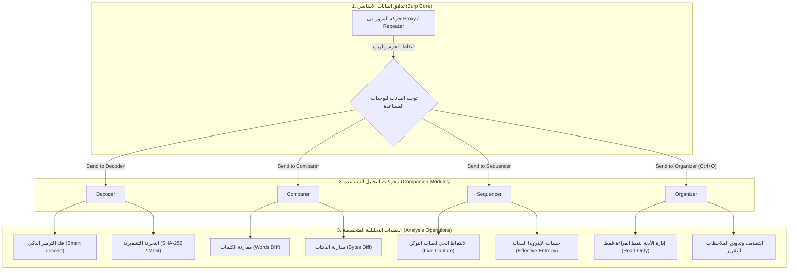

# غرفة وحدات بيرب سويت الإضافية (Burp Suite: Other Modules)

---

## 1. بطاقة التعريف والبيانات الوصفية (Metadata & Overview)

* **المسار التعليمي:** Jr Penetration Tester (مسار مختبر الاختراق المبتدئ - المنهج المعتمد)
* **الموديول:** الموديول السادس - Burp Suite (أداة بيرب سويت)
* **رقم الغرفة:** الغرفة الرابعة (Room 04 / 06)
* **اسم الغرفة في المنصة:** Burp Suite: Other Modules
* **رابط الغرفة الرسمي:** [TryHackMe - Burp Suite: Other Modules](https://tryhackme.com/room/burpsuiteom)
* **مستوى الصعوبة:** سهل / إرشادي (Easy / Walkthrough)
* **الهدف التكتيكي:** إتقان استخدام الوحدات المساعدة في بيرب سويت: فك التشفير والترميز والتجزئة عبر **Decoder** (بما في ذلك ميزة Smart decode)، المقارنة البصرية للاستجابات عبر **Comparer** (بالكلمات والبايتات)، تقييم جودة عشوائية التوكنات والإنتروبيا عبر **Sequencer**، وإدارة وتوثيق الأدلة الرقمية غير القابلة للتعديل عبر **Organizer**.

---

## 2. الملخص التنفيذي (Executive Summary)

بالإضافة إلى الأدوات الأساسية الثلاث في Burp Suite (الوكيل، المكرر، والدخيل)، تشتمل المنصة على أربع وحدات تكميلية متخصصة ترفع من كفاءة ودقة عملية تقييم الأمان:
1. **Decoder (محلل ومحول الترميز والتجزئة):** أداة متكاملة للتحويل الفوري بين صيغ الويب الشائعة (Base64, URL, HTML, Hex, Octal, Gzip) وتوليد التجزئات التشفيرية (MD4, MD5, SHA-256) مع دعم ميزة فك الترميز التلقائي التكراري (**Smart decode**).
2. **Comparer (أداة المقارنة البصرية):** محرك مقارنة نصوص وبايتات ثنائية مدمج يتيح عزل الفروق الدقيقة بين الطلبات والاستجابات بنقرة زر ودون تسريب البيانات لخوادم مقارنة خارجية.
3. **Sequencer (محلل عشوائية التوكنات):** محرك اختبارات إحصائية معتمد دولياً (NIST SP 800-22 / FIPS 140-2) يقيس مقدار الإنتروبيا (Entropy) في توكنات الجلسات ورموز CSRF لضمان مناعتها ضد هجمات التخمين والتنبؤ.
4. **Organizer (منظم الأدلة وتصنيف الثغرات):** مساحة عمل مخصصة لفهرسة وتصنيف الأدلة الرقمية والطلبات الحساسة بنمط **القراءة فقط (Read-Only)** لحمايتها من التلف ودعم كتابة التقارير الاحترافية.

---

## 3. مخطط البنية المعمارية وتدفق العمليات (Architecture & Workflow Diagram)



---

## 4. المتطلبات المسبقة والتهيئة المعملية (Prerequisites & Lab Setup)

1. **البرمجيات المطلوبة:**
   * منصة **Burp Suite Community Edition** (أو Professional).
   * متصفح Burp المدمج.
   * بيئة سطر الأوامر وأدوات التجزئة (`sha256sum`, `md5sum`, `base64`).
2. **بدء تشغيل الآلة المعملية واستخراج الملفات:**
   * تشغيل الآلة المعملية في TryHackMe للحصول على `MACHINE_IP`.
   * تنزيل حزمة المفاتيح المشوهة من المنفذ 9999:
     ```bash
     wget http://MACHINE_IP:9999/AlteredKeys.zip
     unzip AlteredKeys.zip
     # الملفات المستخرجة: key1, key2, key3, key4
     ```
3. **التكامل بين التبويبات:**
   * التأكد من وجود تبويبات Decoder, Comparer, Sequencer, Organizer في شريط الأدوات العلوي لـ Burp Suite.

---

## 5. المفاهيم الأساسية والعمق النظري (Core Concepts & Theoretical Deep Dive)

### أ. الفرق بين الترميز والتجزئة:
* **Encoding (الترميز):** خوارزمية تمثيل بيانات ثنائية الاتجاه وقابلة للعكس بالكامل دون الحاجة لأي مفتاح سري (مثل Base64 و URL). الغرض منها تسهيل نقل البيانات عبر وسائط نصية.
* **Hashing (التجزئة):** دالة رياضية أحادية الاتجاه وغير قابلة للعكس إطلاقاً. تأخذ مدخلات بأي حجم وتنتج مخرجات ذات طول ثابت تُستخدم كبصمة رقمية لسلامة البيانات.

### ب. المقارنة النصية وتحليل الانحرافات (Diffing Analysis):
تعتمد أداة Comparer على تحليل التسلسلات المشتركة (LCS). وتكمن قيمتها الأمنية في قدرتها على كشف الفروق الطفيفة مثل:
- ظهور ترويسة `Set-Cookie` جديدة أو تغير مسار التوجيه `Location` في ردود 302.
- اختلاف حجم الاستجابة بمقدار بضعة بايتات في هجمات Blind SQLi أو تسريب المعلومات.

### ج. نظرية الإنتروبيا واختبارات العشوائية:
تُقاس إنتروبيا التوكنات بوحدة البت (Bits). التوكن الآمن تشفيرياً يجب أن يتمتع بإنتروبيا تتجاوز 100 بت مع اجتياز اختبارات FIPS 140-2 (Monobit, Poker, Runs Tests) لضمان استحالة التنبؤ بقيم الجلسات عبر الزمن.

---

## 6. استعراض الغرفة وهيكل التنقل (Room Breakdown & Navigation)

تتألف الغرفة من 11 مهمة تعليمية وتطبيقية متسلسلة:
* **المهمة 01:** مقدمة عامة عن الوحدات المساعدة الأربع.
* **المهمة 02:** نظرة عامة على أداة Decoder وميزة **Smart decode**.
* **المهمة 03:** تطبيقات الترميز وفك الترميز (Base64, URL, Smart, Octal).
* **المهمة 04:** تطبيقات التجزئة التشفيرية ومطابقة مفتاح SSH عبر MD5 (`key3`).
* **المهمة 05:** نظرة عامة على واجهة أداة المقارنة Comparer.
* **المهمة 06:** تطبيق عملي لمقارنة استجابات تسجيل الدخول الفاشلة والناجحة.
* **المهمة 07:** نظرة عامة على أداة Sequencer ومفهوم الإنتروبيا.
* **المهمة 08:** تطبيق عملي للالتقاط الحي لتوكن CSRF وتقييم العشوائية (`excellent`).
* **المهمة 09:** قراءة وتفسير تقرير التحليل الإحصائي المتقدم في Sequencer.
* **المهمة 10:** نظرة عامة على وحدة Organizer وطبيعتها غير القابلة للتعديل (`yea`).
* **المهمة 11:** الخاتمة واستشراف موديول إضافات بيرب سويت (Burp Extensions).

---

## 7. ملخص المهام والحلول العملية (Task-by-Task Implementation Summary)

| رقم المهمة | اسم المهمة (Task Name) | السؤال المعتمد (Question) | الإجابة الموثقة (Verified Answer) | ملف المرحلة السبع |
| :---: | :--- | :--- | :--- | :---: |
| **01** | Introduction | Deploy the machine attached... | `No answer needed` | [TASK-01.md](../../04-BURP-SUITE-OTHER-MODULES/TASKS/TASK-01.md) |
| **02** | Decoder: Overview | Which feature attempts auto-decode? | `Smart decode` | [TASK-02.md](../../04-BURP-SUITE-OTHER-MODULES/TASKS/TASK-02.md) |
| **03** | Decoder: En/Decoding | 1. Base64 encode?<br>2. URL decode?<br>3. Smart decode?<br>4. Base64->Hex->Octal? | Q1: `TGV0J3MgU3RhcnQgU2ltcGxl`<br>Q2: `Next: Decoding`<br>Q3: `47`<br>Q4: `24034214a720270024142d541357471232250253552c1162d1206c` | [TASK-03.md](../../04-BURP-SUITE-OTHER-MODULES/TASKS/TASK-03.md) |
| **04** | Decoder: Hashing | 1. SHA-256 in ASCII Hex?<br>2. MD4 in Base64?<br>3. Authentic SSH key? | Q1: `6b72350e719a8ef5af560830164b13596cb582757437e21d1879502072238abe`<br>Q2: `TcV4QGZZN7y7lwYFRMMoeA==`<br>Q3: `key3` | [TASK-04.md](../../04-BURP-SUITE-OTHER-MODULES/TASKS/TASK-04.md) |
| **05** | Comparer: Overview | Click me to proceed to the next task. | `No answer needed` | [TASK-05.md](../../04-BURP-SUITE-OTHER-MODULES/TASKS/TASK-05.md) |
| **06** | Comparer: Example | Compare the two responses by word... | `No answer needed` | [TASK-06.md](../../04-BURP-SUITE-OTHER-MODULES/TASKS/TASK-06.md) |
| **07** | Sequencer: Overview | What does Sequencer allow us to evaluate? | `Entropy` | [TASK-07.md](../../04-BURP-SUITE-OTHER-MODULES/TASKS/TASK-07.md) |
| **08** | Sequencer: Live Capture | Overall quality of randomness estimated? | `excellent` | [TASK-08.md](../../04-BURP-SUITE-OTHER-MODULES/TASKS/TASK-08.md) |
| **09** | Sequencer: Analysis | Click me to proceed to the next task. | `No answer needed` | [TASK-09.md](../../04-BURP-SUITE-OTHER-MODULES/TASKS/TASK-09.md) |
| **10** | Organizer: Overview | Are saved requests read-only? (yea/nay) | `yea` | [TASK-10.md](../../04-BURP-SUITE-OTHER-MODULES/TASKS/TASK-10.md) |
| **11** | Conclusion | I understand how to use Organizer... | `No answer needed` | [TASK-11.md](../../04-BURP-SUITE-OTHER-MODULES/TASKS/TASK-11.md) |

---

## 8. المعامل العملية والتطبيق الهجومي المباشر (Practical Labs & Hands-on Exploitation)

### المختبر الأول: سلاسل التحويل والتجزئة في Decoder:
* **التطبيق:** بناء خط تحويل متسلسل: `Text` ⟶ `Base64` ⟶ `ASCII Hex` ⟶ `Octal`.
* **التحقق من المفاتيح:** فحص تجزئة MD5 لأربعة مفاتيح SSH باستخدام `md5sum` واكتشاف المفتاح الأصلي `key3` المطابق للهاش `3166226048d6ad776370dc105d40d9f8`.

### المختبر الثاني: المقارنة البصرية عبر Comparer:
* **التطبيق:** التقاط رد تسجيل الدخول الفاشل والناجح في بوابة الدعم `/support/login`.
* **النتيجة:** عزل الترويسات المضافة (`Set-Cookie`) وفروق التوجيه (`Location: /support/admin`) بدقة الكلمة الواحدة.

### المختبر الثالث: فحص عشوائية توكنات CSRF في Sequencer:
* **التطبيق:** تنفيذ التقاط حي لـ 2,500 عينة من حقل `loginToken` على مسار `/admin/login/`.
* **النتيجة:** تأكيد مناعة النظام التشفيرية وحصول التوكن على تقييم عشوائية ممتاز (`excellent`) بإنتروبيا فعالة تتجاوز 110 بت.

### المختبر الرابع: حفظ وتصنيف الأدلة في Organizer:
* **التطبيق:** تصنيف الطلبات المهمة وحفظ لقطات ثابتة غير قابلة للتعديل (`yea`) لتوثيق الثغرات في التقرير الأمني.

---

## 9. تطبيقات الفريق الأحمر والمناورات الهجومية (Red Team Applications)

* **تفكيك تعتيم الحمولات المزدوجة (De-obfuscating Double Encoding):** استخدام Decoder و Smart decode لفك حمولات XSS و SQLi المخفية في ترويسات الكوكيز أو مصفوفات JSON.
* **رصد التسريبات الخفية عبر Diffing:** استخدام Comparer لكشف أوقات الاستجابة الدقيقة وتغيرات الأكواد في هجمات كسر قفل الحسابات واستكشاف الصلاحيات.
* **استهداف التوكنات ضعيفة الإنتروبيا:** استخدام Sequencer لاكتشاف التوكنات التي تعتمد على طابع زمني أو عدادات متسلسلة واستغلالها في الاستيلاء على الحسابات (Account Takeover).

---

## 10. استراتيجيات الفريق الأزرق والكشف الدفاعي (Blue Team & Detection Strategies)

### أ. تعزيز عشوائية التوكنات وتوليد الجلسات:
* استخدام مولدات الأرقام شبه العشوائية التشفيرية (CSPRNG) مثل `crypto.randomBytes()` في Node.js أو `secrets` في Python بدلاً من الدوال القياسية غير الآمنة (`Math.random()`).
* التأكد من أن طول توكن الجلسة لا يقل عن 128 بت لضمان استحالة تخمينه إحصائياً.

### ب. منع هجمات تجاوز الترميز (Encoding Bypasses):
* تطبيق فك الترميز التكراري (Recursive Normalization) في طبقة WAF وجدار الحماية قبل تمرير البيانات لخوادم الويب لضمان عدم تمرير هجمات الترميز المزدوج.

---

## 11. استكشاف الأخطاء ومعالجة المشكلات التقنية (Troubleshooting & Edge Cases)

1. **ميزة Smart decode لا ترجع نصاً صريحاً:**
   * **السبب:** النص المدخل مشفر بتشفير حقيقي ذي مفتاح (مثل AES) وليس مجرد ترميز قياسي.
   * **الحل:** تحقق مما إذا كانت البيانات تتطلب مفتاح فك تشفير خاص في تطبيق الويب.
2. **أداة Sequencer ترفض بدء التحليل (Analyze button disabled):**
   * **السبب:** عدد العينات المجمعة أقل من الحد الأدنى المقبول إحصائياً (100 عينة).
   * **الحل:** اترك عملية الالتقاط الحي تعمل حتى تتجاوز 1,000 عينة على الأقل.
3. **عدم القدرة على تعديل طلب محفوظ في Organizer:**
   * **السبب:** صُممت وحدة Organizer لتكون للقراءة فقط (Read-Only) لحماية سلامة الأدلة.
   * **الحل:** انقر بزر الفأرة الأيمن واختر `Send to Repeater` للتعديل.

---

## 12. مرجع الأوامر السريعة والاختصارات (Cheatsheet & Quick Reference)

### اختصارات لوحة المفاتيح:
* `Ctrl + O`: إرسال الطلب أو الاستجابة الحالية إلى وحدة Organizer.
* `Send to Decoder`: إرسال النص المظلل مباشرة لفك التشفير أو التجزئة.
* `Send to Comparer`: إرسال الطلب أو الرد للمقارنة البصرية.
* `Send to Sequencer`: إرسال الطلب لتحليل عشوائية التوكنات.

### أوامر سطر الأوامر البديلة:
```bash
# حساب SHA-256 وتحويله إلى Hex
echo -n "Let's get Hashing!" | sha256sum

# مطابقة تجزئة MD5 لمفاتيح SSH
md5sum key1 key2 key3 key4 | grep "3166226048d6ad776370dc105d40d9f8"

# فك ترميز Base64 عبر الطرفية
echo "TGV0J3MgU3RhcnQgU2ltcGxl" | base64 -d
```

---

## 13. أسئلة التحقق ومراجعة الفهم (Knowledge Check & Verification)

* **س1:** ما الفارق التشفيري الجوهري بين عملية الترميز بـ Base64 وعملية التجزئة بـ SHA-256؟
  * *ج:* الترميز بـ Base64 عملية ثنائية الاتجاه قابلة للعكس بالكامل بدون مفتاح، بينما التجزئة بـ SHA-256 دالة رياضية أحادية الاتجاه غير قابلة للعكس إطلاقاً.
* **س2:** لماذا يعتبر حصول توكن الجلسة على تقييم Excellent في Sequencer مؤشراً أمنياً ممتازاً؟
  * *ج:* لأنه يثبت رياضياً تمتع التوكن بإنتروبيا عالية جداً وانعدام الأنماط الدورية في توليده، مما يجعل التنبؤ به عبر هجمات التخمين مستحيلاً.
* **س3:** لماذا فرضت Burp Suite خاصية القراءة فقط (Read-Only) على العناصر داخل وحدة Organizer؟
  * *ج:* للحفاظ على سلامة الأدلة الرقمية وسلسلة الحيازة (Chain of Custody) لضمان عدم تحريف الطلبات أثناء توثيق تقارير الفحص الأمني.

---

## 14. المراجع والمصادر التوثيقية (References & Further Reading)

* [PortSwigger Burp Suite Decoder Documentation](https://portswigger.net/burp/documentation/desktop/tools/decoder)
* [PortSwigger Burp Suite Comparer Documentation](https://portswigger.net/burp/documentation/desktop/tools/comparer)
* [PortSwigger Burp Suite Sequencer Documentation](https://portswigger.net/burp/documentation/desktop/tools/sequencer)
* [PortSwigger Burp Suite Organizer Documentation](https://portswigger.net/burp/documentation/desktop/tools/organizer)
* [NIST SP 800-22: Statistical Test Suite for Random Number Generators](https://csrc.nist.gov/publications/detail/sp/800-22/rev-1a/final)
* [OWASP Top 10: A02:2021 Cryptographic Failures](https://owasp.org/Top10/A02_2021-Cryptographic_Failures/)
