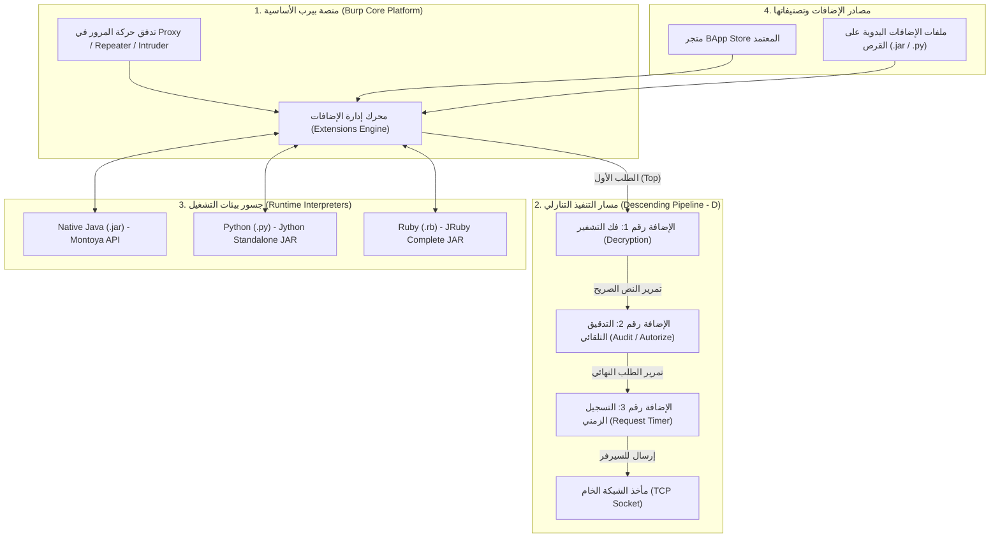

# غرفة إضافات بيرب سويت (Burp Suite: Extensions)

---

## 1. بطاقة التعريف والبيانات الوصفية (Metadata & Overview)

* **المسار التعليمي:** Jr Penetration Tester (مسار مختبر الاختراق المبتدئ - المنهج المعتمد)
* **الموديول:** الموديول السادس - Burp Suite (أداة بيرب سويت)
* **رقم الغرفة:** الغرفة الخامسة (Room 05 / 06)
* **اسم الغرفة في المنصة:** Burp Suite: Extensions
* **رابط الغرفة الرسمي:** [TryHackMe - Burp Suite: Extensions](https://tryhackme.com/room/burpsuiteextensions)
* **مستوى الصعوبة:** سهل / إرشادي (Easy / Walkthrough)
* **الهدف التكتيكي:** إتقان توسيع وظائف Burp Suite، إدارة واجهة Extensions، استيعاب قاعدة الترتيب التنازلي للتنفيذ (`D`)، تثبيت الإضافات الرسمية من متجر **BApp Store** (تطبيق عملي مع Request Timer)، تهيئة مفسر بايثون **Jython Standalone**، واستيعاب هيكلية واجهات برمجة التطبيقات الحديثة (**Montoya API**).

---

## 2. الملخص التنفيذي (Executive Summary)

تُمثل القابلية للتوسعة المعمارية (Extensibility) الميزة الأكثر تنافسية لمنصة Burp Suite. بينما توفر الأدوات الأساسية قدرات شاملة لفحص الويب التقليدي، تتطلب التطبيقات المعاصرة التفاعل مع بروتوكولات مخصصة وتشفير معقد وأتمتة متقدمة لا تتوفر افتراضياً في البرنامج.

يقدم هذا الدليل توثيقاً متكاملاً لمنظومة الإضافات:
1. **واجهة إدارة الإضافات (Extensions Interface):** تفكيك قائمة الإضافات وأزرار التحكم (`Add`, `Remove`, `Up`, `Down`)، وتأصيل القاعدة الجوهرية بأن الإضافات تعالج حركة المرور **بترتيب تنازلي صارم (Descending Order - D)** من أعلى القائمة إلى أسفلها.
2. **متجر التطبيقات (BApp Store):** استعراض المستودع المركزي المعتمد، والتثبيت بنقرة زر واحدة لإضافة **Request Timer** لقياس أزمنة استجابة الخادم بالمللي ثانية لكشف ثغرات Timing Attacks.
3. **بيئة تشغيل بايثون (Jython Environment):** تهيئة حزمة `jython-standalone-2.7.3.jar` لتمكين محرك JVM من تشغيل إضافات بايثون المجتمعية (مثل Autorize و Turbo Intruder).
4. **تطوير الإضافات البرمجية (The Burp Suite API):** مقارنة واجهة `IBurpExtender` الكلاسيكية مع واجهة **Montoya API** الحديثة كمعيار لتطوير أدوات الفحص الموجهة.

---

## 3. مخطط البنية المعمارية وتدفق العمليات (Architecture & Workflow Diagram)



---

## 4. المتطلبات المسبقة والتهيئة المعملية (Prerequisites & Lab Setup)

1. **البرمجيات المطلوبة:**
   * منصة **Burp Suite Community Edition** (أو Professional).
   * بيئة تشغيل جافا (Java Runtime Environment - JRE 17+ أو 21+).
   * حزمة **Jython Standalone JAR** (الإصدار 2.7.3).
2. **تهيئة بيئة بايثون محلياً:**
   * تنزيل حزمة Jython:
     ```bash
     wget https://repo1.maven.org/maven2/org/python/jython-standalone/2.7.3/jython-standalone-2.7.3.jar
     ```
   * التوجه إلى: `Extensions` ⟶ `Extensions settings` ⟶ `Python environment`.
   * تحديد مسار الملف في خيار `Location of Jython standalone JAR file`.
3. **طبيعة المعمل:**
   * هذه الغرفة لا تتطلب تشغيل آلة افتراضية سحابية، حيث يتم تنفيذ كافة الخطوات داخل واجهة Burp Suite مباشرة.

---

## 5. المفاهيم الأساسية والعمق النظري (Core Concepts & Theoretical Deep Dive)

### أ. قاعدة الترتيب التنازلي للتنفيذ (`Descending Order - D`):
تُعالج الإضافات كل طلب واستجابة بالترتيب الفيزيائي لظهورها في القائمة من الأعلى إلى الأسفل:
* إذا قامت الإضافة العلوية بتعديل ترويسة معينة أو فك تشفير جسم الطلب، تتلقى الإضافة التي تليها الطلب المعدل بالفعل.
* يُستخدم زرا **Up** و **Down** لضبط أولوية التنفيذ، مما يمنع تعارض الإضافات ويضمن معالجة البيانات بالترتيب المنطقي السليم.

### ب. جسر جيثون (The Jython Bridge):
لأن مفسر CPython الافتراضي يعتمد على لغة C ولا يعمل داخل جهاز جافا الافتراضي (JVM)، صُمم مفسر Jython لإعادة كتابة مترجم بايثون بالكامل بلغة جافا. يتيح ذلك تشغيل نصوص `.py` داخل نفس مساحة ذاكرة Burp Suite ومشاركة الكائنات البرمجية لحظياً.

### ج. واجهة Montoya API الحديثة:
تمثل Montoya API التحول الأكبر في بنية إضافات Burp Suite:
* استبدلت المصفوفات الثنائية الخام (`byte[]`) بكائنات برمجية كاملة تدعم أمان الأنواع (Type Safety).
* دعمت بروتوكولات الويب الحديثة (HTTP/2 و WebSockets) مع واجهات استماع مبسطة وخالية من تعقيدات إدارة الذاكرة اليدوية.

---

## 6. استعراض الغرفة وهيكل التنقل (Room Breakdown & Navigation)

تتألف الغرفة من 6 مهام تعليمية وتطبيقية مركزة:
* **المهمة 01:** مدخل مفاهيمي والتعريف بمرونة وأهداف التوسعة في بيرب سويت.
* **المهمة 02:** تفكيك واجهة الإضافات واستيعاب قاعدة الترتيب التنازلي للتنفيذ (**`D`**).
* **المهمة 03:** متجر BApp Store وتثبيت إضافة **Request Timer** لقياس أزمنة الاستجابة.
* **المهمة 04:** إعداد وربط مفسر **Jython** لتمكين تشغيل إضافات بايثون.
* **المهمة 05:** استعراض واجهات برمجة التطبيقات ولغات التطوير والانتقال إلى **Montoya API**.
* **المهمة 06:** الخاتمة وترسيخ المهارات الشاملة لموديول Burp Suite.

---

## 7. ملخص المهام والحلول العملية (Task-by-Task Implementation Summary)

| رقم المهمة | اسم المهمة (Task Name) | السؤال المعتمد (Question) | الإجابة الموثقة (Verified Answer) | ملف المرحلة السبع |
| :---: | :--- | :--- | :--- | :---: |
| **01** | Introduction | Click me to proceed to the next task. | `No answer needed` | [TASK-01.md](../../05-BURP-SUITE-EXTENSIONS/TASKS/TASK-01.md) |
| **02** | Extensions Interface | Are extensions invoked in ascending (A) or descending (D) order? | `D` | [TASK-02.md](../../05-BURP-SUITE-EXTENSIONS/TASKS/TASK-02.md) |
| **03** | The BApp Store | Click me to proceed to the next task. | `No answer needed` | [TASK-03.md](../../05-BURP-SUITE-EXTENSIONS/TASKS/TASK-03.md) |
| **04** | Jython | Click me to proceed to the next task. | `No answer needed` | [TASK-04.md](../../05-BURP-SUITE-EXTENSIONS/TASKS/TASK-04.md) |
| **05** | The Burp Suite API | Click me to proceed to the next task. | `No answer needed` | [TASK-05.md](../../05-BURP-SUITE-EXTENSIONS/TASKS/TASK-05.md) |
| **06** | Conclusion | I can use Burp Suite Extensions! | `No answer needed` | [TASK-06.md](../../05-BURP-SUITE-EXTENSIONS/TASKS/TASK-06.md) |

---

## 8. المعامل العملية والتطبيق الهجومي المباشر (Practical Labs & Hands-on Exploitation)

### المختبر الأول: إدارة مسار التنفيذ والأولويات:
* **التطبيق:** فحص قائمة الإضافات والتأكد من ترتيبها التنازلي عبر زري `Up` و `Down`.
* **النتيجة المحققة:** إثبات أن الإضافات العلوية تنفذ أولاً (`D` for Descending) لضمان تغذية الإضافات اللاحقة ببيانات سليمة ومفككة التشفير.

### المختبر الثاني: تثبيت إضافة Request Timer من BApp Store:
* **التطبيق:** البحث عن `Request Timer` وتثبيتها بنقرة زر واحدة.
* **النتيجة المحققة:** ظهور تبويب علوي جديد يسجل زمن الرحلة الكاملة (Round-trip latency) لكل طلب بالمللي ثانية، مما يوفر منصة مراقبة مثالية لهجمات التوقيت الزمني (Timing Attacks).

### المختبر الثالث: تهيئة بيئة Jython المستقلة:
* **التطبيق:** تحميل حزمة `jython-standalone-2.7.3.jar` وربطها في إعدادات بايثون.
* **النتيجة المحققة:** فتح الباب لتثبيت أقوى أدوات الأمان المجتمعية (Autorize و Turbo Intruder) بنجاح دون أخطاء بيئة مفقودة.

---

## 9. تطبيقات الفريق الأحمر والمناورات الهجومية (Red Team Applications)

* **الأتمتة الشاملة لفحص الصلاحيات (Continuous Access Matrix):** استخدام إضافة **Autorize** لتكرار كل طلب يرسله المختبر بجلسة مستخدم عادي لكشف ثغرات IDOR وتخطي الصلاحيات تلقائياً أثناء التصفح الروتيني.
* **استغلال السباق الزمني (Race Condition Exploitation):** توظيف إضافة **Turbo Intruder** لإطلاق 50 طلباً متزامناً في نفس نافذة المللي ثانية لاستغلال ثغرات سحب الرصيد المالي أو استخدام القسائم المتكرر قبل تحديث قاعدة البيانات.
* **التنقيب عن البارامترات غير المعلنة:** توظيف **Param Miner** لاكتشاف متغيرات مخفية في الترويسات ومسارات الروابط تقود إلى ثغرات تسميم الذاكرة المؤقتة (Web Cache Poisoning).

---

## 10. استراتيجيات الفريق الأزرق والكشف الدفاعي (Blue Team & Detection Strategies)

### أ. أمن سلسلة توريد أدوات الاختبار (Tooling Supply Chain Security):
* فرض سياسات صارمة تمنع مختبري الاختراق والفرق الأمنية من تثبيت إضافات مجهولة المصدر من خارج متجر BApp Store المعتمد، لتجنب تسريب حركة مرور العملاء إلى خوادم C2 تابعة لجهات معادية.
* مراجعة الأذونات والصلاحيات التي تطلبها الإضافات للتحقق من عدم قيامها بإنشاء اتصالات خارجية مشبوهة.

### ب. رصد ومواجهة الإضافات الهجومية الفائقة:
* رصد البصمات المميزة لمحركات التخمين عالية السرعة (مثل Turbo Intruder) التي تولد مئات الطلبات دون ترويسات متصفح اعتيادية أو بترتيب ترويسات شاذ.

---

## 11. استكشاف الأخطاء ومعالجة المشكلات التقنية (Troubleshooting & Edge Cases)

1. **فشل تثبيت إضافة بايثون وظهور خطأ "Jython not configured":**
   * **السبب:** لم يتم تحديد مسار ملف Jython Standalone JAR في إعدادات المنصة.
   * **الحل:** توجه إلى `Extensions -> Extensions settings -> Python environment` وحدد مسار ملف `.jar` المستقل.
2. **الإضافة لا تسجل أي مخرجات أو تظهر معطلة:**
   * **السبب:** حدوث استثناء داخلي (Crash) أثناء معالجة الطلبات.
   * **الحل:** افتح تبويب **Errors** في الجزء السفلي من واجهة Extensions لقراءة تفاصيل الخطأ (Stack Trace) وتحديد السطر المسبب للمشكلة.
3. **توقف Burp Suite عن الاستجابة وامتلاء الذاكرة:**
   * **السبب:** تسريب في الذاكرة (Memory Leak) ناتج عن إضافة تقوم بتخزين كل حركة المرور في مصفوفات ضخمة دون تفريغها.
   * **الحل:** عطل الإضافات المشبوهة مؤقتاً عبر إلغاء تحديد خانة `Loaded`.

---

## 12. مرجع الأوامر السريعة والاختصارات (Cheatsheet & Quick Reference)

### خطوات وإعدادات مفسر Jython:
```bash
# 1. تنزيل حزمة Jython Standalone عبر الطرفية
wget https://repo1.maven.org/maven2/org/python/jython-standalone/2.7.3/jython-standalone-2.7.3.jar -O /opt/jython.jar

# 2. مسار التفعيل داخل Burp Suite
Extensions -> Extensions settings -> Python environment -> /opt/jython.jar
```

### اختصارات ومفاتيح الإضافات:
* `Extensions List`: استعراض وترتيب وحذف الإضافات.
* `BApp Store`: التثبيت بنقرة واحدة من المتجر الرسمي.
* `Up / Down`: التحكم في ترتيب التنفيذ التنازلي (`D`).
* `Errors Tab`: تتبع أخطاء الإضافات وتشخيص الأعطال.

---

## 13. أسئلة التحقق ومراجعة الفهم (Knowledge Check & Verification)

* **س1:** بأي ترتيب يتم تنفيذ إضافات Burp Suite عند معالجة طلب أو استجابة HTTP؟
  * *ج:* يتم تنفيذها بترتيب تنازلي صارم (**Descending Order - D**) من أعلى القائمة إلى أسفلها.
* **س2:** لماذا تفشل محاولة تثبيت إضافة مكتوبة بلغة Python في Burp Suite بدون مفسر Jython؟
  * *ج:* لأن Burp يعمل داخل بيئة جافا (JVM) ولا يستطيع تشغيل كود بايثون CPython مباشرة بدون مفسر Jython الذي يترجم كود بايثون إلى Java Bytecode.
* **س3:** ما الميزة الأساسية لواجهة Montoya API مقارنة بالواجهة الكلاسيكية IBurpExtender؟
  * *ج:* توفر بنية كائنية حديثة، وتدعم أمان الأنواع (Type Safety)، وتوفر تكاملاً أصيلاً مع بروتوكولات HTTP/2 و WebSockets.

---

## 14. المراجع والمصادر التوثيقية (References & Further Reading)

* [PortSwigger Burp Suite Extensions Documentation](https://portswigger.net/burp/documentation/desktop/extensions)
* [PortSwigger Montoya API Reference](https://portswigger.net/burp/documentation/desktop/extensions/montoya-api)
* [PortSwigger Official BApp Store](https://portswigger.net/bappstore)
* [The Jython Project Official Repository](https://www.jython.org/)
* [OWASP Top 10: A06:2021 Vulnerable and Outdated Components](https://owasp.org/Top10/A06_2021-Vulnerable_and_Outdated_Components/)
