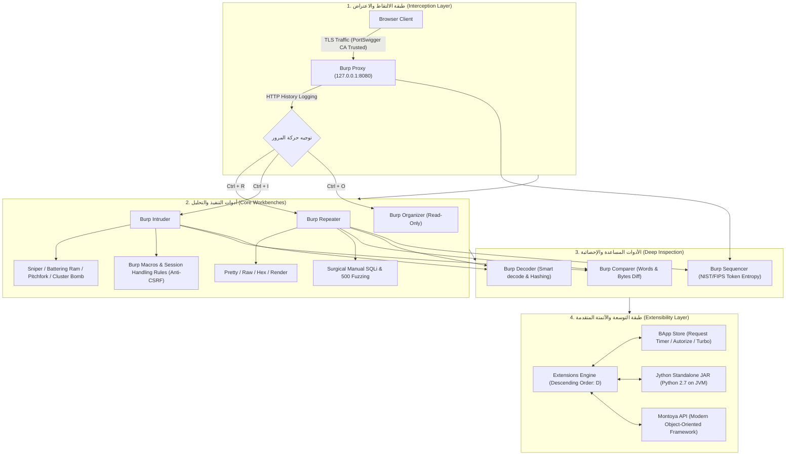

# مراجعة التحول لموديول بيرب سويت (Module 06: Burp Suite Topic Transition Recap)

---

## 1. بطاقة التعريف والبيانات الوصفية (Metadata & Overview)

* **المسار التعليمي:** Jr Penetration Tester (مسار مختبر الاختراق المبتدئ - المنهج المعتمد)
* **الموديول:** الموديول السادس - Burp Suite (أداة بيرب سويت)
* **رقم الغرفة / التقييم:** الغرفة السادسة (Recap 06 / 06)
* **اسم التقييم في المنصة:** Topic Transition Recap
* **رابط التقييم الرسمي:** [TryHackMe - Burp Suite Recap](https://tryhackme.com/recap/6afe01d5f306fc3f65927f67)
* **النقاط المحققة:** 48 / 48 نقطة (بنسبة إنجاز 100%)
* **مستوى الصعوبة:** متوسط / تركيبي (Synthesizing & Assessment)
* **الهدف التكتيكي:** مراجعة وتوليف المفاهيم الشاملة لموديول Burp Suite، ترسيخ دورة حياة تحليل واختبار حركة المرور، والربط المعرفي المباشر للانتقال نحو الموديول السابع (ثغرات تطبيقات الويب I).

---

## 2. الملخص التنفيذي (Executive Summary)

يمثل موديول **Burp Suite** القلب النابض لترسانة اختبار اختراق تطبيقات الويب. على مدار الغرف الخمس التأسيسية والتطبيقية، تدرج المنهج من المبادئ البروتوكولية لاعتراض حركة المرور وفك تشفير TLS، مروراً بالتكرار اليدوي الجراحي والأتمتة التخمينية الفائقة، وصولاً إلى فحص الإنتروبيا التشفيرية وتوسيع المنصة عبر الإضافات البرمجية.

يُعد هذا التقييم التجميعي (Topic Transition Recap) محطة قياس معيارية تختبر الفهم العميق لست ركائز تقنية أساسية:
1. **آلية عمل شهادات CA وفك تشفير HTTPS:** لماذا ترفض المتصفحات شهادة الوكيل ما لم يتم تثبيت شهادة PortSwigger Root CA في مخزن الشهادات الموثوقة.
2. **فلسفة نظام الإضافات (Extensions):** توسيع إمكانيات الأدوات المدمجة وإضافة وظائف جديدة تتجاوز حدود المنصة القياسية.
3. **خطوات المقارنة البصرية في Comparer:** التسلسل المنهجي لالتقاط الرد الفاشل في الوكيل، نقله لـ Repeater، إرسال الرد لـ Comparer، ثم تبديل البيانات بالبيانات الصحيحة وإجراء المقارنة.
4. **مناظير استجابة Repeater:** المطابقة الدقيقة بين أنماط Pretty (التنسيق البصري)، Render (التصيير كمتصفح)، Hex (البايتات الثنائية)، و Raw (النص الحرفي المجرد).
5. **تهيئة بيئة بايثون وجيثون:** الترتيب الإلزامي لتنزيل `jython-standalone-2.7.3.jar`، ضبط مساره في إعدادات بايثون، ثم تحميل ملفات `.py` واستعراض السجلات في لوحة Output.
6. **واجهة إدارة الإضافات:** التمييز بين لوحة التفاصيل (Details) الحاوية للبيانات الوصفية، ولوحة المخرجات (Output)، ولوحة تتبع الأخطاء (Errors).

---

## 3. مخطط البنية المعمارية وتدفق العمليات (Architecture & Workflow Diagram)



---

## 4. المتطلبات المسبقة والتهيئة المعملية (Prerequisites & Lab Setup)

1. **الاستيعاب المفاهيمي للغرف الخمس السابقة:**
   * الغرفة 01: `01-BURP-SUITE-THE-BASICS` (Proxy, CA Cert, Scope).
   * الغرفة 02: `02-BURP-SUITE-REPEATER` (Inspector, Raw editing, UNION SQLi).
   * الغرفة 03: `03-BURP-SUITE-INTRUDER` (4 Attack Types, IDOR, Macros).
   * الغرفة 04: `04-BURP-SUITE-OTHER-MODULES` (Decoder, Comparer, Sequencer, Organizer).
   * الغرفة 05: `05-BURP-SUITE-EXTENSIONS` (BApp Store, Jython, Montoya API).
2. **حالة الحساب المكتمل:**
   * تم توثيق إنجاز كافة الأسئلة الستة بنسبة نجاح 100% وتحقيق الدرجة الكاملة (48/48 نقطة).

---

## 5. المفاهيم الأساسية والعمق النظري (Core Concepts & Theoretical Deep Dive)

### أ. كسر مصافحة TLS واعتراض HTTPS (TLS MITM Decryption):
عندما يطلب المتصفح موقعاً مشفراً (مثل `https://target.thm`) عبر الوكيل:
1. ينهي Burp اتصال TLS مع المتصفح، وينشئ اتصال TLS منفصلاً مع الخادم الحقيقي.
2. يقوم محرك التشفير في Burp بتوليد شهادة رقمية ديناميكية للموقع الهدف ويوقعها باستخدام المفتاح الخاص لشهادة **PortSwigger Root CA**.
3. إذا كانت هذه الشهادة الجذرية مثبتة في مخزن الشهادات الموثوقة للمتصفح، يقبل المتصفح الاتصال دون أخطاء. وبدونها، يرفض المتصفح الاتصال ويعرض تحذيراً أمنياً حرجاً.

### ب. خوارزميات وأنماط هجوم الدخيل (Intruder Math Recap):
* **Sniper:** موضع واحد/قائمة واحدة ($N \times M$).
* **Battering Ram:** قيمة موحدة في جميع المواضع بالتزامن ($M$).
* **Pitchfork:** قوائم متعددة بالتوازي التام والتطابق الزوجي ($\min(S_i)$).
* **Cluster Bomb:** التباديل الديكارتية الشاملة لكافة القوائم ($\prod S_i$).

### ج. هندسة الترتيب التنازلي للإضافات (Descending Order - D):
تتبع الإضافات خط معالجة صارم من الأعلى إلى الأسفل. الإضافة العلوية هي التي تتلقى الحزمة الأولى، مما يفرض وضع أدوات فك التشفير وتجريد الترويسات في قمة القائمة قبل أدوات التدقيق والمسح السلبي.

---

## 6. استعراض الغرفة وهيكل الأسئلة (Recap Breakdown & Navigation)

يتألف التقييم من 6 أسئلة تركيبية شاملة:
* **السؤال 01 (اختيار فردي):** علة استيراد شهادة PortSwigger CA في المتصفح.
* **السؤال 02 (اختيار فردي):** الغاية المعمارية لنظام إضافات Burp Suite.
* **السؤال 03 (إعادة ترتيب):** خطوات مقارنة استجابات تسجيل الدخول عبر Comparer.
* **السؤال 04 (مطابقة أزواج):** مطابقة أنماط استجابة Repeater (Pretty, Render, Hex, Raw).
* **السؤال 05 (إعادة ترتيب):** خطوات تشغيل وقراءة إضافة بايثون عبر Jython.
* **السؤال 06 (اختيار فردي):** القسم المخصص لعرض البيانات الوصفية للإضافة (Details).

---

## 7. ملخص الأسئلة والحلول المعتمدة (Questions Implementation Summary)

| رقم السؤال | نوع السؤال (Question Type) | موضوع السؤال (Topic) | الإجابة المعتمدة (Verified Answer) | النقاط المكتسبة |
| :---: | :--- | :--- | :--- | :---: |
| **01** | Single Choice | علة تثبيت شهادة PortSwigger CA | `The browser rejects the proxy's certificate as untrusted without it` | 8 / 8 |
| **02** | Single Choice | الغرض الأساسي من نظام الإضافات | `To add functionality beyond the built-in tools` | 8 / 8 |
| **03** | Re-order (4 خطوات) | تسلسل مقارنة الاستجابات في Comparer | `Capture in Proxy ⟶ Repeater issue ⟶ Send fail to Comparer ⟶ Replace creds & diff` | 8 / 8 |
| **04** | Match Pairs (4 أزواج) | مطابقة أنماط عرض Repeater | Pretty ⟶ Light formatting<br>Render ⟶ Graphical page<br>Hex ⟶ Byte-level<br>Raw ⟶ Unmodified | 8 / 8 |
| **05** | Re-order (4 خطوات) | خطوات تشغيل إضافة بايثون | `Download Jython ⟶ Set path in settings ⟶ Add .py file ⟶ Read Output pane` | 8 / 8 |
| **06** | Single Choice | قسم تفاصيل الإضافة والوصف | `Details` | 8 / 8 |

---

## 8. المعامل والتطبيقات التكتيكية المركبة (Synthesized Practical Workflows)

### سلسلة الهجوم التكتيكية المتكاملة (The Unified Burp Attack Chain):
```text
1. [Reconnaissance & Proxy]:
   تصفح التطبيق واعتراض الطلبات عبر الوكيل، وتحديد مسار الدخول /support/login ومسار التذاكر /support/ticket/ID.

2. [Surgical Verification in Repeater]:
   عزل طلبات المنتجات والتلاعب بالقيم الحدودية (/products/-1) لاستدراج خطأ 500 وتسريب الراية،
   واستغلال ثغرة UNION SQLi عبر دمج استعلامات /about/0 UNION ALL SELECT notes...

3. [Automated Fuzzing in Intruder]:
   حشو بيانات الاعتماد عبر Pitchfork واكتشاف m.rivera:letmein1،
   ثم فحص ثغرة IDOR عبر Sniper بالأرقام التسلسلية (1-100) وسحب الراية السرية.

4. [Bypassing Defenses with Macros]:
   بناء ماكرو لجلب صفحة الدخول، واستخراج رمز CSRF المتجدد، وتحديثه لحظياً في الذاكرة لكسر بوابة الإدارة.

5. [Cryptographic & Forensic Triage]:
   فك تشفير وتجزئة التوكنات عبر Decoder، ومقارنة ردود الدخول عبر Comparer،
   وتأكيد جودة العشوائية العالية (excellent) عبر Sequencer، وحفظ الأدلة غير القابلة للعبث في Organizer.
```

---

## 9. تطبيقات الفريق الأحمر (Red Team Applications)

* **الأتمتة الهجومية الصامتة:** دمج هجمات Password Spraying منخفضة الكثافة عبر Intruder مع تدوير ترويسات `X-Forwarded-For` لتفادي أنظمة الحظر والحفاظ على استمرارية الجلسة.
* **استغلال ثغرات التوقيت الزمني (Timing Attacks):** استخدام إضافة Request Timer لقياس زمن معالجة قواعد البيانات بدقة وتأكيد وجود ثغرات Blind SQLi دون ترك أثر في نصوص الردود.

---

## 10. استراتيجيات الفريق الأزرق والكشف الدفاعي (Blue Team & Detection Strategies)

* **مراقبة محاولات فك تشفير TLS:** رصد محاولات الاتصال التي تستخدم شهادات غير موقعة من جهات موثوقة عالمياً (Custom CA) داخل بيئات الشركات.
* **رصد الأنماط الشاذة في أطوال الاستجابات:** مراقبة سجلات خوادم الويب للكشف عن تغيرات حجم الاستجابات برمز 302، والتي تشير بوضوح إلى نجاح هجوم حشو بيانات اعتماد (Credential Stuffing).

---

## 11. استكشاف الأخطاء ومعالجة المشكلات التقنية (Troubleshooting & Edge Cases)

1. **ظهور تحذير "Your connection is not private" في المتصفح:**
   * **الحل:** تصدير شهادة PortSwigger من `Proxy -> Proxy settings -> Import/export CA certificate` وتثبيتها في خانة "Authorities" داخل المتصفح مع تفعيل خيار الثقة في المواقع.
2. **فشل المقارنة في Comparer وظهور مخرجات مشوهة:**
   * **الحل:** تأكد من إرسال الاستجابة (Response) وليس الطلب (Request)، واستخدم نمط `Bytes` إذا كانت البيانات تحتوي على ملفات ثنائية أو نصوص مضغوطة.
3. **عدم تنفيذ قواعد إدارة الجلسات في Intruder:**
   * **الحل:** تحقق من تبويب `Scope` داخل قاعدة الجلسة وتأكد من تفعيل أداة `Intruder` وتحديد النطاق الصحيح.

---

## 12. مرجع الأوامر السريعة والاختصارات الشاملة (Complete Cheatsheet)

### الاختصارات العالمية في Burp Suite:
* `Ctrl + R`: إرسال الطلب إلى Repeater.
* `Ctrl + I`: إرسال الطلب إلى Intruder.
* `Ctrl + O`: إرسال الطلب إلى Organizer.
* `Ctrl + Shift + P`: التبديل السريع إلى تبويب Proxy.
* `Ctrl + Space`: إرسال الطلب (Send) في Repeater أو بدء الهجوم في Intruder.
* `Ctrl + Shift + U`: ترميز أو فك ترميز الرابط (URL-encode/decode).

---

## 13. أسئلة التحقق ومراجعة الفهم (Knowledge Check & Verification)

* **س1:** لماذا يعد نمط Raw في Repeater الخيار المفضل عند التحقق من ثغرات تزوير الترويسات وتهريب الطلبات؟
  * *ج:* لأن نمط Raw يعرض المخرجات الحرفية الصادرة من مأخذ الشبكة بما في ذلك محارف CRLF دون أي تدخل أو تنسيق من محرك البرنامج.
* **س2:** ما الفارق بين لوحة Output ولوحة Errors في واجهة إضافات Burp Suite؟
  * *ج:* لوحة Output تعرض السجلات والمخرجات القياسية (`stdout`) التي يكتبها السكربت، بينما لوحة Errors مخصصة حصراً للاستثناءات وتتبع أخطاء الانهيار (`stderr`).
* **س3:** كيف تساهم إضافة Request Timer في اكتشاف ثغرات التحقق من المستخدمين؟
  * *ج:* عبر قياس زمن الاستجابة بدقة؛ حيث يستغرق الخادم وقتاً أطول لمعالجة وتجزئة كلمة المرور إذا كان اسم المستخدم موجوداً بالفعل مقارنة بالمستخدمين غير الموجودين.

---

## 14. المراجع والانتقال للموديول القادم (References & Transition to Module 07)

* [TryHackMe Burp Suite Topic Transition Recap](https://tryhackme.com/recap/6afe01d5f306fc3f65927f67)
* [PortSwigger Web Security Academy](https://portswigger.net/web-security)
* **الانتقال المعرفي التالي (Module 07):**
  الآن بعد أن أتقنت السيطرة الكاملة على بروتوكول HTTP وأدوات التعديل والأتمتة، تنتقل في **الموديول السابع (Web Application Vulnerabilities I)** إلى الاستغلال الهجومي العميق لأخطر ثغرات الويب:
  - `01-SQL-INJECTION-INTRO` (حقن قواعد البيانات SQLi).
  - `02-CSRF-INTRO` (تزوير الطلبات عبر المواقع).
  - `03-XSS-INTRO` (حقن السكربتات عبر المواقع).
  - `04-INTRO-TO-SSRF` (تزوير الطلبات من جانب الخادم).
  - `05-IDOR` (الإسناد المباشر غير الآمن للكائنات).
  - `06-RECRUIT-CHALLENGE` (التحدي الشامل العملي).
  - `07-TOPIC-TRANSITION-RECAP`.
