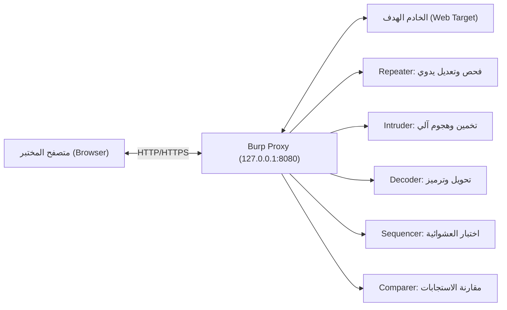

# الموديول 06: منصة بيرب سويت لاختبار تطبيقات الويب (Burp Suite)

---

### 1. بيانات الموديول (Module Metadata)
* **المسار التعليمي (Path):** TryHackMe — Jr Penetration Tester (PT1 Aligned Curriculum)
* **الموديول (Module):** Module 06: Burp Suite
* **التركيز الأساسي (Core Focus):** إتقان منصة Burp Suite Community & Professional كأداة وكيل اعتراضي محورية؛ فحص الطلبات وتعديلها عبر Proxy، والتكرار اليدوي للاستجابات عبر Repeater، والهجمات الآلية الموجهة عبر Intruder، وتحليل التشفير والعشوائية عبر Decoder/Comparer/Sequencer، وتوسيع القدرات عبر BApp Store.
* **إجمالي الغرف (Total Rooms):** 6 غرف (5 معامل تخصصية + 1 مراجعة تقييمية).

---

### 2. البنية الهندسية للموديول (Architecture & Overview)
تعتمد اختبارات أمان الويب الحديثة على التحكم التام في حزم HTTP/HTTPS؛ حيث تعجز المتصفحات العادية عن إرسال ترويسات غير صالحة أو تعديل حقول النماذج بعد ضغط زر الإرسال مباشرة. هنا يأتي دور Burp Suite كوكيل محلي (Local Intercepting Proxy على `127.0.0.1:8080`) يلتقط حركة المرور قبل خروجها للشبكة، مما يتيح لمختبر الاختراق تجاوز أي قيود مفروضة من جانب العميل (Client-Side Controls).

---

### 3. فهرس الغرف التفصيلي (Rooms Index)
* [الغرفة 01: أساسيات بيرب سويت (01-BURP-SUITE-THE-BASICS)](file:///e:/THM-JR-PENETRATION-TESTER/06-BURP-SUITE/01-BURP-SUITE-THE-BASICS/README_AR.md)
* [الغرفة 02: وحدة المكرر (02-BURP-SUITE-REPEATER)](file:///e:/THM-JR-PENETRATION-TESTER/06-BURP-SUITE/02-BURP-SUITE-REPEATER/README_AR.md)
* [الغرفة 03: وحدة المخترق الآلي (03-BURP-SUITE-INTRUDER)](file:///e:/THM-JR-PENETRATION-TESTER/06-BURP-SUITE/03-BURP-SUITE-INTRUDER/README_AR.md)
* [الغرفة 04: الوحدات المساعدة (04-BURP-SUITE-OTHER-MODULES)](file:///e:/THM-JR-PENETRATION-TESTER/06-BURP-SUITE/04-BURP-SUITE-OTHER-MODULES/README_AR.md)
* [الغرفة 05: توسيع المنصة بالإضافات (05-BURP-SUITE-EXTENSIONS)](file:///e:/THM-JR-PENETRATION-TESTER/06-BURP-SUITE/05-BURP-SUITE-EXTENSIONS/README_AR.md)
* [الغرفة 06: المراجعة التقييمية والانتقال (06-TOPIC-TRANSITION-RECAP)](file:///e:/THM-JR-PENETRATION-TESTER/06-BURP-SUITE/06-TOPIC-TRANSITION-RECAP/README_AR.md)
