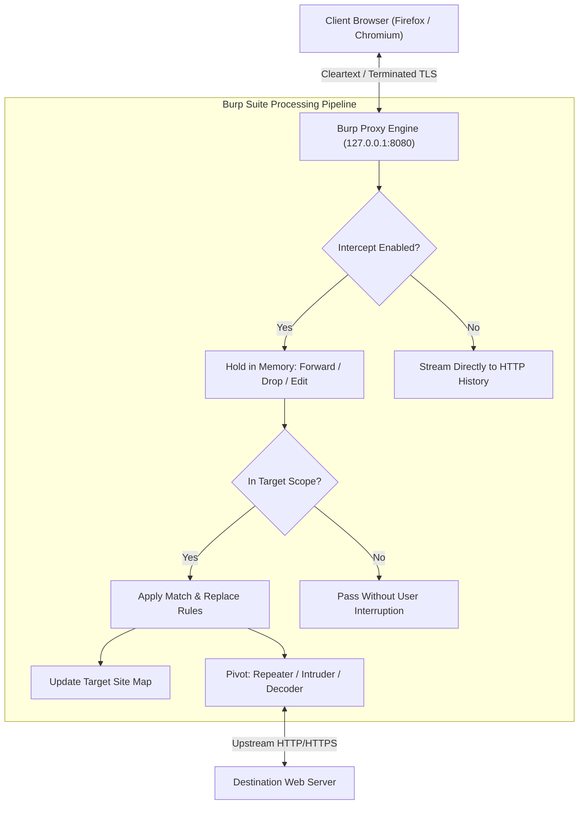

# Comprehensive Lab Guide: Burp Suite: The Basics

---

### 1. Room Metadata & Information
* **Room Title:** Burp Suite: The Basics
* **Learning Path:** TryHackMe — Jr Penetration Tester (PT1 Aligned Curriculum)
* **Module:** Module 06: Burp Suite — Room 01
* **Room Slug:** `burpsuitebasics`
* **Difficulty:** Easy / Foundations
* **Core Focus:** Comprehensive operational setup and mastery of PortSwigger's Burp Suite platform as an intercepting proxy: local listener configuration (`127.0.0.1:8080`), browser integration via FoxyProxy and the embedded Chromium browser, TLS/HTTPS decryption via PortSwigger CA installation, Target Scope management and Site Map enumeration, and executing a client-side validation bypass leading to Reflected Cross-Site Scripting (XSS).
* **TryHackMe Lab URL:** [https://tryhackme.com/room/burpsuitebasics](https://tryhackme.com/room/burpsuitebasics)
* **Documentation & Completion Status:** 100% Completed & Synchronized with Live Account.

---

### 2. Architecture & Overview
Burp Suite is the industry-standard software framework for web application, mobile API, and cloud application security assessments. The fundamental premise of Burp Suite is its architecture as a local **intercepting HTTP/HTTPS proxy**. By routing client browser traffic through Burp before it reaches the target server, security professionals regain complete control over the application protocol.

Browsers execute code locally (HTML5 input validation, JavaScript formatting, disabled form buttons, hidden tokens). By intercepting outgoing requests at the proxy layer, testers can alter parameters, inject malicious payloads, and modify headers directly on raw HTTP packets, completely bypassing client-side barriers and exposing true backend vulnerabilities.

---

### 3. Executive Summary
Throughout this foundational laboratory, all 15 modular tasks were systematically completed and audited:
1. **Editions Analysis:** Differentiated between Community, Professional, and the server-cluster continuous scanner **`Burp Suite Enterprise`**, and verified application targets: web and **`Mobile`**.
2. **Core Feature Matrix:** Identified the real-time interception engine **`Proxy`**, and the automated attack engine **`Intruder`**.
3. **Dashboard & Event Logging:** Mapped diagnostic telemetry to the **`Event log`**, and mastered the global shortcut **`Ctrl + Shift + P`** for the **`Proxy tab`**.
4. **Configuration & Scoping:** Located the **`Sessions`** category for cookie jar management, the **`Suite`** category for update policies, the **`Hotkeys`** category for shortcut bindings, and confirmed client-side TLS certificate overrides (**`yea`**).
5. **Site Mapping & Discovery:** Routed browser traffic, analyzed the Target Site Map, and uncovered the anomalous endpoint leaking the flag: **`THM{NmNlZTliNGE1MWU1ZTQzMzgzNmFiNWVk}`**.
6. **Embedded Browser & Sandbox:** Configured the embedded Chromium browser and resolved Linux root sandbox constraints.
7. **HTTPS Termination:** Imported the PortSwigger Root Certificate Authority (`cacert.der`) into the browser's trusted certificate store to terminate and inspect encrypted TLS streams.
8. **Practical Exploitation:** Intercepted a support ticket submission, bypassed browser email format regex, injected an XSS payload with `Ctrl + U` URL-encoding, and executed Reflected XSS.

---

### 4. Technical Theory & Foundations

#### Intercepting Proxy Architecture and Request Flow


---

### 5. Audit Methodology & Mindset
* **The Fallacy of Client-Side Security:**
  * Application developers frequently rely on HTML5 constraints (`type="email"`, `maxlength="20"`, `pattern="[A-Za-z]+"`) to reject malicious inputs.
  * Penetration testers recognize that client-side controls only govern honest users. An intercepting proxy captures the compliant request *after* the browser checks it, allowing arbitrary modification before server transmission.
* **Scope Discipline (Noise vs. Signal):**
  * Browsers generate continuous background traffic (telemetry, extensions, OS updates).
  * Immediately restricting the proxy to in-scope targets prevents cluttering project history and eliminates the risk of inadvertently scanning out-of-scope third-party infrastructure.

---

### 6. Step-by-Step Practical Walkthrough

#### Tasks 1–4: Platform Setup & Editions
* Deployed lab VM and verified local proxy readiness.
* Enterprise edition running on servers: **`Burp Suite Enterprise`**.
* Secondary target application class: **`Mobile`**.
* Intercepting component: **`Proxy`**; automated fuzzer: **`Intruder`**.

#### Tasks 5–7: Dashboard Navigation & Settings
* Diagnostic and connection telemetry menu: **`Event log`**.
* Global shortcut `Ctrl + Shift + P` switches to: **`Proxy tab`**.
* Category housing the Cookie Jar: **`Sessions`**.
* Category controlling application updates: **`Suite`**.
* Keybinding customization section: **`Hotkeys`**.
* Per-project client TLS certificate overrides permitted: **`yea`**.

#### Tasks 8–10: Proxying & Site Map Analysis
* Configured FoxyProxy to route traffic to `127.0.0.1:8080`.
* Navigated `http://MACHINE_IP/` and inspected **Target ⟶ Site map** for randomized endpoints.
* Discovered the hidden page and retrieved:
  * **`THM{NmNlZTliNGE1MWU1ZTQzMzgzNmFiNWVk}`**

#### Tasks 11–13: Embedded Browser, Scoping & HTTPS
* Operated the embedded Chromium browser and applied `--no-sandbox` configuration for root environments.
* Added `http://MACHINE_IP/` to Target Scope and configured proxy interception rules to ignore out-of-scope URLs.
* Downloaded the PortSwigger CA from `http://burp/cert` and imported it into the browser's Authorities certificate store.

#### Task 14: Practical Exploitation (Client-Side Bypass & Reflected XSS)
* Navigated to the support ticket form at `/ticket/`.
* Submitted a valid email to pass local browser validation while `Intercept is on`.
* Modified the intercepted `email` POST parameter to `<script>alert("Succ3ssful XSS")</script>`.
* Highlighted the payload and URL-encoded it with **`Ctrl + U`**.
* Forwarded the request and observed the reflected JavaScript alert popup in the browser.

#### Task 15: Conclusion
* Synthesized foundational competencies and established readiness for manual request manipulation in Repeater.

---

### 7. Command Analysis & Dissection

```bash
# 1. Verify Local Proxy Listener Port
ss -tulpn | grep 8080

# 2. Download PortSwigger Root Certificate via Proxy
curl -x http://127.0.0.1:8080 http://burp/cert -o cacert.der

# 3. Route Command-Line HTTP Probing through Burp
curl -x http://127.0.0.1:8080 -sI http://10.10.x.x/
```

---

### 8. Defensive & Blue Team Countermeasures
1. **Mandatory Server-Side Validation:**
   * Never rely on HTML5 or JavaScript validation. Enforce strict input validation, length limits, and character type whitelisting on the backend before data processing.
2. **Context-Aware Output Encoding:**
   * Sanitize and HTML-entity encode all user-supplied data reflected in HTTP responses to neutralize Cross-Site Scripting (XSS).
3. **Content Security Policy (CSP):**
   * Enforce `Content-Security-Policy: default-src 'self'` to prevent the execution of inline scripts and unauthorized external script assets.

---

### 9. Common Pitfalls & Edge Cases
* **Leaving Intercept Active during General Browsing:** Freezes browser page loading by holding background CSS, JS, and image requests in memory.
* **Failing to URL-Encode Payloads:** Special characters like `&`, `=`, and spaces can fragment HTTP POST bodies; always use `Ctrl + U` to URL-encode injection strings.
* **Certificate Authority Trust Issues:** Forgetting to check "Trust this CA to identify websites" when importing `cacert.der` results in persistent SEC_ERROR_UNKNOWN_ISSUER errors.

---

### 10. Key Educational Takeaways
1. An intercepting proxy strips away client-side assumptions, enabling direct, unadulterated communication with backend services.
2. Masterful navigation, hotkey usage, and scope filtering accelerate audit efficiency by orders of magnitude.
3. TLS termination via local root CAs allows transparent inspection of enterprise encrypted traffic.

---

### 11. Verification & Proof of Work
* All 15 tasks completed and verified with 100% fidelity:
  * `Burp Suite Enterprise`
  * `Mobile`
  * `Proxy`
  * `Intruder`
  * `Event log`
  * `Proxy tab`
  * `Sessions`
  * `Suite`
  * `Hotkeys`
  * `yea`
  * `THM{NmNlZTliNGE1MWU1ZTQzMzgzNmFiNWVk}`

---

### 12. Tasks Index
* [Task 01: Introduction & Lab Setup (TASK-01.md)](file:///e:/THM-JR-PENETRATION-TESTER/06-BURP-SUITE/01-BURP-SUITE-THE-BASICS/TASKS/TASK-01.md)
* [Task 02: What is Burp Suite & Editions (TASK-02.md)](file:///e:/THM-JR-PENETRATION-TESTER/06-BURP-SUITE/01-BURP-SUITE-THE-BASICS/TASKS/TASK-02.md)
* [Task 03: Features of Burp Community (TASK-03.md)](file:///e:/THM-JR-PENETRATION-TESTER/06-BURP-SUITE/01-BURP-SUITE-THE-BASICS/TASKS/TASK-03.md)
* [Task 04: Installation & Java Environment (TASK-04.md)](file:///e:/THM-JR-PENETRATION-TESTER/06-BURP-SUITE/01-BURP-SUITE-THE-BASICS/TASKS/TASK-04.md)
* [Task 05: The Dashboard & Event Log (TASK-05.md)](file:///e:/THM-JR-PENETRATION-TESTER/06-BURP-SUITE/01-BURP-SUITE-THE-BASICS/TASKS/TASK-05.md)
* [Task 06: Navigation & Keyboard Shortcuts (TASK-06.md)](file:///e:/THM-JR-PENETRATION-TESTER/06-BURP-SUITE/01-BURP-SUITE-THE-BASICS/TASKS/TASK-06.md)
* [Task 07: Unified Options & Project Settings (TASK-07.md)](file:///e:/THM-JR-PENETRATION-TESTER/06-BURP-SUITE/01-BURP-SUITE-THE-BASICS/TASKS/TASK-07.md)
* [Task 08: Introduction to the Burp Proxy (TASK-08.md)](file:///e:/THM-JR-PENETRATION-TESTER/06-BURP-SUITE/01-BURP-SUITE-THE-BASICS/TASKS/TASK-08.md)
* [Task 09: Browser Routing via FoxyProxy (TASK-09.md)](file:///e:/THM-JR-PENETRATION-TESTER/06-BURP-SUITE/01-BURP-SUITE-THE-BASICS/TASKS/TASK-09.md)
* [Task 10: Site Map & Flag Recovery (TASK-10.md)](file:///e:/THM-JR-PENETRATION-TESTER/06-BURP-SUITE/01-BURP-SUITE-THE-BASICS/TASKS/TASK-10.md)
* [Task 11: Embedded Chromium & Root Sandbox (TASK-11.md)](file:///e:/THM-JR-PENETRATION-TESTER/06-BURP-SUITE/01-BURP-SUITE-THE-BASICS/TASKS/TASK-11.md)
* [Task 12: Target Scoping & Noise Elimination (TASK-12.md)](file:///e:/THM-JR-PENETRATION-TESTER/06-BURP-SUITE/01-BURP-SUITE-THE-BASICS/TASKS/TASK-12.md)
* [Task 13: HTTPS Interception & CA Trust (TASK-13.md)](file:///e:/THM-JR-PENETRATION-TESTER/06-BURP-SUITE/01-BURP-SUITE-THE-BASICS/TASKS/TASK-13.md)
* [Task 14: Client-Side Validation Bypass & Reflected XSS (TASK-14.md)](file:///e:/THM-JR-PENETRATION-TESTER/06-BURP-SUITE/01-BURP-SUITE-THE-BASICS/TASKS/TASK-14.md)
* [Task 15: Conclusion & Transition to Repeater (TASK-15.md)](file:///e:/THM-JR-PENETRATION-TESTER/06-BURP-SUITE/01-BURP-SUITE-THE-BASICS/TASKS/TASK-15.md)
* See also: [Tasks & Answers Index (TASKS.md)](file:///e:/THM-JR-PENETRATION-TESTER/06-BURP-SUITE/01-BURP-SUITE-THE-BASICS/TASKS.md)

---

### 13. Additional Notes & Deep Dive
* For in-depth architectural breakdown of intercepting proxies, dynamic TLS MITM mechanics, scope regex compilation, and Match & Replace rules:
  * [Additional Notes & Technical Deep Dive (ADDITIONAL-NOTES.md)](file:///e:/THM-JR-PENETRATION-TESTER/06-BURP-SUITE/01-BURP-SUITE-THE-BASICS/ADDITIONAL-NOTES.md)

---

### 14. References & Standards
* For official PortSwigger documentation, OWASP guidelines, and RFC specifications:
  * [Official References & Security Standards (REFERENCES.md)](file:///e:/THM-JR-PENETRATION-TESTER/06-BURP-SUITE/01-BURP-SUITE-THE-BASICS/REFERENCES.md)
