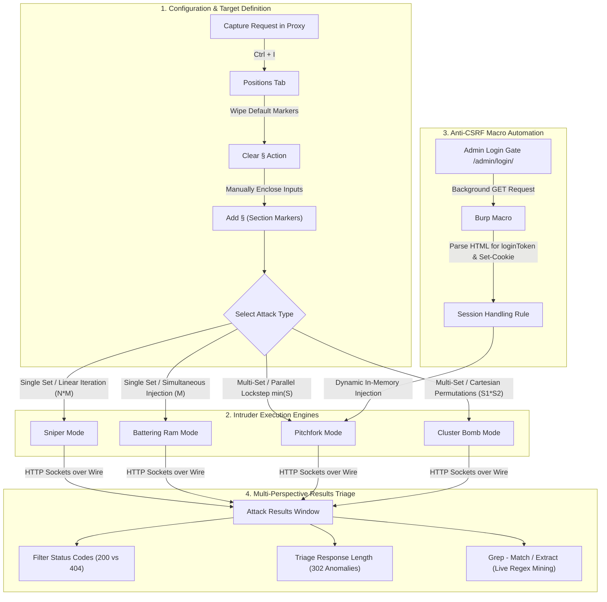

# Burp Suite: Intruder (Comprehensive Technical Guide)

---

## 1. Metadata & Overview

* **Curriculum Track:** Jr Penetration Tester (PT1 Aligned Curriculum)
* **Module:** Module 06 - Burp Suite
* **Room Number:** Room 03 of 06
* **Platform Room Name:** Burp Suite: Intruder
* **Official Room Link:** [TryHackMe - Burp Suite: Intruder](https://tryhackme.com/room/burpsuiteintruder)
* **Difficulty:** Medium / Walkthrough
* **Tactical Objective:** Master automated HTTP fuzzing and brute-forcing, understand the four core attack types (Sniper, Battering Ram, Pitchfork, Cluster Bomb), execute credential stuffing attacks, exploit Insecure Direct Object References (IDOR), and engineer Burp Macros to bypass dynamic anti-CSRF protections.

---

## 2. Executive Summary

The **Burp Suite Intruder** module serves as the automated request generation engine of the Burp Suite ecosystem. While manual testing in Repeater is crucial for hypothesis validation and fine-grained byte manipulation, real-world penetration testing demands systematic enumeration across comprehensive wordlists, dictionary brute-forcing, parameter discovery, and mass object identifier testing.

This guide delivers an architectural breakdown of Intruder:
1. **Structural Sub-Tabs:** Comprehensive breakdown of **Positions** (marker definition using the section symbol `§` and attack type selection), **Payloads** (payload set allocation and real-time processing rules such as `Add suffix`), **Resource Pool** (concurrency and thread throttling), and **Settings** (error handling, redirection controls, and Grep Match/Extract rules).
2. **The Four Attack Types:** Mathematical models, iteration behaviors, and algorithmic complexities of **Sniper**, **Battering Ram**, **Pitchfork**, and **Cluster Bomb**.
3. **Hands-On Exploitation Workflows:**
   - Executing a parallel **Pitchfork** attack on `/support/login` using compromised credential dumps, identifying the valid credentials (`m.rivera:letmein1`) via response length anomaly triage.
   - Performing a sequential **Sniper** attack with numeric payloads against `/support/ticket/NUMBER` to exploit an IDOR vulnerability and exfiltrate flag `THM{MTMxNTg5NTUzMWM0OWRlYzUzMDVjMzJl}`.
   - Defeating single-use anti-CSRF tokens and dynamic session cookies on `/admin/login/` by engineering a **Burp Macro** combined with a Session Handling Rule to dynamically harvest and inject the `loginToken`, cracking the admin account (`o.bennett:bella1`).

---

## 3. Architecture & Concepts Diagram



---

## 4. Prerequisites & Setup

1. **Required Tooling:**
   * **Burp Suite Community Edition** or Professional.
   * Burp Embedded Chromium Browser.
   * Standard CLI networking utilities (cURL, Wget, Unzip).
2. **Lab VM Initialization & Credential Acquisition:**
   * Deploy the target virtual machine on TryHackMe to obtain `MACHINE_IP`.
   * Download the lab credential archive from the target's internal HTTP service:
     ```bash
     wget http://MACHINE_IP:9999/Credentials/BastionHostingCreds.zip
     unzip BastionHostingCreds.zip
     # Unpacked files: usernames.txt, passwords.txt, emails.txt, combined.txt
     ```
3. **Proxy Interception Discipline:**
   * Toggle off intercept mode to allow seamless browser traffic capture.
   * Identify target requests in `Proxy -> HTTP history` and transfer them directly to Intruder via `Ctrl + I`.

---

## 5. Core Concepts & Theoretical Deep Dive

### The Section Delimiter (`§`)
Burp Intruder identifies variable substitution positions by wrapping text in section symbols: `§payload§`. When a request is transferred to Intruder, Burp heuristically places delimiters around every detectable parameter. Clicking **Clear §** is mandatory to prevent accidental mutation of session cookies or operational headers.

### Mathematical Breakdown of Attack Types
* **Sniper:** $\text{Total Requests} = \text{Positions} \times \text{Wordlist Length}$ (Uses 1 payload set).
* **Battering Ram:** $\text{Total Requests} = \text{Wordlist Length}$ (Uses 1 payload set injected everywhere simultaneously).
* **Pitchfork:** $\text{Total Requests} = \min(\text{len}(S_1), \text{len}(S_2), \dots)$ (Uses up to 20 sets iterated in parallel lockstep).
* **Cluster Bomb:** $\text{Total Requests} = \prod_{i=1}^n \text{len}(S_i)$ (Uses up to 20 sets calculating exhaustive Cartesian permutations).

### Bypassing Synchronizer CSRF Tokens via Burp Macros
Modern web frameworks protect authentication forms with single-use CSRF tokens embedded within hidden input fields (`<input type="hidden" name="loginToken" value="...">`). Standard automated brute-forcing fails because the server rejects replayed or missing tokens. Burp Macros resolve this by establishing an out-of-band request pipeline: before every Intruder POST request, Burp executes a GET request, extracts the fresh `loginToken` and `session` cookie, and rewrites the pending POST request prior to socket transmission.

---

## 6. Room Breakdown & Navigation

The room consists of 13 progressive tasks:
* **Task 01: Introduction** — Scope of automated fuzzing.
* **Task 02: What is Intruder** — Tab layout and the role of the **Positions** tab.
* **Task 03: Positions** — Delimiter syntax (`§`) and position management actions.
* **Task 04: Payloads** — Payload types and transformation rules (`Add suffix`).
* **Task 05: Introduction to Attack Types** — Overview of attack modes and **Sniper** mechanics.
* **Task 06: Sniper** — Quantitative request calculation and single-set restriction.
* **Task 07: Battering Ram** — Synchronized multi-position injection behavior.
* **Task 08: Pitchfork** — Multi-set lockstep iteration and the 20-set boundary.
* **Task 09: Cluster Bomb** — Combinatorial permutations and request volume math.
* **Task 10: Practical Example** — Real-world credential stuffing against `/support/login`.
* **Task 11: Practical Challenge** — Systematic IDOR fuzzing against `/support/ticket/NUMBER`.
* **Task 12: Extra Mile Challenge** — Overcoming CSRF defenses on `/admin/login/` via Burp Macros.
* **Task 13: Conclusion** — Tactical transition toward Decoder, Comparer, and Sequencer.

---

## 7. Task-by-Task Implementation Summary

| Task # | Task Title | Question | Verified Answer | Stage A-G Detailed File |
| :---: | :--- | :--- | :--- | :---: |
| **01** | Introduction | Let's get started! | `No answer needed` | [TASK-01.md](../../03-BURP-SUITE-INTRUDER/TASKS/TASK-01.md) |
| **02** | What is Intruder | In which tab can we define Attack type? | `Positions` | [TASK-02.md](../../03-BURP-SUITE-INTRUDER/TASKS/TASK-02.md) |
| **03** | Positions | What symbol defines start and end of position? | `§` | [TASK-03.md](../../03-BURP-SUITE-INTRUDER/TASKS/TASK-03.md) |
| **04** | Payloads | Which rule adds characters at the end? | `Add suffix` | [TASK-04.md](../../03-BURP-SUITE-INTRUDER/TASKS/TASK-04.md) |
| **05** | Intro to Attack Types | What attack type cycles inserting one at a time? | `Sniper` | [TASK-05.md](../../03-BURP-SUITE-INTRUDER/TASKS/TASK-05.md) |
| **06** | Sniper | Requests for 3 positions * 100 words? / Accepted sets? | Q1: `300`<br>Q2: `1` | [TASK-06.md](../../03-BURP-SUITE-INTRUDER/TASKS/TASK-06.md) |
| **07** | Battering Ram | What would body parameters of first request be? | `username=admin&password=admin` | [TASK-07.md](../../03-BURP-SUITE-INTRUDER/TASKS/TASK-07.md) |
| **08** | Pitchfork | Max number of payload sets in Pitchfork? | `20` | [TASK-08.md](../../03-BURP-SUITE-INTRUDER/TASKS/TASK-08.md) |
| **09** | Cluster Bomb | Total requests for sets with 100, 2, and 30 lines? | `6000` | [TASK-09.md](../../03-BURP-SUITE-INTRUDER/TASKS/TASK-09.md) |
| **10** | Practical Example | Successful username and password combination? | `m.rivera:letmein1` | [TASK-10.md](../../03-BURP-SUITE-INTRUDER/TASKS/TASK-10.md) |
| **11** | Practical Challenge | Best attack type? / Attack execution / Flag value? | Q1: `Sniper`<br>Q2: `No answer needed`<br>Q3: `THM{MTMxNTg5NTUzMWM0OWRlYzUzMDVjMzJl}` | [TASK-11.md](../../03-BURP-SUITE-INTRUDER/TASKS/TASK-11.md) |
| **12** | Extra Mile Challenge | Successful admin credentials (username:password)? | `o.bennett:bella1` | [TASK-12.md](../../03-BURP-SUITE-INTRUDER/TASKS/TASK-12.md) |
| **13** | Conclusion | I can use Intruder! | `No answer needed` | [TASK-13.md](../../03-BURP-SUITE-INTRUDER/TASKS/TASK-13.md) |

---

## 8. Practical Labs & Hands-on Exploitation

### Lab 1: Parallel Credential Stuffing
* **Target:** `POST /support/login`
* **Configuration:** Attack type `Pitchfork`, Set 1 (`usernames.txt`), Set 2 (`passwords.txt`).
* **Detection:** Filtering by response length revealed an anomalous length of 238 bytes (redirecting to `/support/tickets`) compared to the 272-byte failed baseline.
* **Credentials:** `m.rivera:letmein1`

### Lab 2: Systematic IDOR Exploitation
* **Target:** `GET /support/ticket/§1§`
* **Configuration:** Attack type `Sniper`, Numbers payload type (Range: 1 to 100, Step: 1).
* **Detection:** Sorting by Status code isolated five valid `200 OK` tickets amidst `404 Not Found` errors.
* **Captured Flag:** `THM{MTMxNTg5NTUzMWM0OWRlYzUzMDVjMzJl}`

### Lab 3: Overcoming Anti-Automation Defenses via Burp Macros
* **Target:** `POST /admin/login/`
* **Defenses:** Per-request dynamic `loginToken` and session tracking cookie.
* **Solution:** Configured a Burp Macro to fetch `/admin/login/`, extracted `loginToken` via parameter extraction, bound it to a Session Handling Rule targeting Intruder, and executed a Pitchfork attack.
* **Administrative Credentials:** `o.bennett:bella1`

---

## 9. Red Team & Offensive Applications

* **Low-and-Slow Password Spraying:** Configure Sniper or Pitchfork to test a single common password across thousands of enterprise usernames with long, randomized delays to stay beneath lockout thresholds.
* **Automated Parameter Discovery:** Fuzz URL endpoints with common parameter dictionaries (`id`, `admin`, `debug`, `redirect`) to reveal hidden developer backdoors.
* **Token Randomness Auditing:** Combine Intruder with Sequencer to collect hundreds of session cookies or password reset tokens to test for entropy weaknesses.

---

## 10. Blue Team & Defensive Strategies

* **Multi-Factor Authentication (MFA):** Enforcing hardware or app-based MFA renders credential stuffing ineffective even when passwords are leaked.
* **Exponential Backoff & Account Lockout:** Temporarily lock accounts or introduce progressive response delays after 3-5 failed login attempts.
* **Robust Access Control Validation:** Implement session ownership validation on all direct object references:
  ```python
  # Secure object reference check
  ticket = Ticket.objects.filter(id=ticket_id, organization=request.user.org).first()
  if not ticket:
      raise PermissionDenied
  ```

---

## 11. Troubleshooting & Edge Cases

* **Issue: "Invalid CSRF Token" errors during attack.**
  * *Fix:* Verify that the Burp Macro extracts the exact token boundaries, and confirm that Intruder is checked under the Session Handling Rule's **Scope** tab.
* **Issue: Community Edition speed slows down dramatically.**
  * *Fix:* The Community Edition enforces artificial throttling. Use targeted, concise wordlists or leverage CLI utilities like `ffuf` for high-volume discovery.
* **Issue: Session invalidated mid-attack.**
  * *Fix:* Ensure session cookies were not accidentally wrapped in section marks (`§`) in the Positions tab. Always execute **Clear §** before setting markers.

---

## 12. Cheatsheet & Command Line Equivalents

```bash
# Automated credential stuffing via curl in bash
while IFS=: read -r user pass; do
  res=$(curl -s -o /dev/null -w "%{http_code}:%{size_download}\n" \
    --data "username=$user&password=$pass" "http://MACHINE_IP/support/login")
  echo "Testing $user:$pass -> $res"
done < credentials.txt

# IDOR fuzzing with curl
for id in {1..100}; do
  code=$(curl -s -o /dev/null -w "%{http_code}" "http://MACHINE_IP/support/ticket/$id")
  if [ "$code" -eq 200 ]; then
    echo "[+] Ticket $id exists!"
  fi
done
```

---

## 13. Knowledge Check & Verification Questions

1. **Question:** What is the critical distinction between Pitchfork and Cluster Bomb when testing two wordlists of 50 items each?
   * *Answer:* Pitchfork executes 50 requests in parallel lockstep pairs, while Cluster Bomb executes 2,500 requests testing every possible combination.
2. **Question:** Why does Burp's auto-detection of insertion points require manual clearing before attacking?
   * *Answer:* Automatic detection often marks session identifiers and static headers, which invalidates active sessions if modified.
3. **Question:** How does a Burp Macro circumvent CSRF protections during automated testing?
   * *Answer:* By issuing an automated GET request prior to each attack iteration to harvest a fresh token and session, injecting them into the POST request in memory.

---

## 14. References & Documentation

* [PortSwigger Burp Suite Intruder Documentation](https://portswigger.net/burp/documentation/desktop/tools/intruder)
* [PortSwigger Intruder Attack Types](https://portswigger.net/burp/documentation/desktop/tools/intruder/attack-types)
* [PortSwigger Session Handling Rules & Macros](https://portswigger.net/burp/documentation/desktop/settings/sessions/rules)
* [OWASP Top 10: A07:2021 - Identification and Authentication Failures](https://owasp.org/Top10/A07_2021-Identification_and_Authentication_Failures/)
* [OWASP Top 10: A01:2021 - Broken Access Control (IDOR)](https://owasp.org/Top10/A01_2021-Broken_Access_Control/)
