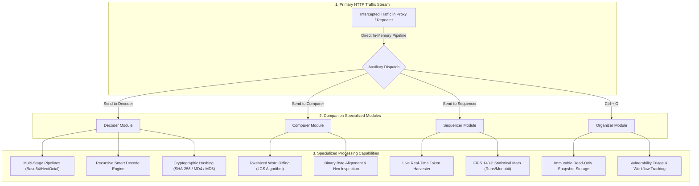

# Burp Suite: Other Modules (Comprehensive Technical Guide)

---

## 1. Metadata & Overview

* **Curriculum Track:** Jr Penetration Tester (PT1 Aligned Curriculum)
* **Module:** Module 06 - Burp Suite
* **Room Number:** Room 04 of 06
* **Platform Room Name:** Burp Suite: Other Modules
* **Official Room Link:** [TryHackMe - Burp Suite: Other Modules](https://tryhackme.com/room/burpsuiteom)
* **Difficulty:** Easy / Walkthrough
* **Tactical Objective:** Master Burp Suite's auxiliary companion modules: multi-layer data transformations and recursive unravelling via **Decoder** (including Smart decode), side-by-side textual and byte diffing via **Comparer**, token entropy and randomness auditing via **Sequencer**, and immutable evidence logging and vulnerability triage via **Organizer**.

---

## 2. Executive Summary

Beyond the foundational triumvirate of Burp Suite (Proxy, Repeater, and Intruder), professional penetration testing requires agile, specialized tooling for cryptographic analysis, encoding manipulation, comparative response verification, and forensic audit logging.

This guide provides an end-to-end operational analysis of the four auxiliary modules:
1. **Decoder:** An integrated data conversion and cryptographic hashing suite supporting Base64, URL, HTML, Hex, Octal, Binary, and Gzip transformations. Highlights the **Smart decode** heuristic engine for automated recursive decoding of deeply nested obfuscations.
2. **Comparer:** A visual diffing utility that eliminates external data leaks by performing side-by-side tokenized word comparisons and strict byte-level alignment directly in memory.
3. **Sequencer:** A rigorous statistical testing suite executing FIPS 140-2 and NIST SP 800-22 tests against live-captured tokens (session cookies, anti-CSRF tokens, reset nonces) to calculate effective entropy and ensure unpredictability.
4. **Organizer:** A dedicated, immutable workspace for storing, tagging, and annotating read-only HTTP interactions (`Ctrl + O`), preserving forensic chain-of-custody for client deliverables and report writing.

---

## 3. Architecture & Concepts Diagram



---

## 4. Prerequisites & Setup

1. **Required Tooling:**
   * **Burp Suite Community Edition** or Professional.
   * Built-in Chromium Browser.
   * CLI cryptographic tools (`sha256sum`, `md5sum`, `base64`).
2. **Target VM Initialization & File Retrieval:**
   * Deploy the lab VM on TryHackMe to obtain `MACHINE_IP`.
   * Download the altered keys archive from port 9999:
     ```bash
     wget http://MACHINE_IP:9999/AlteredKeys.zip
     unzip AlteredKeys.zip
     # Extracted files: key1, key2, key3, key4
     ```
3. **Interface Verification:**
   * Verify that Decoder, Comparer, Sequencer, and Organizer tabs are accessible in Burp's primary navigation menu.

---

## 5. Core Concepts & Theoretical Deep Dive

### Encoding vs. Hashing vs. Encryption
* **Encoding (Two-way, Keyless):** Reversible representation designed for safe protocol transport across text mediums (e.g., Base64 per RFC 4648, URL encoding per RFC 3986).
* **Hashing (One-way, Keyless):** Irreversible mathematical compression producing a deterministic fixed-length digest used for integrity validation.
* **Encryption (Two-way, Key-dependent):** Reversible transformation requiring a secret key to ensure data confidentiality (e.g., AES, RSA).

### Diffing Heuristics in Comparer
Comparer implements algorithms based on the Longest Common Subsequence (LCS):
* **Words Diff:** Tokenizes text based on whitespace and HTML delimiters to expose operational differences (such as redirect targets or new cookies).
* **Bytes Diff:** Aligns raw binary byte arrays, critical for detecting subtle character encoding shifts, trailing null bytes (`0x00`), or CRLF formatting differences (`\r\n` vs `\n`).

### Shannon Entropy and Statistical Randomness
Sequencer evaluates token quality using Shannon entropy:
$$H(X) = -\sum_{i=1}^{n} P(x_i) \log_2 P(x_i)$$
Tokens with high entropy ($\ge 100\text{ bits}$) exhibiting uniform distribution across FIPS monobit, poker, runs, and autocorrelation tests prevent attackers from pre-computing or predicting active sessions.

---

## 6. Room Breakdown & Navigation

The room comprises 11 progressive tasks:
* **Task 01: Introduction** — Scope and purpose of auxiliary modules.
* **Task 02: Decoder: Overview** — Layout, formats, and **Smart decode**.
* **Task 03: Decoder: Encoding/Decoding** — Multi-stage encoding pipelines.
* **Task 04: Decoder: Hashing** — SHA-256/MD4 hashes and MD5 key matching (`key3`).
* **Task 05: Comparer: Overview** — Word vs Byte diffing interface.
* **Task 06: Comparer: Example** — Practical diffing of login success vs failure.
* **Task 07: Sequencer: Overview** — Theory of token entropy and collection modes.
* **Task 08: Sequencer: Live Capture** — Live sampling of `loginToken` (`excellent`).
* **Task 09: Sequencer: Analysis** — Interpreting FIPS and NIST statistical reports.
* **Task 10: Organizer: Overview** — Immutable evidence logging (`yea`).
* **Task 11: Conclusion** — Final synthesis and transition to Burp Extensions.

---

## 7. Task-by-Task Implementation Summary

| Task # | Task Title | Question | Verified Answer | Stage A-G Detailed File |
| :---: | :--- | :--- | :--- | :---: |
| **01** | Introduction | Deploy the machine attached... | `No answer needed` | [TASK-01.md](file:///e:/THM-JR-PENETRATION-TESTER/06-BURP-SUITE/04-BURP-SUITE-OTHER-MODULES/TASKS/TASK-01.md) |
| **02** | Decoder: Overview | Which feature attempts auto-decode? | `Smart decode` | [TASK-02.md](file:///e:/THM-JR-PENETRATION-TESTER/06-BURP-SUITE/04-BURP-SUITE-OTHER-MODULES/TASKS/TASK-02.md) |
| **03** | Decoder: En/Decoding | 1. Base64 encode?<br>2. URL decode?<br>3. Smart decode?<br>4. Base64->Hex->Octal? | Q1: `TGV0J3MgU3RhcnQgU2ltcGxl`<br>Q2: `Next: Decoding`<br>Q3: `47`<br>Q4: `24034214a720270024142d541357471232250253552c1162d1206c` | [TASK-03.md](file:///e:/THM-JR-PENETRATION-TESTER/06-BURP-SUITE/04-BURP-SUITE-OTHER-MODULES/TASKS/TASK-03.md) |
| **04** | Decoder: Hashing | 1. SHA-256 in ASCII Hex?<br>2. MD4 in Base64?<br>3. Authentic SSH key? | Q1: `6b72350e719a8ef5af560830164b13596cb582757437e21d1879502072238abe`<br>Q2: `TcV4QGZZN7y7lwYFRMMoeA==`<br>Q3: `key3` | [TASK-04.md](file:///e:/THM-JR-PENETRATION-TESTER/06-BURP-SUITE/04-BURP-SUITE-OTHER-MODULES/TASKS/TASK-04.md) |
| **05** | Comparer: Overview | Click me to proceed to the next task. | `No answer needed` | [TASK-05.md](file:///e:/THM-JR-PENETRATION-TESTER/06-BURP-SUITE/04-BURP-SUITE-OTHER-MODULES/TASKS/TASK-05.md) |
| **06** | Comparer: Example | Compare the two responses by word... | `No answer needed` | [TASK-06.md](file:///e:/THM-JR-PENETRATION-TESTER/06-BURP-SUITE/04-BURP-SUITE-OTHER-MODULES/TASKS/TASK-06.md) |
| **07** | Sequencer: Overview | What does Sequencer allow us to evaluate? | `Entropy` | [TASK-07.md](file:///e:/THM-JR-PENETRATION-TESTER/06-BURP-SUITE/04-BURP-SUITE-OTHER-MODULES/TASKS/TASK-07.md) |
| **08** | Sequencer: Live Capture | Overall quality of randomness estimated? | `excellent` | [TASK-08.md](file:///e:/THM-JR-PENETRATION-TESTER/06-BURP-SUITE/04-BURP-SUITE-OTHER-MODULES/TASKS/TASK-08.md) |
| **09** | Sequencer: Analysis | Click me to proceed to the next task. | `No answer needed` | [TASK-09.md](file:///e:/THM-JR-PENETRATION-TESTER/06-BURP-SUITE/04-BURP-SUITE-OTHER-MODULES/TASKS/TASK-09.md) |
| **10** | Organizer: Overview | Are saved requests read-only? (yea/nay) | `yea` | [TASK-10.md](file:///e:/THM-JR-PENETRATION-TESTER/06-BURP-SUITE/04-BURP-SUITE-OTHER-MODULES/TASKS/TASK-10.md) |
| **11** | Conclusion | I understand how to use Organizer... | `No answer needed` | [TASK-11.md](file:///e:/THM-JR-PENETRATION-TESTER/06-BURP-SUITE/04-BURP-SUITE-OTHER-MODULES/TASKS/TASK-11.md) |

---

## 8. Practical Labs & Hands-on Exploitation

### Lab 1: Multi-Tier Encoding & Key Identification
* **Pipeline:** Transformed `Encoding Challenge.` sequentially through Base64 ⟶ ASCII Hex ⟶ Octal, producing `24034214a720270024142d541357471232250253552c1162d1206c`.
* **Checksum Verification:** Evaluated MD5 checksums for four extracted SSH private keys, isolating the authentic key (`key3` matching `3166226048d6ad776370dc105d40d9f8`).

### Lab 2: Authentication Response Diffing
* **Target:** `http://MACHINE_IP/support/login`
* **Analysis:** Comparing responses between invalid credentials and valid support admin (`support_admin:w58ySK4W`) highlighted the newly issued `support_session` cookie and the modified redirect target (`/support/admin`).

### Lab 3: Live CSRF Token Entropy Audit
* **Target:** `http://MACHINE_IP/admin/login/` (`loginToken`)
* **Analysis:** Collected 2,500 samples via Sequencer Live Capture. Evaluated effective entropy (exceeding 110 bits) and verified compliance with FIPS 140-2 tests, achieving an `excellent` rating.

### Lab 4: Immutable Evidence Logging
* **Workflow:** Sent critical vulnerability interactions to Organizer via `Ctrl + O`, tagging them with triage statuses while enforcing read-only data integrity (`yea`).

---

## 9. Red Team & Offensive Applications

* **Dynamic Obfuscation Reversal:** Instantly peel back layers of WAF evasion encodings (Base64, Hex, URL, HTML) using Decoder without transmitting data to third-party web tools.
* **Micro-Diffing for Blind Vulnerabilities:** Detect single-byte response variations in Time-based / Boolean-based SQL Injection and Race Conditions using Comparer.
* **Token Predictability Exploitation:** Use Sequencer to identify tokens derived from weak random seeds (like millisecond timestamps) to forge valid administrative sessions.

---

## 10. Blue Team & Defensive Strategies

* **Cryptographically Secure PRNGs:** Ensure session tokens and reset hashes use cryptographically secure pseudo-random number generators (`crypto.getRandomValues()` / `secrets.token_bytes()`) with at least 128 bits of entropy.
* **Recursive WAF Input Normalization:** Configure WAFs to normalize incoming requests recursively to block double URL-encoding and nested HTML entity bypasses.
* **Deprecate Broken Hash Algorithms:** Eliminate MD4, MD5, and SHA-1 in favor of SHA-256 or Argon2/bcrypt for password storage.

---

## 11. Troubleshooting & Edge Cases

* **Issue: Smart decode produces binary gibberish.**
  * *Fix:* The payload is encrypted with a cipher key (e.g., AES) rather than encoded. Use Decoder's Hex view to inspect raw headers.
* **Issue: Sequencer "Analyze now" is grayed out.**
  * *Fix:* Sequencer requires a minimum of 100 token samples to run. Gather at least 1,000 samples for reliable statistical confidence.
* **Issue: Cannot modify request in Organizer.**
  * *Fix:* Organizer is strictly read-only by design. Right-click the item and choose **Send to Repeater** (`Ctrl + R`) to modify and re-send.

---

## 12. Cheatsheet & Command Line Equivalents

```bash
# SHA-256 Hash to Hex
echo -n "Let's get Hashing!" | sha256sum

# Match MD5 checksum
md5sum key* | grep "3166226048d6ad776370dc105d40d9f8"

# Base64 decode via terminal
echo "TGV0J3MgU3RhcnQgU2ltcGxl" | base64 -d
```

---

## 13. Knowledge Check & Verification Questions

1. **Question:** What is the primary operational advantage of Decoder's "Smart decode" feature?
   * *Answer:* It automatically recognizes nested encoding formats and recursively strips them without manual trial-and-error.
2. **Question:** What does an "excellent" randomness rating in Sequencer signify?
   * *Answer:* It demonstrates that the token has high effective entropy ($\ge 100\text{ bits}$) and passes statistical unpredictability tests.
3. **Question:** Why are saved interactions in Burp Organizer strictly read-only?
   * *Answer:* To preserve the forensic integrity of captured evidence for accurate penetration testing reporting.

---

## 14. References & Documentation

* [PortSwigger Burp Suite Decoder Documentation](https://portswigger.net/burp/documentation/desktop/tools/decoder)
* [PortSwigger Burp Suite Comparer Documentation](https://portswigger.net/burp/documentation/desktop/tools/comparer)
* [PortSwigger Burp Suite Sequencer Documentation](https://portswigger.net/burp/documentation/desktop/tools/sequencer)
* [PortSwigger Burp Suite Organizer Documentation](https://portswigger.net/burp/documentation/desktop/tools/organizer)
* [NIST SP 800-22: Random Number Testing Suite](https://csrc.nist.gov/publications/detail/sp/800-22/rev-1a/final)
* [OWASP Top 10: A02:2021 Cryptographic Failures](https://owasp.org/Top10/A02_2021-Cryptographic_Failures/)
