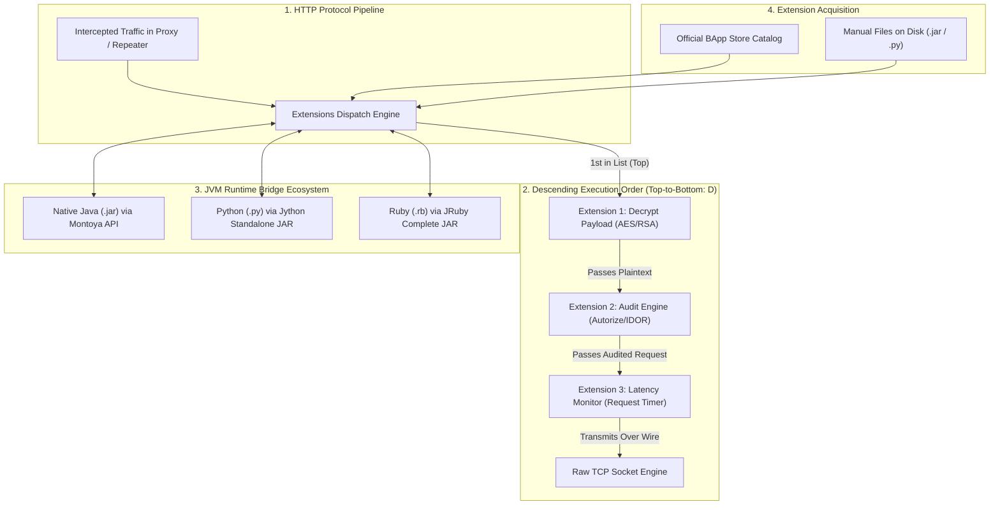

# Burp Suite: Extensions (Comprehensive Technical Guide)

---

## 1. Metadata & Overview

* **Curriculum Track:** Jr Penetration Tester (PT1 Aligned Curriculum)
* **Module:** Module 06 - Burp Suite
* **Room Number:** Room 05 of 06
* **Platform Room Name:** Burp Suite: Extensions
* **Official Room Link:** [TryHackMe - Burp Suite: Extensions](https://tryhackme.com/room/burpsuiteextensions)
* **Difficulty:** Easy / Walkthrough
* **Tactical Objective:** Master the Burp Suite extensibility architecture, manage the Extensions interface, enforce the descending execution hierarchy (`D`), install verified community plugins from the **BApp Store** (Request Timer walkthrough), configure the **Jython Standalone JAR** environment for Python modules, and explore the modern **Montoya API** framework.

---

## 2. Executive Summary

Architectural extensibility is Burp Suite's most powerful differentiator. While standard features accommodate generic web application security testing, modern enterprise engagements frequently involve proprietary protocols, customized token signing, real-time message encryption, and specialized authorization workflows that require custom tooling.

This guide provides an end-to-end technical exploration of Burp Suite's extension ecosystem:
1. **Extensions Management:** Granular breakdown of extension states, action buttons (`Add`, `Remove`, `Up`, `Down`), and the foundational architectural rule that active extensions execute in **descending order (`D`)** from top to bottom.
2. **The BApp Store:** Exploring PortSwigger's centralized repository of community-vetted tools, including a hands-on walkthrough installing **Request Timer** to measure round-trip response latency for timing attack detection.
3. **Python Runtime Integration (Jython):** Configuring the `jython-standalone-2.7.3.jar` interpreter to seamlessly execute Python plugins on top of the Java Virtual Machine (JVM).
4. **API Evolution:** Comparative analysis between the legacy byte-oriented `IBurpExtender` interface and the modern, type-safe, object-oriented **Montoya API**.

---

## 3. Architecture & Concepts Diagram



---

## 4. Prerequisites & Setup

1. **Required Tooling:**
   * **Burp Suite Community Edition** (v2023.x+ or v2024.x+) or Professional.
   * Java Runtime Environment (JRE 17+ or 21+).
   * **Jython Standalone JAR** (version 2.7.3).
2. **Configuring Jython Locally:**
   * Download the standalone JAR:
     ```bash
     wget https://repo1.maven.org/maven2/org/python/jython-standalone/2.7.3/jython-standalone-2.7.3.jar
     ```
   * In Burp Suite: Navigate to `Extensions` ⟶ `Extensions settings` ⟶ `Python environment`.
   * Set `Location of Jython standalone JAR file` to the path of your downloaded JAR.
3. **Lab Environment:**
   * No target virtual machine is required; all exercises are performed within the native Burp Suite interface.

---

## 5. Core Concepts & Theoretical Deep Dive

### Descending Execution Order (`D`)
Burp Suite processes incoming requests and responses through loaded extensions sequentially in the exact physical order displayed in the list from top to bottom (**Descending Order - D**):
* When chaining multiple plugins (e.g., custom decryption ⟶ vulnerability scanner ⟶ re-encryption/signing), placing the decryptor at the top is mandatory.
* Reversing the order causes downstream auditing tools to receive undecipherable ciphertext, rendering passive and active security checks completely ineffective.

### The Jython Bridge Architecture
Because standard CPython is implemented in C and runs as an independent operating system process, it cannot natively share memory with the Java Virtual Machine (JVM). Jython rewrites the Python interpreter in 100% pure Java. This enables Python scripts to run directly within the JVM, access Burp's internal memory heap, and instantiate Java classes natively without IPC overhead.

### The Modern Montoya API
The Montoya API (`burp.api.montoya.*`) replaces the legacy `burp.IBurpExtender` interface:
* Introduces strong type-safety, immutable request/response models, and clean abstraction layers.
* Provides native support for modern web standards including HTTP/2 protocol frames, WebSocket streams, and structured logging.

---

## 6. Room Breakdown & Navigation

The room consists of 6 progressive tasks:
* **Task 01: Introduction** — The rationale for modular extensibility in security testing.
* **Task 02: The Extensions Interface** — Tab architecture and the descending execution rule (**`D`**).
* **Task 03: The BApp Store** — Installing community tools (Request Timer walkthrough).
* **Task 04: Jython** — Bridging Python execution onto the JVM.
* **Task 05: The Burp Suite API** — Language support and transitioning to Montoya API.
* **Task 06: Conclusion** — Module synthesis and roadmap to Topic Transition Recap.

---

## 7. Task-by-Task Implementation Summary

| Task # | Task Title | Question | Verified Answer | Stage A-G Detailed File |
| :---: | :--- | :--- | :--- | :---: |
| **01** | Introduction | Click me to proceed to the next task. | `No answer needed` | [TASK-01.md](file:///e:/THM-JR-PENETRATION-TESTER/06-BURP-SUITE/05-BURP-SUITE-EXTENSIONS/TASKS/TASK-01.md) |
| **02** | Extensions Interface | Are extensions invoked in ascending (A) or descending (D) order? | `D` | [TASK-02.md](file:///e:/THM-JR-PENETRATION-TESTER/06-BURP-SUITE/05-BURP-SUITE-EXTENSIONS/TASKS/TASK-02.md) |
| **03** | The BApp Store | Click me to proceed to the next task. | `No answer needed` | [TASK-03.md](file:///e:/THM-JR-PENETRATION-TESTER/06-BURP-SUITE/05-BURP-SUITE-EXTENSIONS/TASKS/TASK-03.md) |
| **04** | Jython | Click me to proceed to the next task. | `No answer needed` | [TASK-04.md](file:///e:/THM-JR-PENETRATION-TESTER/06-BURP-SUITE/05-BURP-SUITE-EXTENSIONS/TASKS/TASK-04.md) |
| **05** | The Burp Suite API | Click me to proceed to the next task. | `No answer needed` | [TASK-05.md](file:///e:/THM-JR-PENETRATION-TESTER/06-BURP-SUITE/05-BURP-SUITE-EXTENSIONS/TASKS/TASK-05.md) |
| **06** | Conclusion | I can use Burp Suite Extensions! | `No answer needed` | [TASK-06.md](file:///e:/THM-JR-PENETRATION-TESTER/06-BURP-SUITE/05-BURP-SUITE-EXTENSIONS/TASKS/TASK-06.md) |

---

## 8. Practical Labs & Hands-on Exploitation

### Lab 1: Extension Pipeline Hierarchy
* **Concept:** Managing extension execution order using `Up` and `Down` controls.
* **Result:** Confirmed that traffic travels top-to-bottom (`D` for Descending), ensuring proper cascading of transformations.

### Lab 2: BApp Store Deployment
* **Action:** Installed **Request Timer** by Nick Taylor directly from the BApp Store.
* **Result:** Successfully instantiated a dedicated top-level GUI tab providing real-time latency graphs to identify timing-based side channels.

### Lab 3: Jython Environment Setup
* **Action:** Configured `jython-standalone-2.7.3.jar` in Extensions settings.
* **Result:** Enabled instant support for loading Python extensions like Autorize without runtime errors.

---

## 9. Red Team & Offensive Applications

* **Automated Authorization Auditing:** Utilize **Autorize** to automatically replay captured administrative requests with standard user cookies to identify IDOR and access control bypasses.
* **Race Condition Exploitation:** Deploy **Turbo Intruder** to launch dozens of requests within a single millisecond window to exploit balance transfers or coupon usage flaws.
* **Hidden Parameter Discovery:** Run **Param Miner** to unearth unlinked headers and query parameters susceptible to cache poisoning or secret debugging paths.

---

## 10. Blue Team & Defensive Strategies

* **Extension Supply Chain Auditing:** Strictly mandate that internal Red Teams and testers source extensions exclusively from verified repositories to prevent malicious data exfiltration.
* **High-Concurrency Anomaly Detection:** Monitor SIEM alerts for sudden bursts of asynchronous HTTP traffic characteristic of Turbo Intruder or Spike-based engines.

---

## 11. Troubleshooting & Edge Cases

* **Issue: "Jython not configured" error when installing Python extensions.**
  * *Fix:* Point Burp Suite to `jython-standalone-2.7.3.jar` under `Extensions -> Extensions settings -> Python environment`.
* **Issue: Extension crashes silently during testing.**
  * *Fix:* Inspect the **Errors** tab in the lower pane of the Extensions tab to view the full Java or Python exception stack trace.
* **Issue: High memory usage and application freeze.**
  * *Fix:* Poorly coded extensions can cause memory leaks. Uncheck the `Loaded` box for suspicious extensions to free JVM resources.

---

## 12. Cheatsheet & Command Line Equivalents

```bash
# Download Jython Standalone JAR
wget https://repo1.maven.org/maven2/org/python/jython-standalone/2.7.3/jython-standalone-2.7.3.jar -O /opt/jython.jar

# Path inside Burp:
# Extensions -> Extensions settings -> Python environment -> /opt/jython.jar
```

---

## 13. Knowledge Check & Verification Questions

1. **Question:** In what order are Burp Suite extensions invoked when handling HTTP messages?
   * *Answer:* Descending order (**`D`**), processing from top to bottom.
2. **Question:** Why is the Jython Standalone JAR required for Python extensions?
   * *Answer:* Standard CPython cannot execute natively inside the Java Virtual Machine (JVM); Jython implements Python in pure Java to run within Burp's memory space.
3. **Question:** What key advantage does the Montoya API offer over the legacy IBurpExtender interface?
   * *Answer:* Strong type-safety, clean object-oriented architecture, and native support for modern protocols like HTTP/2 and WebSockets.

---

## 14. References & Documentation

* [PortSwigger Burp Suite Extensions User Guide](https://portswigger.net/burp/documentation/desktop/extensions)
* [PortSwigger Montoya API Reference](https://portswigger.net/burp/documentation/desktop/extensions/montoya-api)
* [Official PortSwigger BApp Store Catalog](https://portswigger.net/bappstore)
* [The Jython Project Official Site](https://www.jython.org/)
* [OWASP Top 10: A06:2021 - Vulnerable and Outdated Components](https://owasp.org/Top10/A06_2021-Vulnerable_and_Outdated_Components/)
