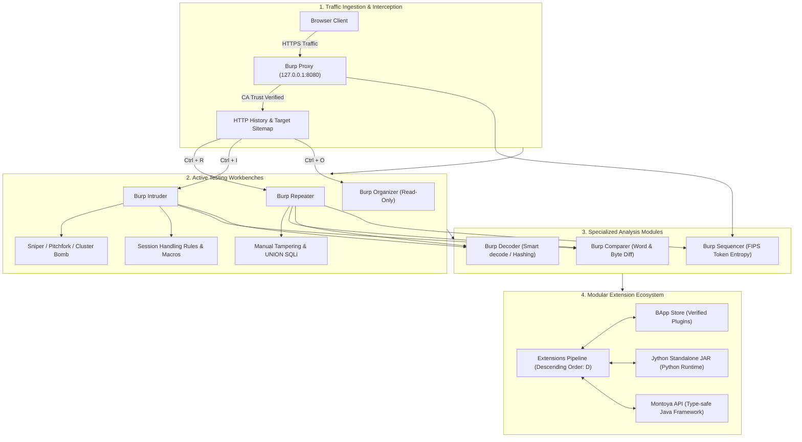

# Burp Suite: Topic Transition Recap (Module 06 Synthesis & Review)

---

## 1. Metadata & Overview

* **Curriculum Track:** Jr Penetration Tester (PT1 Aligned Curriculum)
* **Module:** Module 06 - Burp Suite
* **Room Number:** Room 06 of 06 (Assessment / Synthesis)
* **Platform Assessment Name:** Topic Transition Recap
* **Official Assessment Link:** [TryHackMe - Burp Suite Recap](https://tryhackme.com/recap/6afe01d5f306fc3f65927f67)
* **Points Awarded:** 48 / 48 points (100% Complete)
* **Difficulty:** Medium / Synthesis
* **Tactical Objective:** Synthesize core methodologies, tool workflows, and theoretical concepts across all five Burp Suite module rooms, verifying operational mastery before transitioning into Module 07 (Web Application Vulnerabilities I).

---

## 2. Executive Summary

Module 06 established the definitive toolset for inspecting, manipulating, and automating web application attacks. Starting from the network architecture of proxy listeners and SSL/TLS interception in *Burp Suite: The Basics*, transitioning through surgical manual exploitation in *Burp Suite: Repeater*, mass automation and anti-automation circumvention in *Burp Suite: Intruder*, auxiliary analysis tools in *Burp Suite: Other Modules*, and culminating in modular extensibility in *Burp Suite: Extensions*.

This **Topic Transition Recap** assesses and solidifies 6 foundational competencies:
1. **TLS Certificate Authority Trust:** The technical rationale requiring the PortSwigger CA certificate to be imported into client trust stores to eliminate browser security blocks.
2. **The Architecture of Extensions:** The core mission of the Extensions ecosystem to broaden functionality beyond built-in tooling.
3. **Comparer Workflow Orchestration:** The sequential lifecycle of capturing failed interactions, generating baseline responses in Repeater, forwarding to Comparer, and diffing against successful responses.
4. **Repeater Response Rendering Modes:** Precise functional mapping across Pretty (syntax highlighting), Render (DOM visualization), Hex (byte offsets), and Raw (unmodified wire data).
5. **Python/Jython Environment Setup:** Step-by-step pipeline for establishing Jython Standalone JAR paths and monitoring extension runtime outputs.
6. **Extension Metadata Triage:** Identifying the **Details** pane as the authoritative source for extension descriptions, author credits, and versioning.

---

## 3. Architecture & Concepts Diagram



---

## 4. Prerequisites & Setup

1. **Foundational Room Mastery:**
   - Room 01: `01-BURP-SUITE-THE-BASICS`
   - Room 02: `02-BURP-SUITE-REPEATER`
   - Room 03: `03-BURP-SUITE-INTRUDER`
   - Room 04: `04-BURP-SUITE-OTHER-MODULES`
   - Room 05: `05-BURP-SUITE-EXTENSIONS`
2. **Account Parity:**
   - 100% verified completion on the TryHackMe live platform with 48/48 points achieved.

---

## 5. Core Concepts & Theoretical Deep Dive

### TLS MITM Interception Mechanics
When proxying HTTPS traffic, Burp Suite acts as an active Man-In-The-Middle (MITM). It intercepts client connections, dynamically creates an SSL certificate forged in the name of the destination host, and signs it with PortSwigger's local Root CA. If the browser trust store lacks this root certificate, it immediately halts connection negotiation due to unverified trust chain errors.

### The Descending Execution Rule (`D`)
Extensions execute in strict descending hierarchy (top to bottom). This guarantees that request pre-processors (e.g., custom decrypters or authorization token injectors) manipulate payload data before downstream security scanners or latency loggers analyze the stream.

### Advanced Automation with Burp Macros
Dynamic anti-automation controls (such as single-use synchronizer CSRF tokens) are defeated by linking a background Macro (issuing pre-flight GET requests) to an active Session Handling Rule. This dynamic in-memory parameter harvesting enables automated brute-forcing tools like Intruder to run unimpeded.

---

## 6. Recap Assessment Structure & Questions Breakdown

The evaluation comprises 6 multi-format assessment questions:
* **Question 1 (Single Choice):** PortSwigger CA certificate requirement.
* **Question 2 (Single Choice):** Core objective of Burp Suite extensions.
* **Question 3 (Re-order):** Sequential workflow for diffing responses in Comparer.
* **Question 4 (Match Pairs):** Matching Repeater response views (Pretty, Render, Hex, Raw).
* **Question 5 (Re-order):** Procedural setup for Python extensions via Jython.
* **Question 6 (Single Choice):** Identifying extension metadata and description panes.

---

## 7. Assessment Implementation Summary

| Q # | Type | Technical Topic | Verified Submitted Answer | Points |
| :---: | :--- | :--- | :--- | :---: |
| **01** | Single Choice | CA Certificate Trust Rationale | `The browser rejects the proxy's certificate as untrusted without it` | 8 / 8 |
| **02** | Single Choice | Core Purpose of Extensions | `To add functionality beyond the built-in tools` | 8 / 8 |
| **03** | Re-order (4 Steps) | Diffing Lifecycle in Comparer | `Capture in Proxy ⟶ Repeater issue ⟶ Send fail to Comparer ⟶ Replace creds & diff` | 8 / 8 |
| **04** | Match Pairs (4 Pairs) | Repeater View Perspective Mapping | Pretty ⟶ Light formatting<br>Render ⟶ Graphical page<br>Hex ⟶ Byte-level<br>Raw ⟶ Unmodified | 8 / 8 |
| **05** | Re-order (4 Steps) | Python Extension Deployment Pipeline | `Download Jython ⟶ Set path in settings ⟶ Add .py file ⟶ Read Output pane` | 8 / 8 |
| **06** | Single Choice | Extension Description & Version Pane | `Details` | 8 / 8 |

---

## 8. Synthesized Practical Workflows

### The Unified Attack Pipeline Across Module 06
```text
1. Proxy Interception & Scoping:
   Configure Firefox with Burp CA, navigate target application, define scope regex to prevent out-of-scope traffic logging.

2. Surgical Probing in Repeater:
   Send interesting requests to Repeater (Ctrl + R). Fuzz boundary parameters to force HTTP 500 errors (CWE-209), and craft 5-column UNION SQLi queries to exfiltrate database records.

3. Automated Fuzzing in Intruder:
   Dispatch login endpoints to Intruder (Ctrl + I). Run Pitchfork attacks to test credential pairs, identifying valid logins via response length anomalies. Fuzz IDOR numeric paths via Sniper.

4. Anti-CSRF Macro Bypass:
   Record background GET requests in Macros, configure Session Handling Rules to harvest loginTokens in memory, enabling automated brute-forcing against hardened admin gates.

5. Cryptographic Triage & Companion Tools:
   Decode nested Base64/URL payloads in Decoder. Diff response bodies in Comparer. Verify token entropy with Sequencer (excellent / 112 bits). Log read-only findings in Organizer.
```

---

## 9. Red Team & Offensive Applications

* **Dynamic Traffic Normalization:** Write custom Montoya/Python extensions to seamlessly decrypt mobile API payloads before they hit Repeater.
* **Timing-Based Data Exfiltration:** Leverage Request Timer to measure microsecond server processing differentials during blind SQLi or username enumeration.
* **High-Throughput Concurrency:** Employ Turbo Intruder via Jython to exploit multi-request race conditions within single-packet windows.

---

## 10. Blue Team & Defensive Strategies

* **Client Certificate Pinning:** Implement TLS pinning in corporate mobile applications to prevent unauthorized MITM interception by tools like Burp Suite.
* **Response Length Normalization:** Standardize error response bodies and HTTP status codes to prevent attackers from triaging credential stuffing attacks via length discrepancies.
* **Cryptographically Strong Session Tokens:** Ensure all session identifiers utilize CSPRNGs with $\ge 128$ bits of effective entropy to thwart Sequencer-based prediction attacks.

---

## 11. Troubleshooting & Edge Cases

* **Issue: Browser halts with SEC_ERROR_UNKNOWN_ISSUER.**
  * *Fix:* Export PortSwigger CA certificate from Proxy settings and install it under "Authorities" in the browser certificate manager.
* **Issue: Python extensions fail to load.**
  * *Fix:* Confirm that the Jython Standalone JAR (not installer) path is set in `Extensions -> Extensions settings -> Python environment`.
* **Issue: Comparer diff fails to reveal hidden differences.**
  * *Fix:* Switch from `Words` diff to `Bytes` diff to inspect non-printable bytes, trailing nulls, or CRLF variations.

---

## 12. Cheatsheet & Global Shortcut Reference

```bash
# Global Burp Suite Hotkeys:
Ctrl + R          Send selection to Repeater
Ctrl + I          Send selection to Intruder
Ctrl + O          Send selection to Organizer
Ctrl + Shift + P  Switch focus to Proxy tab
Ctrl + Space      Send request (Repeater) / Start attack (Intruder)
Ctrl + Shift + U  URL-encode / URL-decode highlighted string

# Jython Download:
wget https://repo1.maven.org/maven2/org/python/jython-standalone/2.7.3/jython-standalone-2.7.3.jar
```

---

## 13. Knowledge Check & Verification Questions

1. **Question:** Why does the Raw view in Repeater remain indispensable despite modern Pretty formatting?
   * *Answer:* Raw view exposes exact byte streams and CRLF boundaries without browser or parser beautification, which is critical for identifying subtle protocol desyncs and header injection flaws.
2. **Question:** How does descending execution order protect chained extensions?
   * *Answer:* It ensures that decryption and parameter transformation plugins execute before downstream auditing or logging extensions process the message.
3. **Question:** What distinguishes the Output tab from the Errors tab in the Extensions module?
   * *Answer:* The Output tab streams standard output (`stdout`) from script prints, while the Errors tab captures runtime exception stack traces (`stderr`).

---

## 14. References & Transition to Module 07

* [PortSwigger Web Security Academy](https://portswigger.net/web-security)
* [TryHackMe Burp Suite Topic Transition Recap](https://tryhackme.com/recap/6afe01d5f306fc3f65927f67)
* **Next Module: Module 07 — Web Application Vulnerabilities I**
  With Burp Suite mastered as your operational workbench, Module 07 dives into the practical exploitation of critical web vulnerabilities:
  - `01-SQL-INJECTION-INTRO` (SQL Injection Mechanics & Union Attacks)
  - `02-CSRF-INTRO` (Cross-Site Request Forgery)
  - `03-XSS-INTRO` (Cross-Site Scripting: Reflected, Stored, DOM)
  - `04-INTRO-TO-SSRF` (Server-Side Request Forgery)
  - `05-IDOR` (Insecure Direct Object References)
  - `06-RECRUIT-CHALLENGE` (Comprehensive Hands-On Challenge Lab)
  - `07-TOPIC-TRANSITION-RECAP` (Module 07 Assessment)
