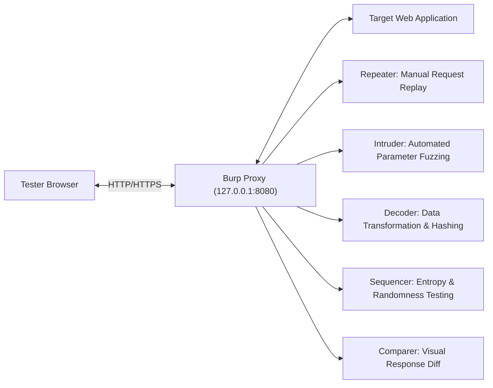

# Module 06: Burp Suite Web Application Security Platform

---

### 1. Module Metadata
* **Learning Path:** TryHackMe — Jr Penetration Tester (PT1 Aligned Curriculum)
* **Module:** Module 06: Burp Suite
* **Core Focus:** Mastering PortSwigger's industry-standard web penetration testing platform: HTTP traffic interception and manipulation via Proxy, rapid iterative fuzzing via Repeater, automated high-throughput attacks via Intruder, token randomness analysis via Sequencer, data transformation via Decoder, diff inspection via Comparer, and extensibility via the BApp Store.
* **Total Rooms:** 6 rooms (5 practical walk-throughs + 1 assessment recap).

---

### 2. Architecture & Overview
Burp Suite operates as a man-in-the-middle HTTP/HTTPS intercepting proxy running locally (by default on `127.0.0.1:8080`). Modern web browsers enforce numerous client-side restrictions (HTML5 validation, JavaScript form sanitization, disabled buttons, read-only fields). By routing traffic through Burp Suite, the penetration tester intercepts the raw HTTP request *after* it leaves the browser but *before* it arrives at the backend server, completely bypassing all client-side barriers.

---

### 3. Rooms Index
* [Room 01: Burp Suite: The Basics (01-BURP-SUITE-THE-BASICS)](file:///e:/THM-JR-PENETRATION-TESTER/06-BURP-SUITE/01-BURP-SUITE-THE-BASICS/README_EN.md)
* [Room 02: Burp Suite: Repeater (02-BURP-SUITE-REPEATER)](file:///e:/THM-JR-PENETRATION-TESTER/06-BURP-SUITE/02-BURP-SUITE-REPEATER/README_EN.md)
* [Room 03: Burp Suite: Intruder (03-BURP-SUITE-INTRUDER)](file:///e:/THM-JR-PENETRATION-TESTER/06-BURP-SUITE/03-BURP-SUITE-INTRUDER/README_EN.md)
* [Room 04: Burp Suite: Other Modules (04-BURP-SUITE-OTHER-MODULES)](file:///e:/THM-JR-PENETRATION-TESTER/06-BURP-SUITE/04-BURP-SUITE-OTHER-MODULES/README_EN.md)
* [Room 05: Burp Suite: Extensions (05-BURP-SUITE-EXTENSIONS)](file:///e:/THM-JR-PENETRATION-TESTER/06-BURP-SUITE/05-BURP-SUITE-EXTENSIONS/README_EN.md)
* [Room 06: Topic Transition Recap (06-TOPIC-TRANSITION-RECAP)](file:///e:/THM-JR-PENETRATION-TESTER/06-BURP-SUITE/06-TOPIC-TRANSITION-RECAP/README_EN.md)
