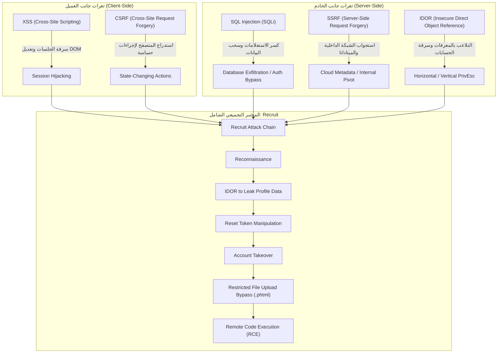

# الموديول 07: ثغرات تطبيقات الويب - الجزء الأول (Web Application Vulnerabilities I)

---

## 1. بطاقة التعريف والبيانات الوصفية (Metadata & Overview)

* **المسار التعليمي:** Jr Penetration Tester (مسار مختبر الاختراق المبتدئ - المنهج المعتمد)
* **الموديول:** الموديول السابع (Module 07 of 18)
* **عنوان الموديول:** Web Application Vulnerabilities I
* **التركيز التكتيكي:** استغلال أشهر خمس ثغرات في تطبيقات الويب وفق تصنيف OWASP Top 10 (SQLi, CSRF, XSS, SSRF, IDOR)، وبناء سيناريو اختراق متكامل في مختبر التحدي (Recruit).
* **إجمالي الغرف:** 7 غرف (5 غرف تعليمية + 1 مختبر تحدي + 1 مراجعة تقييمية)

---

## 2. الملخص التنفيذي (Executive Summary)

بعد التمكن من فحص الشبكات واستخدام أدوات Burp Suite باحترافية، يدخل مختبر الاختراق في هذا الموديول إلى صلب اختبار اختراق الويب الحقيقي. يعالج هذا الموديول الثغرات من منظورين متكاملين: **الفهم المعماري لسبب حدوث الثغرة برمجياً**، و**المنهجية الهجومية لاستغلالها وإثبات أثرها (PoC)**.

تتوزع رحلة الموديول على النحو التالي:
1. **حقن قواعد البيانات (SQL Injection):** فهم كيفية اختراق طبقة قواعد البيانات من خلال دمج المدخلات غير المنقاة، وتنفيذ هجمات UNION لاستخراج الجداول، واستغلال الثغرات العمياء (Blind SQLi).
2. **تزوير الطلبات عبر المواقع (CSRF):** دراسة كيفية إجبار متصفح الضحية على إرسال طلبات موثقة لتغيير البريد الإلكتروني أو كلمات المرور، واستيعاب آليات الحماية (Anti-CSRF Tokens و SameSite Cookies).
3. **حقن السكربتات البرمجية (XSS):** التمييز الحاسم بين XSS المنعكس، والمخزن في قواعد البيانات، والمعتمد على شجرة DOM في المتصفح، وسرقة جلسات المستخدمين.
4. **تزوير الطلبات من جانب الخادم (SSRF):** تطويع خادم الويب ليصبح وكيلاً للمهاجم يطلب الموارد المعزولة خلف جدار الحماية أو يسحب بيانات الاعتماد من خدمات السحابة (`169.254.169.254`).
5. **الإسناد المباشر غير الآمن للكائنات (IDOR):** استغلال غياب التحقق من صلاحيات المستخدم على السجلات والكائنات المرقمة تسلسلياً.
6. **مختبر التحدي (Recruit Challenge):** اختبار واقعي يحاكي سيناريو اختبار اختراق حقيقي يجمع بين Recon ⟶ IDOR ⟶ Password Reset Bypass ⟶ File Upload ⟶ Remote Code Execution (RCE).

---

## 3. مخطط السلسلة الهجومية الشاملة للموديول (Unified Attack Chain Diagram)

---

## 4. قائمة غرف الموديول ومسار التوثيق

* [01-SQL-INJECTION-INTRO](file:///e:/THM-JR-PENETRATION-TESTER/07-WEB-APPLICATION-VULNERABILITIES-I/01-SQL-INJECTION-INTRO/)
* [02-CSRF-INTRO](file:///e:/THM-JR-PENETRATION-TESTER/07-WEB-APPLICATION-VULNERABILITIES-I/02-CSRF-INTRO/)
* [03-XSS-INTRO](file:///e:/THM-JR-PENETRATION-TESTER/07-WEB-APPLICATION-VULNERABILITIES-I/03-XSS-INTRO/)
* [04-INTRO-TO-SSRF](file:///e:/THM-JR-PENETRATION-TESTER/07-WEB-APPLICATION-VULNERABILITIES-I/04-INTRO-TO-SSRF/)
* [05-IDOR](file:///e:/THM-JR-PENETRATION-TESTER/07-WEB-APPLICATION-VULNERABILITIES-I/05-IDOR/)
* [06-RECRUIT-CHALLENGE](file:///e:/THM-JR-PENETRATION-TESTER/07-WEB-APPLICATION-VULNERABILITIES-I/06-RECRUIT-CHALLENGE/)
* [07-TOPIC-TRANSITION-RECAP](file:///e:/THM-JR-PENETRATION-TESTER/07-WEB-APPLICATION-VULNERABILITIES-I/07-TOPIC-TRANSITION-RECAP/)
