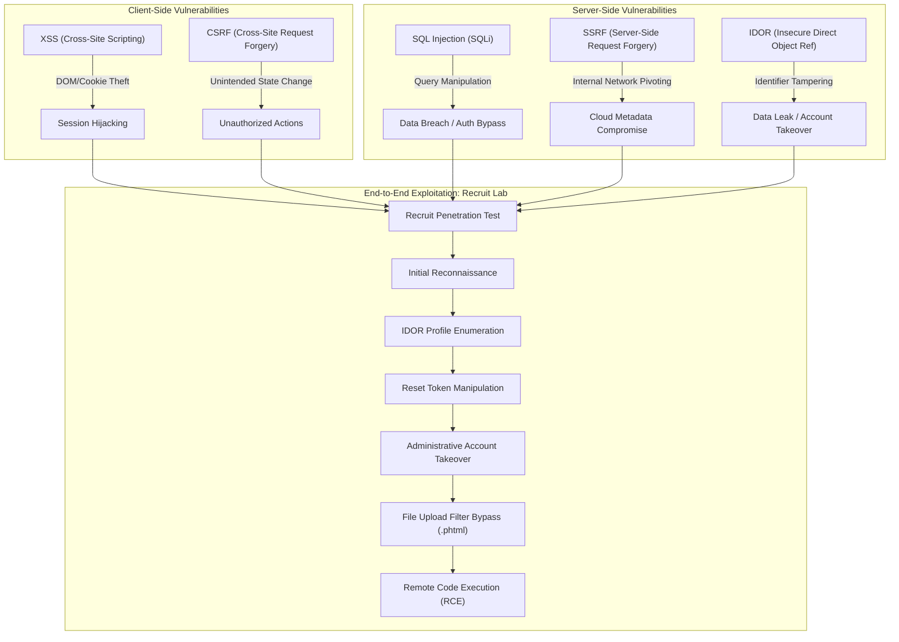

# Module 07: Web Application Vulnerabilities I

---

## 1. Metadata & Overview

* **Curriculum Track:** Jr Penetration Tester (PT1 Aligned Curriculum)
* **Module:** Module 07 of 18
* **Module Title:** Web Application Vulnerabilities I
* **Tactical Scope:** Deep dive and practical exploitation of the top five OWASP web vulnerability classes (SQLi, CSRF, XSS, SSRF, IDOR), culminating in a comprehensive end-to-end multi-stage challenge lab (Recruit).
* **Total Rooms:** 7 Rooms (5 Concept/Exploitation Rooms + 1 Challenge Lab + 1 Topic Transition Recap)

---

## 2. Executive Summary

Having established operational proxy and manual repetition mastery in Module 06, **Module 07: Web Application Vulnerabilities I** shifts focus to real-world software security auditing. Web applications process complex, stateful user input across disparate layers (databases, client runtimes, remote servers, and internal microservices). When developers fail to enforce strict input validation, contextual output encoding, and robust authorization checks, critical vulnerabilities emerge.

This module delivers systematic theoretical foundation and weaponized practical exploitation across five dominant vulnerability domains:
1. **SQL Injection (SQLi):** Exploiting untrusted dynamic SQL queries, mastering UNION-based data extraction, authentication bypass, and boolean/time-based blind exfiltration.
2. **Cross-Site Request Forgery (CSRF):** Tricking victim browsers into executing state-changing authenticated actions, engineering exploit PoCs, and evaluating SameSite cookie and anti-CSRF token defenses.
3. **Cross-Site Scripting (XSS):** Dissecting the triad of XSS execution (Stored, Reflected, DOM-based), payload crafting for cookie harvesting, and filter evasion.
4. **Server-Side Request Forgery (SSRF):** Forcing web servers to act as unwitting network proxies to query air-gapped internal services and cloud instance metadata (`169.254.169.254`).
5. **Insecure Direct Object References (IDOR):** Bypassing access controls via predictable identifiers to achieve horizontal and vertical privilege escalation.
6. **Recruit Challenge Lab:** A comprehensive real-world penetration test orchestrating chained vulnerabilities: Recon ⟶ IDOR ⟶ Password Reset Bypass ⟶ Upload Filter Bypass ⟶ Remote Code Execution (RCE).

---

## 3. Architecture & Concepts Diagram

---

## 4. Module Directory Structure

* [01-SQL-INJECTION-INTRO](../01-SQL-INJECTION-INTRO)
* [02-CSRF-INTRO](../02-CSRF-INTRO)
* [03-XSS-INTRO](../03-XSS-INTRO)
* [04-INTRO-TO-SSRF](../04-INTRO-TO-SSRF)
* [05-IDOR](../05-IDOR)
* [06-RECRUIT-CHALLENGE](../06-RECRUIT-CHALLENGE)
* [07-TOPIC-TRANSITION-RECAP](../07-TOPIC-TRANSITION-RECAP)
