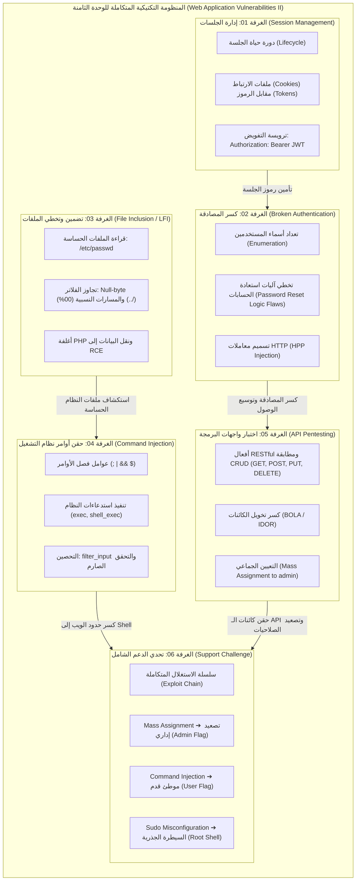

# التوثيق الشامل: المراجعة التركيبية واختبار الانتقال (Topic Transition Recap - Module 08)

---

## القسم 01: نظرة عامة وبيانات وصفية (Room Overview & Metadata)

| البند (Item) | التفاصيل والمواصفات التقنية (Technical Specification) |
| :--- | :--- |
| **اسم التقييم (Assessment Title)** | Topic Transition Recap: Web Application Vulnerabilities II |
| **المسار التعليمي (Path)** | Jr Penetration Tester (المستوى الوظيفي لمختبر الاختراق المبتدئ - معتمد PT1) |
| **الوحدة التعليمية (Module)** | Web Application Vulnerabilities II (الوحدة 08: ثغرات تطبيقات الويب 2) |
| **معرف التقييم (Recap ID)** | `6afe01d5f306fc3f65927fb7` |
| **رابط التقييم (Canonical URL)** | `https://tryhackme.com/recap/6afe01d5f306fc3f65927fb7` |
| **نوع التقييم (Recap Type)** | مراجعة تركيبية مرحلية (Topic Transition Assessment) |
| **إجمالي عدد الأسئلة (Total Questions)** | 6 أسئلة تقييمية (5 أسئلة اختيار من متعدد + 1 سؤال ربط أزواج متطابقة) |
| **إجمالي النقاط المكتسبة (Score Achieved)** | **48 / 48 نقطة (الدرجة الكاملة 100% بنجاح فوري)** |
| **نطاق التغطية الشامل (Coverage Scope)** | إدارة الجلسات (Session Management)، كسر المصادقة (Broken Auth)، تضمين الملفات (File Inclusion)، حقن الأوامر (Command Injection)، اختبار الـ API، وتحدي الدعم الفني (Support Challenge) |

---

## القسم 02: الأهداف التعليمية والعملياتية (Educational & Operational Objectives)

1. **التركيب المفاهيمي الشامل لموضوعات الوحدة الثامنة:** التحقق من قدرة مختبر الاختراق على دمج مفاهيم إدارة الجلسات، كسر آليات المصادقة، الثغرات المنطقية، ثغرات الملفات، وحقن أوامر الخادم في نموذج فكري وعملياتي موحد.
2. **التمييز الهندسي بين الدفاع الشكلي والحل الجذري:** فهم الفارق الجوهري بين تدابير التقييد الإجرائي (Rate Limiting أو Hashing أو URL Encoding) والحلول المعمارية الصحيحة القائمة على استخلاص البيانات من سجلات موثوقة في قاعدة البيانات (Trusted Source Derivation).
3. **إتقان أهداف فحص نظم الملفات في Linux:** إدراك الأهمية الاستراتيجية لملف `/etc/passwd` كنقطة انطلاق برهانية ومصدر استخباري لتعداد الحسابات في اختبارات التخطي الموضعي وتضمين الملفات (LFI/Traversal).
4. **التفكيك الدقيق لثغرات حقن أوامر نظام التشغيل (OS Command Injection):** تحديد النقطة التي تنتقل فيها مدخلات العميل غير المعقمة إلى دوال استدعاء نظام التشغيل (System Calls) بصلاحيات خادم الويب.
5. **التحقق من البيانات على مستوى الخادم (Server-Side Validation):** إتقان دوال الفحص الأصيلة في PHP (مثل `filter_input()` مع الفلاتر الرقمية) وإدراك انعدام جدوى القيود الشكلية في المتصفح.
6. **معيارية توثيق ومصادقة واجهات البرمجة (REST API Standards):** الإلمام الدقيق بتمرير رموز JWT عبر ترويسة `Authorization: Bearer`، ومطابقة أفعال HTTP المعيارية (`GET`, `POST`, `PUT`, `DELETE`) مع عمليات الـ CRUD الأربع.
7. **الجسر المعرفي نحو الوحدة التاسعة:** الاستعداد للتحول من استغلال ثغرات الويب المنعزلة إلى دراسة قواعد بيانات الثغرات المعتمدة عالمياً (Vulnerability Knowledge & Databases) وفهم معايير CVE و CVSS و CWE.

---

## القسم 03: البنية المعمارية وخريطة التهديدات الموحدة (Unified Architecture & Attack Taxonomy)



---

## القسم 04: المتطلبات الأساسية وجاهزية البيئة (Prerequisites & Readiness)

### 1. المتطلبات المعرفية المتحققة:
- إتقان العمليات الست المنجزة في الوحدة الثامنة بنسبة 100%.
- القدرة على قراءة مخرجات أدوات الفحص وتحليل حزم HTTP الخام بدقة.
- استيعاب مواصفات RFC 7231 (HTTP Semantics) و RFC 6750 (Bearer Token Usage).
- معرفة عميقة بهيكلية أنظمة ملفات POSIX و Linux.

---

## القسم 05: التحليل النظري والعمق المفاهيمي للمراجعة (Theoretical Deep Dive)

### أ. سيكولوجية تدفقات استعادة الحسابات (Password Reset Architecture):
تكمن الثغرة القاتلة في العديد من بوابات الويب عندما يتم التعامل مع البريد الإلكتروني للمستلم كمعامل يدخله المستخدم أثناء تقديم طلب الاستعادة:
```
[طلب المهاجم الخبيث]:
POST /reset_password.php
account=victim_ceo&email=attacker@evil.com
```
إذا اعتمد الخادم على البريد المرسل في الطلب لإرسال رابط إعادة التعيين، يتم تسليم الحساب للمهاجم فوراً. التصميم الآمن يقتضي أن يقبل الخادم فقط معرّف الحساب (`username` أو `account_id`)، ثم يستعلم قاعدة البيانات الداخلية لجلب البريد المعتمد حصراً وإرسال الرابط إليه، مما يلغي إمكانية التوجيه العشوائي.

### ب. فيزياء حقن الأوامر مقابل حقن الاستعلامات (CWE-78 vs CWE-89):
من الأخطاء المفاهيمية الشائعة الخلط بين أنواع الحقن:
- **حقن أوامر النظام (Command Injection):** يستهدف مفسر أوامر نظام التشغيل (OS Shell) عبر دوال مثل `exec()` أو `system()`، ويمنح المهاجم صلاحيات مستخدم نظام تشغيلي (مثل `www-data` أو `ubuntu`).
- **حقن قواعد البيانات (SQL Injection):** يستهدف محرك قاعدة البيانات (RDBMS Engine) عبر استعلامات غير مهيأة، ويمنح المهاجم قدرة قراءة أو تعديل الجداول.
- **حقن المتصفح (XSS):** يستهدف محرك جافاسكربت في متصفح الضحية (Client-Side Execution).

---

## القسم 06: الاستطلاع ورسم خريطة سطح الهجوم للتقييم (Reconnaissance & Assessment Mapping)

توزعت أسئلة التقييم الستة لتغطي كامل أركان الوحدة الثامنة بأسلوب تركيبي دقيق:
- **السؤال 1:** استعادة الحسابات والثغرات المنطقية (Broken Auth / Room 02).
- **السؤال 2:** تعداد حسابات لينكس عبر تضمين الملفات (File Inclusion / Room 03).
- **السؤال 3:** التعريف الجوهري لحقن أوامر النظام (Command Injection / Room 04).
- **السؤال 4:** معالجة وتحصين المدخلات في PHP (Remediation / Room 04).
- **السؤال 5:** مصادقة وتمرير رموز الـ JWT في واجهات البرمجة (Session & API / Rooms 01 & 05).
- **السؤال 6:** مطابقة أفعال REST مع عمليات CRUD (API Pentesting / Room 05).

---

## القسم 07: تفكيك الأسباب الجذرية للثغرات المراجعة (Vulnerability Root Causes)

| رقم المسألة | التصنيف المعياري | السبب الجذري الفعلي (Underlying Flaw) | العلاج الهندسي الحاسم (Permanent Fix) |
|:---:|---|---|---|
| **Q1** | CWE-640 (Weak Password Recovery) | الثقة في عناوين بريد إلكتروني مقدمة من طلب العميل | جلب البريد المسجل حصرياً من قاعدة البيانات للحساب المحدد |
| **Q2** | CWE-22 (Path Traversal / LFI) | السماح بقراءة مسارات النظام العامة دون تقييد المجلد الجذري | تقييد التضمين بمسار ثابت، واستخدام `basename()` أو مسارات محددة مسبقاً |
| **Q3** | CWE-78 (OS Command Injection) | دمج مدخلات المستخدم مباشرة في استدعاءات الصدفة | الامتناع عن استخدام مفسرات الأصداف واستخدام واجهات برمجية آمنة خالية من الـ Shell |
| **Q4** | CWE-20 (Improper Input Validation) | الاعتماد على قيود المتصفح أو الفلاتر الشكلية الخاطئة | استخدام دوال الفحص الأصيلة بالخادم: `filter_input(INPUT_GET, ..., FILTER_VALIDATE_INT)` |
| **Q5** | RFC 6750 / JWT Standards | غياب الفهم المعياري لتمرير الرموز عبر الترويسات | استخدام ترويسة `Authorization: Bearer <token>` القياسية |
| **Q6** | RFC 7231 (HTTP Semantics) | الخلط بين دلالات أفعال HTTP وطبيعة استبدال الموارد | الالتزام الصارم بمواصفات RESTful: GET للقراءة، POST للإنشاء، PUT للاستبدال، DELETE للحذف |

---

## القسم 08: الحل العملي التفصيلي وتحليل الأسئلة (Step-by-Step Questions Analysis)

### السؤال 1: المعالجة الجذرية لخلل تدفق استعادة كلمة المرور
- **السؤال:** *ما هو التعديل التصميمي الذي يزيل الثغرة من تدفق إعادة التعيين الذي يرسل رابطاً إلى بريد إلكتروني مرفق في الطلب؟*
- **الخيارات المدحوضة:**
  - *تحديد معدل الطلبات (Rate Limiting):* حل إجرائي يبطئ الهجوم لكن طلب واحد كافٍ لاختراق الحساب.
  - *ترميز البريد بـ URL Encoding:* تغيير شكلي لا يغير وجهة الإرسال.
  - *تشفير البريد بـ Hash:* تجزئة قيمة خبيثة تنتج قيمة خبيثة مجزأة بلا أي موثوقية.
  - *رفض تكرار المعامل (HPP):* يحجب طريقة إرسال واحدة ويترك الثغرة قائمة.
- **الإجابة المعتمدة:** `Send to the address stored in the database for the identified account`
- **التعليل:** قراءة عنوان الإرسال من السجل الموثوق في قاعدة البيانات تجعل مدخلات الطلب عاجزة عن تغيير الوجهة.

---

### السؤال 2: الملف المستهدف لتعداد حسابات المستخدمين في لينكس
- **السؤال:** *أي ملف في لينكس يتم استهدافه عادة لأنه يسرد جميع حسابات المستخدمين المسجلة في النظام؟*
- **الخيارات المدحوضة:**
  - `/etc/profile`: يحدد إعدادات البيئة العامة للصدفة.
  - `/etc/issue`: يحوي نص الترحيب قبل تسجيل الدخول.
  - `/proc/version`: يكشف إصدار النواة والـ Kernel.
  - `/var/mail/root`: صندوق بريد المستخدم root.
- **الإجابة المعتمدة:** `/etc/passwd`
- **التعليل:** ملف متاح للقراءة العامة لجميع المستخدمين (`world-readable`) ويسرد كافة الحسابات، مما يجعله الهدف البرهاني الأول لثغرات التخطي وتضمين الملفات.

---

### السؤال 3: الوصف الأدق لثغرة حقن أوامر نظام التشغيل
- **السؤال:** *ما هو الوصف الأفضل لثغرة حقن أوامر نظام التشغيل (OS Command Injection)؟*
- **الخيارات المدحوضة:**
  - سكربت خبيث يعرض في متصفح مستخدم آخر (هذا XSS).
  - بناء استعلام قاعدة بيانات من نص غير موثوق (هذا SQLi).
  - رموز جلسات متوقعة وقابلة للتخمين (هذا خلل في إدارة الجلسات).
  - قيام الخادم بجلب رابط يوفره المهاجم (هذا SSRF).
- **الإجابة المعتمدة:** `User input reaches a system call without validation`
- **التعليل:** تنشأ الثغرة عندما يتم دمج مدخلات غير موثوقة داخل أمر ينفذه نظام التشغيل مباشرة.

---

### السؤال 4: أفضل طريقة لفحص المعاملات الرقمية في PHP بالخادم
- **السؤال:** *أي نهج في PHP هو الأفضل لرفض معامل في Query String إذا لم يكن رقماً صحيحاً من جهة الخادم؟*
- **الخيارات المدحوضة:**
  - ترميز المخرجات (Output Encoding): يحمي من XSS ولا يمنع تنفيذ الأوامر.
  - عنصر HTML ذو نمط أرقام فقط: قيد عميل بالمتصفح يسهل تجاوزه عبر Burp.
  - استخدام `exec()` بدلاً من `system()`: كلاهما ينفذ أوامر في الصدفة.
  - وضع المعامل بين علامات تنصيص مزدوجة: سهل الكسر عبر الرموز الخاصة.
- **الإجابة المعتمدة:** `filter_input() with a numeric validation filter`
- **التعليل:** يتحقق من القيمة بالخادم ويتيح للتطبيق رفض أي مدخل لا يطابق النوع المتوقع فورياً.

---

### السؤال 5: ترويسة الطلب القياسية لتمرير رموز JWT
- **السؤال:** *أي ترويسة طلب هي الأكثر شيوعاً واستخداماً لنقل رمز JSON Web Token إلى تطبيق ويب؟*
- **الخيارات المدحوضة:**
  - `Referer`: ترويسة مسار الصفحة الأصلية.
  - `X-Token`: ترويسة غير قياسية نادرة الاستخدام.
  - `Cookie`: آلية جلسات متصفح تقليدية وليست الترويسة القياسية لرموز الـ Bearer.
  - `Set-Cookie`: ترويسة استجابة مرسلة من الخادم لتخزين الكعكات.
- **الإجابة المعتمدة:** `Authorization`
- **التعليل:** الرموز مثل JWT يتم إرفاقها قياسياً في هذه الترويسة باستخدام نظام Bearer (`Authorization: Bearer <token>`).

---

### السؤال 6: مطابقة أفعال HTTP مع عمليات CRUD في واجهات REST
- **السؤال:** *طابق كل فعل HTTP مع عملية CRUD المقابلة له في واجهات برمجة التطبيقات RESTful.*
- **الأزواج المتطابقة المعتمدة:**
  1. **`DELETE`** ➔ **`Remove a resource from the server`** (إزالة المورد من الخادم).
  2. **`POST`** ➔ **`Create a new resource`** (إنشاء مورد جديد على الخادم).
  3. **`GET`** ➔ **`Retrieve a resource without modifying it`** (جلب المورد دون تعديل حالته).
  4. **`PUT`** ➔ **`Full replacement of an existing resource`** (استبدال المورد بالكامل).

---

## القسم 09: استراتيجيات الدفاع متعدد الطبقات (Defense-in-Depth & Hardening)

```
┌────────────────────────────────────────────────────────────────────────────────────────┐
│                        MODULE 08 DEFENSE-IN-DEPTH ARCHITECTURE                         │
│                                                                                        │
│  [ الطبقة الأولى: التحقق الصارم في طبقة النقل والتفويض (Transport & Auth Layer) ]       │
│  - اعتماد ترويسات Authorization: Bearer القياسية وتطبيق التشفير الكامل HTTPS.            │
│  - استخلاص وجهات المراسلة الحساسة من سجلات قاعدة البيانات الموثوقة حصراً.               │
│                                                                                        │
│  [ الطبقة الثانية: تأمين نظام الملفات ومسارات الـ I/O (Filesystem & Path Layer) ]       │
│  - منع التضمين الديناميكي المباشر وتجريد أسماء الملفات باستخدام basename().             │
│  - عزل الملفات خارج مسار خادم الويب العام وتعطيل محركات السكربتات في مجلدات الرفع.       │
│                                                                                        │
│  [ الطبقة الثالثة: إبطال استدعاءات الصدفة ونمذجة البيانات (Process & Execution Layer) ] │
│  - استخدام filter_input() للفحص الرقمي الصارم للمدخلات قبل المعالجة.                   │
│  - استبدال استدعاءات Shell بمكتبات داخلية أصلية أو عزل المعاملات بـ escapeshellarg().   │
│  - تطبيق كائنات نقل البيانات (DTOs) لحظر ثغرات التعيين الجماعي (Mass Assignment).      │
└────────────────────────────────────────────────────────────────────────────────────────┘
```

---

## القسم 10: الكشف وصيد التهديدات وقواعد SIEM (Detection & SIEM Signatures)

### 1. تحليل سجلات الوصول لاكتشاف محاولات قراءة `/etc/passwd`:
```bash
grep -E "(\.\.\/|\.\.\\|%2e%2e%2f).*(etc\/passwd)" /var/log/apache2/access.log
```

### 2. قاعدة Sigma لاكتشاف محاولات حقن أوامر نظام التشغيل عبر الويب:
```yaml
title: Potential Web-Based OS Command Injection
id: 7a8b9c0d-1e2f-3a4b-5c6d-7e8f9a0b1c2d
status: stable
description: Detects command delimiter characters followed by Unix administrative utilities in HTTP parameters.
logsource:
  category: webserver
detection:
  selection:
    cs-uri-query|re: '(\;|\||\&\&|\`|\$\().*(cat|ls|whoami|id|nc|bash|sh|ping)'
  condition: selection
fields:
  - c-ip
  - cs-method
  - cs-uri-stem
  - cs-uri-query
level: high
```

---

## القسم 11: الأخطاء الشائعة واستكشاف المشكلات وإصلاحها (Troubleshooting)

1. **الخلط بين التحقق في جانب العميل والتحقق في جانب الخادم:**
   - الاعتماد على خصائص HTML5 مثل `required` أو `pattern="[0-9]+"` يوفر تجربة مستخدم فقط، ولا يمثل أي حماية أمنية لأن المهاجم يرسل الطلب مباشرة متجاوزاً المتصفح.
2. **الاعتقاد بأن التنصيف المزدوج يحمي من حقن الأوامر:**
   - تمرير `shell_exec("ping \"$ip\"")` لا يمنع المهاجم من استخدام علامات التنصيص نفسها لكسر السلسلة أو استخدام استبدال الأوامر عبر `$(whoami)`.
3. **افتراض أن رموز JWT محمية تلقائياً من CSRF داخل الكعكات:**
   - إذا تم حفظ رمز JWT داخل Cookie قياسي دون تفعيل `SameSite=Strict` وترويسات مضادة لـ CSRF، يصبح التطبيق عرضة لتزوير الطلبات بالكامل.

---

## القسم 12: دراسات حالة واقعية ومطابقة مع معايير CVE (Case Studies & CVE Mapping)

1. **ثغرة Apache Log4j (Log4Shell - CVE-2021-44228):**
   - النموذج الأخطر لتمرير مدخلات غير مفلترة إلى محرك التفسير والتسجيل، مما أدى إلى تنفيذ أوامر عشوائية عن بُعد (RCE) على ملايين الخوادم.
2. **ثغرة GitLab Mass Assignment (CVE-2020-10977):**
   - استغلال تعيين جماعي وتخطي مسارات الملفات للوصول إلى بيانات المستخدمين والسيطرة على المنصة.
3. **التصنيف المعياري المرجعي:**
   - **CWE-640:** Weak Password Recovery Mechanism.
   - **CWE-22:** Improper Limitation of a Pathname to a Restricted Directory ('Path Traversal').
   - **CWE-78:** Improper Neutralization of Special Elements used in an OS Command.
   - **CWE-20:** Improper Input Validation.
   - **CWE-915:** Improperly Controlled Modification of Dynamically-Determined Object Attributes.

---

## القسم 13: الملخص العام ومصفوفة الإجابات المعتمدة (Summary & Verified Answers Matrix)

| رقم المسألة | موضوع السؤال (Topic Focus) | نص السؤال التقني (Question Prompt) | الإجابة المعتمدة المؤكدة (Verified Correct Answer) | النقاط المكتسبة |
|:---:|---|---|:---:|:---:|
| **Q1** | Password Reset Flaw | Which redesign removes the flaw from a reset workflow that mails a link to a request-supplied email address? | `Send to the address stored in the database for the identified account` | 8 / 8 |
| **Q2** | User Enumeration Target | Which Linux file is commonly targeted because it lists all registered user accounts on the system? | `/etc/passwd` | 8 / 8 |
| **Q3** | Command Injection Definition | What best describes an OS command injection vulnerability? | `User input reaches a system call without validation` | 8 / 8 |
| **Q4** | Server-Side Numeric Filter | Which PHP approach best rejects a query-string parameter that is not a valid number, server-side? | `filter_input() with a numeric validation filter` | 8 / 8 |
| **Q5** | JWT Transmission Header | Which request header is most commonly used to transmit a JSON Web Token to a web application? | `Authorization` | 8 / 8 |
| **Q6** | REST to CRUD Mapping | Match each HTTP method to the CRUD operation it performs in a RESTful API: | `DELETE` ➔ `Remove a resource from the server`<br>`POST` ➔ `Create a new resource`<br>`GET` ➔ `Retrieve a resource without modifying it`<br>`PUT` ➔ `Full replacement of an existing resource` | 8 / 8 |
| **الإجمالي** | **اكتمال الوحدة الثامنة** | **مجموع درجات تقييم الانتقال التركيبي** | **48 / 48 نقطة (الدرجة الكاملة 100%)** | **48 / 48** |

---

## القسم 14: التمارين العملية والانتقال إلى الوحدة التاسعة (Exercises & Module 09 Bridge)

1. **تمرين 1: بناء وتأمين دالة استعادة الحسابات برمجياً:**
   - اكتب دالة بلغة Python أو PHP تستقبل اسم المستخدم وتولد رمز استعادة عشوائي تشفيري (CSPRNG) وترسله إلى البريد المسجل في قاعدة البيانات، مع منع قبول أي حقل بريد إلكتروني في الطلب.
2. **تمرين 2: محاكاة فحص المعاملات بالخادم:**
   - صمم سكربت PHP صغير يستخدم دالة `filter_input()` لاختبار حقل معرّف الطلب (`order_id`)، وتأكد من رفضه لحمولات مثل `123; whoami` أو `123' OR 1=1--`.
3. **الجسر التشغيلي نحو الوحدة التاسعة (Vulnerability Knowledge):**
   - مع ختام ثغرات تطبيقات الويب بجزأيها الأول والثاني، ينتقل مسار Jr Penetration Tester إلى دراسة **علم ومعارف الثغرات الأمنية (Module 09: Vulnerability Knowledge)** للتعرف على قواعد البيانات العالمية (NVD, CVE, Exploit-DB)، وأدوات المسح، ودورات حياة كشف الثغرات الأمنية وتوثيقها وفق المعايير الدولية.
