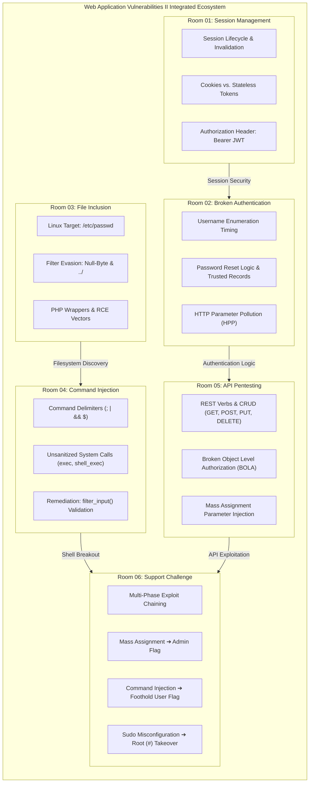

# Topic Transition Recap: Web Application Vulnerabilities II - Comprehensive Technical Guide

---

## 1. Room Overview & Assessment Metadata

| Property | Details / Technical Specification |
|:---|:---|
| **Assessment Title** | Topic Transition Recap: Web Application Vulnerabilities II |
| **Learning Path** | Jr Penetration Tester (PT1 Aligned Curriculum) |
| **Module** | Web Application Vulnerabilities II (Module 08) |
| **Recap ID** | `6afe01d5f306fc3f65927fb7` |
| **Canonical URL** | `https://tryhackme.com/recap/6afe01d5f306fc3f65927fb7` |
| **Recap Type** | Curriculum Synthesis & Transition Assessment |
| **Total Assessment Questions** | 6 Questions (5 Single-Choice + 1 Four-Way Match-Pair) |
| **Score Achieved** | **48 / 48 Points (100% Perfect Score)** |
| **Coverage Scope** | Session Management, Broken Authentication, File Inclusion, Command Injection, API Pentesting, and the Support Challenge |

---

## 2. Educational & Operational Objectives

1. **Synthesize Web Application Vulnerabilities II:** Unify the concepts of state management, broken authentication, filesystem manipulation, shell command injection, and modern API authorization into a coherent mental model.
2. **Differentiate Remediation Depth:** Distinguish between superficial rate-limiting or encoding mitigations and permanent architectural redesigns centered on trusted database record derivation.
3. **Understand POSIX User Enumeration Artifacts:** Recognize the historical, functional, and security significance of `/etc/passwd` as a world-readable target during Path Traversal and Local File Inclusion (LFI) operations.
4. **Define OS Command Injection Rigorously:** Trace the boundary failure where untrusted user input crosses from application runtime memory into operating system execution calls (`exec`, `shell_exec`).
5. **Enforce Robust Server-Side Validation:** Implement native PHP typing validation functions (`filter_input()` with numeric filters) rather than fragile client-side patterns or double-quoting anti-patterns.
6. **Standardize API Authentication & REST Semantics:** Transmit JSON Web Tokens (JWT) using the standard `Authorization: Bearer` scheme and map HTTP verbs (`GET`, `POST`, `PUT`, `DELETE`) to corresponding CRUD database operations.
7. **Transition to Vulnerability Knowledge (Module 09):** Prepare for industry-standard vulnerability scoring, CVE/NVD research, vulnerability scanners, and exploit databases.

---

## 3. Unified Architecture & Attack Taxonomy



---

## 4. Prerequisites & Environment Setup

* **Knowledge Prerequisites:** Completion of Rooms 01 through 06 of Module 08.
* **Standards Alignment:** RFC 7231 (HTTP Semantics), RFC 6750 (Bearer Token Usage), RFC 7519 (JSON Web Tokens), OWASP ASVS v4.0.3.

---

## 5. Theoretical Deep Dive: Key Concepts Reviewed

### A. Architectural Trust in Password Reset Workflows
A classic vulnerability pattern occurs when password reset workflows accept an arbitrary destination address in the HTTP request (`email=attacker@evil.com`). Attackers manipulate this parameter to redirect the password reset link to their own mailbox. The only architectural fix is **Trusted Source Derivation**: the client request provides an account identifier, and the server exclusively consults its internal, immutable database record to retrieve the recipient email address.

### B. OS Command Injection vs. Database & Client-Side Injections
* **OS Command Injection (CWE-78):** Untrusted input is passed to an operating system shell interpreter (`/bin/sh`), allowing attackers to execute host-level system commands.
* **SQL Injection (CWE-89):** Untrusted input modifies the structure of a query evaluated by a database management engine.
* **Cross-Site Scripting (CWE-79):** Untrusted input evaluates in another user's web browser, executing client-side JavaScript.

---

## 6. Attack Surface & Synthesis Analysis

The 6 recap questions systematically evaluate proficiency across all major Module 08 vulnerability categories:
- **Question 1:** Authentication logic & password reset trust boundaries.
- **Question 2:** Local filesystem traversal targets on Linux (`/etc/passwd`).
- **Question 3:** Command injection root-cause identification.
- **Question 4:** Robust server-side numeric validation in PHP (`filter_input`).
- **Question 5:** API token transmission standards (`Authorization: Bearer`).
- **Question 6:** RESTful HTTP verb semantics mapped to CRUD operations.

---

## 7. Vulnerability Root Cause Matrix

| Question # | Vulnerability Classification | Root Cause | Permanent Architectural Remediation |
|:---:|---|---|---|
| **Q1** | CWE-640 (Weak Password Recovery) | Relying on client-supplied destination addresses | Derive recipient addresses strictly from trusted database records |
| **Q2** | CWE-22 (Path Traversal / LFI) | Allowing direct user traversal of server directories | Enforce directory confinement, strict whitelists, and `basename()` |
| **Q3** | CWE-78 (OS Command Injection) | Passing unsanitized input to operating system calls | Eliminate shell execution wrappers; use safe non-shell APIs |
| **Q4** | CWE-20 (Improper Input Validation) | Relying on client-side patterns or flawed quote-wrapping | Implement strict server-side validation using `filter_input()` |
| **Q5** | RFC 6750 / JWT Standards | Misunderstanding bearer token transport standards | Standardize on the `Authorization: Bearer <token>` request header |
| **Q6** | RFC 7231 (HTTP Semantics) | Confusing HTTP verbs and resource mutation behaviors | Adhere strictly to RESTful specifications for idempotent and state-changing actions |

---

## 8. Step-by-Step Question Walkthrough & Technical Rationale

### Question 1: Eliminating Flaws in Password Reset Workflows
- **Prompt:** *Which redesign removes the flaw from a reset workflow that mails a link to a request-supplied email address?*
- **Refutations:**
  - *Rate limiting:* Slows brute-force, but a single crafted request still hijacks the account.
  - *URL-encoding:* Encoding changes transport representation, not server-side data routing.
  - *Hashing the email:* Hashing an attacker-chosen value yields an attacker-chosen hash.
  - *Rejecting duplicate parameters:* Blocks one HPP syntax, leaving parameter trust intact.
- **Accepted Answer:** `Send to the address stored in the database for the identified account`
- **Technical Rationale:** The application must read the recipient address from the trusted record associated with the account, ensuring request input cannot redirect the email.

---

### Question 2: Linux User Account Enumeration File Target
- **Prompt:** *Which Linux file is commonly targeted because it lists all registered user accounts on the system?*
- **Refutations:**
  - `/etc/profile`: Configures shell environment defaults.
  - `/etc/issue`: Displays pre-login console banners.
  - `/proc/version`: Discloses kernel version and compiler information.
  - `/var/mail/root`: Mailbox spool for the root user.
- **Accepted Answer:** `/etc/passwd`
- **Technical Rationale:** The file is world-readable (`644`) to allow system utilities to resolve UIDs to usernames, making it the primary target for directory traversal proof-of-concept demonstrations.

---

### Question 3: Accurate Characterization of OS Command Injection
- **Prompt:** *What best describes an OS command injection vulnerability?*
- **Refutations:**
  - Untrusted script executed in browser = Cross-Site Scripting (XSS).
  - Database query built from untrusted input = SQL Injection (SQLi).
  - Predictable session tokens = Broken Session Management.
  - Server fetching attacker-supplied URL = Server-Side Request Forgery (SSRF).
- **Accepted Answer:** `User input reaches a system call without validation`
- **Technical Rationale:** The vulnerability arises when untrusted data is concatenated directly into a command executed by the operating system shell.

---

### Question 4: Server-Side Numeric Parameter Validation in PHP
- **Prompt:** *Which PHP approach best rejects a query-string parameter that is not a valid number, server-side?*
- **Refutations:**
  - Output encoding: Mitigates XSS; has no effect on command execution.
  - HTML pattern attribute: Purely client-side; easily bypassed via proxy.
  - `exec()` instead of `system()`: Both execute shell commands.
  - Wrapping in double quotes: Easily broken via quote escaping or `$()` substitution.
- **Accepted Answer:** `filter_input() with a numeric validation filter`
- **Technical Rationale:** `filter_input(INPUT_GET, 'param', FILTER_VALIDATE_INT)` validates input on the server side and safely rejects non-matching input before processing.

---

### Question 5: Standard Transmission Header for JSON Web Tokens (JWT)
- **Prompt:** *Which request header is most commonly used to transmit a JSON Web Token to a web application?*
- **Refutations:**
  - `Referer`: Identifies referring page URL.
  - `X-Token`: Non-standard custom header.
  - `Cookie`: Browser-automated storage, not the standard bearer transport.
  - `Set-Cookie`: Response header from server to browser.
- **Accepted Answer:** `Authorization`
- **Technical Rationale:** JWTs are standardly transmitted in the `Authorization` request header using the `Bearer` scheme (`Authorization: Bearer <token>`).

---

### Question 6: Mapping RESTful HTTP Methods to CRUD Operations
- **Prompt:** *Match each HTTP method to the CRUD operation it performs in a RESTful API.*
- **Verified Match Pairs:**
  1. **`DELETE`** ➔ **`Remove a resource from the server`**
  2. **`POST`** ➔ **`Create a new resource`**
  3. **`GET`** ➔ **`Retrieve a resource without modifying it`**
  4. **`PUT`** ➔ **`Full replacement of an existing resource`**

---

## 9. Defense-in-Depth & Hardening Strategies

```
+-----------------------------------------------------------------------------------+
|                        MODULE 08 DEFENSE-IN-DEPTH MATRIX                          |
+-----------------------------------------------------------------------------------+
|                                                                                   |
|  [ Layer 1: Transport & Identity Integrity ]                                      |
|  - Transmit bearer tokens strictly via Authorization: Bearer over HTTPS.          |
|  - Bind sensitive operations to authenticated session contexts.                   |
|                                                                                   |
|  [ Layer 2: Filesystem & Input Sanitization ]                                     |
|  - Confine file inclusions using hardcoded paths and basename() sanitization.     |
|  - Validate all numeric inputs using filter_input(FILTER_VALIDATE_INT).           |
|                                                                                   |
|  [ Layer 3: Process Execution & Architecture ]                                    |
|  - Avoid system shell execution wrappers; use safe programming libraries.         |
|  - Enforce DTO allowlisting to defeat Mass Assignment vulnerabilities.            |
|                                                                                   |
+-----------------------------------------------------------------------------------+
```

---

## 10. Detection & Threat Hunting

### 1. Traversal Detection:
```bash
grep -E "(\.\.\/|\.\.\\|%2e%2e%2f).*(etc\/passwd)" /var/log/apache2/access.log
```

### 2. Sigma Rule: Web-Based Command Injection Detection
```yaml
title: Potential Web-Based OS Command Injection
id: 7a8b9c0d-1e2f-3a4b-5c6d-7e8f9a0b1c2d
status: stable
description: Detects command delimiter characters followed by Unix administrative utilities in HTTP parameters.
logsource:
  category: webserver
detection:
  selection:
    cs-uri-query|re: '(\;|\||\&\&|\`|\$\().*(cat|ls|whoami|id|nc|bash|sh|ping)'
  condition: selection
fields:
  - c-ip
  - cs-method
  - cs-uri-stem
  - cs-uri-query
level: high
```

---

## 11. Troubleshooting & Common Pitfalls

1. **Client-Side vs. Server-Side Validation:** Never rely on HTML5 form attributes (`type="number"`, `pattern=...`) for security. All validation must execute on the server.
2. **Double-Quoting Trap in Command Strings:** Wrapping arguments in quotes inside `exec("ping \"$ip\"")` is insufficient because quotes can be escaped or subshells (`$()`) can be evaluated.
3. **Cookie-Based JWT Misconfiguration:** Storing JWTs in cookies without `SameSite=Strict` and anti-CSRF protections reintroduces Cross-Site Request Forgery risks.

---

## 12. Case Studies & CVE Mapping

* **Apache Log4j (Log4Shell - CVE-2021-44228):** Unsanitized input evaluated by an internal logging framework leading to RCE.
* **GitLab Path Traversal & Mass Assignment (CVE-2020-10977):** Chained file path manipulation and model binding flaws enabling full instance takeover.
* **CWE Standards:** CWE-640, CWE-22, CWE-78, CWE-20, CWE-915.

---

## 13. Summary & Answers Matrix

| Question # | Topic Focus | Question Prompt | Accepted Answer | Points Awarded |
|:---:|---|---|:---:|:---:|
| **Q1** | Password Reset Flaw | Which redesign removes the flaw from a reset workflow that mails a link to a request-supplied email address? | `Send to the address stored in the database for the identified account` | 8 / 8 |
| **Q2** | User Enumeration Target | Which Linux file is commonly targeted because it lists all registered user accounts on the system? | `/etc/passwd` | 8 / 8 |
| **Q3** | Command Injection Definition | What best describes an OS command injection vulnerability? | `User input reaches a system call without validation` | 8 / 8 |
| **Q4** | Server-Side Numeric Filter | Which PHP approach best rejects a query-string parameter that is not a valid number, server-side? | `filter_input() with a numeric validation filter` | 8 / 8 |
| **Q5** | JWT Transmission Header | Which request header is most commonly used to transmit a JSON Web Token to a web application? | `Authorization` | 8 / 8 |
| **Q6** | REST to CRUD Mapping | Match each HTTP method to the CRUD operation it performs in a RESTful API: | `DELETE` ➔ `Remove a resource from the server`<br>`POST` ➔ `Create a new resource`<br>`GET` ➔ `Retrieve a resource without modifying it`<br>`PUT` ➔ `Full replacement of an existing resource` | 8 / 8 |
| **Total** | **Module 08 Complete** | **Topic Transition Synthesis Score** | **48 / 48 Points (100% Perfect Score)** | **48 / 48** |

---

## 14. Practical Exercises & Bridge to Module 09

1. **Practical Exercise:** Implement a secure password reset handler in Python Flask using CSPRNG tokens with database lookup.
2. **Practical Exercise:** Write a custom Nginx reverse proxy rule that inspects URI query strings and blocks unescaped command injection metacharacters.
3. **Bridge to Module 09 (Vulnerability Knowledge):** Transition from individual web application flaws to formalized vulnerability discovery, public disclosure channels, National Vulnerability Database (NVD), CVE scoring (CVSS v3.1), and automated scanning tools.
