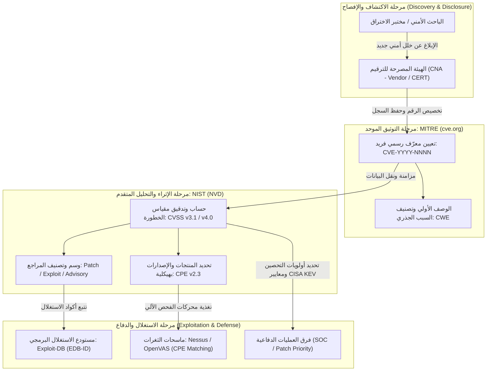

# التوثيق الشامل: فهم قواعد بيانات الثغرات الأمنية (Understanding Vulnerability Databases)

---

## القسم 01: نظرة عامة وبيانات وصفية (Room Overview & Metadata)

| البند (Item) | التفاصيل والمواصفات التقنية (Technical Specification) |
| :--- | :--- |
| **اسم الغرفة (Room Title)** | Understanding Vulnerability Databases (فهم قواعد بيانات الثغرات الأمنية) |
| **المسار التعليمي (Path)** | Jr Penetration Tester (المستوى الوظيفي لمختبر الاختراق المبتدئ - معتمد PT1) |
| **الوحدة التعليمية (Module)** | Vulnerability Knowledge (الوحدة 09: علم ومعارف الثغرات الأمنية) |
| **معرف الغرفة (Room Slug)** | `understandingvulnerabilitydatabases` |
| **مستوى الصعوبة (Difficulty)** | سهل (Easy) |
| **نوع الغرفة (Room Type)** | غرفة إرشادية وتطبيقية (Walkthrough Room) |
| **الوقت التقديري للإنجاز (Est. Completion Time)** | 60 دقيقة |
| **إجمالي عدد المهام (Total Tasks)** | 7 مهام تعليمية وتطبيقية (7 Tasks) تضم 10 أسئلة محققة |
| **التطبيق المستهدف (Target Scope)** | مستودعات cve.org و nvd.nist.gov و exploit-db.com ومقاييس CVSS |
| **حالة إنجاز الحساب (Completion Status)** | 100% مكتمل (تم التحقق والمطابقة التامة مع حساب المنصة) |

---

## القسم 02: الأهداف التعليمية والعملياتية (Educational & Operational Objectives)

1. **فهم الطبيعة المركزية لقواعد بيانات الثغرات (VDBs):** استيعاب كيفية عمل هذه المستودعات كمرجع موحد وموثوق للحقيقة (Single Source of Truth) لكافة أطراف مجتمع الأمن السيبراني.
2. **إتقان اللبنات البنائية الخمس الأساسية:**
   - نظام معرّفات الثغرات القياسي (**CVE**).
   - إطار قياس شدة الخطورة التقنية (**CVSS v3.1 / CVSS v4.0**).
   - مخطط التسمية التركيبي للمنصات والمنتجات (**CPE v2.3**).
   - التصنيف الهرمي لأسباب الخلل والضعف الجذري (**CWE**).
   - الهيئات والجهات المصرحة بإصدار الأرقام (**CNAs**).
3. **التنقل والاستعلام العملي في سجل MITRE الرسمي (`cve.org`):** البحث عن الثغرات الحديثة، واستخراج مؤشرات CVSS v4.0، وتحديد أرقام CWE وبيانات المطورين (Vendor Details) بدقة.
4. **استكشاف قاعدة البيانات الوطنية الأمريكية (`NVD`):** تحليل عملية إثراء السجلات عبر أشجار الـ CPE وتدقيق المراجع الموسومة (Exploit / Patch)، وفحص أعلى درجة خطورة في تاريخ المعيار (`10.0 CRITICAL` لثغرة Log4Shell).
5. **استخراج الأكواد الاستغلالية من مستودع (`Exploit-DB`):** الربط العملي بين أرقام CVE وأرقام EDB-ID، وتحديد مؤلفي الأكواد ومنصات التشغيل وحالة التحقق البرهاني.
6. **التمييز التشغيلي بين شدة الخطورة (Severity) ومستوى الخطر الفعلي (Risk):** فهم كيف تؤثر البيئة التشغيلية وتوافر كود الاستغلال في تحديد أولوية الترقيع.

---

## القسم 03: البنية المعمارية ومنظومة تدفق المعلومات (Information Architecture & Ecosystem)



---

## القسم 04: المتطلبات الأساسية وإعداد البيئة (Prerequisites & Environment Setup)

### 1. المتطلبات المعرفية (Knowledge Prerequisites):
- فهم دورة حياة حزم البيانات وبروتوكولات الشبكة الأساسية (TCP/IP, HTTP).
- الإلمام بأساسيات تطبيقات الويب وبصمات الخوادم والخدمات.
- معرفة مبدئية بمصطلحات الثغرات البرمجية الشائعة (مثل RCE, SQLi, LFI).

### 2. تجهيز بيئة وأدوات الاستعلام على سطر الأوامر (CLI Tools):
```bash
# التأكد من تثبيت وتحديث أداة searchsploit محلياً في نظام Kali
which searchsploit
searchsploit -u

# فحص توافر أداة jq لمعالجة مخرجات JSON من واجهات NVD البرمجية
which jq curl
```

---

## القسم 05: التحليل النظري والعمق المفاهيمي (Theoretical Deep Dive)

### أ. الركائز الخمس لإدارة الثغرات الأمنية (The 5 Pillars):

```
┌────────────────────────────────────────────────────────────────────────────────────────┐
│                              THE 5 PILLARS OF VULNERABILITY MANAGEMENT                 │
├────────────────────────────────────────────────────────────────────────────────────────┤
│ 1. CVE (Identity):       المعرف الرقمي المعياري للثغرة (مثل CVE-2021-44228)             │
│ 2. CVSS (Severity):      المقياس العددي لشدة الخطورة التقنية من 0.0 إلى 10.0           │
│ 3. CPE (Platform):       المخطط الهيكلي لتسمية الأنظمة والمنتجات والإصدارات بدقة        │
│ 4. CWE (Root Cause):     قاموس تصنيف العيب البرمجي الهيكلي والخلل المعماري             │
│ 5. CNA (Authority):      الهيئة المعتمدة رسمياً لإصدار وتخصيص أرقام الثغرات             │
└────────────────────────────────────────────────────────────────────────────────────────┘
```

### ب. الفرق الجوهري بين شدة الخطورة (Severity) ومستوى الخطر (Risk):
- **شدة الخطورة (Severity):** مقياس تقني مجرد وثابت يعكس أقصى أثر ممكن للثغرة في بيئة معزولة (يحدده مقياس CVSS Base Score).
- **مستوى الخطر (Risk):** مقياس سياقي وديناميكي يأخذ في الحسبان:
  $$\text{الخطر (Risk)} = \text{شدة الثغرة (Vulnerability)} \times \text{التهديد وتوافر الاستغلال (Threat)} \times \text{قيمة الأصل التجاري (Asset Value)}$$
  *مثال توضيحي:* ثغرة بدرجة CVSS 9.8 موجودة على خادم اختبار داخلي معزول تماماً عن الإنترنت تمثل خطراً تشغيلياً منخفضاً، بينما ثغرة بدرجة CVSS 7.5 تمتلك كود استغلال نشط في CISA KEV وموجودة على جدار حماية خارجي للشركة تمثل خطراً داهماً وفورياً.

---

## القسم 06: الاستطلاع وأساليب تصفح قواعد البيانات (Database Navigation)

### 1. استعلام قائمة MITRE CVE عبر `cve.org`:
- يوفر الموقع واجهة بحث مباشرة تدعم البحث بمعرف الـ CVE أو الكلمات المفتاحية.
- في حالة البحث عن `CVE-2026-22871`، تعرض البطاقة:
  - **Vendor:** DataDog.
  - **CWE:** CWE-22 (Path Traversal).
  - **Severity:** High (وفق مقاييس CVSS الحديثة).

### 2. استعلام قاعدة بيانات NIST NVD عبر `nvd.nist.gov`:
- تتيح واجهة البحث المتقدم تصفية الثغرات حسب نقاط CWE أو نطاقات إصدارات CPE.
- بالبحث عن `CVE-2021-44228` (Log4Shell)، تكشف NVD عن:
  - **Base Score:** 10.0 CRITICAL.
  - **Vector:** `CVSS:3.1/AV:N/AC:L/PR:N/UI:N/S:C/C:H/I:H/A:H`.
  - **CPE Matches:** حزم Apache Log4j من إصدار 2.0-beta9 وحتى 2.14.1.

### 3. استعلام مستودع Exploit-DB عبر الويب وسطر الأوامر:
- بالبحث عن `CVE-2025-59342`:
  - **EDB-ID:** 52461.
  - **Author:** Byte Reaper.
  - **Type:** WebApps.

---

## القسم 07: تفكيك الأسباب الجذرية ومطابقة المعايير (Vulnerability Root Cause Analysis)

| رقم الثغرة المستعلمة | المطور المتأثر (Vendor) | التصنيف الجذري (CWE) | وصف الخلل المعماري | مقياس CVSS |
|:---:|---|:---:|---|:---:|
| **CVE-2021-44228** | Apache Software Foundation | CWE-502 / CWE-94 | إلغاء تسلسل غير آمن لرسائل JNDI عبر بروتوكول LDAP | **10.0 CRITICAL** |
| **CVE-2026-22869** | eigent-ai | CWE-94 | تنفيذ أكواد عشوائية عبر ثغرة في مشغلات GitHub Actions | **8.9 HIGH** |
| **CVE-2026-22871** | DataDog | CWE-22 | تخطي مسارات الملفات (Path Traversal) في موديولات المراقبة | **High** |
| **CVE-2025-59342** | Multiple | CWE-89 / CWE-78 | ثغرة تنفيذ أوامر في تطبيقات ويب موثقة برمجياً في Exploit-DB | **Critical/High** |

---

## القسم 08: الحل العملي التفصيلي واستخراج الأجوبة (Step-by-Step Task Solutions)

### المهمة 1: المقدمة والأهداف التعليمية
- **السؤال:** I understand the learning objectives and am ready to learn about vulnerability databases!
- **الحل العملي:** قراءة متطلبات الغرفة وتأكيد الفهم.
- **الإجابة:** `No answer needed`.

---

### المهمة 2: لماذا نستخدم قواعد بيانات الثغرات؟
- **السؤال:** *Do vulnerability databases connect vulnerabilities, their associated exploits, and available patches? (yea/nay)?*
- **الحل والتحليل:** قواعد البيانات تربط الركائز الثلاث (الثغرة، كود الاستغلال، والرقعة الأمنية).
- **الإجابة:** `yea`.

---

### المهمة 3: اللبنات البنائية الأساسية (CWE & CPE)
- **السؤال 1:** *What classification system groups vulnerabilities based on their root cause?*
  - **التحليل:** النظام المسؤول عن تصنيف الأسباب الجذرية للخلل البرمجي هو Common Weakness Enumeration.
  - **الإجابة:** `CWE`.
- **السؤال 2:** *Which standardised naming scheme is used to identify affected vendors, products, and versions precisely?*
  - **التحليل:** مخطط التسمية القياسي للمنصات والمنتجات هو Common Platform Enumeration.
  - **الإجابة:** `CPE`.

---

### المهمة 4: أنواع قواعد البيانات: قائمة CVE (cve.org)
- **السؤال 1:** *What is the CVSS score for the vulnerability?*
  - **التحليل:** فحص الثغرة التوضيحية `CVE-2026-22869` في cve.org يظهر تقييم CVSS v4.0.
  - **الإجابة:** `8.9`.
- **السؤال 2:** *What is the CWE number for the CVE-2026-22871 ?*
  - **التحليل:** بالاستعلام عن `CVE-2026-22871` نجد أنها ثغرة Path Traversal برقم CWE-22.
  - **الإجابة:** `22`.
- **السؤال 3:** *What is the vendor name for the CVE-2026-22871 ?*
  - **التحليل:** الشركة المسجلة في حقل المطور هي منصة المراقبة السحابية DataDog.
  - **الإجابة:** `DataDog`.

---

### المهمة 5: أنواع قواعد البيانات: قاعدة NVD
- **السؤال 1:** *Which vulnerability database enriches CVE entries with structured CPE mappings and tagged exploit references?*
  - **التحليل:** المؤسسة التي تثري الإدخالات بأشجار الـ CPE والمراجع الموسومة هي National Vulnerability Database.
  - **الإجابة:** `NVD`.
- **السؤال 2:** *Using the NVD, what is the CVSS v3.1 base score assigned to CVE-2021-44228 ?*
  - **التحليل:** بالبحث عن Log4Shell في NVD نجد درجة الأساس القصوى تاريخياً.
  - **الإجابة:** `10.0`.

---

### المهمة 6: قواعد البيانات العامة الأخرى: Exploit-DB
- **السؤال 1:** *What is the EDB-ID associated with CVE-2025-59342 ?*
  - **التحليل:** بالبحث عن المعرف في موقع Exploit-DB يظهر الإدخال برقم تسلسلي.
  - **الإجابة:** `52461`.
- **السؤال 2:** *What is the author's name for the exploit with CVE-2025-59342 ?*
  - **التحليل:** عمود المؤلف (Author) في السجل يكشف اسم الباحث ناشر الاستغلال.
  - **الإجابة:** `Byte Reaper`.

---

### المهمة 7: الخاتمة والتوليف المعرفي
- **السؤال:** I have successfully completed the room!
- **الإجابة:** `No answer needed`.

---

## القسم 09: استراتيجيات الدفاع متعدد الطبقات (Defense-in-Depth & Hardening)

```
┌────────────────────────────────────────────────────────────────────────────────────────┐
│                        ENTERPRISE VULNERABILITY MANAGEMENT MODEL                       │
│                                                                                        │
│  [ الطبقة الأولى: جرد الأصول ومطابقة المعايير (Asset Inventory & CPE Mapping) ]         │
│  - بناء سجل دقيق لكافة البرمجيات والأنظمة بصيغة CPE v2.3.                               │
│  - أتمتة مطابقة الحزم المنصبة مع تغذيات NVD JSON API للكشف الفوري عن الثغرات.          │
│                                                                                        │
│  [ الطبقة الثانية: تقييم وتحديد أولويات المخاطر (Threat-Informed Prioritization) ]     │
│  - عدم الاعتماد المطلق على CVSS المجرد؛ ودمج مؤشرات كتالوج CISA KEV ونظام EPSS.         │
│  - منح أولوية عاجلة (خلال 24-72 ساعة) للثغرات التي يتوافر لها استغلال معتمد في Exploit-DB. │
│                                                                                        │
│  [ الطبقة الثالثة: إدارة دورة حياة الرقع والتحصين (Patch & Lifecycle Governance) ]      │
│  - مراجعة إعلانات وتنبيهات المطورين الرسمية (Vendor Advisories) قبل تثبيت التحديثات.    │
│  - تطبيق آليات دفاع استباقية (WAF Virtual Patching / ModSecurity) في حال تأخر الرقعة.  │
└────────────────────────────────────────────────────────────────────────────────────────┘
```

---

## القسم 10: الكشف وصيد التهديدات وقواعد SIEM (Detection & Threat Hunting)

### 1. استعلام قواعد البيانات برمجياً للكشف عن الثغرات الحرجة في المخزون:
```bash
# استخدام searchsploit للتحقق من وجود استغلال لأي خدمة مكتشفة عبر nmap
searchsploit --nmap nmap_scan_output.xml
```

### 2. قاعدة Sigma لرصد محاولات استغلال ثغرات الـ Path Traversal (CWE-22):
```yaml
title: Potential Path Traversal Attempt Detected
id: d4e5f6a7-b8c9-0a1b-2c3d-4e5f6a7b8c9d
status: stable
description: Detects directory traversal patterns (../ sequences) targeting sensitive system files like /etc/passwd.
logsource:
  category: webserver
detection:
  selection:
    cs-uri-stem|contains:
      - '../'
      - '..%2f'
      - '..%252f'
      - '..%c0%af'
  condition: selection
fields:
  - c-ip
  - cs-method
  - cs-uri-stem
level: high
```

---

## القسم 11: الأخطاء الشائعة واستكشاف المشكلات وإصلاحها (Troubleshooting)

1. **الخلط بين معرّف CVE ومعرّف CWE:**
   - *الخطأ:* البحث عن "ثغرة SQL Injection" في خانة الـ CVE وتوقع نتيجة واحدة.
   - *التصحيح:* SQL Injection هو ضعف جذري مصنف كـ `CWE-89` يضم تحته آلاف حالات الـ CVE المستقلة في برامج مختلفة.
2. **الاعتماد على CVSS Base Score فقط في تحديد أولويات المعالجة:**
   - *الخطأ:* إهمال ثغرة بدرجة CVSS 7.2 والتركيز على ثغرة 9.0 غير قابلة للوصول عبر الشبكة.
   - *التصحيح:* يجب الاستعانة بكتالوج CISA KEV؛ فالثغرة الأقل درجة قد تكون مستغلة فعلياً في حملات فدية نشطة الآن.
3. **تشغيل سكربتات Exploit-DB دون مراجعة الشفرة:**
   - *الخطأ:* تشغيل ملف بايثون أو باش محمل مباشرة دون التحقق من عناوين IP والمنافذ المحددة فيه.
   - *التصحيح:* مراجعة الكود سطراً بسطر وتعديل متغيرات الاتصال العكسي للتأكد من عدم وجود أوامر تخريبية.

---

## القسم 12: دراسات حالة واقعية ومطابقة مع معايير CVE (Case Studies & CVE Mapping)

1. **ثغرة Apache Log4Shell (CVE-2021-44228):**
   - أعظم مثال على أهمية قواعد بيانات الثغرات؛ حيث حصلت على درجة `10.0 CRITICAL` في NVD بسبب سهولة الاستغلال والانتشار الهائل للمكتبة في ملايين الأنظمة المؤسسية.
2. **ثغرة DataDog Client Traversal (CVE-2026-22871):**
   - توضح كيف تقوم الشركات المصرحة (CNAs) بتوثيق الثغرات المكتشفة في برمجياتها وتصنيفها تحت معايير CWE قبل إصدار التحديثات.
3. **التصنيف المعياري المرجعي:**
   - **CWE-22:** Path Traversal.
   - **CWE-94:** Code Injection.
   - **CWE-502:** Deserialization of Untrusted Data.
   - **NIST CPE v2.3:** IR-7695 Specification.

---

## القسم 13: الملخص العام ومصفوفة الإجابات المعتمدة (Summary & Answers Matrix)

| المهمة (Task) | موضوع السؤال (Topic Focus) | السؤال التقني المعتمد (Verified Question Prompt) | الإجابة المعتمدة (Accepted Answer) |
|:---:|---|---|:---:|
| **Task 01** | Introduction | I understand the learning objectives and am ready... | `No answer needed` |
| **Task 02** | Why We Use VDBs | Do vulnerability databases connect vulnerabilities, exploits, and patches? | `yea` |
| **Task 03** | Key Building Blocks | What classification system groups vulnerabilities based on their root cause? | `CWE` |
| | | Which standardised naming scheme identifies affected vendors, products, versions? | `CPE` |
| **Task 04** | CVE List (cve.org) | What is the CVSS score for the vulnerability (CVE-2026-22869)? | `8.9` |
| | | What is the CWE number for the CVE-2026-22871 ? | `22` |
| | | What is the vendor name for the CVE-2026-22871 ? | `DataDog` |
| **Task 05** | NVD (nvd.nist.gov) | Which database enriches CVE entries with structured CPE mappings? | `NVD` |
| | | Using NVD, what is the CVSS v3.1 base score assigned to CVE-2021-44228 ? | `10.0` |
| **Task 06** | Exploit-DB | What is the EDB-ID associated with CVE-2025-59342 ? | `52461` |
| | | What is the author's name for the exploit with CVE-2025-59342 ? | `Byte Reaper` |
| **Task 07** | Conclusion | I have successfully completed the room! | `No answer needed` |

---

## القسم 14: تمارين عملية وتوسعات معرفية (Practical Exercises & Next Steps)

1. **تمرين 1: بناء أداة استعلام CVE محلية ببايثون:**
   - اكتب اسكربت بايثون يستقبل رقم CVE ويقوم بسحب بياناته من واجهة NVD REST API 2.0 وطباعة درجة الـ CVSS ووصف الثغرة وسلاسل الـ CPE المتأثرة بتنسيق ملون.
2. **تمرين 2: فحص الأصول ومطابقة CPE عبر Nmap:**
   - قم بتشغيل الأمر `nmap -sV --script vulners <Target_IP>` لمشاهدة كيف يقوم Nmap تلقائياً بمطابقة بصمات الخدمات مع قواعد بيانات الثغرات وإرجاع أرقام CVE المرتبطة بها فورياً.
3. **الجسر نحو الغرفة الثانية (Vulnerability Scanning Tools):**
   - بعد أن أتقنت الفهم النظري لقواعد بيانات الثغرات ومعايير CVE و CVSS و CPE، تنتقل في الغرفة التالية (`02-VULNERABILITY-SCANNING-TOOLS`) إلى دراسة **أدوات المسح الآلي للثغرات** (مثل Nessus و OpenVAS) والتعرف على كيفية عمل محركاتها في فحص الشبكات والأنظمة.
