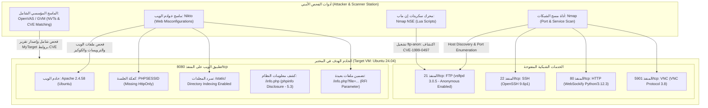

# التوثيق الشامل: أدوات مسح وفحص الثغرات الأمنية (Vulnerability Scanning Tools)

---

## القسم 01: نظرة عامة وبيانات وصفية (Room Overview & Metadata)

| البند (Item) | التفاصيل والمواصفات التقنية (Technical Specification) |
| :--- | :--- |
| **اسم الغرفة (Room Title)** | Vulnerability Scanning Tools (أدوات مسح وفحص الثغرات الأمنية) |
| **المسار التعليمي (Path)** | Jr Penetration Tester (المستوى الوظيفي لمختبر الاختراق المبتدئ - معتمد PT1) |
| **الوحدة التعليمية (Module)** | Vulnerability Knowledge (الوحدة 09: علم ومعارف الثغرات الأمنية) |
| **معرف الغرفة (Room Slug)** | `vulnerabilityscanningtools` |
| **مستوى الصعوبة (Difficulty)** | متوسط (Medium) |
| **نوع الغرفة (Room Type)** | غرفة تطبيقية وإرشادية مع بيئة معملية افتراضية (Walkthrough with VM) |
| **الوقت التقديري للإنجاز (Est. Completion Time)** | 60 دقيقة |
| **إجمالي عدد المهام (Total Tasks)** | 7 مهام تعليمية وتطبيقية (7 Tasks) تضم 11 سؤالاً تقنياً محققاً |
| **الأدوات المشروحة عملياً (Tools Covered)** | Nmap (مع محرك NSE), Nikto Web Scanner, OpenVAS (Greenbone GSA) |
| **حالة إنجاز الحساب (Completion Status)** | 100% مكتمل (تم التحقق والمطابقة التامة مع حساب المنصة) |

---

## القسم 02: الأهداف التعليمية والعملياتية (Educational & Operational Objectives)

1. **استيعاب دور الأتمتة في إدارة الثغرات:** فهم كيف يتيح المسح الآلي تقييم آلاف الأصول والأنظمة الشبكية والخدمات بسرعة وتناسق قبل أن يستغلها المهاجمون.
2. **التمييز الدقيق بين فئات الماسحات الأمنية:**
   - الماسحات الشبكية (**Network Scanners**): لفحص المنافذ والخدمات والطبقات التحتية (مثل Nmap).
   - ماسحات تطبيقات الويب (**Web Application Scanners**): لفحص خوادم الويب، والترويسات، والملفات الافتراضية، وكعكات الجلسة (مثل Nikto).
   - الماسحات القائمة على المضيف (**Host-Based Scanners**): لفحص الحزم المحلية وسجلات النظام الداخلي وملفات الإعدادات.
3. **الاحتراف في تشغيل أداة Nmap ومحرك سكربتات NSE:** اكتشاف الأجهزة الحية، وبصمات الخدمات المفتوحة (FTP 21, SSH 22, WebSockify 80, Apache 8080)، وتشغيل سكربتات فحص التكوينات الخاطئة مثل `ftp-anon`.
4. **فحص وتحصين خوادم الويب باستخدام Nikto:** تشغيل فحص شامل على المنفذ 8080 وكشف غياب سمة `HttpOnly`، وتفعيل سرد المجلدات (`static`)، واكتشاف معلمات تضمين الملفات البعيدة (`RFI`).
5. **إدارة عمليات المسح المؤسسي عبر OpenVAS (Greenbone):** تكوين الأهداف (Targets)، وإنشاء وإطلاق مهام المسح (Tasks)، وقراءة تقارير الفحص الشاملة وربط النتائج بدرجات CVSS (مثل `5.3` لكشف phpinfo) ومعرّفات الـ CVE (مثل `CVE-1999-0497`).
6. **تطبيق أفضل الممارسات التشغيلية للمسح الآمن:** الالتزام بالمبادئ السبعة لتجنب حجب الخدمة (DoS)، واستبعاد النتائج الإيجابية الكاذبة (False Positives)، والاستفادة من الفحص المصادق (Authenticated Scanning).

---

## القسم 03: البنية المعمارية وتدفق عمليات الفحص (Scanning Pipeline Architecture)



---

## القسم 04: المتطلبات الأساسية وإعداد البيئة (Prerequisites & Environment Setup)

### 1. المتطلبات المعرفية (Knowledge Prerequisites):
- الإلمام ببروتوكولات الشبكات الأساسية (TCP/IP، منافذ الخدمات الشائعة).
- فهم بروتوكول HTTP وأساليب عمل الترويسات وكعكات الجلسة.
- استيعاب معايير CVE و CVSS المكتسبة من الغرفة الأولى.

### 2. بيئة وأدوات الفحص في نظام Kali:
```bash
# فحص جاهزية الأدوات في النظام
which nmap nikto

# الوصول إلى واجهة Greenbone Security Assistant (OpenVAS) عبر المتصفح المحلي:
# الرابط: http://127.0.0.1:9392
# بيانات الدخول: admin / admin
```

---

## القسم 05: التحليل النظري والعمق المفاهيمي (Theoretical Deep Dive)

### أ. سيكولوجية وتصنيفات أدوات المسح (Scanner Taxonomies):
1. **الماسح الشبكي (Network Scanner):**
   - يعمل على الطبقات السفلى (الطبقة 3 و 4 في OSI).
   - لا يهتم بمحتوى التطبيق البرمجي؛ بل يرسل حزم SYN أو ACK أو UDP لاكتشاف المنافذ المفتوحة وتحديد هوية الخدمات المشغلة (مثل Nmap).
2. **ماسح تطبيقات الويب (Web Application Scanner):**
   - يعمل على طبقة التطبيقات (الطبقة 7).
   - يفحص مسارات HTTP/HTTPS، والملفات المؤقتة، والترويسات الأمنية المفقودة، ويختبر معاملات الويب ضد ثغرات شائعة مثل XSS و SQLi و RFI (مثل Nikto و OWASP ZAP).
3. **الماسح الشامل القائم على قواعد البيانات (Enterprise Vulnerability Scanner):**
   - يدمج بين الفحص الشبكي وفحص الويب والفحص المصادق للأنظمة.
   - يعتمد على قواعد بيانات ضخمة من نصوص اختبار الثغرات (مثل NVTs في OpenVAS أو Plugins في Nessus)، ويطابق النتائج تلقائياً مع معرّفات CVE ونظام CVSS.

### ب. النطاق الأقصى لدرجة خطورة CVSS:
- في جميع الإصدارات المعيارية لمقياس الخطورة المشترك (CVSS v2, v3.0, v3.1, v4.0)، يبدأ المقياس من `0.0` وينتهي بالحد الأقصى الحرج:
  $$\mathbf{CVSS_{\max} = 10.0}$$

---

## القسم 06: الاستطلاع ورسم خريطة سطح الهجوم (Reconnaissance & Surface Mapping)

### 1. فحص المنافذ وبصمات الخدمات عبر Nmap:
```bash
nmap -sV MACHINE_IP
```
**تحليل المخرجات المسترجعة:**
- **Port 21/tcp:** Open — `vsftpd 3.0.5` (FTP Service)
- **Port 22/tcp:** Open — `OpenSSH 9.6p1 Ubuntu` (SSH Remote Access)
- **Port 80/tcp:** Open — `WebSockify Python/3.12.3` (WebSocket Proxy)
- **Port 5901/tcp:** Open — `VNC protocol 3.8` (Remote Desktop)
- **Port 8080/tcp:** Open — `Apache httpd 2.4.58 (Ubuntu)` (Web Application Server)

### 2. فحص السكربتات المتقدمة (NSE):
```bash
nmap --script=ftp-anon -p 21 MACHINE_IP
```
النتيجة أظهرت قبول خادم FTP لاتصالات الدخول المجهول (`Anonymous FTP login allowed`), رمز الاستجابة `230`.

---

## القسم 07: تفكيك الأسباب الجذرية للثغرات المكتشفة (Vulnerability Root Cause Analysis)

| الثغرة المكتشفة | الأداة الكاشفة | التصنيف المعياري | السبب الجذري الفعلي للخلل |
|:---:|:---:|:---:|---|
| **الدخول المجهول لـ FTP** | Nmap / OpenVAS | CVE-1999-0497 / CWE-16 | تفعيل خيار `anonymous_enable=YES` في إعدادات خادم vsftpd |
| **غياب سمة HttpOnly** | Nikto / OpenVAS | CWE-1004 | عدم ضبط علامة `HttpOnly` في تكوين الجلسات، مما يتيح لجافاسكربت قراءة الكعكة |
| **سرد محتويات المجلدات** | Nikto | CWE-548 | تفعيل خيار `Options +Indexes` في مجلد `/static/` في Apache |
| **كشف معلومات phpinfo** | Nikto / OpenVAS | CWE-200 | ترك ملف اختبار إداري `/info.php` في بيئة الإنتاج الحية (درجة خطورة 5.3) |
| **تضمين ملفات بعيدة (RFI)** | Nikto | CWE-98 | تمرير مدخلات المستخدم من معامل `file` مباشرة لدالة `include()` دون تعقيم |

---

## القسم 08: الحل العملي التفصيلي واستخراج الأجوبة (Step-by-Step Task Solutions)

### المهمة 1: المقدمة وتشغيل بيئة المختبر
- **السؤال:** I can successfully start the machine.
- **الحل:** تشغيل الآلة الافتراضية عبر الزر المخصص والتأكد من توافر عنوان الـ IP.
- **الإجابة:** `No answer needed`.

---

### المهمة 2: المفاهيم الأساسية وفئات الماسحات
- **السؤال 1:** *What is the maximum range for a CVSS score?*
  - **التحليل:** الحد الأقصى لمقياس الخطورة CVSS هو الرقم 10.
  - **الإجابة:** `10`.
- **السؤال 2:** *What is a scanner called that examines devices on a network to identify open ports and running services?*
  - **التحليل:** الماسح الذي يفحص الشبكة والمنافذ والخدمات المشغلة هو الماسح الشبكي.
  - **الإجابة:** `network scanner`.

---

### المهمة 3: الفحص المتقدم باستخدام Nmap ومحرك NSE
- **السؤال 1:** *What is the FTP port number on the lab machine?*
  - **التحليل:** مخرجات فحص Nmap أظهرت أن بروتوكول FTP يعمل على المنفذ 21.
  - **الإجابة:** `21`.
- **السؤال 2:** *What service is running on port 80 on the lab machine?*
  - **التحليل:** بصمة الخدمة المكتشفة على المنفذ 80 هي خادم وسيط بايثون باسم WebSockify.
  - **الإجابة:** `WebSockify`.
- **السؤال 3:** *What is the name of the scripting engine that allows Nmap to run specialised scripts written in Lua to extend its functionality?*
  - **التحليل:** المحرك البرمجي المدمج في Nmap لتشغيل سكربتات لغة Lua هو Nmap Scripting Engine.
  - **الإجابة:** `Nmap Scripting Engine`.

---

### المهمة 4: فحص تطبيقات الويب باستخدام Nikto
- تنفيذ الأمر:
  ```bash
  nikto -h http://MACHINE_IP:8080
  ```
- **السؤال 1:** *What is the Apache Server version?*
  - **التحليل:** سطر الترويسة: `+ Server: Apache/2.4.58 (Ubuntu)`.
  - **الإجابة:** `2.4.58`.
- **السؤال 2:** *Per the Nikto report, which flag is missing from the cookie in the web app?*
  - **التحليل:** سطر الكعكة: `The cookie PHPSESSID does not have the HttpOnly flag set`.
  - **الإجابة:** `HttpOnly`.
- **السؤال 3:** *What is the name of the directory with directory listing enabled?*
  - **التحليل:** سطر سرد المجلدات: `+ /static/: Directory indexing found`.
  - **الإجابة:** `static`.
- **السؤال 4:** *What is the parameter vulnerable to RFI?*
  - **التحليل:** سطر فحص RFI: `/info.php?file=http://cirt.net/rfiinc.txt?`.
  - **الإجابة:** `file`.

---

### المهمة 5: الفحص المؤسسي الشامل عبر OpenVAS (Greenbone)
- الدخول إلى لوحة التحكم `http://127.0.0.1:9392` واستعراض تقرير `MyTarget`:
- **السؤال 1:** *What is the severity number for the vulnerablility phpinfo() Output Reporting (HTTP) ?*
  - **التحليل:** في تبويب Results، درجة خطورة فحص phpinfo المسجلة هي 5.3 (Medium).
  - **الإجابة:** `5.3`.
- **السؤال 2:** *What is the CVE value associated with Anonymous FTP Login Reporting ?*
  - **التحليل:** في تفاصيل فحص الدخول المجهول لـ FTP، يظهر المعرف التاريخي CVE-1999-0497.
  - **الإجابة:** `CVE-1999-0497`.
- **السؤال 3:** *What is the target Operating System?*
  - **التحليل:** بطاقة تعريف المضيف تحدد نظام التشغيل كـ Ubuntu 24.04.
  - **الإجابة:** `Ubuntu 24.04`.

---

### المهمة 6: أفضل الممارسات التشغيلية (Best Practices)
- **السؤال:** I have understood the best practices for using vulnerability scanning tools.
- **الحل:** استيعاب القواعد السبع (البدء بفحص خفيف، اختيار الأداة المناسبة، التحقق اليدوي، التحديث الدوري، الفحص المصادق، المقارنة الزمنية، والجدولة الذكية).
- **الإجابة:** `No answer needed`.

---

### المهمة 7: الخاتمة
- **السؤال:** Great work! You have completed the Vulnerability Scanning Tools room.
- **الإجابة:** `No answer needed`.

---

## القسم 09: استراتيجيات الدفاع متعدد الطبقات (Defense-in-Depth & Hardening)

```
┌────────────────────────────────────────────────────────────────────────────────────────┐
│                        DEFENSE-IN-DEPTH REMEDIATION ARCHITECTURE                       │
│                                                                                        │
│  [ الطبقة الأولى: معالجة الأخطاء التكوينية في الخدمات (Service Configuration) ]         │
│  - تعطيل الدخول المجهول لـ FTP عبر anonymous_enable=NO في /etc/vsftpd.conf.            │
│  - تعطيل سرد المجلدات في Apache عبر Options -Indexes في ملفات التكوين.                 │
│  - حذف ملفات الاختبار والكشف الإدارية مثل info.php نهائياً من خوادم الإنتاج.          │
│                                                                                        │
│  [ الطبقة الثانية: تأمين جلسات وترويسات تطبيقات الويب (Web Session Hardening) ]         │
│  - إلزام إضافة سمات HttpOnly و Secure و SameSite=Strict لجميع كعكات الجلسات.          │
│  - تفعيل ترويسة X-Frame-Options: DENY وترويسات Content-Security-Policy (CSP).         │
│                                                                                        │
│  [ الطبقة الثالثة: حوكمة إدارة الثغرات والمراقبة (Vulnerability Governance) ]           │
│  - تطبيق برنامج فحص دوري مصادق شهرياً لاكتشاف الرقع الناقصة في النظام المحلي.          │
│  - عزل الأنظمة القديمة والخدمات التجريبية (مثل WebSockify) خلف جدران حماية داخلية.    │
└────────────────────────────────────────────────────────────────────────────────────────┘
```

---

## القسم 10: الكشف وصيد التهديدات وقواعد SIEM (Detection & Threat Hunting)

### 1. تحليل سجلات خادم الويب لرصد ماسحات الويب الآلية:
```bash
grep -E "(Nikto|sqlmap|acunetix|dirbuster|gobuster)" /var/log/apache2/access.log
```

### 2. قاعدة Sigma لاكتشاف عمليات فحص ماسح Nikto عبر ترويسة User-Agent:
```yaml
title: Automated Web Scanner Activity (Nikto User-Agent)
id: e8a9b0c1-2d3e-4f5a-6b7c-8d9e0f1a2b3c
status: stable
description: Detects HTTP requests containing default Nikto web scanner signatures in the User-Agent header.
logsource:
  category: webserver
detection:
  selection:
    cs-method: 'GET'
    cs-header-user-agent|contains:
      - 'Nikto'
      - 'Mozilla/5.00 (Nikto'
  condition: selection
fields:
  - c-ip
  - cs-method
  - cs-uri-stem
  - cs-header-user-agent
level: high
```

---

## القسم 11: الأخطاء الشائعة واستكشاف المشكلات وإصلاحها (Troubleshooting)

1. **الوقوع في فخ الإيجابيات الكاذبة لحزم أوبونتو (Backporting False Positives):**
   - خادم Apache يظهر بإصدار `2.4.58`؛ قد تفترض الماسحات السطحية أنه مصاب بثغرات معينة تم ترقيعها بالفعل داخلياً بواسطة فريق أوبونتو دون تغيير رقم الإصدار الأساسي. الحل هو إجراء فحص مصادق أو مراجعة `apt changelog apache2`.
2. **تسبب الماسح في إسقاط خدمات الخادم:**
   - إطلاق فحص OpenVAS بمعدل متزامن عالٍ ضد خادم ضعيف يستهلك موارد الذاكرة ويؤدي لانهيار خدمة الويب. الحل هو استخدام نمط الفحص المنضبط وضبط خيارات `max_hosts` و `max_checks`.
3. **عدم كفاية مسح Nikto لاكتشاف ثغرات المنطق البرمجي:**
   - تعتمد Nikto على قائمة روابط ثابتة، وهي عاجزة عن اكتشاف ثغرات الـ IDOR أو كسر الصلاحيات المعقدة؛ لذا يجب دعم الفحص الآلي دائماً باختبار يدوي عبر Burp Suite.

---

## القسم 12: دراسات حالة واقعية ومطابقة مع معايير CVE (Case Studies & CVE Mapping)

1. **ثغرة الدخول المجهول لخوادم FTP (CVE-1999-0497):**
   - واحدة من أقدم الثغرات الموثقة في تاريخ الأمن السيبراني؛ تسببت تاريخياً في تسريب آلاف الملفات السرية والنسخ الاحتياطية بسبب ترك الخوادم بإعداداتها الافتراضية.
2. **ثغرة كشف بيئة PHP عبر `phpinfo()` (CWE-200):**
   - خطأ شائع في آلاف المواقع يتيح للمهاجمين قراءة مسارات السيرفر، والمتغيرات البيئية، وتكوينات الأمان، ونسخ الموديولات المفعلة بدقة مكنتهم من تخصيص حمولات RCE لاحقة.
3. **التصنيف المعياري المرجعي:**
   - **CWE-1004:** Sensitive Cookie Without 'HttpOnly' Flag.
   - **CWE-548:** Exposure of Information Through Directory Listing.
   - **CWE-98:** PHP Remote File Inclusion.
   - **NIST SP 800-115:** Technical Guide to Information Security Testing.

---

## القسم 13: الملخص العام ومصفوفة الإجابات المعتمدة (Summary & Answers Matrix)

| المهمة (Task) | موضوع السؤال (Topic Focus) | السؤال التقني المعتمد (Question Prompt) | الإجابة المعتمدة المؤكدة (Accepted Answer) |
|:---:|---|---|:---:|
| **Task 01** | Introduction | I can successfully start the machine. | `No answer needed` |
| **Task 02** | Important Topics | What is the maximum range for a CVSS score? | `10` |
| | | Scanner that examines devices on a network to identify open ports? | `network scanner` |
| **Task 03** | Nmap | What is the FTP port number on the lab machine? | `21` |
| | | What service is running on port 80 on the lab machine? | `WebSockify` |
| | | Scripting engine allowing Nmap to run specialized Lua scripts? | `Nmap Scripting Engine` |
| **Task 04** | Nikto Web Scanner | What is the Apache Server version? | `2.4.58` |
| | | Per the Nikto report, which flag is missing from the cookie? | `HttpOnly` |
| | | What is the name of the directory with directory listing enabled? | `static` |
| | | What is the parameter vulnerable to RFI? | `file` |
| **Task 05** | OpenVAS & GSA | Severity number for phpinfo() Output Reporting (HTTP) ? | `5.3` |
| | | CVE value associated with Anonymous FTP Login Reporting ? | `CVE-1999-0497` |
| | | What is the target Operating System? | `Ubuntu 24.04` |
| **Task 06** | Best Practices | I have understood the best practices for using scanning tools. | `No answer needed` |
| **Task 07** | Conclusion | Great work! You have completed the Vulnerability Scanning Tools room. | `No answer needed` |

---

## القسم 14: تمارين عملية وتوسعات للتحدي (Practical Exercises & Next Steps)

1. **تمرين 1: تشغيل ماسح Nikto مع تغيير البصمة:**
   - نفذ فحص Nikto ضد خادم محلي مع تغيير ترويسة الـ User-Agent لتجاوز فلاتر WAF البسيطة:
     ```bash
     nikto -h http://127.0.0.1:8080 -useragent "Mozilla/5.0 (Windows NT 10.0; Win64; x64)"
     ```
2. **تمرين 2: كتابة سكربت NSE بسيط للتحقق من الترويسات:**
   - اكتب سكربت بلغة Lua مخصص لـ Nmap يفحص ما إذا كانت ترويسة `X-Content-Type-Options: nosniff` مفقودة من استجابات خادم الويب.
3. **الجسر نحو الغرفة الثالثة (Basic Vulnerability Identification Techniques):**
   - بعد أن أتقنت تشغيل الماسحات الآلية (Nmap, Nikto, OpenVAS)، تنتقل في الغرفة الثالثة (`03-BASIC-VULNERABILITY-IDENTIFICATION`) إلى تعلم **تقنيات تحديد واكتشاف الثغرات يدوياً** دون الاعتماد الكلي على الماسحات الضخمة، والاعتماد على فحص لافتات الخدمات ومطابقتها مع الأكواد الاستغلالية.
