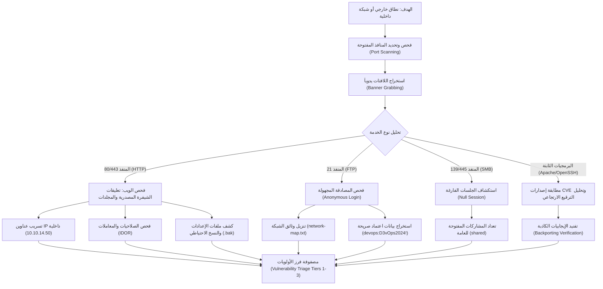

# تقنيات تحديد الثغرات الأساسية · Basic Vulnerability Identification

---

## 1. الترويسة والبيانات الوصفية (Metadata & Room Header)

- **اسم الغرفة بالإنجليزية:** Basic Vulnerability Identification
- **الاسم بالعربية:** تقنيات تحديد الثغرات الأساسية
- **المعرف البرمجي (Slug):** `basicvulnerabilityidentificationtechniques`
- **المسار التعليمي:** Junior Penetration Tester (الوحدة 09: معرفة الثغرات الأمنية - Vulnerability Knowledge)
- **الترتيب داخل الوحدة:** الغرفة 03 من أصل 09
- **مستوى الصعوبة:** متوسط (Medium / Fundamental)
- **نوع التقييم:** عملي ويدوي (Hands-on Manual Assessment)
- **الوسوم (Tags):** `Vulnerability Identification`, `Banner Grabbing`, `Backporting`, `IDOR`, `Anonymous FTP`, `SMB Null Session`, `Triage`, `OffSec`

---

## 2. نظرة عامة وملخص تنفيذي (Room Overview & Executive Summary)

تمثل مرحلة **تحديد الثغرات وتصنيفها (Vulnerability Identification & Triaging)** حجر الزاوية الذي يفصل بين الاستطلاع الأولي (Reconnaissance) والاستغلال الفعلي (Exploitation) في اختبارات الاختراق المؤسسية. تُعنى هذه الغرفة ببناء المهارات التحليلية للمختبر الأمني بحيث لا يعتمد اعتماداً أعمى على أدوات الفحص التلقائي (Automated Scanners) مثل Nessus أو OpenVAS، بل يتعلم كيف يجمع الأدلة ويفسر اللافتات يدويًا، ويدرك أسباب الإيجابيات الكاذبة الناتجة عن الترقيع الارتجاعي في توزيعات لينكس (Distribution Backporting)، ويكتشف الثغرات المنطقية في تطبيقات الويب كالإسناد المباشر غير الآمن للكائنات (IDOR)، ويستغل الأخطاء الإعدادية لبروتوكولات المشاركة (FTP و SMB)، ثم يُرتب النتائج ضمن مصفوفة أولويات ثلاثية المستويات موجهة للشركات.

---

## 3. الهيكلية وتحليل سطح الهجوم (Architecture & Attack Surface Analysis)

### أ. مخطط تدفق فحص سطح الهجوم وتحديد الثغرات


---

## 4. الأهداف التعليمية ومصفوفة المهارات (Pedagogical Objectives & Skills Matrix)

| المهارة المستهدفة | الوصف التقني للقدرة المكتسبة | معيار التحقق والتقييم |
| :--- | :--- | :--- |
| **تحديد سطح الهجوم (Attack Surface)** | التمييز بين أسطح الهجوم الخارجية والداخلية بعد الحصول على موطئ قدم. | الإجابة بـ `Internal`. |
| **التقاط اللافتات يدوياً (Banner Grabbing)** | استخراج لافتات خوادم أباتشي وOpenSSH عبر Nmap وNetcat. | استخراج `2.4.52` و `OpenSSH_8.9p1`. |
| **تفنيد الترقيع الارتجاعي (Backporting)** | إدراك سياسة أوبونتو وديبيان في ترقيع الثغرات دون تغيير رقم الإصدار العام. | الإجابة بـ `Nay` لإلغاء الإيجابية الكاذبة. |
| **اكتشاف ثغرات الويب المنطقية** | رصد تسريب عناوين IP، واستغلال IDOR، واستخراج بيانات الدخول من `.bak`. | استخراج `10.10.14.50`، `IDOR`، و `dbadmin`. |
| **استكشاف بروتوكولات الشبكة** | تصفح مشاركات FTP المجهولة واستعراض مشاركات SMB بجلسات فارغة. | استخراج `network-map.txt`، `devops:D3vOps2024!`، و `shared`. |
| **فرز وتصنيف الأولويات (Triage)** | تصنيف الثغرات إلى Tier 1 للحرجة المباشرة و Tier 3 للاستطلاعية. | الإجابة بـ `1` للـ RCE، و `3` لكشف الإصدارات. |
| **التحدي العملي الشامل** | تخمين المجلدات الحساسة واستخراج كلمات المرور الافتراضية. | استخراج `admin`، `maintenance-schedule.txt`، و `Welcome2024!`. |

---

## 5. الجدول التفصيلي لمهام الغرفة (Comprehensive Task Breakdown)

| رقم المهمة | اسم المهمة الأصلي | العنوان بالعربية | السؤال الأساسي | القيمة المعتمدة |
| :---: | :--- | :--- | :--- | :---: |
| **Task 01** | Introduction | مقدمة الغرفة | I am ready to learn... | `No answer needed` |
| **Task 02** | Attack Surface and Asset Identification | تحديد سطح الهجوم | What kind of attack surface are you assessing... | `Internal` |
| **Task 03** | Service Enumeration and Banner Grabbing | تعداد الخدمات واللافتات | Version of Apache on port 80? | `2.4.52` |
| **Task 03** | Service Enumeration and Banner Grabbing | تعداد الخدمات واللافتات | OpenSSH banner returned on port 22? | `OpenSSH_8.9p1` |
| **Task 04** | Researching Known Vulnerabilities | البحث عن الثغرات والترقيع | If vendor backported patch, is it exploitable? | `Nay` |
| **Task 05** | Web Application Vulnerabilities | ثغرات تطبيقات الويب | Internal IP discovered in comments? | `10.10.14.50` |
| **Task 05** | Web Application Vulnerabilities | ثغرات تطبيقات الويب | Vulnerability category on `/profile.php?id=2`? | `IDOR` |
| **Task 05** | Web Application Vulnerabilities | ثغرات تطبيقات الويب | Hardcoded admin username in backup config? | `dbadmin` |
| **Task 06** | Network and System Vulnerabilities | ثغرات الشبكات والأنظمة | Network map filename in FTP `/pub`? | `network-map.txt` |
| **Task 06** | Network and System Vulnerabilities | ثغرات الشبكات والأنظمة | Dev environment credentials (user:pass)? | `devops:D3vOps2024!` |
| **Task 06** | Network and System Vulnerabilities | ثغرات الشبكات والأنظمة | Name of readable SMB share? | `shared` |
| **Task 07** | Triaging and Prioritising Findings | فرز وتحديد الأولويات | Priority tier for unauthenticated external RCE? | `1` |
| **Task 07** | Triaging and Prioritising Findings | فرز وتحديد الأولويات | Priority tier for informational version disclosure? | `3` |
| **Task 08** | Practical Challenge | التحدي العملي | Hidden admin directory discovered? | `admin` |
| **Task 08** | Practical Challenge | التحدي العملي | Sensitive patch schedule file in backups? | `maintenance-schedule.txt` |
| **Task 08** | Practical Challenge | التحدي العملي | Default employee onboarding password? | `Welcome2024!` |
| **Task 09** | Conclusion | الخاتمة ومراجعة المفاهيم | I understand how to systematically triage... | `No answer needed` |

---

## 6. المنهجية واستراتيجية الاستطلاع (Methodology & Reconnaissance Strategy)

تعتمد استراتيجية الغرفة على الخطوات المنهجية التالية:
1. **الاستطلاع المباشر الخفيف (Low-Noise Banner Grabbing):** استخدام حزم TCP مفردة عبر `nc -vn` للاتصال بالمنافذ 21 و 22 و 80 لتحديد هوية البرمجيات دون تشغيل ماسحات صاخبة.
2. **التحقق من صحة الثغرات وإسقاط الإيجابيات الكاذبة:** مراجعة سجلات الحزم عبر متتبعات أمان أوبونتو للتحقق مما إذا كان الإصدار الظاهر في اللافتة قد خضع لترقيع ارتجاعي (Backport).
3. **استكشاف طبقة التطبيقات (Web Layer Recon):** قراءة التعليقات المتروكة في HTML/JS وتخمين الملفات الحساسة (`.bak`, `.old`, `.txt`) واختبار معاملات التحكم بالصلاحيات (IDOR).
4. **استكشاف بروتوكولات المشاركة (Protocol Auditing):** استغلال السماح بالدخول المجهول على خوادم FTP وجلسات Null Session على خوادم SMB لاستخراج الوثائق الداخلية وبيانات الاعتماد.
5. **مصفوفة الفرز والتقييم المؤسسي:** تصنيف كل مكتشف أمني ضمن مستويات التهديد الثلاثية لتحديد سرعة الاستجابة المطلوبة من فريق التطوير.

---

## 7. الشرح العملي المتعمق لكل محور (Deep-Dive Practical Walkthrough)

### أ. التقاط اللافتات وفحص المنافذ
```bash
# استجواب إصدار خادم الويب
curl -I http://10.10.14.50/
# النتيجة: Server: Apache/2.4.52 (Ubuntu)

# استجواب لافتة SSH عبر netcat
nc -vn 10.10.14.50 22
# النتيجة: SSH-2.0-OpenSSH_8.9p1 Ubuntu-3ubuntu0.1
```

### ب. فحص مشاركات FTP المجهولة
```bash
ftp 10.10.14.50
# User: anonymous
# Pass: [Enter]
ftp> cd pub
ftp> ls
# النتيجة: network-map.txt و dev-environment.conf
ftp> get network-map.txt
ftp> get dev-environment.conf
```
عند فحص `dev-environment.conf` يظهر زوج البيانات: `devops:D3vOps2024!`.

### ج. فحص مشاركات SMB
```bash
smbclient -L //10.10.14.50/ -N
# يظهر جدول المشاركات وفيه المشاركة المفتوحة: shared
```

### د. اكتشاف المجلدات الإدارية وملفات الصيانة
```bash
gobuster dir -u http://10.10.14.50 -w /usr/share/wordlists/dirb/common.txt -x txt,bak
# يكتشف مسار /admin و /admin/maintenance-schedule.txt
```
عند قراءة الملف يظهر الباسوورد الافتراضي لتهيئة الموظفين: `Welcome2024!`.

---

## 8. تحليل الثغرات وآليات الاستغلال (Vulnerability Analysis & Exploitation Mechanics)

### أ. ثغرة الإسناد المباشر غير الآمن للكائنات (IDOR - CWE-639)
- **الآلية:** عند استدعاء `/profile.php?id=1`، يقرأ الخادم المعامل `id` مباشرة ويستعلم قاعدة البيانات دون التحقق من أن جلسة العميل الحالية تخص المستخدم رقم 1.
- **الاستغلال:** يؤدي استبدال المعامل بـ `id=2` إلى استرجاع الملف الشخصي الكامل للمستخدم الآخر دون أدنى اعتراض.

### ب. معضلة الترقيع الارتجاعي (Backporting - CWE-200 / False Positives)
- تطلق الماسحات تنبيهاً كاذباً لأنها تفحص الرقم `2.4.52` المجرد. في الواقع، الحزمة `2.4.52-1ubuntu4.6` تحتوي على الشيفرة المرقعة، لذا فإن الثغرة غير قابلة للاستغلال على الإطلاق (`Nay`).

---

## 9. الكشف وسجلات النظام والأثر الجنائي (Detection, Logging & Forensics)

- **سجلات FTP (`/var/log/vsftpd.log`):**
  تسجل محاولات الدخول المجهول:
  ```text
  Wed Nov 19 11:52:10 2026 [pid 1420] [anonymous] OK LOGIN: Client "10.10.14.50"
  Wed Nov 19 11:52:14 2026 [pid 1422] [anonymous] OK DOWNLOAD: Client "10.10.14.50", "/pub/network-map.txt", 1024 bytes
  ```
- **سجلات أباتشي (`/var/log/apache2/access.log`):**
  تسجل استكشاف المسارات عبر Gobuster بمعدل طلبات مرتفع غير طبيعي.
- **أثر جلسات SMB الفارغة في سجلات ويندوز (Event ID 4624):**
  تسجل محاولة دخول ناجحة بنوع `Logon Type 3` باسم المستخدم `ANONYMOUS LOGON`.

---

## 10. التحصين والمعالجة الجذرية (Hardening, Mitigation & Remediation Guide)

1. **إيقاف الدخول المجهول على FTP:**
   في ملف `/etc/vsftpd.conf`:
   ```ini
   anonymous_enable=NO
   ```
2. **منع جلسات SMB الفارغة:**
   تعطيل حساب الضيف وتقييد الوصول المجهول عبر مفتاح التسجيل:
   `HKLM\SYSTEM\CurrentControlSet\Control\Lsa\RestrictAnonymous = 1`
3. **معالجة ثغرات IDOR:**
   التحقق دائماً من الصلاحيات من خلال الجلسة المخزنة في الخادم:
   ```php
   if ($_SESSION['user_id'] !== intval($_GET['id'])) {
       http_response_code(403);
       die("Access Denied");
   }
   ```
4. **حظر الوصول لملفات النسخ الاحتياطي في خوادم الويب:**
   إضافة توجيهات أباتشي لحجب الملفات الحساسة:
   ```apache
   <FilesMatch "\.(bak|old|conf|env|txt)$">
       Require all denied
   </FilesMatch>
   ```

---

## 11. الدفاع في العمق والبيئات المؤسسية (Defense-in-Depth)

- **فصل الشبكات (Network Segmentation):** وضع الخوادم التي تقدم خدمات ملفات داخل شبكات VLAN خاصة معزولة عن الواجهات الموجهة للإنترنت.
- **إدارة كلمات المرور والتأهيل:** استبدال كلمات المرور الافتراضية العامة مثل `Welcome2024!` بروابط تأهيل رقمية أحادية الاستخدام ومحددة بوقت صلاحية صارم.
- **فحص دوري للإيجابيات الكاذبة:** إنشاء آلية تدقيق داخلي لمقارنة نتائج أدوات فحص الثغرات مع سجلات التوزيعات المعتمدة لتوفير وقت فرق التطوير.

---

## 12. مقارنة الأدوات والأوامر السريعة (Tool Comparison & Quick Reference)

| العملية | الأداة المفضلة | الأمر النموذجي | المخرجات المتوقعة |
| :--- | :--- | :--- | :--- |
| **التقاط اللافتة** | `nc` | `nc -vn <IP> <PORT>` | لافتة الخدمة النصية الخام |
| **استعراض مشاركات SMB** | `smbclient` | `smbclient -L //<IP>/ -N` | قائمة المشاركات المتاحة |
| **فحص صلاحيات SMB** | `smbmap` | `smbmap -H <IP> -u ""` | جدول الصلاحيات (READ/WRITE) |
| **تخمين مسارات الويب** | `gobuster` | `gobuster dir -u http://<IP> -w wordlist.txt -x bak,txt` | المسارات والملفات المكتشفة |
| **تنزيل ملف عبر FTP** | `curl` | `curl -s "ftp://anonymous:@<IP>/pub/file.txt" -o file.txt` | تنزيل صامت ومباشر |

---

## 13. الأخطاء الشائعة وحل المشكلات (Common Pitfalls & Troubleshooting)

1. **الخلط بين الإصدار البرمجي وإصدار التوزيعة:** التسرع في تصنيف إصدار مثل `Apache 2.4.52` كثغرة حرجة دون التحقق من الـ Backport يؤدي لفقدان المصداقية المهنية.
2. **عدم فحص وضع النقل في FTP:** محاولة تنزيل ملفات ثنائية أو نصوص في وضع ASCII قد يؤدي إلى تلف البيانات. استخدم دائماً الأمر `binary`.
3. **إغفال امتدادات الملفات أثناء التخمين:** البحث عن المجلدات فقط دون تحديد الامتدادات الحساسة (`-x txt,bak,old`) يفوت ملفات النسخ الاحتياطي المحتوية على كلمات المرور.

---

## 14. المراجع والمعايير الدولية (References & Standards)

- رابط الغرفة الرسمي على منصة TryHackMe: [https://tryhackme.com/room/basicvulnerabilityidentificationtechniques](https://tryhackme.com/room/basicvulnerabilityidentificationtechniques)
- دليل OWASP لأمان الوصول: [OWASP A01: Broken Access Control](https://owasp.org/Top10/A01_2021-Broken_Access_Control/)
- معيار MITRE للبيانات الحساسة: [CWE-200 Information Exposure](https://cwe.mitre.org/data/definitions/200.html)
- متتبع ثغرات أوبونتو الرسمي: [Ubuntu Security CVEs Tracker](https://ubuntu.com/security/cves)
- توثيق خادم سامبا لبروتوكول SMB: [Samba Official Docs](https://www.samba.org/samba/docs/)
