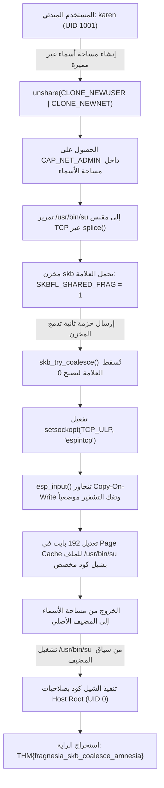

# CVE-2026-46300: Fragnesia · الدليل التقني والتوثيق الشامل للغرفة

---

## 1. الترويسة والبيانات الوصفية (Metadata & Room Header)

- **اسم الغرفة بالإنجليزية:** CVE-2026-46300: Fragnesia
- **الاسم بالعربية:** ثغرة نواة لينكس CVE-2026-46300: فراجنيزيا
- **المعرف البرمجي (Slug):** `cve202646300`
- **المسار التعليمي:** Junior Penetration Tester (الوحدة 09: معرفة الثغرات الأمنية - Vulnerability Knowledge)
- **الترتيب داخل الوحدة:** الغرفة 07 من أصل 09
- **مستوى الصعوبة:** سهل (Easy)
- **نوع التقييم:** عملي وواقعي (Hands-on Walkthrough & Kernel CVE Analysis)
- **الوسوم (Tags):** `CVE-2026-46300`, `Linux Kernel`, `LPE`, `Page Cache`, `ESP-in-TCP`, `skb_try_coalesce`, `Container Escape`

---

## 2. نظرة عامة وملخص تنفيذي (Room Overview & Executive Summary)

تستعرض هذه الغرفة تحليلاً عملياً وتفصيلياً لواحدة من أحدث وأخطر ثغرات نواة لينكس لتصعيد الصلاحيات محلياً (LPE): **ثغرة Fragnesia (CVE-2026-46300)** الحاصلة على تقييم خطورة **7.8 High**. تتميز هذه الثغرة بكونها "انتكاسة أمنية" (Regression) نشأت مباشرة عن الترقيع الأولي لثغرة سابقة (Dirty Frag). تكشف الغرفة كيف يؤدي إسقاط علامة الأمان `SKBFL_SHARED_FRAG` أثناء دمج حزم المقابس في دالة `skb_try_coalesce()` إلى خداع مسار تشفير IPsec المعزول في بروتوكول ESP-in-TCP (`esp_input()`)، مما يسمح بفك تشفير الحزم الموضعي (In-place Decryption) فوق ذاكرة التخزين المؤقت لصفحات النواة (Page Cache) لملفات تنفيذية محمية مثل `/usr/bin/su`. ونظراً لأن الـ Page Cache مشتركة عبر كافة مساحات الأسماء والحاويات، ينجح الهجوم في تصعيد الصلاحيات إلى جذر النظام الحقيقي (Host UID 0) دون ترك أي أثر على القرص الصلب، واستخراج راية النظام `THM{fragnesia_skb_coalesce_amnesia}`.

---

## 3. الهيكلية وتحليل سطح الهجوم (Architecture & Attack Surface Analysis)



---

## 4. الأهداف التعليمية ومصفوفة المهارات (Pedagogical Objectives & Skills Matrix)

| المهارة المستهدفة | الوصف التقني للقدرة المكتسبة | معيار التحقق والتقييم |
| :--- | :--- | :--- |
| **هندسة الـ Page Cache في لينكس** | فهم دور ذاكرة التخزين المؤقت المشتركة للملفات وكيفية استغلالها للهروب من الحاويات. | استيعاب المفهوم المعماري. |
| **تحليل انكسار الثوابت البرمجية** | تتبع سبب إسقاط علامة `SKBFL_SHARED_FRAG` في كود دمج حزم النواة. | مراجعة الترقيع الكودي `f84eca581739`. |
| **الاستغلال العملي ذو المرحلتين** | الفصل بين مرحلة إفساد الذاكرة في مساحة الأسماء وبين إطلاق الشيل كود في المضيف. | استخراج الراية `THM{fragnesia_skb_coalesce_amnesia}`. |
| **تخطي أنظمة فحص سلامة الملفات** | إدراك أسباب فشل أدوات مثل AIDE و Tripwire في كشف التعديلات التي تحدث في الرام فقط. | فحص بصمة التجزئة النظيفة لـ `/usr/bin/su`. |
| **هندسة الكشف عبر eBPF و Falco** | كتابة قواعد رصد تلتقط نداءات `setsockopt(TCP_ULP, "espintcp")` المشبوهة. | توثيق قواعد الرصد والتحصين. |

---

## 5. الجدول التفصيلي لمهام الغرفة (Comprehensive Task Breakdown)

| رقم المهمة | اسم المهمة الأصلي | العنوان بالعربية | السؤال الأساسي | القيمة المعتمدة |
| :---: | :--- | :--- | :--- | :---: |
| **Task 01** | Introduction | مقدمة: تحليل ثغرة نواة لينكس Fragnesia | I have successfully started my machine. | `No answer needed` |
| **Task 02** | How a Patch Becomes a Vulnerability | كيف يتحول الترقيع إلى ثغرة | *Reading task: Understand the architectural breakdown.* | `No answer needed` |
| **Task 03** | The Patch That Became the Vulnerability | تحليل الشيفرة المصدرية للرقعة | *Reading task: Review the patch commits and code diffs.* | `No answer needed` |
| **Task 04** | Exploitation | الاستغلال العملي واسترجاع راية الجذر | What is the content of /root/flag.txt? | `THM{fragnesia_skb_coalesce_amnesia}` |
| **Task 05** | Detection and Mitigation | هندسة الكشف والتحصين الشامل | *Reading task: Review detection rules and mitigation...* | `No answer needed` |
| **Task 06** | Conclusion | الخاتمة والدروس المستفادة | I can now exploit CVE-2026-46300! | `No answer needed` |

---

## 6. المنهجية واستراتيجية الاستطلاع (Methodology & Reconnaissance Strategy)

1. **التحقق من إصدار النواة:** التأكد من تشغيل النواة على إصدار يحتوي على الترقيع المرجعي المنكوس لـ Dirty Frag.
2. **عزل بيئة العمل:** استغلال صلاحيات المستخدم العادي لإنشاء مساحة أسماء جديدة عبر `unshare` للحصول على امتيازات شبكية (`CAP_NET_ADMIN`).
3. **توليد جدول فك التشفير:** حساب مصفوفة بايتات AES-GCM مسبقاً لتحديد كيفية تشفير كل بايت للحصول على الشيل كود المطلوب.
4. **تفعيل دمج الحزم وإسقاط الراية:** دمج حزم المقبس عبر نداءات TCP متتالية لإسقاط راية الأمان.
5. **حقن الشيل كود في الـ Page Cache:** تشغيل بروتوكول ESP-in-TCP للكتابة المباشرة فوق الذاكرة المخبأة لـ `/usr/bin/su`.
6. **إطلاق الامتيازات السيادية:** الخروج من مساحة الأسماء وتشغيل `/usr/bin/su` بصلاحيات المضيف الفعلية.

---

## 7. الشرح العملي المتعمق لكل محور (Deep-Dive Practical Walkthrough)

### أ. التحقق من صلاحيات المستخدم
```bash
karen@fragnesia:~$ id
# uid=1001(karen) gid=1001(karen)
```

### ب. تجميع وتشغيل أداة الاستغلال
```bash
cd /home/karen/fragnesia
gcc -O2 -w fragnesia.c -o exp
./exp
```
المخرجات تظهر إنشاء مساحات الأسماء، وتوليد جدول بايتات التشفير، وحقن 192 بايت في الـ Page Cache بنجاح، ثم فتح جلسة داخل مساحة الأسماء المعزولة.

### ج. إطلاق المرحلة الثانية وقراءة الراية
```bash
root@fragnesia:~/fragnesia# exit
karen@fragnesia:~/fragnesia$ /usr/bin/su
# id
# uid=0(root) gid=0(root)
# cat /root/flag.txt
THM{fragnesia_skb_coalesce_amnesia}
```

---

## 8. تحليل الثغرات وآليات الاستغلال (Vulnerability Analysis & Exploitation Mechanics)

### أ. ثغرة انكسار الثابت البرمجي (Invariant Collapse - CVE-2026-46300)
- **السبب الجذري:** قامت دالة `skb_try_coalesce()` بدمج مخازن الحزم دون نقل علامة `SKBFL_SHARED_FRAG`.
- **ميكانيكية الاستغلال:** اعتمد ترقيع Dirty Frag على وجود هذه الراية ليقرر ما إذا كان المخزن يحتاج إلى Copy-On-Write. عندما أصبحت الراية `0`، افترضت دالة `esp_input()` أن المخزن خاص وقامت بفك التشفير موضعياً داخل صفحات ذاكرة النواة للملف المقروء عبر `splice()`.

---

## 9. الكشف وسجلات النظام والأثر الجنائي (Detection, Logging & Forensics)

- **الرصد السلوكي لنداءات النظام (eBPF / Falco):**
  رصد استدعاء `setsockopt(SOL_TCP, TCP_ULP, "espintcp")` من قِبل عمليات غير تابعة لخدمات IPsec الرسمية.
- **سجلات التدقيق (Linux Auditd):**
  رصد استخدام `unshare` متبوعاً بحزم Netlink متتالية من نوع `XFRM_MSG_NEWSA`.
- **غياب الأثر الجنائي على القرص الصلب:**
  الملف `/usr/bin/su` على القرص يحتفظ ببصمة التجزئة السليمة تماماً، لأن التعديل حدث حصرياً في ذاكرة الرام المتطايرة.

---

## 10. التحصين والمعالجة الجذرية (Hardening, Mitigation & Remediation Guide)

1. **الترقية الرسمية للنواة:**
   تثبيت الترقيع المعتمد (الالتزام `f84eca581739`) الذي يضمن نقل راية `SKBFL_SHARED_FRAG` أثناء دمج الحزم.
2. **تعطيل مساحات أسماء المستخدمين غير المميزة:**
   ```bash
   sudo sysctl -w kernel.unprivileged_userns_clone=0
   ```
3. **حظر وحدات النواة المؤقت (Workaround):**
   ```bash
   sudo sh -c 'printf "install esp4 /bin/false\ninstall esp6 /bin/false\n" > /etc/modprobe.d/dirtyfrag.conf'
   sudo rmmod esp4 esp6 2>/dev/null
   sudo sh -c 'echo 3 > /proc/sys/vm/drop_caches'
   ```

---

## 11. الدفاع في العمق والبيئات المؤسسية (Defense-in-Depth)

- **حماية بيئات الحاويات (Containers Hardening):** تقييد تشغيل الحاويات التي تتيح مساحات أسماء مستخدمين غير مقيدة دون حواجز أمان مثل Seccomp.
- **تفريغ الذاكرة المخبأة دورياً في الحوادث الأمنية:** في حال الاشتباه في تعرض خادم لهجوم في الذاكرة، يؤدي أمر `echo 3 > /proc/sys/vm/drop_caches` إلى إفراغ الذاكرة المتطايرة واستعادة النسخ الأصلية من القرص فوراً.

---

## 12. مقارنة الأدوات والأوامر السريعة (Tool Comparison & Quick Reference)

| المكون / الأداة | دوره في سيناريو Fragnesia | الوظيفة التقنية |
| :--- | :--- | :--- |
| **splice()** | استدعاء نظام لنقل البيانات | تمرير صفحات ملف `/usr/bin/su` إلى مقبس TCP دون نسخ |
| **skb_try_coalesce** | دالة دمج الحزم في النواة | الموضع البرمجي الذي يسقط راية الأمان `SKBFL_SHARED_FRAG` |
| **esp_input** | دالة فك تشفير بروتوكول ESP | تنفيذ فك التشفير الموضعي في ذاكرة الـ Page Cache |
| **Falco** | محرك رصد أمني عبر eBPF | التقاط استدعاءات `espintcp` المشبوهة في الوقت الفعلي |

---

## 13. الأخطاء الشائعة وحل المشكلات (Common Pitfalls & Troubleshooting)

1. **محاولة قراءة الراية من داخل مساحة الأسماء:** المستخدم root داخل مساحة الأسماء غير المميزة لا يمتلك صلاحيات الوصول لملفات المضيف الحقيقية (`Permission denied`). يجب كتابة `exit` أولاً ثم تشغيل `/usr/bin/su`.
2. **الاعتماد على برامج فحص الملفات (FIM):** الاعتماد على أدوات فحص بصمة الملفات على القرص الصلب لن يفيد في رصد هذا الهجوم، لأن الملف على القرص لم يُمس إطلاقاً.

---

## 14. المراجع والمعايير الدولية (References & Standards)

- رابط الغرفة الرسمي على TryHackMe: [https://tryhackme.com/room/cve202646300](https://tryhackme.com/room/cve202646300)
- البحث الأمني لشركة Zellic: [Fragnesia Kernel Bug Writeup](https://www.zellic.io/blog/)
- معيار MITRE لتصعيد الصلاحيات: [CWE-269 Improper Privilege Management](https://cwe.mitre.org/data/definitions/269.html)
- معايير IETF لبروتوكول IPsec: [RFC 8229 ESP in TCP](https://datatracker.ietf.org/doc/html/rfc8229)
