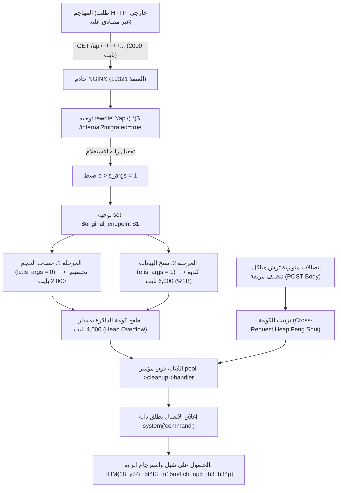

# CVE-2026-42945: Nginx Rift · الدليل التقني والتوثيق الشامل للغرفة

---

## 1. الترويسة والبيانات الوصفية (Metadata & Room Header)

- **اسم الغرفة بالإنجليزية:** CVE-2026-42945: Nginx Rift
- **الاسم بالعربية:** ثغرة خادم إنجن إكس CVE-2026-42945: إنجن إكس ريفت
- **المعرف البرمجي (Slug):** `cve202642945`
- **المسار التعليمي:** Junior Penetration Tester (الوحدة 09: معرفة الثغرات الأمنية - Vulnerability Knowledge)
- **الترتيب داخل الوحدة:** الغرفة 08 من أصل 09
- **مستوى الصعوبة:** سهل (Easy)
- **نوع التقييم:** عملي وواقعي (Hands-on Walkthrough & Memory Corruption Analysis)
- **الوسوم (Tags):** `CVE-2026-42945`, `Nginx`, `Heap Overflow`, `RCE`, `ngx_http_rewrite_module`, `Heap Feng Shui`, `Memory Corruption`

---

## 2. نظرة عامة وملخص تنفيذي (Room Overview & Executive Summary)

تستعرض هذه الغرفة تحليلاً عملياً وتفصيلياً للثغرة البالغة الخطورة **CVE-2026-42945 (NGINX Rift)** الحاصلة على تقييم **9.2 Critical** على مقياس CVSS v4. ظلت هذه الثغرة كامنة داخل الشيفرة المصدرية لوحدة إعادة الكتابة `ngx_http_rewrite_module` في خادم NGINX لمدة 18 عاماً (منذ عام 2008). يرجع سبب الثغرة إلى عدم تطابق حالة المتغير الداخلي `is_args` في محرك السكربتات ثنائي المراحل: حيث تقوم المرحلة الأولى بحساب طول السلسلة غير المشفرة (حيث يُحسب الرمز `+` كـ 1 بايت)، بينما تقوم المرحلة الثانية بنسخ السلسلة بعد تشفيرها عبر `ngx_escape_uri()` (حيث يتمدد كل رمز `+` إلى 3 بايتات `%2B`). ينتج عن هذا التباين طفح حتمي في كومة الذاكرة (Heap Overflow) يمكن استغلاله عبر تقنية **Heap Feng Shui** للسيطرة على مؤشرات دوال التنظيف في مجمعات الذاكرة (`ngx_pool_t`) وتنفيذ أوامر عشوائية بصلاحيات خادم الويب، واستخراج راية النظام `THM{18_y34r_5t4t3_m15m4tch_rip5_th3_h34p}`.

---

## 3. الهيكلية وتحليل سطح الهجوم (Architecture & Attack Surface Analysis)



---

## 4. الأهداف التعليمية ومصفوفة المهارات (Pedagogical Objectives & Skills Matrix)

| المهارة المستهدفة | الوصف التقني للقدرة المكتسبة | معيار التحقق والتقييم |
| :--- | :--- | :--- |
| **محرك سكربتات NGINX** | تحليل معمارية التقييم ثنائي المراحل في وحدة `ngx_http_rewrite_module`. | فهم خلل راية `is_args`. |
| **حسابات طفح الكومة الحتمية** | حساب التباين الرياضي بين تخصيص البايتات الخام والنسخ بعد التشفير (`%2B`). | استيعاب معادلة طفح $2N$ بايت. |
| **هندسة ترتيب الكومة (Heap Feng Shui)** | فتح اتصالات متوازية لترتيب مجمعات الذاكرة `ngx_pool_t` بشكل متلاصق. | السيطرة على مؤشرات `cleanup`. |
| **تجاوز قيود تشفير المحارف** | استخدام أجسام طلبات POST لتمرير مؤشرات ثنائية خام إلى الذاكرة. | تشغيل كود الاستغلال بنجاح. |
| **الاستغلال واسترجاع الراية** | تشغيل الشيل واستخراج راية النظام. | الحصول على `THM{18_y34r_5t4t3_m15m4tch_rip5_th3_h34p}`. |
| **التحصين عبر المتغيرات المسماة** | استخدام المجموعات المسماة `(?<name>.*)` كحل وقائي بدون توقف الخدمة. | تعديل إعدادات `nginx.conf`. |

---

## 5. الجدول التفصيلي لمهام الغرفة (Comprehensive Task Breakdown)

| رقم المهمة | اسم المهمة الأصلي | العنوان بالعربية | السؤال الأساسي | القيمة المعتمدة |
| :---: | :--- | :--- | :--- | :---: |
| **Task 01** | Introduction | مقدمة: تحليل ثغرة NGINX Rift | I have successfully started my machine. | `No answer needed` |
| **Task 02** | Rewrite and Set Directives | توجيهات إعادة الكتابة والتعيين | *Reading task: Understand the interplay between...* | `No answer needed` |
| **Task 03** | The Two-Pass Script Engine | محرك السكربتات ثنائي المراحل | *Reading task: Dissect the C source code and arithmetic...* | `No answer needed` |
| **Task 04** | From Heap Overflow to Code Execution | من طفح الكومة إلى السيطرة | *Reading task: Understand cross-request heap layout...* | `No answer needed` |
| **Task 05** | Exploitation | الاستغلال العملي واسترجاع الراية | What is the content of flag.txt? | `THM{18_y34r_5t4t3_m15m4tch_rip5_th3_h34p}` |
| **Task 06** | Detection and Mitigation | هندسة الكشف والتحصين الشامل | *Reading task: Review hardening configurations...* | `No answer needed` |
| **Task 07** | Conclusion | الخاتمة والدروس المستفادة | I can now exploit CVE-2026-42945! | `No answer needed` |

---

## 6. المنهجية واستراتيجية الاستطلاع (Methodology & Reconnaissance Strategy)

1. **فحص نسخة NGINX:** التحقق من تشغيل إصدار يقع ضمن النطاق المصاب (أقل من 1.30.1).
2. **تدقيق ملف التكوين (`nginx.conf`):** البحث عن وجود توجيه `rewrite` يحتوي على `?` يليه مباشرة توجيه `set` يستدعي `$1`.
3. **اختبار طفح الذاكرة المبدئي:** إرسال طلب يحتوي على سلسلة طويلة من أحرف `+` ومراقبة سجلات الأخطاء لرصد انهيار العملية (Signal 11).
4. **تجهيز هياكل الكومة (Heap Spraying):** ضخ هياكل تنظيف مزيفة عبر أجسام طلبات POST لترتيب الذاكرة.
5. **إطلاق الاتصال العكسي:** توجيه المؤشر المخترق لتنفيذ أمر الاتصال العكسي واستقبال الشيل كـ `nginx`.

---

## 7. الشرح العملي المتعمق لكل محور (Deep-Dive Practical Walkthrough)

### أ. التحقق من حاوية NGINX المستهدفة
```bash
sudo docker ps --filter label=com.docker.compose.project=nginx-rift
curl -s "http://127.0.0.1:19321/api/users/42"
```

### ب. تشغيل أداة الاستغلال واستقبال الشيل
```bash
python3 poc.py --shell
# السكربت يقوم بفتح اتصالات متوازية ورش الكومة وإرسال حمولة الطفح:
# GET /api/++++++++++++++++++++... (2000 رموز زائد)
# استقبال اتصال الشيل العكسي:
# $ id -> uid=101(nginx) gid=101(nginx)
# $ cat /flag.txt
THM{18_y34r_5t4t3_m15m4tch_rip5_th3_h34p}
```

---

## 8. تحليل الثغرات وآليات الاستغلال (Vulnerability Analysis & Exploitation Mechanics)

### أ. ثغرة عدم تطابق الحالة (State Mismatch - CWE-122)
- **السبب الجذري:** قامت دالة `ngx_http_script_start_args_code` بضبط `e->is_args = 1`، وعند تقييم أمر `set` التالي، قامت دالة حساب الطول بتصفير محرك فرعي (`le.is_args = 0`) فحسبت الرموز غير مشفرة، بينما قامت دالة النسخ باستخدام المحرك الأصلي ونفذت التشفير `%2B` مما ضاعف حجم البيانات المكتوبة.
- **الاستغلال:** مكن هذا التباين من الكتابة خارج حدود المخزن فوق هيكل `ngx_pool_t` المجاور والسيطرة على مؤشر `cleanup->handler`.

---

## 9. الكشف وسجلات النظام والأثر الجنائي (Detection, Logging & Forensics)

- **سجلات الوصول (Access Logs):**
  ظهور طلبات غير طبيعية تتضمن تكراراً طويلاً لعلامة الزائد:
  `grep -E '\+{30,}' /var/log/nginx/access.log`
- **سجلات الأخطاء (Error Logs):**
  رصد انهيار متكرر لعمليات NGINX الفرعية:
  `worker process [PID] exited on signal 11 (core dumped)`
- **قياسات اتصالات الشبكة:**
  رصد تراكم مفاجئ لاتصالات في حالتي `CLOSE_WAIT` و `LAST_ACK`.

---

## 10. التحصين والمعالجة الجذرية (Hardening, Mitigation & Remediation Guide)

1. **الترقية الفورية:**
   تحديث NGINX إلى 1.30.1 أو 1.31.0 فما فوق.
2. **تطبيق الحل البديل عبر المجموعات المسماة (Named Captures):**
   ```nginx
   location ~ ^/api/(?<path>.*)$ {
       rewrite ^/api/(?<path>.*)$ /internal?migrated=true;
       set $original_endpoint $path;
   }
   ```
   هذا التعديل يسلك مساراً برمجياً آمناً لا يتأثر براية `is_args`.

---

## 11. الدفاع في العمق والبيئات المؤسسية (Defense-in-Depth)

- **تقييد صلاحيات مستخدم خادم الويب:** تشغيل NGINX بحساب مستخدم مخصص غير جذري (`nginx`) مع عزل نظام الملفات.
- **تفعيل جدران حماية تطبيقات الويب (WAF):** منع الطلبات التي تحتوي على سلاسل غير طبيعية من المحارف الخاصة المتكررة في المسارات.

---

## 12. مقارنة الأدوات والأوامر السريعة (Tool Comparison & Quick Reference)

| المكون / الأداة | دوره في سيناريو NGINX Rift | الوظيفة التقنية |
| :--- | :--- | :--- |
| **ngx_http_rewrite_module** | وحدة إعادة الكتابة في NGINX | الوحدة المصابة بخلل عدم تطابق راية `is_args` |
| **ngx_pool_t** | هيكل مجمع الذاكرة المخصص للطلب | الكائن المستهدف للكتابة فوق مؤشر دوال التنظيف |
| **ngx_escape_uri** | دالة تشفير محارف الروابط | الدالة التي تضاعف حجم البيانات المكتوبة في المرحلة 2 |
| **Named Captures** | أسلوب صياغة Regex المسمى | الحل البديل المحصن بدون الحاجة لترقية الحزم |

---

## 13. الأخطاء الشائعة وحل المشكلات (Common Pitfalls & Troubleshooting)

1. **إغفال شرط وجود علامة الاستفهام:** الثغرة لا تحدث إلا إذا تضمن مسار الاستبدال في `rewrite` علامة `?` لتفعيل راية `is_args`.
2. **الاعتماد على رقم الإصدار فقط:** لا يكفي أن يكون الإصدار قديماً؛ بل يجب توافر النمط البرمجي المصاب في ملف التكوين.

---

## 14. المراجع والمعايير الدولية (References & Standards)

- رابط الغرفة الرسمي على TryHackMe: [https://tryhackme.com/room/cve202642945](https://tryhackme.com/room/cve202642945)
- البحث الفني لفريق DepthFirst: [DepthFirstDisclosures/Nginx-Rift](https://github.com/DepthFirstDisclosures/Nginx-Rift)
- التوثيق الرسمي لوحدة إعادة الكتابة في NGINX: [NGINX Rewrite Module Docs](https://nginx.org/en/docs/http/ngx_http_rewrite_module.html)
- معيار MITRE لطفح الكومة: [CWE-122 Heap-based Buffer Overflow](https://cwe.mitre.org/data/definitions/122.html)
