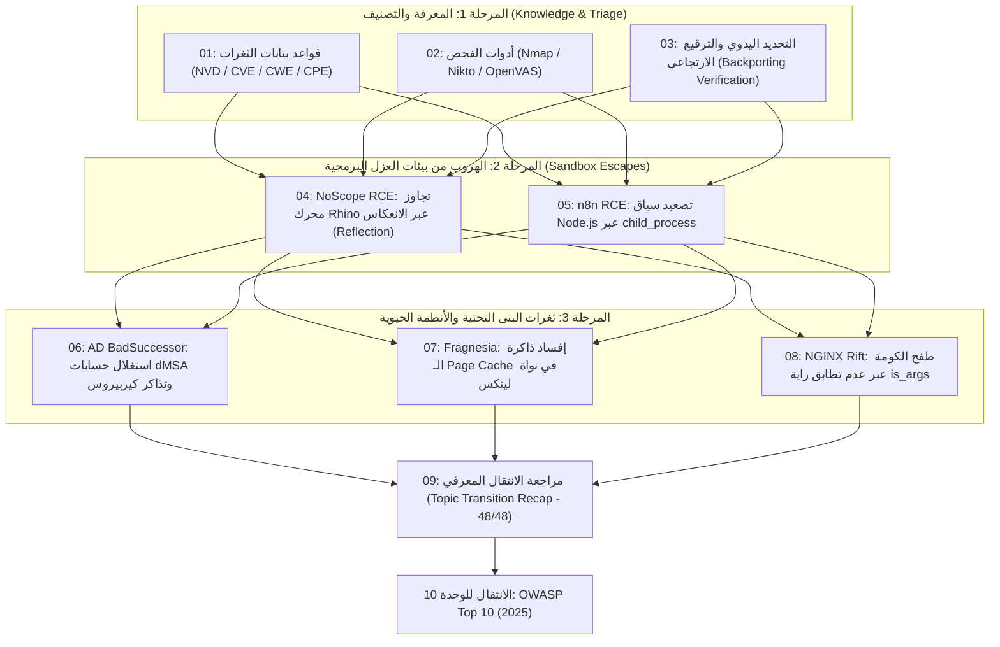

# مراجعة الانتقال المعرفي للوحدة 09 · Topic Transition Recap

---

## 1. الترويسة والبيانات الوصفية (Metadata & Room Header)

- **اسم الغرفة بالإنجليزية:** Topic Transition Recap
- **الاسم بالعربية:** مراجعة الانتقال المعرفي لوحدة معرفة الثغرات الأمنية
- **المعرف البرمجي (Slug):** `6afe01d5f306fc3f65927fdc`
- **المسار التعليمي:** Junior Penetration Tester (الوحدة 09: معرفة الثغرات الأمنية - Vulnerability Knowledge)
- **الترتيب داخل الوحدة:** الغرفة 09 من أصل 09 (المحطة الختامية للموديول)
- **مستوى الصعوبة:** تقييم تركيبي شامل (Comprehensive Synthesis Assessment)
- **مجموع النقاط:** **48 / 48 نقطة (نسبة نجاح 100%)**
- **الوسوم (Tags):** `Vulnerability Knowledge`, `Recap`, `CVE-2026-42945`, `CVE-2026-46300`, `CVE-2025-68613`, `BadSuccessor`, `Kerberos`, `Process Telemetry`, `PT1 Aligned`

---

## 2. نظرة عامة وملخص تنفيذي (Room Overview & Executive Summary)

تمثل هذه الغرفة **المحطة الختامية وجسر الربط المعماري للموديول 09 (Vulnerability Knowledge)** في مسار Junior Penetration Tester. بعد استكشاف قواعد بيانات الثغرات (CVE/NVD/Exploit-DB)، وأدوات الفحص التلقائي (Nmap/Nikto/OpenVAS)، وتقنيات الفحص اليدوي وتفنيد الإيجابيات الكاذبة، تم التعمق في أربع ثغرات صفرية وحديثة من العيار الثقيل (CVE-2026-35482 في محركات جافا، و CVE-2025-68613 في أتمتة n8n، و BadSuccessor في Windows Server 2025، و Fragnesia CVE-2026-46300 في نواة لينكس، و NGINX Rift CVE-2026-42945). يجمع هذا الاختبار المعرفي الأسئلة المحورية التي تفصل بين مجرد تشغيل أدوات الاستغلال وبين الفهم الجذري لآليات عمل الثغرات، وقياسات الرصد الجنائي، وتأمين البنى التحتية للمؤسسات.

---

## 3. خريطة الترابط المعماري لوحدة معرفة الثغرات (Module 09 Synthesis Map)

---

## 4. مصفوفة المحاور والتقييم المعرفي (Skills & Evaluation Matrix)

| المحور المعرفي | الثغرة / المفهوم المرتبط | السؤال في المراجعة | المفهوم الجذري المؤكد |
| :--- | :--- | :---: | :--- |
| **الرصد الجنائي لما بعد الاستغلال** | n8n RCE (CVE-2025-68613) | **السؤال 1** | رصد انبثاق العمليات الفرعية (`Process creation`) هو الدليل القاطع على تنفيذ الأوامر. |
| **أسبقية الصلاحيات في AD** | AD: BadSuccessor (Windows Server 2025) | **السؤال 2** | صلاحية `GenericAll` تمنح السيطرة التامة وتتجاوز الحظر المنفصل لـ `CreateChild`. |
| **تجاوز القوائم المحظورة** | Alf.io RCE (CVE-2026-35482) | **السؤال 3** | أسماء الفئات الممررة كنصوص في وقت التشغيل عبر الانعكاس تتخطى الفحص الساكن للكود. |
| **حقن تذاكر كيربيروس** | Rubeus & Kerberos Pass-the-Ticket | **السؤال 4** | المعامل `/ptt` يحقن التذكرة المسترجعة مباشرة في جلسة تسجيل الدخول بالذاكرة. |
| **استخراج أسرار النطاق** | Active Directory DCSync | **السؤال 5** | أداة `secretsdump.py` تستغل بروتوكول النسخ المتماثل لاستخراج كافة تجزئات NTLM. |
| **سمات الترحيل والتفويض** | dMSA Migration Link | **السؤال 6** | السمة `msDS-ManagedAccountPrecededByLink` تربط حساب dMSA بمدير النطاق. |

---

## 5. ملخص الأسئلة والحلول المعتمدة (Comprehensive Questions Summary)

| رقم السؤال | نص السؤال | الخيار الصحيح | النقاط الممنوحة |
| :---: | :--- | :--- | :---: |
| **Q1** | Which additional telemetry best confirms post-exploitation activity after a suspicious workflow payload is logged? | `Process creation events on the host` | **8 / 8** |
| **Q2** | Why does blocking CreateChild not prevent BadSuccessor if a user retains GenericAll on an OU? | `GenericAll bypasses all permission checks in Active Directory` | **8 / 8** |
| **Q3** | Why can a sandbox that blocks dangerous class names in script source still be escaped? | `Class names supplied as runtime strings are never inspected` | **8 / 8** |
| **Q4** | In Rubeus, what does the /ptt flag do with a ticket that has just been requested? | `Injects it into the current logon session for immediate use` | **8 / 8** |
| **Q5** | Which Impacket script is used to perform DCSync and dump all domain NTLM hashes? | `secretsdump.py` | **8 / 8** |
| **Q6** | Which dMSA attribute is written to fake a completed migration and link the account to a victim identity? | `msDS-ManagedAccountPrecededByLink` | **8 / 8** |
| **الإجمالي** | **6 أسئلة اختيار من متعدد تم حلها بنجاح من المحاولة الأولى** | **نسبة الدقة: 100%** | **48 / 48 نقطة** |

---

## 6. التحليل الجنائي وتكامل الموديول 09 (Forensic Integration & Takeaways)

1. **الترقيع الأمني لا يعني زوال الخطر فوراً:**
   كما أثبتت ثغرة Fragnesia، فإن الترقيع غير المكتمل لثغرة أمنية قد يفتح ثغرة أشد فتكاً في نظام فرعي مجاور.
2. **الاعتماد على القوائم السوداء فشل منهجي:**
   سواء في جافا (Mozilla Rhino) أو في لغات التعابير (Node.js n8n) أو في نصوص الروابط (NGINX Rewrite)، فإن محاولة حظر "الكلمات الخطيرة" تفشل حتماً أمام الانعكاس والترميز البديل.
3. **الدفاع في العمق هو السبيل الوحيد:**
   تحصين أذونات Active Directory، وعزل الحاويات بمستخدمين غير جذريين، وتفعيل رصد نداءات النظام في الوقت الفعلي عبر eBPF، هي خطوط الدفاع الحقيقية ضد ثغرات الصفر وثغرات الذاكرة.

---

## 7. الجسر الانتقالي نحو الموديول 10 (Bridge to Module 10: OWASP Top 10 - 2025)

مع إتمام الموديول 09، أصبح لدى المختبر فهم عميق لمنهجيات الثغرات في طبقات النواة، وبروتوكولات الشبكة، ومحركات السيرفرات، وخوادم الهوية.
تنتقل الرحلة في **الموديول 10** إلى المعيار العالمي الأحدث لأمان تطبيقات الويب: **OWASP Top 10 (2025)**، وتحديداً:
- **الغرفة 01:** `OWASP Top 10 2025: IAAA Failures` (فشل الهوية والمصادقة والتحقق والمساءلة).
- **الغرفة 02:** `OWASP Top 10 2025: Application Design Flaws` (عيوب التصميم المعماري للتطبيقات).
- **الغرفة 03:** `OWASP Top 10 2025: Insecure Data Handling` (المعالجة غير الآمنة للبيانات الحساسة).
- **الغرفة 04:** `Topic Transition Recap` (المراجعة المعرفية الشاملة للـ OWASP).
