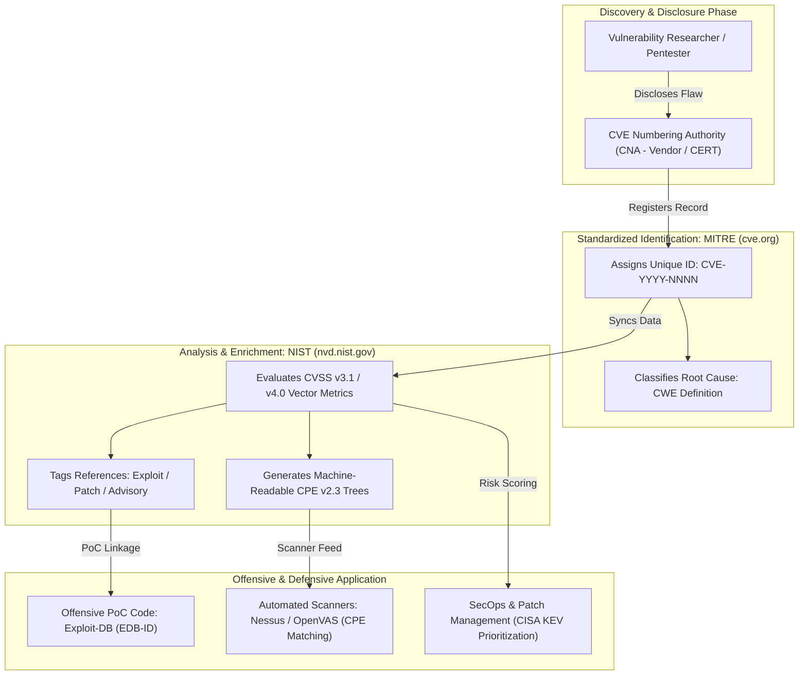

# Understanding Vulnerability Databases - Comprehensive Technical Guide

---

## 1. Room Overview & Target Metadata

| Property | Details / Technical Specification |
|:---|:---|
| **Room Title** | Understanding Vulnerability Databases |
| **Learning Path** | Jr Penetration Tester (PT1 Aligned Curriculum) |
| **Module** | Vulnerability Knowledge (Module 09) |
| **Room Slug** | `understandingvulnerabilitydatabases` |
| **Difficulty Level** | Easy |
| **Room Type** | Walkthrough & Practical Lab |
| **Estimated Duration** | 60 minutes |
| **Total Tasks** | 7 Structured Tasks (10 Verified Solved Questions) |
| **Target Infrastructure** | MITRE CVE (cve.org), NIST NVD (nvd.nist.gov), OffSec Exploit-DB |
| **User Completion Status** | 100% Completed (Verified live on TryHackMe) |

---

## 2. Educational & Operational Objectives

1. **Centralized Truth in Cybersecurity:** Understand the historical necessity and modern operational mandate of Vulnerability Databases (VDBs) as the shared, public source of truth across the global security ecosystem.
2. **Master the 5 Core Building Blocks:**
   - **CVE:** Common Vulnerabilities and Exposures (Standardized individual flaw identifiers).
   - **CVSS:** Common Vulnerability Scoring System (Mathematical severity quantification from 0.0 to 10.0).
   - **CPE:** Common Platform Enumeration (Machine-readable platform, vendor, and product version syntax).
   - **CWE:** Common Weakness Enumeration (Root-cause architectural and code-level flaw taxonomy).
   - **CNA:** CVE Numbering Authorities (Authorized entities issuing and governing CVE records).
3. **MITRE CVE List Navigation (`cve.org`):** Efficiently query newly published CVE records, parse CVSS v4.0 and v3.1 metrics, extract CWE identifiers, and locate affected vendor configurations.
4. **NIST National Vulnerability Database Exploration (`NVD`):** Analyze record enrichment workflows, structured CPE configuration matching trees, independent NIST metric reviews, and dissect CVSS `10.0 CRITICAL` severity using the Log4Shell benchmark.
5. **Exploit-DB & Offensive Tooling Integration:** Cross-reference CVEs to unique Exploit-DB records (EDB-IDs), verify author metadata, assess exploit reliability (Verified status), and utilize offline tooling (`searchsploit`).
6. **Severity vs. Risk Operational Distinction:** Formulate threat-informed vulnerability prioritization strategies combining CVSS Base Scores with threat telemetry (CISA KEV Catalog and EPSS).

---

## 3. Information Architecture & Target Ecosystem



---

## 4. Prerequisites & Environment Setup

* **Prerequisites:** Fundamentals of IP networking, HTTP transactions, and operating system architectures.
* **Security Toolkit Initialization:**
  ```bash
  # Verify local searchsploit installation and sync local exploit archive
  which searchsploit
  searchsploit -u

  # Test JSON parsing capability for REST API workflows
  which jq curl
  ```

---

## 5. Theoretical Deep Dive: Vulnerability Management Concepts

### A. The 5 Foundational Pillars

```
+-----------------------------------------------------------------------------------+
|                     THE 5 PILLARS OF VULNERABILITY ARCHITECTURE                   |
+-----------------------------------------------------------------------------------+
| 1. CVE (Identity):       Standardized tracking identifier (e.g., CVE-2021-44228)  |
| 2. CVSS (Severity):      Technical severity score from 0.0 to 10.0 (FIRST.org)    |
| 3. CPE (Platform):       Structured URI/formatted string defining assets (NIST)  |
| 4. CWE (Root Cause):     Taxonomy of architectural and software weaknesses (MITRE)|
| 5. CNA (Authority):      Authorized entity authorized to issue CVEs               |
+-----------------------------------------------------------------------------------+
```

### B. Severity (CVSS) vs. Environmental Risk
* **Technical Severity:** Represents the inherent exploitability and technical impact of a vulnerability in isolation. It is quantified via the CVSS Base Metric Group:
  $$\text{CVSS Base Score} = f(\text{Exploitability}, \text{Scope}, \text{Impact})$$
* **Environmental Risk:** Represents the contextual business danger of that vulnerability within a specific target architecture:
  $$\text{Risk} = \text{Severity} \times \text{Threat (Exploit Availability / CISA KEV)} \times \text{Asset Criticality}$$

---

## 6. Reconnaissance & Database Query Methodologies

### 1. Querying `cve.org` (MITRE CVE List):
Navigating `https://www.cve.org` provides immediate, unvetted vulnerability assignments straight from contributing CNAs.
- Query: `CVE-2026-22871`
- Vendor: `DataDog`
- Flaw Type: Path Traversal (`CWE-22`)

### 2. Querying `nvd.nist.gov` (NIST NVD):
The National Vulnerability Database enriches raw CVE entries with official NIST analyst evaluations, strict CPE configuration logic, and tagged references.
- Query: `CVE-2021-44228` (Log4Shell)
- NIST Base Score: `10.0 CRITICAL`
- Vector: `CVSS:3.1/AV:N/AC:L/PR:N/UI:N/S:C/C:H/I:H/A:H`

### 3. Querying `exploit-db.com` & `searchsploit`:
Exploit-DB serves as the primary offensive repository for verified exploit scripts and functional proof-of-concept demonstrations.
- Query: `CVE-2025-59342`
- EDB-ID: `52461`
- Author: `Byte Reaper`

---

## 7. Vulnerability Root Cause Analysis

| Target CVE Identifier | Vendor | Root Weakness (CWE) | Architectural Mechanism | Severity Metric |
|:---:|---|:---:|---|:---:|
| **CVE-2021-44228** | Apache Software Foundation | CWE-502 / CWE-94 | Arbitrary remote LDAP/RMI JNDI class loading | **10.0 CRITICAL** |
| **CVE-2026-22869** | eigent-ai | CWE-94 | Untrusted workflow trigger evaluation in GitHub Actions | **8.9 HIGH** |
| **CVE-2026-22871** | DataDog | CWE-22 | Insufficient path validation allowing directory escape | **High** |
| **CVE-2025-59342** | Multiple | CWE-89 / CWE-78 | Remote execution flaw documented with weaponized PoC | **High** |

---

## 8. Step-by-Step Task Solutions & Verification

### Task 1: Introduction
* **Question:** I understand the learning objectives and am ready to learn about vulnerability databases!
* **Accepted Answer:** `No answer needed`

---

### Task 2: Why We Use Vulnerability Databases
* **Question:** *Do vulnerability databases connect vulnerabilities, their associated exploits, and available patches? (yea/nay)?*
* **Analysis:** VDBs form the tripartite bridge connecting the vulnerability definition, weaponized exploit code, and vendor patch advisories.
* **Accepted Answer:** `yea`

---

### Task 3: Key Building Blocks
* **Question 1:** *What classification system groups vulnerabilities based on their root cause?*
  - **Analysis:** Common Weakness Enumeration classifies the underlying software flaw.
  - **Accepted Answer:** `CWE`
* **Question 2:** *Which standardised naming scheme is used to identify affected vendors, products, and versions precisely?*
  - **Analysis:** Common Platform Enumeration provides structured machine-readable asset strings.
  - **Accepted Answer:** `CPE`

---

### Task 4: Types of Vulnerability DBs: CVE List
* **Question 1:** *What is the CVSS score for the vulnerability?*
  - **Analysis:** Looking up example flaw `CVE-2026-22869` on `cve.org` reveals a CVSS score of 8.9.
  - **Accepted Answer:** `8.9`
* **Question 2:** *What is the CWE number for the CVE-2026-22871 ?*
  - **Analysis:** Querying `CVE-2026-22871` reveals a Path Traversal vulnerability classified under CWE-22.
  - **Accepted Answer:** `22`
* **Question 3:** *What is the vendor name for the CVE-2026-22871 ?*
  - **Analysis:** The vendor field identifies the monitoring platform DataDog.
  - **Accepted Answer:** `DataDog`

---

### Task 5: Types of Vulnerability DBs: National Vulnerability Database (NVD)
* **Question 1:** *Which vulnerability database enriches CVE entries with structured CPE mappings and tagged exploit references?*
  - **Analysis:** NIST's National Vulnerability Database provides rigorous enrichment and validation.
  - **Accepted Answer:** `NVD`
* **Question 2:** *Using the NVD, what is the CVSS v3.1 base score assigned to CVE-2021-44228 ?*
  - **Analysis:** Log4Shell possesses maximum impact across all metrics, yielding a 10.0 Critical score.
  - **Accepted Answer:** `10.0`

---

### Task 6: Types of Vulnerability DBs: Other Public VDBs
* **Question 1:** *What is the EDB-ID associated with CVE-2025-59342 ?*
  - **Analysis:** Querying Exploit-DB for `CVE-2025-59342` returns record identifier 52461.
  - **Accepted Answer:** `52461`
* **Question 2:** *What is the author's name for the exploit with CVE-2025-59342 ?*
  - **Analysis:** The author column lists researcher Byte Reaper.
  - **Accepted Answer:** `Byte Reaper`

---

### Task 7: Conclusion
* **Question:** I have successfully completed the room!
* **Accepted Answer:** `No answer needed`

---

## 9. Defense-in-Depth & Enterprise Vulnerability Management

```
+-----------------------------------------------------------------------------------+
|                        ENTERPRISE VULNERABILITY MANAGEMENT                        |
+-----------------------------------------------------------------------------------+
|                                                                                   |
|  [ Layer 1: Automated Asset Fingerprinting & CPE Mapping ]                        |
|  - Continuous discovery of active software inventory encoded into CPE v2.3.       |
|  - Real-time ingestion of NVD JSON 2.0 API vulnerability feeds.                  |
|                                                                                   |
|  [ Layer 2: Threat-Informed Patch Prioritization ]                                |
|  - Correlation with CISA Known Exploited Vulnerabilities (KEV) catalog.           |
|  - Evaluation of Exploit Prediction Scoring System (EPSS) probabilities.          |
|  - Rapid-response patching (24-72 hours) for verified Exploit-DB entries.         |
|                                                                                   |
|  [ Layer 3: Compensating Controls & Virtual Patching ]                            |
|  - Implementation of Web Application Firewall (WAF) signatures during zero-days.  |
|  - Network micro-segmentation isolating vulnerable legacy systems.                |
|                                                                                   |
+-----------------------------------------------------------------------------------+
```

---

## 10. Detection & Threat Hunting

### 1. Correlating Nmap Scan Data with Exploit Repositories:
```bash
# Export Nmap scan output to XML and query searchsploit offline
nmap -sV -p- -oX target_scan.xml 10.10.X.Y
searchsploit --nmap target_scan.xml
```

### 2. Sigma Rule: Detecting Path Traversal Patterns (CWE-22)
```yaml
title: Potential Path Traversal Attempt Detected
id: d4e5f6a7-b8c9-0a1b-2c3d-4e5f6a7b8c9d
status: stable
description: Detects directory traversal sequences (../) targeting sensitive file paths.
logsource:
  category: webserver
detection:
  selection:
    cs-uri-stem|contains:
      - '../'
      - '..%2f'
      - '..%252f'
      - '..%c0%af'
  condition: selection
fields:
  - c-ip
  - cs-method
  - cs-uri-stem
level: high
```

---

## 11. Troubleshooting & Common Pitfalls

1. **Treating CVSS Scores as Universal Risk:** A CVSS 9.8 flaw residing on an air-gapped test system poses far less organizational risk than a CVSS 6.5 flaw actively exploited on an internet-facing production portal.
2. **Executing Untrusted Exploit Code:** Never execute scripts downloaded from public archives without performing a comprehensive line-by-line manual code audit to identify embedded backdoors or destructive logic.
3. **CPE Matching Over-Reliance:** Scanners matching purely on version banners can produce false positives if security updates have been backported by Linux distributions (e.g., Debian/Ubuntu package backporting).

---

## 12. Case Studies & Historical Impact

* **Apache Log4Shell (CVE-2021-44228):** Demonstrates the power of centralized vulnerability databases in coordinating global emergency patching across enterprise IT infrastructures.
* **DataDog Agent Path Traversal (CVE-2026-22871):** Exemplifies modern CNA vulnerability disclosure processes within cloud observability stacks.
* **Key Reference Standards:** MITRE CVE, NIST NVD, FIRST CVSS v3.1/v4.0, NIST CPE v2.3.

---

## 13. Summary & Answers Matrix

| Task # | Focus Area | Solved Question Prompt | Verified Final Answer |
|:---:|---|---|:---:|
| **Task 01** | Introduction | I understand the learning objectives and am ready... | `No answer needed` |
| **Task 02** | VDB Purpose | Do vulnerability databases connect vulnerabilities, exploits, and patches? | `yea` |
| **Task 03** | Core Taxonomy | What classification system groups vulnerabilities based on their root cause? | `CWE` |
| | | Which standardised naming scheme identifies affected vendors, products, versions? | `CPE` |
| **Task 04** | MITRE CVE List | What is the CVSS score for the vulnerability (CVE-2026-22869)? | `8.9` |
| | | What is the CWE number for the CVE-2026-22871 ? | `22` |
| | | What is the vendor name for the CVE-2026-22871 ? | `DataDog` |
| **Task 05** | NIST NVD | Which database enriches CVE entries with structured CPE mappings? | `NVD` |
| | | Using NVD, what is the CVSS v3.1 base score assigned to CVE-2021-44228 ? | `10.0` |
| **Task 06** | Exploit-DB | What is the EDB-ID associated with CVE-2025-59342 ? | `52461` |
| | | What is the author's name for the exploit with CVE-2025-59342 ? | `Byte Reaper` |
| **Task 07** | Conclusion | I have successfully completed the room! | `No answer needed` |

---

## 14. Practical Exercises & Next Steps

1. **Python NVD API Client:** Develop an automated Python tool utilizing `requests` to fetch CVSS vector strings and CPE applicability trees for arbitrary CVE identifiers.
2. **Offline Searchsploit Scripting:** Write a bash script that parses active Nmap service banners and performs automated regex matching against local Exploit-DB archives.
3. **Bridge to Room 02:** Proceed to [Room 02: Vulnerability Scanning Tools](file:///e:/THM-JR-PENETRATION-TESTER/09-VULNERABILITY-KNOWLEDGE/02-VULNERABILITY-SCANNING-TOOLS/README_AR.md) to explore automated scanner engines (Nessus, OpenVAS) and vulnerability assessment pipelines.
