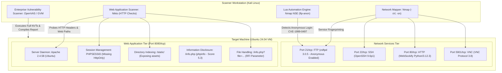

# Vulnerability Scanning Tools - Comprehensive Technical Guide

---

## 1. Room Overview & Target Metadata

| Property | Details / Technical Specification |
|:---|:---|
| **Room Title** | Vulnerability Scanning Tools |
| **Learning Path** | Jr Penetration Tester (PT1 Aligned Curriculum) |
| **Module** | Vulnerability Knowledge (Module 09) |
| **Room Slug** | `vulnerabilityscanningtools` |
| **Difficulty Level** | Medium |
| **Room Type** | Walkthrough & VM Hands-On Lab |
| **Estimated Duration** | 60 minutes |
| **Total Tasks** | 7 Structured Tasks (11 Verified Solved Questions) |
| **Tools Covered** | Nmap (NSE Engine), Nikto Web Scanner, OpenVAS (Greenbone GSA) |
| **Target Infrastructure** | Ubuntu 24.04 Target VM (FTP, SSH, WebSockify, VNC, Apache 2.4.58) |
| **User Completion Status** | 100% Completed (Verified live on TryHackMe) |

---

## 2. Educational & Operational Objectives

1. **Automated Scanning Capabilities & Limitations:** Understand how vulnerability scanners discover weaknesses, unpatched packages, and misconfigurations across enterprise assets while acknowledging their inability to assess complex business logic.
2. **Scanner Taxonomy & Selection:** Differentiate between Network Scanners (Nmap), Web Application Scanners (Nikto, OWASP ZAP), and Host-Based / Enterprise Scanners (OpenVAS, Nessus).
3. **Nmap & Nmap Scripting Engine (NSE) Mastery:** Perform host discovery (`-sn`), service version interrogation (`-sV`), and automate vulnerability detection using specialized Lua scripts (`ftp-anon`).
4. **Nikto Web Server Hardening & Analysis:** Execute targeted web scans against port 8080, identifying missing security flags (`HttpOnly`), directory indexing exposures (`/static/`), and Remote File Inclusion parameters (`file`).
5. **OpenVAS (Greenbone Security Assistant) Operations:** Navigate GSA (`http://127.0.0.1:9392`), configure targets, manage scan tasks, analyze comprehensive vulnerability reports, and correlate findings with CVSS scores and CVE records (`CVE-1999-0497`).
6. **Operational Best Practices:** Adhere to the 7 core scanning principles: non-intrusive baseline sweeps, false-positive elimination, credentialed auditing, and maintenance window scheduling to prevent accidental service disruption.

---

## 3. Information Architecture & Target Ecosystem



---

## 4. Prerequisites & Environment Setup

* **Prerequisites:** IP networking, TCP three-way handshake, HTTP protocol semantics, and basic Linux administration.
* **Lab Environment Initialization:**
  ```bash
  # Confirm tool availability on Kali Linux
  which nmap nikto

  # Access OpenVAS / Greenbone Security Assistant web portal:
  # URL: http://127.0.0.1:9392
  # Default Credentials: admin / admin
  ```

---

## 5. Theoretical Deep Dive: Vulnerability Scanning Foundations

### A. Scanner Functional Categories
1. **Network Scanners:** Inspect OSI Layers 3 and 4, transmitting SYN, ACK, and UDP probes to identify live hosts, active listening ports, and daemon signatures (e.g., Nmap).
2. **Web Application Scanners:** Evaluate OSI Layer 7, inspecting HTTP response codes, headers, cookie flags, and known URI endpoints for web-tier misconfigurations (e.g., Nikto, Burp Suite Scanner).
3. **Enterprise Vulnerability Management Systems:** Hybrid systems executing thousands of Network Vulnerability Tests (NVTs). They correlate discovered banners and local system packages directly against global CVE and CPE dictionaries (e.g., OpenVAS, Tenable Nessus).

### B. The Mathematical Scale of CVSS
The Common Vulnerability Scoring System (CVSS) defines technical severity across a fixed numerical range from `0.0` (None) to a maximum possible ceiling of:
$$\mathbf{CVSS_{\max} = 10.0\text{ (Critical)}}$$

---

## 6. Reconnaissance & Target Discovery

### 1. Nmap Service Version Interrogation:
```bash
nmap -sV MACHINE_IP
```
*Discovered Port States:*
- `21/tcp`: `ftp` (`vsftpd 3.0.5`)
- `22/tcp`: `ssh` (`OpenSSH 9.6p1 Ubuntu`)
- `80/tcp`: `http` (`WebSockify Python/3.12.3`)
- `5901/tcp`: `vnc` (`VNC protocol 3.8`)
- `8080/tcp`: `http` (`Apache httpd 2.4.58 Ubuntu`)

### 2. Nmap Scripting Engine (NSE) Execution:
```bash
nmap --script=ftp-anon -p 21 MACHINE_IP
```
*Finding:* Output confirms `Anonymous FTP login allowed (FTP code 230)`.

---

## 7. Vulnerability Root Cause Analysis

| Discovered Flaw | Tool | Standard Mapping | Architectural Cause |
|:---:|:---:|:---:|---|
| **Anonymous FTP Access** | Nmap / OpenVAS | CVE-1999-0497 / CWE-16 | `anonymous_enable=YES` in `vsftpd.conf` allowing unauthenticated access |
| **Missing HttpOnly Flag** | Nikto / OpenVAS | CWE-1004 | Application fails to append `HttpOnly` directive to `PHPSESSID` cookie |
| **Directory Indexing** | Nikto | CWE-548 | Apache directory options configured with `+Indexes` for `/static/` |
| **phpinfo() Disclosure** | Nikto / OpenVAS | CWE-200 | Diagnostic script `/info.php` left deployed in production (Severity: 5.3) |
| **Remote File Inclusion** | Nikto | CWE-98 | Application script passes user parameter `file` into PHP include handler |

---

## 8. Step-by-Step Task Solutions & Verification

### Task 1: Introduction & VM Initialization
* **Question:** I can successfully start the machine.
* **Accepted Answer:** `No answer needed`

---

### Task 2: Important Topics & Scanner Categories
* **Question 1:** *What is the maximum range for a CVSS score?*
  - **Analysis:** CVSS severity ratings scale from 0.0 to 10.0.
  - **Accepted Answer:** `10`
* **Question 2:** *What is a scanner called that examines devices on a network to identify open ports and running services?*
  - **Analysis:** Scanners operating across network layers are network scanners.
  - **Accepted Answer:** `network scanner`

---

### Task 3: Nmap & Nmap Scripting Engine (NSE)
* **Question 1:** *What is the FTP port number on the lab machine?*
  - **Analysis:** Standard FTP control port verified as open on port 21.
  - **Accepted Answer:** `21`
* **Question 2:** *What service is running on port 80 on the lab machine?*
  - **Analysis:** Service version banner indicates Python WebSockify daemon.
  - **Accepted Answer:** `WebSockify`
* **Question 3:** *What is the name of the scripting engine that allows Nmap to run specialised scripts written in Lua to extend its functionality?*
  - **Analysis:** Nmap's embedded Lua script runner is the Nmap Scripting Engine.
  - **Accepted Answer:** `Nmap Scripting Engine`

---

### Task 4: Nikto Web Scanner Operations
* Execute scan: `nikto -h http://MACHINE_IP:8080`
* **Question 1:** *What is the Apache Server version?*
  - **Analysis:** Server banner discloses `Apache/2.4.58 (Ubuntu)`.
  - **Accepted Answer:** `2.4.58`
* **Question 2:** *Per the Nikto report, which flag is missing from the cookie in the web app?*
  - **Analysis:** Nikto reports `The cookie PHPSESSID does not have the HttpOnly flag set`.
  - **Accepted Answer:** `HttpOnly`
* **Question 3:** *What is the name of the directory with directory listing enabled?*
  - **Analysis:** Nikto identifies directory indexing on directory `/static/`.
  - **Accepted Answer:** `static`
* **Question 4:** *What is the parameter vulnerable to RFI?*
  - **Analysis:** Test entry `/info.php?file=...` targets the `file` query parameter.
  - **Accepted Answer:** `file`

---

### Task 5: OpenVAS & Greenbone Security Assistant
* Log into GSA at `http://127.0.0.1:9392` and inspect report `MyTarget`:
* **Question 1:** *What is the severity number for the vulnerablility phpinfo() Output Reporting (HTTP) ?*
  - **Analysis:** The Results tab classifies the finding at severity 5.3 (Medium).
  - **Accepted Answer:** `5.3`
* **Question 2:** *What is the CVE value associated with Anonymous FTP Login Reporting ?*
  - **Analysis:** The CVE column associates anonymous FTP access with legacy identifier CVE-1999-0497.
  - **Accepted Answer:** `CVE-1999-0497`
* **Question 3:** *What is the target Operating System?*
  - **Analysis:** The host overview classifies the target operating system as Ubuntu 24.04.
  - **Accepted Answer:** `Ubuntu 24.04`

---

### Task 6: Operational Best Practices
* **Question:** I have understood the best practices for using vulnerability scanning tools.
* **Accepted Answer:** `No answer needed`

---

### Task 7: Conclusion
* **Question:** Great work! You have completed the Vulnerability Scanning Tools room.
* **Accepted Answer:** `No answer needed`

---

## 9. Defense-in-Depth & Remediation Architecture

```
+-----------------------------------------------------------------------------------+
|                        DEFENSE-IN-DEPTH REMEDIATION MODEL                         |
+-----------------------------------------------------------------------------------+
|                                                                                   |
|  [ Layer 1: Service Hardening & Configuration ]                                   |
|  - Disable anonymous FTP access: anonymous_enable=NO in /etc/vsftpd.conf.         |
|  - Disable directory listing: Options -Indexes in Apache configuration.           |
|  - Remove debugging/diagnostic scripts (info.php) from production environments.   |
|                                                                                   |
|  [ Layer 2: Web Session & Transport Hardening ]                                   |
|  - Enforce HttpOnly, Secure, and SameSite=Strict flags on all session cookies.    |
|  - Deploy anti-clickjacking headers: X-Frame-Options: DENY and strict CSP rules.  |
|                                                                                   |
|  [ Layer 3: Vulnerability Scanning Program Governance ]                           |
|  - Schedule credentialed scans monthly to eliminate backporting false positives.  |
|  - Enforce scan rate limits (-T2 / --max-rate) to avoid service disruption.       |
|                                                                                   |
+-----------------------------------------------------------------------------------+
```

---

## 10. Detection & Threat Hunting

### 1. Detecting Web Scanners via Web Access Logs:
```bash
grep -E "(Nikto|sqlmap|acunetix|dirbuster|gobuster)" /var/log/apache2/access.log
```

### 2. Sigma Rule: Automated Web Scanner Activity (Nikto)
```yaml
title: Automated Web Scanner Activity (Nikto User-Agent)
id: e8a9b0c1-2d3e-4f5a-6b7c-8d9e0f1a2b3c
status: stable
description: Detects HTTP requests containing default Nikto web scanner signatures in the User-Agent header.
logsource:
  category: webserver
detection:
  selection:
    cs-method: 'GET'
    cs-header-user-agent|contains:
      - 'Nikto'
      - 'Mozilla/5.00 (Nikto'
  condition: selection
fields:
  - c-ip
  - cs-method
  - cs-uri-stem
  - cs-header-user-agent
level: high
```

---

## 11. Troubleshooting & Common Pitfalls

1. **Backporting False Positives in Ubuntu:** Apache reports version `2.4.58`; security scanners may claim vulnerabilities exist that have already been resolved via Ubuntu security package backporting. Verify findings via credentialed package audits (`dpkg -l`).
2. **Denial of Service from Aggressive Scanners:** Unchecked concurrency in OpenVAS scans can exhaust target server memory. Constrain scans using timing options and limit concurrent threads.
3. **Nikto Blind Spots:** Nikto performs static URI testing; it cannot discover complex stateful authorization flaws like IDOR or multi-stage CSRF.

---

## 12. Case Studies & Historical Impact

* **Anonymous FTP Exploitation (CVE-1999-0497):** Unauthenticated file uploads to writable anonymous FTP directories historically served as primary infection vectors for initial footholds and ransomware deployment.
* **Information Disclosure via `phpinfo()` (CWE-200):** Exposing internal environment variables, database hosts, and compiler flags enables tailored binary or web exploit payload generation.
* **Standards References:** CWE-1004, CWE-548, CWE-98, NIST SP 800-115.

---

## 13. Summary & Answers Matrix

| Task # | Topic Focus | Solved Question Prompt | Verified Final Answer |
|:---:|---|---|:---:|
| **Task 01** | Introduction | I can successfully start the machine. | `No answer needed` |
| **Task 02** | Core Concepts | What is the maximum range for a CVSS score? | `10` |
| | | Scanner that examines devices on a network to identify open ports? | `network scanner` |
| **Task 03** | Nmap | What is the FTP port number on the lab machine? | `21` |
| | | What service is running on port 80 on the lab machine? | `WebSockify` |
| | | Scripting engine allowing Nmap to run specialized Lua scripts? | `Nmap Scripting Engine` |
| **Task 04** | Nikto Web Scanner | What is the Apache Server version? | `2.4.58` |
| | | Per the Nikto report, which flag is missing from the cookie? | `HttpOnly` |
| | | What is the name of the directory with directory listing enabled? | `static` |
| | | What is the parameter vulnerable to RFI? | `file` |
| **Task 05** | OpenVAS & GSA | Severity number for phpinfo() Output Reporting (HTTP) ? | `5.3` |
| | | CVE value associated with Anonymous FTP Login Reporting ? | `CVE-1999-0497` |
| | | What is the target Operating System? | `Ubuntu 24.04` |
| **Task 06** | Best Practices | I have understood the best practices for using scanning tools. | `No answer needed` |
| **Task 07** | Conclusion | Great work! You have completed the Vulnerability Scanning Tools room. | `No answer needed` |

---

## 14. Practical Exercises & Next Steps

1. **Custom NSE Scripting:** Author a simple Nmap Lua script checking whether HTTP responses include security headers such as `X-Content-Type-Options: nosniff`.
2. **Nikto User-Agent Evasion:** Run Nikto against a local test web server with custom User-Agent strings to observe logging behavior and WAF evasion.
3. **Bridge to Room 03:** Advance to [Room 03: Basic Vulnerability Identification Techniques](file:///e:/THM-JR-PENETRATION-TESTER/09-VULNERABILITY-KNOWLEDGE/03-BASIC-VULNERABILITY-IDENTIFICATION/README_AR.md) to master manual service inspection, banner extraction, and exploit identification without reliance on automated tools.
