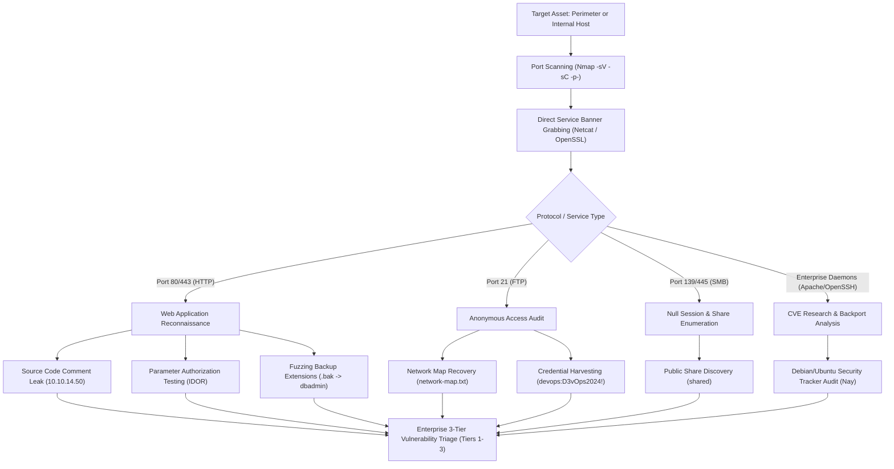

# Basic Vulnerability Identification · Technical Guide & Room Documentation

---

## 1. Metadata & Room Header

- **Room Title:** Basic Vulnerability Identification
- **Room Slug:** `basicvulnerabilityidentificationtechniques`
- **Learning Path:** Junior Penetration Tester (Module 09: Vulnerability Knowledge)
- **Module Order:** Room 03 of 09
- **Difficulty:** Medium / Fundamental
- **Assessment Type:** Practical & Manual Assessment
- **Tags:** `Vulnerability Identification`, `Banner Grabbing`, `Backporting`, `IDOR`, `Anonymous FTP`, `SMB Null Session`, `Triage`, `OffSec`

---

## 2. Room Overview & Executive Summary

The vulnerability identification phase bridges initial reconnaissance and active exploitation. This room focuses on developing foundational technical and analytical capabilities to discover vulnerabilities manually rather than relying blindly on automated scanners (e.g., Nessus, OpenVAS). It covers manual banner grabbing, distinguishing between actual exploitable vulnerabilities and false positives created by enterprise Linux distribution backporting, auditing application logic for Insecure Direct Object References (IDOR), identifying protocol-level misconfigurations in FTP and SMB, and applying a rigorous 3-tier triage model to prioritize remediation efforts based on organizational risk.

---

## 3. Architecture & Attack Surface Analysis



---

## 4. Pedagogical Objectives & Skills Matrix

| Target Competency | Technical Description | Verification & Measurement |
| :--- | :--- | :--- |
| **Attack Surface Mapping** | Distinguish between internal and external surfaces following network foothold. | Verified via `Internal`. |
| **Manual Banner Grabbing** | Interrogate listening services using raw TCP connections (Netcat). | Extracted `2.4.52` and `OpenSSH_8.9p1`. |
| **Backporting Verification** | Analyze enterprise Linux patch policies to dismiss scanner false positives. | Answered `Nay` regarding exploitability. |
| **Web Logic Flaw Identification** | Discover IP disclosure in comments, exploit IDOR, and retrieve backup config files. | Identified `10.10.14.50`, `IDOR`, and `dbadmin`. |
| **Network Protocol Auditing** | Harvest files from anonymous FTP and enumerate unauthenticated SMB shares. | Recovered `network-map.txt`, `devops:D3vOps2024!`, and `shared`. |
| **Vulnerability Triaging** | Classify findings into prioritized remediation tiers (Tier 1 vs Tier 3). | Assigned `1` for RCE and `3` for info disclosure. |
| **Challenge Synthesis** | Discover hidden admin endpoints and recover temporary onboarding passwords. | Recovered `admin`, `maintenance-schedule.txt`, and `Welcome2024!`. |

---

## 5. Comprehensive Task Breakdown

| Task # | Task Title | Primary Objective / Target Question | Verified Answer Value |
| :---: | :--- | :--- | :---: |
| **Task 01** | Introduction | I am ready to learn about basic vulnerability identification techniques. | `No answer needed` |
| **Task 02** | Attack Surface and Asset Identification | What kind of attack surface are you assessing once you gain a foothold inside a corporate network? | `Internal` |
| **Task 03** | Service Enumeration and Banner Grabbing | What version of Apache is running on port 80? | `2.4.52` |
| **Task 03** | Service Enumeration and Banner Grabbing | What is the full OpenSSH banner returned on port 22? | `OpenSSH_8.9p1` |
| **Task 04** | Researching Known Vulnerabilities | If a package on Ubuntu has a known CVE but vendor applied backported patch, is it exploitable? | `Nay` |
| **Task 05** | Web Application Vulnerabilities | What internal IP address is discovered in the developer's deployment notes comment? | `10.10.14.50` |
| **Task 05** | Web Application Vulnerabilities | What category of vulnerability is present on `/profile.php?id=2`? | `IDOR` |
| **Task 05** | Web Application Vulnerabilities | What username was found hardcoded in the backup config file for the administrative interface? | `dbadmin` |
| **Task 06** | Network and System Vulnerabilities | What is the filename of the network map left in the anonymous FTP `/pub` directory? | `network-map.txt` |
| **Task 06** | Network and System Vulnerabilities | What username and password pair were recovered for the dev environment? | `devops:D3vOps2024!` |
| **Task 06** | Network and System Vulnerabilities | What is the name of the readable SMB share discovered during enumeration? | `shared` |
| **Task 07** | Triaging and Prioritising Findings | What priority tier (1, 2, or 3) should be assigned to an unauthenticated external RCE? | `1` |
| **Task 07** | Triaging and Prioritising Findings | What priority tier (1, 2, or 3) should be assigned to informational version disclosure? | `3` |
| **Task 08** | Practical Challenge | What is the hidden administrative directory discovered during directory brute-forcing? | `admin` |
| **Task 08** | Practical Challenge | What is the name of the sensitive file left in the publicly accessible backup directory? | `maintenance-schedule.txt` |
| **Task 08** | Practical Challenge | What default password was assigned to the temporary employee onboarding account? | `Welcome2024!` |
| **Task 09** | Conclusion | I understand how to systematically identify and triage vulnerabilities. | `No answer needed` |

---

## 6. Methodology & Reconnaissance Strategy

The assessment methodology follows an operational progression:
1. **Low-Noise Banner Grabbing:** Establishing direct TCP handshakes with ports 21, 22, and 80 to observe daemon welcome banners without generating multi-packet scanner footprints.
2. **Backport Verification:** Cross-referencing identified version strings with vendor security trackers (Ubuntu Security Tracker) to filter out scanner false positives.
3. **Application-Layer Enumeration:** Auditing client-side HTML source comments for internal topologies and testing horizontal access controls across numeric profile parameters.
4. **File Sharing Protocol Auditing:** Verifying anonymous read permissions across FTP directories and establishing SMB null sessions to enumerate exposed shares.
5. **Systematic Triaging:** Prioritizing confirmed vulnerabilities into an actionable 3-tier remediation model.

---

## 7. Deep-Dive Practical Walkthrough

### 1. Manual Banner Grabbing
Interrogating the web and SSH daemons:
```bash
# Querying HTTP daemon banner:
curl -I http://10.10.14.50/
# Output: Server: Apache/2.4.52 (Ubuntu)

# Grabbing SSH banner via Netcat:
nc -vn 10.10.14.50 22
# Output: SSH-2.0-OpenSSH_8.9p1 Ubuntu-3ubuntu0.1
```

### 2. Anonymous FTP Harvest
```bash
ftp 10.10.14.50
# Authenticate: user 'anonymous', blank password
ftp> cd pub
ftp> ls -la
# Displays network-map.txt and dev-environment.conf
ftp> get network-map.txt
ftp> get dev-environment.conf
```
Extracting credentials from `dev-environment.conf` yields `devops:D3vOps2024!`.

### 3. SMB Null Session Enumeration
```bash
smbclient -L //10.10.14.50/ -N
```
The share listing reveals the readable public directory `shared`.

### 4. Practical Directory Discovery & Secret Extraction
```bash
gobuster dir -u http://10.10.14.50 -w /usr/share/wordlists/dirb/common.txt -x txt,bak -q
```
Discovers `/admin` and `/admin/maintenance-schedule.txt`. Inspecting the file reveals the employee temporary password `Welcome2024!`.

---

## 8. Vulnerability Analysis & Exploitation Mechanics

### Insecure Direct Object References (IDOR - CWE-639)
- **Root Cause:** The application backend maps database records directly to client-controlled request parameters (`/profile.php?id=2`) without validating tenant ownership or session authorization.
- **Impact:** Complete exposure of personal identifiable information (PII) across all system users.

### Distribution Backporting vs False Positives
- **Root Cause:** Enterprise distributions patch vulnerabilities in-place without bumping upstream software version numbers. Automated scanners checking raw version strings report vulnerabilities that no longer exist in the compiled binary.
- **Exploitation Verdict:** Because the vulnerable code path was excised, the flaw is unexploitable (`Nay`).

---

## 9. Detection, Logging & Forensic Artifacts

- **FTP Transfer Logs (`/var/log/vsftpd.log`):**
  Records client IP, anonymous username, and specific downloaded file paths (`/pub/network-map.txt`).
- **Web Access Logs (`/var/log/apache2/access.log`):**
  Records high-frequency HTTP GET requests originating from directory fuzzers (Gobuster / FFUF).
- **Windows Security Event Log (Event ID 4624):**
  Logs Logon Type 3 (Network) associated with `NT AUTHORITY\ANONYMOUS LOGON` during SMB null session enumeration.

---

## 10. Hardening, Mitigation & Remediation Guide

1. **Disable Anonymous FTP Access:** Configure `/etc/vsftpd.conf` with `anonymous_enable=NO` and restart the daemon.
2. **Restrict SMB Null Sessions:** Enforce `RestrictAnonymous = 1` in the Windows registry or configure Samba with `restrict anonymous = 2`.
3. **Remediate IDOR:** Implement server-side authorization checks:
   ```php
   if ($_SESSION['user_id'] !== (int)$_GET['id']) {
       http_response_code(403);
       exit('Access Denied');
   }
   ```
4. **Deny Direct Access to Sensitive File Extensions:** Configure web servers to block `.bak`, `.old`, `.env`, and `.txt` in production docroots.

---

## 11. Defense-in-Depth & Enterprise Architecture

- **VLAN & Perimeter Segmentation:** Restrict internal file sharing and management interfaces (FTP, SMB, SSH) to dedicated management VLANs accessible solely via VPN or bastion hosts.
- **Credential Lifecycle Management:** Enforce individualized, expiring invitation tokens rather than static default passwords (`Welcome2024!`) during employee onboarding.
- **Vulnerability Triage Workflows:** Direct engineering remediation based on contextual exposure (Tier 1 < 24h, Tier 2 < 14d, Tier 3 < 90d) to mitigate operational fatigue.

---

## 12. Tool Comparison & Quick Reference

| Task | Preferred Utility | Syntax | Key Advantage |
| :--- | :--- | :--- | :--- |
| **Banner Grabbing** | `nc` | `nc -vn <IP> <PORT>` | Zero scanner overhead, immediate raw text response |
| **SMB Listing** | `smbclient` | `smbclient -L //<IP>/ -N` | Standard native client, accurate share discovery |
| **SMB Permissions** | `smbmap` | `smbmap -H <IP> -u ""` | Color-coded READ/WRITE permission breakdown |
| **Web Fuzzing** | `gobuster` | `gobuster dir -u <URL> -w <WORDLIST> -x bak,txt` | Fast concurrent HTTP path discovery |

---

## 13. Common Pitfalls & Operational Troubleshooting

1. **Blind Scanner Reliance:** Submitting vulnerability scanner outputs without verifying distribution backporting leads to rejected reports and compromised professional credibility.
2. **FTP Transfer Mode Corruption:** Downloading non-text files without specifying `binary` mode corrupts binary payloads and hash integrity.
3. **Ignoring Client-Side Source Comments:** Skipping source code review frequently misses internal network topologies and staging IPs.

---

## 14. References & Standards

- Official TryHackMe Room: [https://tryhackme.com/room/basicvulnerabilityidentificationtechniques](https://tryhackme.com/room/basicvulnerabilityidentificationtechniques)
- MITRE CWE-639: [Insecure Direct Object References](https://cwe.mitre.org/data/definitions/639.html)
- MITRE CWE-200: [Exposure of Sensitive Information](https://cwe.mitre.org/data/definitions/200.html)
- Canonical Ubuntu Security Tracker: [https://ubuntu.com/security/cves](https://ubuntu.com/security/cves)
- Samba Administration Guide: [https://www.samba.org/samba/docs/](https://www.samba.org/samba/docs/)
