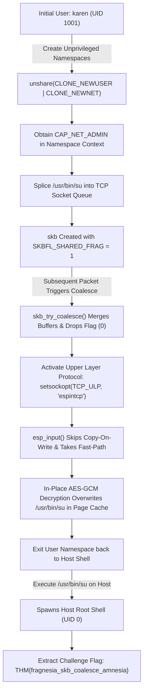

# CVE-2026-46300: Fragnesia · Technical Guide & Room Documentation

---

## 1. Metadata & Room Header

- **Room Title:** CVE-2026-46300: Fragnesia
- **Room Slug:** `cve202646300`
- **Learning Path:** Junior Penetration Tester (Module 09: Vulnerability Knowledge)
- **Module Order:** Room 07 of 09
- **Difficulty:** Easy
- **Assessment Type:** Practical Walkthrough & Linux Kernel CVE Analysis
- **Tags:** `CVE-2026-46300`, `Linux Kernel`, `LPE`, `Page Cache`, `ESP-in-TCP`, `skb_try_coalesce`, `Container Escape`

---

## 2. Room Overview & Executive Summary

This room provides an advanced practical dissection of **CVE-2026-46300 (Fragnesia)**, a critical Linux kernel Local Privilege Escalation (LPE) vulnerability carrying a CVSS score of **7.8 High**. Disclosed in May 2026 by William Bowling from Zellic, the vulnerability represents an architectural regression introduced by the remediation patch for Dirty Frag. When `skb_try_coalesce()` merges incoming TCP socket buffers, it fails to propagate the `SKBFL_SHARED_FRAG` flag. Consequently, the XFRM ESP-in-TCP receive path (`esp_input()`) mistakenly treats shared page-cache fragments as private, executing in-place AES-GCM decryption directly over cached file pages for `/usr/bin/su`. Because the Linux kernel page cache is globally shared across namespaces and containers, triggering the corrupted binary yields real host UID 0 privileges, retrieving `THM{fragnesia_skb_coalesce_amnesia}` without leaving any on-disk filesystem artifacts.

---

## 3. Architecture & Attack Surface Analysis



---

## 4. Pedagogical Objectives & Skills Matrix

| Target Competency | Technical Description | Verification & Measurement |
| :--- | :--- | :--- |
| **Kernel Page Cache Architecture** | Understand shared in-memory caching and analyze how kernel writes compromise binaries. | Analyzed `/usr/bin/su` cache overwrite. |
| **Buffer Coalescing Mechanics** | Dissect `skb_try_coalesce()` and trace the dropped `SKBFL_SHARED_FRAG` flag invariant. | Evaluated kernel source code diffs. |
| **Two-Stage LPE Execution** | Execute namespace-isolated memory corruption followed by host-level binary invocation. | Recovered `THM{fragnesia_skb_coalesce_amnesia}`. |
| **In-Memory Evasion Analysis** | Observe how page-cache modifications completely bypass on-disk file integrity monitors. | Verified pristine disk hash via `sha256sum`. |
| **Behavioral Detection Engineering** | Author Falco and Auditd rules targeting anomalous `TCP_ULP espintcp` activations. | Configured real-time detection telemetry. |

---

## 5. Comprehensive Task Breakdown

| Task # | Task Title | Primary Objective / Target Question | Verified Answer Value |
| :---: | :--- | :--- | :---: |
| **Task 01** | Introduction | I have successfully started my machine. | `No answer needed` |
| **Task 02** | How a Patch Becomes a Vulnerability | *Reading task: Understand the architectural breakdown.* | `No answer needed` |
| **Task 03** | The Patch That Became the Vulnerability | *Reading task: Review the patch commits and code diffs.* | `No answer needed` |
| **Task 04** | Exploitation | What is the content of /root/flag.txt? | `THM{fragnesia_skb_coalesce_amnesia}` |
| **Task 05** | Detection and Mitigation | *Reading task: Review detection rules and mitigation...* | `No answer needed` |
| **Task 06** | Conclusion | I can now exploit CVE-2026-46300! | `No answer needed` |

---

## 6. Methodology & Reconnaissance Strategy

1. **Kernel Verification:** Checking kernel version and confirming presence of vulnerable XFRM/coalesce logic.
2. **Namespace Creation:** Spawning unprivileged user and network namespaces via `unshare` to gain `CAP_NET_ADMIN`.
3. **Keystream Pre-computation:** Generating a 256-byte AES-GCM lookup table mapping ciphertext bytes to desired plaintext bytes.
4. **Buffer Splicing & Coalescing:** Using `splice()` to queue page-cache pages and forcing `skb_try_coalesce()` to drop the shared flag.
5. **Upper Layer Protocol Activation:** Switching the socket to `espintcp` to trigger in-place decryption over the `/usr/bin/su` ELF header.
6. **Host Privilege Escalation:** Exiting the namespace and executing the in-memory modified `/usr/bin/su` binary to obtain host root.

---

## 7. Deep-Dive Practical Walkthrough

### 1. Compiling and Launching the Exploit
```bash
karen@fragnesia:~$ id
# uid=1001(karen) gid=1001(karen)

karen@fragnesia:~$ cd /home/karen/fragnesia
karen@fragnesia:~/fragnesia$ gcc -O2 -w fragnesia.c -o exp
karen@fragnesia:~/fragnesia$ ./exp
```
The exploit unshares namespaces, builds the AES-GCM keystream table, splices `/usr/bin/su`, coalesces socket buffers, and overwrites 192 bytes of the page cache, dropping into an unprivileged namespace root shell.

### 2. Transitioning to Host Root
```bash
root@fragnesia:~/fragnesia# exit
karen@fragnesia:~/fragnesia$ /usr/bin/su
# id
uid=0(root) gid=0(root) groups=0(root),1001(karen)
# cat /root/flag.txt
THM{fragnesia_skb_coalesce_amnesia}
```

---

## 8. Vulnerability Analysis & Exploitation Mechanics

### Root Cause: Broken Invariant in `skb_try_coalesce()`
When `skb_try_coalesce()` appends fragments from one `sk_buff` to another, it fails to propagate `SKBFL_SHARED_FRAG`. The Dirty Frag patch relied on `skb_has_shared_frag()` to mandate Copy-on-Write (`skb_cow_data()`). When the flag is zero, `esp_input()` assumes private ownership and decrypts directly in-place over shared kernel page-cache pages.

---

## 9. Detection, Logging & Forensic Artifacts

- **Syscall Telemetry (Falco / eBPF):**
  Monitors `setsockopt(SOL_TCP, TCP_ULP, "espintcp")` originating from non-IPsec processes (e.g. `exp` or standard user shells).
- **Auditd Rule:**
  Tracks calls to `setsockopt` with parameter `optname=31`.
- **Zero On-Disk Footprint:**
  The disk inode for `/usr/bin/su` remains pristine; running `sha256sum /usr/bin/su` matches package repository records.

---

## 10. Hardening, Mitigation & Remediation Guide

1. **Kernel Updates:** Apply upstream patch `f84eca581739` to ensure `SKBFL_SHARED_FRAG` propagation.
2. **Restrict Unprivileged User Namespaces:**
   ```bash
   sudo sysctl -w kernel.unprivileged_userns_clone=0
   ```
3. **Emergency Module Blacklist:**
   ```bash
   sudo sh -c 'printf "install esp4 /bin/false\ninstall esp6 /bin/false\n" > /etc/modprobe.d/dirtyfrag.conf'
   sudo rmmod esp4 esp6 2>/dev/null
   sudo sh -c 'echo 3 > /proc/sys/vm/drop_caches'
   ```

---

## 11. Defense-in-Depth & Enterprise Architecture

- **Container Host Hardening:** Do not allow unprivileged user namespaces in multi-tenant environments without strict Seccomp filters.
- **Immediate Incident Response Purge:** Executing `echo 3 > /proc/sys/vm/drop_caches` forces the kernel to purge modified volatile page-cache memory, restoring clean binaries from disk immediately.

---

## 12. Tool Comparison & Quick Reference

| Component | Role in Scenario | Technical Function |
| :--- | :--- | :--- |
| **splice()** | Zero-copy syscall | Moves page-cache pages into TCP socket buffers |
| **skb_try_coalesce** | Kernel networking function | Coalesces skbs and inadvertently drops `SKBFL_SHARED_FRAG` |
| **esp_input** | IPsec crypto function | Executes in-place AES-GCM decryption over page cache |
| **Falco** | Behavioral security engine | Detects anomalous `espintcp` socket option calls |

---

## 13. Common Pitfalls & Operational Troubleshooting

1. **Trying to Read Root Flag Inside Namespace:** Namespace root is mapped to an unprivileged UID on the host; you must exit the namespace before running `/usr/bin/su`.
2. **Static Inode Scanning:** File integrity monitors reading disk blocks cannot detect Fragnesia modifications.

---

## 14. References & Standards

- Official TryHackMe Room: [https://tryhackme.com/room/cve202646300](https://tryhackme.com/room/cve202646300)
- Zellic Vulnerability Research: [Fragnesia Bug Breakdown](https://www.zellic.io/blog/)
- Linux Kernel Commit: [Commit f84eca581739](https://git.kernel.org/)
- IETF Specification: [RFC 8229 ESP in TCP](https://datatracker.ietf.org/doc/html/rfc8229)
