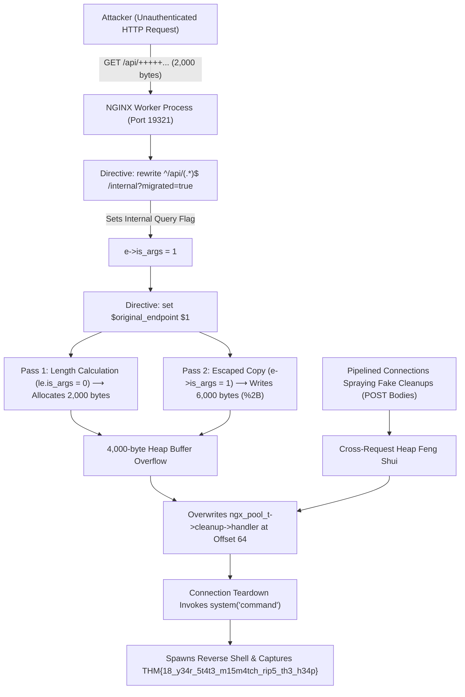

# CVE-2026-42945: Nginx Rift · Technical Guide & Room Documentation

---

## 1. Metadata & Room Header

- **Room Title:** CVE-2026-42945: Nginx Rift
- **Room Slug:** `cve202642945`
- **Learning Path:** Junior Penetration Tester (Module 09: Vulnerability Knowledge)
- **Module Order:** Room 08 of 09
- **Difficulty:** Easy
- **Assessment Type:** Practical Walkthrough & Memory Corruption Analysis
- **Tags:** `CVE-2026-42945`, `Nginx`, `Heap Overflow`, `RCE`, `ngx_http_rewrite_module`, `Heap Feng Shui`, `Memory Corruption`

---

## 2. Room Overview & Executive Summary

This room delivers an in-depth technical examination of **CVE-2026-42945 (NGINX Rift)**, an unauthenticated heap buffer overflow in the core `ngx_http_rewrite_module` of NGINX evaluated at **CVSS v4 9.2 (Critical)**. Disclosed by depthfirst in May 2026 after remaining dormant in the codebase since 2008, the flaw originates from an internal state synchronization mismatch in NGINX's two-pass script engine. When a `rewrite` directive containing a query argument (`?`) precedes a `set` directive referencing an unnamed capture (`$1`), Pass 1 computes buffer length using an unescaped sub-engine (`le.is_args = 0`), while Pass 2 copies the string with full URI escaping (`e->is_args = 1`), expanding each `+` character into `%2B`. The resulting deterministic heap overflow enables cross-request **Heap Feng Shui** against per-request memory pools (`ngx_pool_t`), allowing attackers to overwrite cleanup handler function pointers with `system()` and capture `THM{18_y34r_5t4t3_m15m4tch_rip5_th3_h34p}`.

---

## 3. Architecture & Attack Surface Analysis



---

## 4. Pedagogical Objectives & Skills Matrix

| Target Competency | Technical Description | Verification & Measurement |
| :--- | :--- | :--- |
| **NGINX Script Engine Architecture** | Understand two-pass string serialization in `ngx_http_rewrite_module`. | Traced `is_args` flag state flow. |
| **Deterministic Buffer Overflows** | Calculate allocation vs. copy size discrepancies created by URI escaping expansions. | Modeled $2N$ heap overflow byte growth. |
| **Cross-Request Heap Feng Shui** | Interleave concurrent TCP connections to align `ngx_pool_t` instances. | Hijacked `ngx_pool_cleanup_t` pointers. |
| **Encoding Filter Bypasses** | Deliver raw binary function pointer structures using unescaped HTTP POST request bodies. | Executed successful RCE payload. |
| **RCE Verification & Flag Extraction** | Operate reverse shell payloads within target container environment. | Extracted `THM{18_y34r_5t4t3_m15m4tch_rip5_th3_h34p}`. |
| **Configuration Workarounds** | Implement PCRE named captures `(?<name>.*)` for zero-downtime remediation. | Validated safe config patterns. |

---

## 5. Comprehensive Task Breakdown

| Task # | Task Title | Primary Objective / Target Question | Verified Answer Value |
| :---: | :--- | :--- | :---: |
| **Task 01** | Introduction | I have successfully started my machine. | `No answer needed` |
| **Task 02** | Rewrite and Set Directives | *Reading task: Understand the interplay between...* | `No answer needed` |
| **Task 03** | The Two-Pass Script Engine | *Reading task: Dissect the C source code and arithmetic...* | `No answer needed` |
| **Task 04** | From Heap Overflow to Code Execution | *Reading task: Understand cross-request heap layout...* | `No answer needed` |
| **Task 05** | Exploitation | What is the content of flag.txt? | `THM{18_y34r_5t4t3_m15m4tch_rip5_th3_h34p}` |
| **Task 06** | Detection and Mitigation | *Reading task: Review hardening configurations...* | `No answer needed` |
| **Task 07** | Conclusion | I can now exploit CVE-2026-42945! | `No answer needed` |

---

## 6. Methodology & Reconnaissance Strategy

1. **Version Identification:** Verifying an installed NGINX version below 1.30.1.
2. **Configuration Inspection:** Auditing `nginx.conf` for the pattern `rewrite ...?...; set $var $1;`.
3. **Crash Verification:** Probing the endpoint with a string of 1,000 `+` characters and observing worker exits in error logs.
4. **Heap Grooming:** Generating concurrent HTTP requests to align per-request pools and spray cleanup structs.
5. **Exploitation & Command Execution:** Triggering the overflow to overwrite `pool->cleanup` and spawn a shell.

---

## 7. Deep-Dive Practical Walkthrough

### 1. Confirming Vulnerable Container
```bash
sudo docker ps --filter label=com.docker.compose.project=nginx-rift
curl -s "http://127.0.0.1:19321/api/users/42"
```

### 2. Exploiting via Interactive Shell Mode
```bash
python3 poc.py --shell
# Connects to 127.0.0.1:19321
# Performs heap spraying via HTTP POST bodies
# Sends overflow trigger: GET /api/++++++++++...
# Inbound reverse shell caught:
# $ id -> uid=101(nginx) gid=101(nginx)
# $ cat /flag.txt
THM{18_y34r_5t4t3_m15m4tch_rip5_th3_h34p}
```

---

## 8. Vulnerability Analysis & Exploitation Mechanics

### Root Cause: State Mismatch in Two-Pass Engine
`ngx_http_script_start_args_code()` sets `e->is_args = 1`. In the subsequent `set` directive, length calculation zeros a local engine structure (`le.is_args = 0`), counting raw ASCII bytes. However, data copying uses the main engine (`e->is_args = 1`), invoking `ngx_escape_uri()` which expands each `+` into `%2B`, creating a heap buffer overflow of exactly $2N$ bytes.

---

## 9. Detection, Logging & Forensic Artifacts

- **Web Access Logs:**
  Unusually long runs of `+` characters in URI paths:
  `grep -E '\+{30,}' /var/log/nginx/access.log`
- **Error Log Signals:**
  Worker segmentation fault notifications:
  `worker process [PID] exited on signal 11 (core dumped)`
- **Network Socket States:**
  Clusters of lingering sockets in `CLOSE_WAIT` and `LAST_ACK`.

---

## 10. Hardening, Mitigation & Remediation Guide

1. **Patching:** Upgrade NGINX Open Source to 1.30.1, 1.31.0+, or NGINX Plus R32 P6, R36 P4, 37.0.0 LTS+.
2. **Configuration Workaround (Named Captures):**
   ```nginx
   location ~ ^/api/(?<path>.*)$ {
       rewrite ^/api/(?<path>.*)$ /internal?migrated=true;
       set $original_endpoint $path;
   }
   ```
   Named captures execute through a separate, safe code path unaffected by `is_args`.

---

## 11. Defense-in-Depth & Enterprise Architecture

- **Least Privilege Worker Runtime:** Run NGINX workers under unprivileged accounts (`nginx`) with minimal filesystem access.
- **WAF Rule Integration:** Reject incoming requests with excessive repeated URI encoding meta-characters.

---

## 12. Tool Comparison & Quick Reference

| Component / Utility | Role in Scenario | Technical Function |
| :--- | :--- | :--- |
| **ngx_http_rewrite_module** | Target NGINX component | Houses the `is_args` state mismatch flaw |
| **ngx_pool_t** | Per-request memory allocator | Target for heap buffer overflow |
| **ngx_escape_uri()** | Character encoding routine | Triples the byte length of `+` during Pass 2 |
| **Named Captures** | PCRE regex feature | Zero-downtime configuration workaround |

---

## 13. Common Pitfalls & Operational Troubleshooting

1. **Missing Query String in Rewrite:** The vulnerability does not trigger unless the replacement string contains a `?`.
2. **Numbered vs. Named Captures:** Numbered captures (`$1`) are vulnerable; named captures (`$path`) are immune.

---

## 14. References & Standards

- Official TryHackMe Room: [https://tryhackme.com/room/cve202642945](https://tryhackme.com/room/cve202642945)
- DepthFirst Research Disclosure: [Nginx-Rift PoC Repository](https://github.com/DepthFirstDisclosures/Nginx-Rift)
- NGINX Official Rewrite Documentation: [ngx_http_rewrite_module Docs](https://nginx.org/en/docs/http/ngx_http_rewrite_module.html)
- MITRE CWE-122: [Heap-based Buffer Overflow](https://cwe.mitre.org/data/definitions/122.html)
