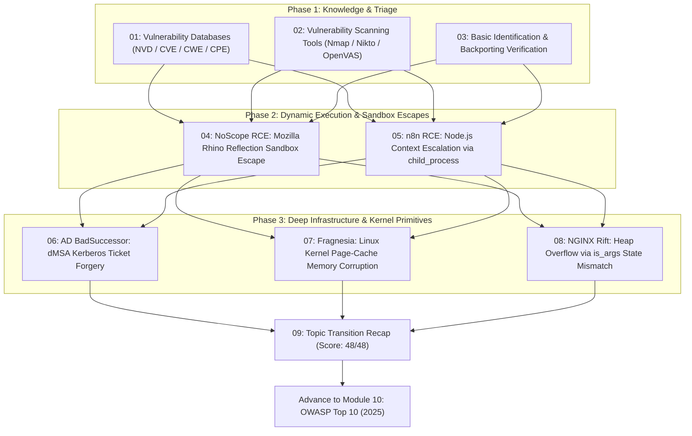

# Module 09 Topic Transition Recap · Technical Synthesis Guide

---

## 1. Metadata & Room Header

- **Room Title:** Topic Transition Recap
- **Module:** Vulnerability Knowledge (Module 09 Recap on the Jr Penetration Tester path)
- **Module Order:** Room 09 of 09 (Final Module Capstone)
- **Recap ID:** `6afe01d5f306fc3f65927fdc`
- **Assessment Type:** Comprehensive Multiple-Choice Synthesis Assessment
- **Score Achieved:** **48 / 48 Points (100% Perfect Score)**
- **Tags:** `Vulnerability Knowledge`, `Recap`, `CVE-2026-42945`, `CVE-2026-46300`, `CVE-2025-68613`, `BadSuccessor`, `Kerberos`, `Process Telemetry`, `PT1 Aligned`

---

## 2. Room Overview & Executive Summary

This room represents the **final capstone and synthesis bridge for Module 09 (Vulnerability Knowledge)**. After mastering vulnerability databases (NVD/CWE/CPE), vulnerability scanning engines (Nmap/Nikto/OpenVAS), manual banner grabbing and backport verification, the module advanced through deep-dive analysis of real-world critical CVEs: Java reflection sandbox escapes (CVE-2026-35482 in Alf.io), Node.js expression injection (CVE-2025-68613 in n8n), Windows Server 2025 dMSA privilege escalation (BadSuccessor), Linux kernel page-cache corruption (CVE-2026-46300 Fragnesia), and NGINX two-pass script engine heap overflows (CVE-2026-42945 NGINX Rift). This recap consolidates core technical insights, forensic artifacts, and mitigation strategies required to operate as an elite penetration tester.

---

## 3. Module 09 Technical Synthesis Map

---

## 4. Skills & Evaluation Matrix

| Domain Tested | Associated Vulnerability / Concept | Question # | Verified Core Concept |
| :--- | :--- | :---: | :--- |
| **Post-Exploitation Telemetry** | n8n RCE (CVE-2025-68613) | **Question 1** | Process creation events on the host provide definitive proof of command execution. |
| **Active Directory Permissions** | AD: BadSuccessor (Windows Server 2025) | **Question 2** | `GenericAll` grants complete control, overriding standalone `CreateChild` restrictions. |
| **Sandbox Evasion Mechanics** | Alf.io RCE (CVE-2026-35482) | **Question 3** | Class names assembled or passed as runtime strings bypass static keyword blocklists. |
| **Kerberos Ticket Injection** | Rubeus `/ptt` Flag | **Question 4** | Pass-the-Ticket injects harvested tickets straight into memory for immediate use. |
| **Domain Secret Extraction** | Active Directory DCSync | **Question 5** | `secretsdump.py` exploits directory replication to dump NTDS.dit password hashes. |
| **Migration Attribute Abuse** | dMSA Migration Predecessor Link | **Question 6** | `msDS-ManagedAccountPrecededByLink` points dMSA at the victim account identity. |

---

## 5. Comprehensive Question & Answer Reference

| # | Question Summary | Correct Verified Answer | Points Awarded |
| :---: | :--- | :--- | :---: |
| **Q1** | Additional telemetry confirming post-exploitation after suspicious workflow payload | `Process creation events on the host` | **8 / 8** |
| **Q2** | Why blocking CreateChild fails if user retains GenericAll on an OU | `GenericAll bypasses all permission checks in Active Directory` | **8 / 8** |
| **Q3** | Why a sandbox blocking dangerous class names in source code can still be escaped | `Class names supplied as runtime strings are never inspected` | **8 / 8** |
| **Q4** | What the `/ptt` flag in Rubeus does with a requested ticket | `Injects it into the current logon session for immediate use` | **8 / 8** |
| **Q5** | Impacket script used to perform DCSync and dump all domain NTLM hashes | `secretsdump.py` | **8 / 8** |
| **Q6** | dMSA attribute written to fake completed migration and link account | `msDS-ManagedAccountPrecededByLink` | **8 / 8** |
| **Total** | **6 Multi-choice questions completed on first attempt** | **100% Accuracy** | **48 / 48 Points** |

---

## 6. Strategic Takeaways from Module 09

1. **Vulnerabilities Transcend Web Applications:** Real-world penetration testing requires mastering low-level primitives: Linux kernel socket buffers, Active Directory Kerberos delegation attributes, and C web server memory allocators.
2. **String Filtering is Universally Defeated by Dynamic Semantics:** Relying on regex or AST token filtering fails whenever execution engines permit reflection, dynamic evaluation, or encoding expansions.
3. **Defense-in-Depth Remains Mandatory:** Hardening must operate across multiple tiers: least-privilege service runtimes, container sandboxing, restricted user namespaces, and host-level EDR process monitoring.

---

## 7. Transition to Module 10: OWASP Top 10 (2025)

Having completed the foundational and advanced vulnerability knowledge curriculum, the path advances to **Module 10: OWASP Top 10 (2025)**, exploring modern application security standards:
- **Room 01:** `OWASP Top 10 2025: IAAA Failures` (Identification, Authentication, Authorization, Accountability).
- **Room 02:** `OWASP Top 10 2025: Application Design Flaws`.
- **Room 03:** `OWASP Top 10 2025: Insecure Data Handling`.
- **Room 04:** `Topic Transition Recap`.
