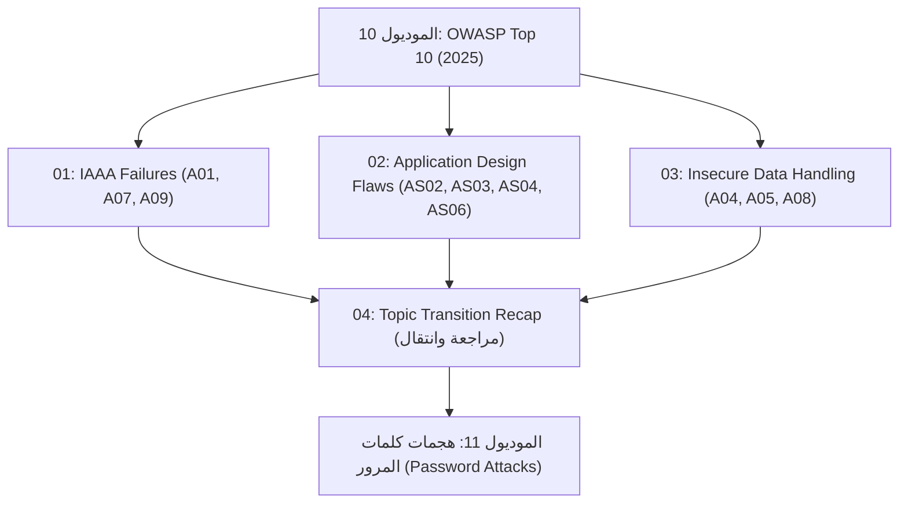

# الوحدة 10: المعيار العالمي لأمان تطبيقات الويب OWASP Top 10 (2025)

---

## 1. الترويسة والبيانات الوصفية (Metadata)

- **اسم الوحدة بالإنجليزية:** Module 10: OWASP Top 10 (2025)
- **المسار التعليمي:** Junior Penetration Tester (PT1 Aligned Curriculum)
- **المعرف الهيكلي على القرص:** `10-OWASP-TOP-10-2025`
- **عدد الغرف والتحديات:** 4 وحدات (3 غرف رئيسية + اختبار مراجعة انتقالية)
- **المتطلبات السابقة:** Module 05 (Web Application Security Fundamentals)، Module 07 و 08 (Web Application Vulnerabilities I & II).

---

## 2. النظرة الشاملة لمعيار OWASP لعام 2025

يُمثل مشروع أمان تطبيقات الويب المفتوح (OWASP) المرجع العالمي الأول لتقييم المخاطر الأمنية في برمجيات الويب. يُحدث إصدار عام 2025 تصنيفات التهديدات ليركز على المحاور الحديثة في بيئات الحوسبة السحابية وسلاسل الإمداد ومحركات التعابير والهوية الرقمية:

1. **إخفاقات الهوية والتحقق والمصادقة والمساءلة (IAAA Failures):**
   تغطي انهيار ضوابط الوصول (A01: Broken Access Control)، وفشل المصادقة وإدارة الجلسات (A07: Authentication Failures)، وقصور التسجيل والإنذار (A09: Logging & Alerting Failures).
2. **عيوب التصميم المعماري (Application Design Flaws):**
   تغطي أخطاء التكوين الأمني (AS02)، وإخفاقات سلاسل الإمداد البرمجية للطرف الثالث (AS03)، والعيوب المشفرة وضعف التصميم الهندسي (AS06).
3. **معالجة البيانات غير الآمنة (Insecure Data Handling):**
   تغطي التشفير الهش ونقل البيانات الحساسة غير المحمية (A04)، وثغرات الحقن البرمجي بكافة أنواعها (A05)، وإخفاقات سلامة البيانات والبرمجيات (A08).

---

## 3. خريطة الترابط الهيكلي لغرف الموديول 10

