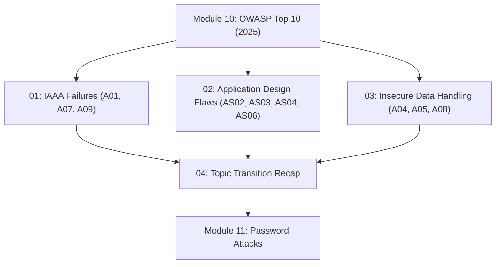

# Module 10: OWASP Top 10 (2025) · Executive Overview & Curriculum Blueprint

---

## 1. Module Metadata

- **Module Title:** Module 10: OWASP Top 10 (2025)
- **Learning Path:** Junior Penetration Tester (PT1 Aligned Curriculum)
- **Directory Identifier:** `10-OWASP-TOP-10-2025`
- **Total Rooms:** 4 units (3 core walkthrough rooms + 1 Topic Transition Recap)
- **Prerequisites:** Module 05 (Web Fundamentals), Modules 07 & 08 (Web Application Vulnerabilities I & II), Module 09 (Vulnerability Knowledge).

---

## 2. Executive Overview: The 2025 OWASP Standard

The Open Web Application Security Project (OWASP) Top 10 is the global consensus standard for developers and penetration testers. The updated 2025 curriculum recalibrates classic vulnerability classes to address contemporary cloud-native application stacks, decentralized authentication models, third-party software supply chains, and complex execution engines:

1. **IAAA Failures (Identification, Authentication, Authorization, and Accountability):**
   Examines authorization collapses (A01: Broken Access Control), credential and session management weaknesses (A07: Authentication Failures), and audit omissions (A09: Logging & Alerting Failures).
2. **Application Design Flaws:**
   Evaluates architectural security misconfigurations (AS02), dependency supply chain compromises (AS03), and root-level insecure design paradigms (AS06).
3. **Insecure Data Handling:**
   Addresses data at rest/transit cryptographic failures (A04), injection vectors (A05), and data/software integrity violations (A08).

---

## 3. Curriculum Architectural Diagram

