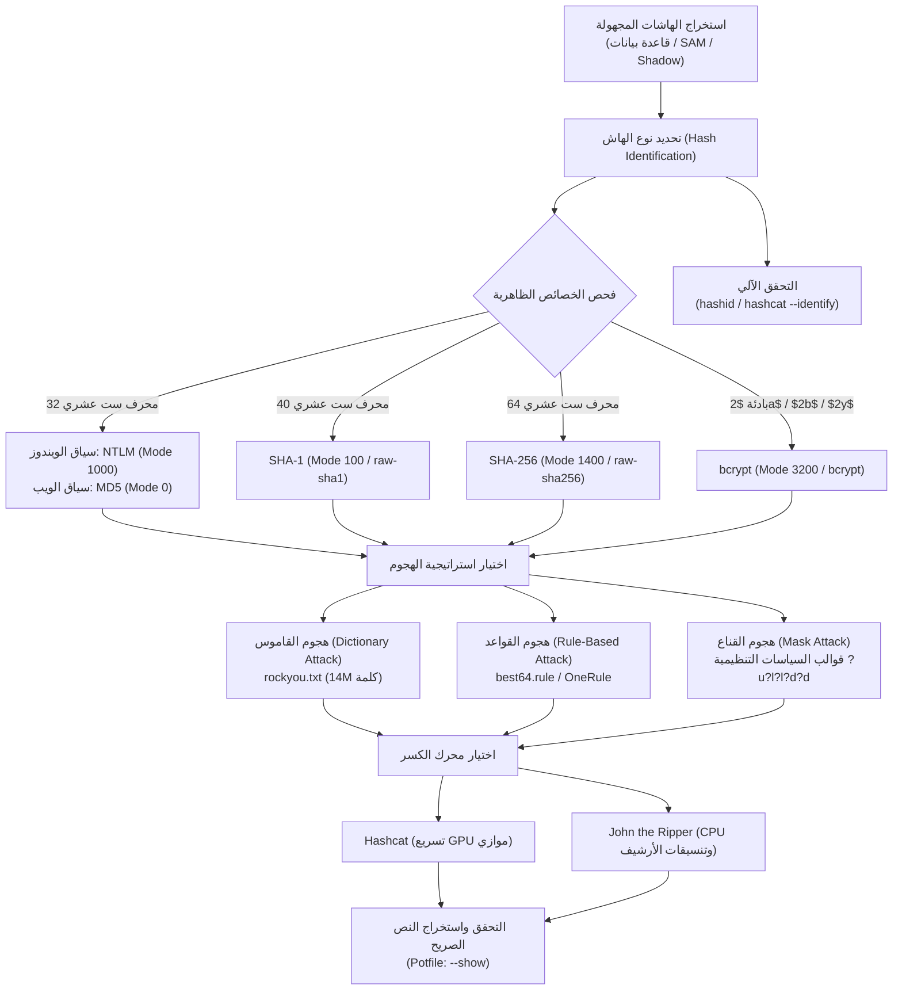

# توثيق غرفة كسر كلمات المرور (Password Cracking)

---

## 1. بيانات المديول والروم (Metadata & Overview)

* **المسار التعليمي:** مسار مبتدئ اختبار الاختراق (Jr Penetration Tester)
* **المديول:** المديول الحادي عشر — هجمات كلمات المرور (11-PASSWORD-ATTACKS)
* **اسم الغرفة:** كسر كلمات المرور (Password Cracking)
* **المعرف البرمجي (Slug):** `passwordcracking`
* **الرابط المباشر:** [TryHackMe Password Cracking](https://tryhackme.com/room/passwordcracking)
* **مستوى الصعوبة:** سهل (Easy)
* **النوع:** غرفة إرشادية وتطبيق عملي (Walkthrough & Practice Lab)
* **عدد المهام:** 7 مهام
* **عدد الأسئلة:** 18 سؤالاً مع التحقق بنسبة 100%

---

## 2. الملخص التنفيذي (Executive Summary)

تُعد عمليات **كسر كلمات المرور دون اتصال (Offline Password Cracking)** ركيزة جوهرية في تقييمات الأمن السيبراني واختبار الاختراق المتقدم؛ إذ تمكن المختبرين والفرق الحمراء من استعادة الحسابات وصلاحيات الوصول الإدارية بعد سحب الهاشات (Hashes) من قواعد البيانات المسربة، أو ملفات النظام الحساسة (`/etc/shadow` أو قواعد `SAM` و `NTDS.dit`).

تغطي هذه الغرفة دورة حياة كسر الهاشات بالكامل بدءاً من الفهم العميق لخصائص الدوال التشفيرية أحادية الاتجاه (One-Way Cryptographic Hashes)، مروراً بآليات التمييز والتعرف على خوارزميات الهاش بناءً على طول المحارف والبادئات وسياق الاستخراج، وتحديد استراتيجية الهجوم المثلى (قواميس، أقنعة، تحويلات قواعد)، ووصولاً إلى التنفيذ العملي عالي الكفاءة عبر أداتي الصناعة القياسيتين: **John the Ripper** المعززة بالمعالجة المركزية (CPU) وأداة **Hashcat** فائقة السرعة المعتمدة على معالجات الرسوميات (GPU).

---

## 3. مخطط سير العمل ومعمارية الكسر (Architectural Flow Diagram)

يوضح المخطط التالي دورة حياة كسر الهاشات المنهجية ابتداءً من استخراج البيانات وانتهاءً باسترداد النص الصريح:



---

## 4. المتطلبات وإعداد البيئة (Prerequisites & Environment Setup)

للعمل العملي على كسر الهاشات، تتطلب البيئة التحقق من حزم الأدوات والملفات القياسية التالية:

```bash
# 1. التحقق من تثبيت أداة John the Ripper
john --version

# 2. التحقق من تثبيت أداة Hashcat ودعمها للأجهزة (OpenCL / CUDA)
hashcat --version
hashcat -I

# 3. التأكد من فك ضغط قاموس RockYou
if [ -f /usr/share/wordlists/rockyou.txt.gz ]; then
    sudo gzip -d /usr/share/wordlists/rockyou.txt.gz
fi
ls -lh /usr/share/wordlists/rockyou.txt

# 4. تثبيت أداة التعرف على الهاشات hashid
sudo apt update && sudo apt install -y hashid
```

---

## 5. توصيف الهاشات والهدف (Target & Hash Profiling)

خلال التطبيق العملي، يتم استهداف أربعة ملفات هاشات في مسار `/root/Rooms/PasswordCracking/`:

| اسم الملف | الطول / البادئة | الخوارزمية الفعلية | نمط Hashcat | تنسيق John | النص الصريح المستعاد |
| :--- | :--- | :--- | :---: | :---: | :--- |
| `hash1.txt` | 32 محرف ست عشري | **MD5** | `0` | `raw-md5` | `123456` |
| `hash2.txt` | 64 محرف ست عشري | **SHA-256** | `1400` | `raw-sha256` | `password` |
| `hash3.txt` | 40 محرف ست عشري | **SHA-1** | `100` | `raw-sha1` | `password` |
| `hash4.txt` | بادئة `$2y$12$` | **bcrypt** | `3200` | `bcrypt` | `hayden07` |

---

## 6. دليل الحل التفصيلي والمراحل المنهجية (Complete Walkthrough)

### المرحلة الأولى: فهم تخزين كلمات المرور والتشفير
- تُخزن كلمات المرور كهاشات مشتقة بواسطة دوال أحادية الاتجاه (**One-Way**)، حيث يستحيل رياضياً حساب المعكوس.
- لإحباط هجمات جداول قوس قزح (Rainbow Tables) التي تعتمد على الهاشات المحسوبة مسبقاً، يُضاف ملح عشوائي فريد (**Salt**) لكل مستخدم.
- الخوارزميات العامة (MD5/SHA) صُممت لتكون سريعة جداً؛ لذا طُوّرت خوارزميات مخصصة لكلمات المرور مثل **bcrypt** و **Argon2** لتكون بطيئة عمداً (**Deliberately Slow**) وقابلة لزيادة معامل الجهد (Cost Factor).

### المرحلة الثانية: التعرف على الهاشات (Hash Identification)
- حساب عدد البتات والمحارف: 256 بت ينتج عنها **64** محرفاً ست عشرياً ($256 \div 4 = 64$).
- عند توجيه أداة John the Ripper لكسر هاش SHA-256 صريح دون ملح، يُستخدم التنسيق: `--format=raw-sha256`.

### المرحلة الثالثة: استراتيجيات الهجوم والقواميس
- المسار القياسي لقاموس RockYou على بيئات AttackBox و Kali هو: `/usr/share/wordlists/rockyou.txt`.
- عند تطبيق تحويلات برمجية (كتكبير الحرف الأول وإضافة أرقام ورموز) على كلمات القاموس، يُسمى هذا الهجوم **Rule-Based Attack**.
- عندما تكون بنية كلمة المرور معلومة بموجب سياسة تعقيد معينة (مثل حرف كبير يليه 6 أحرف صغيرة ورقمين)، فإن الهجوم الأنسب والأسرع هو هجوم القناع (**Mask Attack**).

### المرحلة الرابعة: استخدام John the Ripper و Hashcat
- عند الرغبة في كسر كميات ضخمة من هاشات SHA-256 بأعلى سرعة ممكنة، يتفوق **Hashcat** بفضل المعالجة المتوازية على معالجات الرسوميات (GPU).
- رقم نمط الهجوم في Hashcat المخصص لهجمات القناع (Mask) هو النمط **`3`** (`-a 3`).
- لعرض كلمات المرور التي تم كسرها سابقاً من ملف السجلات الدائم (Potfile) في أداة John the Ripper، نستخدم الخيار **`--show`**.

### المرحلة الخامسة: التطبيق العملي واستخراج الأعلام
1. فحص `hash1.txt`: الطول 32 محرفاً $\to$ خوارزمية **MD5**. الكسر عبر القاموس يكشف: `123456`.
2. فحص `hash2.txt`: الطول 64 محرفاً $\to$ خوارزمية **SHA-256**. نمط Hashcat المطلوب هو **`1400`**. الكسر يكشف: `password`.
3. فحص `hash3.txt`: يشترك مع `hash2.txt` في نفس النص الصريح رغم اختلاف الخوارزمية: `password`.
4. فحص `hash4.txt`: يبدأ بـ `$2y$` $\to$ خوارزمية **bcrypt**. الكسر عبر القاموس يكشف كلمة المرور: `hayden07`.

---

## 7. المصفوفة التقنية لأوامر الأدوات (Tools Syntax Matrix)

| الأداة | الغرض العملياتي | صياغة الأمر الكاملة |
| :--- | :--- | :--- |
| **John** | كسر هاش MD5 خام بواسطة قاموس | `john --format=raw-md5 --wordlist=/usr/share/wordlists/rockyou.txt hash1.txt` |
| **John** | كسر هاش SHA-256 خام بواسطة قاموس | `john --format=raw-sha256 --wordlist=/usr/share/wordlists/rockyou.txt hash2.txt` |
| **John** | كسر هاش bcrypt بواسطة قاموس | `john --format=bcrypt --wordlist=/usr/share/wordlists/rockyou.txt hash4.txt` |
| **John** | عرض النتائج المكسورة من الـ Potfile | `john --show --format=raw-md5 hash1.txt` |
| **Hashcat** | كسر MD5 بهجوم قاموس | `hashcat -m 0 -a 0 hash1.txt /usr/share/wordlists/rockyou.txt` |
| **Hashcat** | كسر SHA-256 بقاموس وقواعد | `hashcat -m 1400 -a 0 hash2.txt rockyou.txt -r /usr/share/hashcat/rules/best64.rule` |
| **Hashcat** | كسر بقناع مخصص (Upper+6Lower+2Digits) | `hashcat -m 1400 -a 3 hash2.txt '?u?l?l?l?l?l?l?d?d'` |
| **Hashcat** | عرض الهاشات المكسورة سابقاً | `hashcat -m 1400 hash2.txt --show` |

---

## 8. الأعماق التشفيرية والأمنية (Cryptographic Internals)

### الفارق بين الخوارزميات السريعة والبطيئة:
1. **خوارزميات النزاهة العامة (MD5/SHA-256):**
   - تعتمد على بنية **Merkle–Damgård** وتنفيذ عمليات إزاحة البتات (Bit Shifts) البسيطة.
   - يستطيع معالج رسوميات حديث مثل RTX 4090 معالجة أكثر من 160 مليار هاش MD5 في الثانية الواحدة.
2. **خوارزميات كلمات المرور المتكيفة (bcrypt / Argon2):**
   - تعتمد **bcrypt** على تشفير Blowfish الموسع (Eksblowfish) مع دورات تكرار أسية: $2^{\text{cost}}$ دورة.
   - عند ضبط معامل الجهد على 12، تتطلب كل محاولة كسر 4,096 دورة تشفير داخلية، مما يخفض سرعة معالج الرسوميات إلى حوالي 25,000 محاولة بالثانية فقط (تراجع بنسبة تفوق 6 ملايين ضعف).

---

## 9. الأمن العملياتي وبصمة الاكتشاف (OpSec & Detection Footprint)

* **انعدام البصمة الشبكية:** تجري هجمات الكسر دون اتصال (Offline) بالكامل على أجهزة المختبر الخاصة؛ وبالتالي لا تُولد أي حركة مرور على شبكة العميل ولا تتسبب في إطلاق تنبيهات جدران الحماية أو أنظمة كشف التسلل (IDS/IPS).
* **تجاوز سياسات القفل (Account Lockout Bypass):** لا تملك أنظمة تشغيل الأهداف أو خدمات Active Directory أي علم بمحاولات التخمين التي تحدث محلياً؛ مما يتيح تجربة مليارات الاحتمالات دون قفل الحسابات.
* **حظر الخدمات السحابية العامة:** يُحظر تماماً تحت اتفاقيات عدم الإفصاح (NDA) وقوانين حماية البيانات رفع هاشات العملاء الحساسة إلى محركات البحث العامة مثل CrackStation؛ إذ تُفهرس تلك المواقع الاستعلامات علناً.

---

## 10. التحصين الدفاعي والمعالجة (Defensive Hardening)

بناءً على إرشادات **NIST SP 800-63B** و **OWASP Password Storage**:
1. **التخلص الفوري من الخوارزميات المتقادمة:** إيقاف استخدام MD5 و SHA-1 وتجزئات NTLM داخل قواعد البيانات نهائياً.
2. **اعتماد دوال إبطاء الذاكرة (Memory-Hard KDFs):**
   - المعيار الأول: **Argon2id** (بمعامل ذاكرة لا يقل عن 64 ميجابايت و 3 تكرارات).
   - المعيار الثاني: **bcrypt** (بمعامل جهد لا يقل عن 12 للتطبيقات العامة، و 14 للحسابات الإدارية).
3. **تطبيق التمليح الإلزامي (Unique Salting):** توليد ملح عشوائي مشفر لا يقل طوله عن 16 بايتاً لكل مستخدم لمنع هجمات جداول قوس قزح.
4. **تحديث سياسات كلمات المرور:**
   - إلغاء التدوير الدوري الإجباري لكلمات المرور (الذي يجبر المستخدمين على أنماط تخمين متوقعة).
   - التركيز على طول كلمة المرور (12-16 محرفاً كحد أدنى) بدلاً من التعقيد الشكلي.
   - فحص كلمات المرور الجديدة لحظة التسجيل ومطابقتها مع قواعد بيانات التسريبات السابقة (Blacklist Screening).

---

## 11. الأخطاء الشائعة وحلولها (Common Pitfalls)

* **الخلط بين MD5 و NTLM:** كلاهما ينتج 32 محرفاً ست عشرياً. تحديد الخوارزمية يعتمد على السياق؛ إذا كان الهاش مستخرجاً من نظام ويندوز (SAM / NTDS.dit) فهو NTLM (`-m 1000` / `--format=nt`)، وإن كان من قاعدة بيانات ويب فهو غالباً MD5 (`-m 0` / `--format=raw-md5`).
* **نسيان خيار `--show`:** عندما يبلغك John أو Hashcat بأنه لم تعد هناك هاشات متبقية، فهذا يعني أن الهاش تم كسره بالفعل ومحفوظ في الـ Potfile. استخدم `--show` لقراءة النتيجة مباشرة.
* **مشاكل محارف نهاية السطر في ويندوز (CRLF):** إذا تم إنشاء القاموس أو تحريره على نظام ويندوز، يجب إزالة محارف العودة (`\r`) باستخدام أمر `tr -d '\r'` لتفادي فشل المطابقة في بيئات لينكس.

---

## 12. فهرس المهام والحلول الكامل (Comprehensive Tasks Index)

| المهمة | عنوان المهمة | السؤال | الإجابة المحققة |
| :---: | :--- | :--- | :--- |
| **01** | Introduction | I understand the learning objectives and am ready to password-crack! | `No answer needed` |
| **02** | How Passwords Are Stored | What property of a hash function means you cannot reverse a hash? | `one-way` |
| **02** | How Passwords Are Stored | What term describes the unique random string added to a password? | `salt` |
| **02** | How Passwords Are Stored | Which hashing algorithm was designed specifically for passwords and is slow? | `bcrypt` |
| **03** | Identifying Hash Types | What is the character length of an SHA-256 hash? | `64` |
| **03** | Identifying Hash Types | What John the Ripper format would you use for an SHA-256 hash? | `raw-sha256` |
| **04** | Wordlists and Attack Strategies | What is the full path to the rockyou wordlist on the AttackBox? | `/usr/share/wordlists/rockyou.txt` |
| **04** | Wordlists and Attack Strategies | What type of attack applies transformations such as capitalisation? | `rule-based` |
| **04** | Wordlists and Attack Strategies | What attack type is best suited to cracking a known pattern hash? | `mask` |
| **05** | Cracking with John and Hashcat | Which tool is the better choice for large sets: John or Hashcat? | `hashcat` |
| **05** | Cracking with John and Hashcat | What Hashcat attack mode number is used for a mask attack? | `3` |
| **05** | Cracking with John and Hashcat | Which John flag displays previously cracked passwords from potfile? | `--show` |
| **06** | Practical | What algorithm produced the hash in hash1.txt? | `MD5` |
| **06** | Practical | What Hashcat mode would you use to crack the hash in hash2.txt? | `1400` |
| **06** | Practical | What is the plaintext password for hash1.txt? | `123456` |
| **06** | Practical | hash2.txt and hash3.txt share the same plaintext. What is it? | `password` |
| **06** | Practical | What is the plaintext password for hash4.txt? | `hayden07` |
| **07** | Conclusion | I have completed the room! | `No answer needed` |

---

## 13. مراجعة المفاهيم والأسئلة الامتحانية (Knowledge Check)

1. **س: لماذا تفشل هجمات جداول قوس قزح ضد كلمات المرور المملحة (Salted Passwords)؟**  
   *ج:* لأن الملح الفريد يجعل الهاش الناتج عن كلمة المرور فريداً لكل مستخدم، مما يتطلب من المهاجم إعادة حساب جدول مخصص لكل ملح فردي بدلاً من الاعتماد على جدول واحد محسوب مسبقاً لملايين المستخدمين.

2. **س: ما الفارق الجوهري بين نمط الهجوم 0 ونمط الهجوم 3 في Hashcat؟**  
   *ج:* النمط 0 (`-a 0`) هو هجوم قاموس خطي يختبر المرشحات من ملف نصي، بينما النمط 3 (`-a 3`) هو هجوم قناع وتخمين شامل يولد التباديل آلياً وفق قوالب محددة للمحارف دون قراءة ملف خارجي.

3. **س: كيف يؤثر معامل التكلفة (Cost Factor) في خوارزمية bcrypt على الدفاع؟**  
   *ج:* يحدد معامل التكلفة عدد دورات التشفير الداخلية بمقدار $2^{\text{cost}}$؛ مما يضاعف الوقت الحسابي المطلوب لكل محاولة كسر مع كل زيادة فردية في المعامل، محبطاً هجمات الكسر الجماعي على بطاقات GPU.

---

## 14. المراجع والتوثيق الرسمي (References)

* [دليل NIST SP 800-63B لإدارة الهويات الرقمية](https://csrc.nist.gov/publications/detail/sp/800-63b/final)
* [دليل OWASP لتخزين كلمات المرور الآمن](https://cheatsheetseries.owasp.org/cheatsheets/Password_Storage_Cheat_Sheet.html)
* [الموقع والتوثيق الرسمي لأداة Hashcat](https://hashcat.net/wiki/)
* [المستودع الرسمي لأداة John the Ripper](https://github.com/openwall/john)
* [غرفة TryHackMe Password Cracking](https://tryhackme.com/room/passwordcracking)
