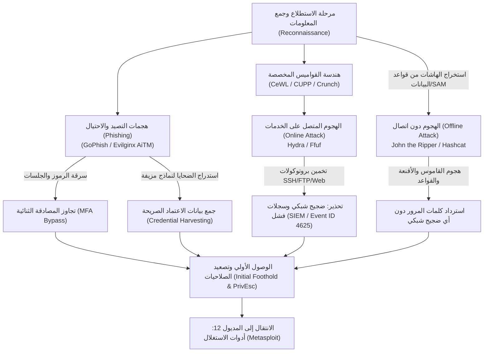

# توثيق مراجعة الانتقال الموضوعي: هجمات كلمات المرور (Topic Transition Recap)

---

## 1. بيانات المديول والروم (Metadata & Overview)

* **المسار التعليمي:** مسار مبتدئ اختبار الاختراق (Jr Penetration Tester)
* **المديول:** المديول الحادي عشر — هجمات كلمات المرور (11-PASSWORD-ATTACKS)
* **اسم الغرفة:** مراجعة الانتقال الموضوعي (Topic Transition Recap)
* **المعرف البرمجي (Slug / ID):** `6afe01d5f306fc3f65928020`
* **الرابط المباشر:** [TryHackMe Password Attacks Recap](https://tryhackme.com/recap/6afe01d5f306fc3f65928020)
* **مستوى الصعوبة:** سهل إلى متوسط (Comprehensive Module Review)
* **النوع:** تقييم ختامي وتحقق مفاهيمي (Topic Transition Assessment)
* **عدد الأسئلة:** 6 أسئلة تقييم شاملة
* **النقاط المحرزة:** 48 / 48 نقطة (التحقق الكامل بنسبة 100%)

---

## 2. الملخص التنفيذي (Executive Summary)

تُمثل هذه الغرفة **محطة التقييم الختامي والانتقال المنهجي** للمديول الحادي عشر (Password Attacks) في مسار Jr Penetration Tester؛ حيث تجمع وتربط بين كافة المفاهيم والأدوات الهجومية التي تم استكشافها عملياً عبر غرف المديول الخمس السابقة:
1. **التصيد الاحتيالي (Phishing Basics):** آليات الهندسة الاجتماعية، تجاوز المصادقة الثنائية عبر وسيط في المنتصف (AiTM / Evilginx)، وإدارة الحملات عبر GoPhish و SET.
2. **التخمين الشبكي عبر Hydra:** استهداف بروتوكولات الشبكة ونماذج الويب (`http-get-form` و `http-post-form`) وضبط التزامن لتفادي قفل الحسابات.
3. **هندسة القواميس المخصصة (Introduction to Wordlists):** إنشاء القواميس عبر Crunch و CeWL، تنقية الكلمات برمجياً، وهجمات الأقنعة.
4. **كسر الهاشات دون اتصال (Password Cracking):** التمييز التشفيري بين MD5 و SHA-256 و bcrypt، وتسخير معالجات الرسوميات عبر Hashcat والمعالجات المركزية عبر John the Ripper.
5. **تحدي الشطرنج الأمني (Checkmate):** الاستغلال الواقعي للأنماط البشرية الخاطئة، من القيم الافتراضية والبيانات الشخصية ووصولاً إلى التحوير المتوقع لسياسات التعقيد.

---

## 3. مخطط سير الهجمات وتكامل المديول (Architectural & Synthesis Diagram)

يوضح المخطط التالي المنظومة المتكاملة لهجمات كلمات المرور وكيف تغذي كل مرحلة المرحلة التالية:

---

## 4. المتطلبات ومراجعة البيئة (Prerequisites & Environment Setup)

تمثل هذه المراجعة تتويجاً شاملاً للمديول، وتفترض إتقان بيئة التشغيل التالية:
* الإلمام ببيئة سطر الأوامر في أنظمة لينكس وأدوات معالجة النصوص (`tr`, `grep`, `sort`, `sed`).
* الإلمام ببروتوكولات الويب (HTTP GET vs POST، ترويسات المصادقة، والترميز).
* جاهزية حزمة الأدوات الهجومية: `hydra`, `john`, `hashcat`, `ffuf`, `cewl`, `crunch`, و `hashid`.

---

## 5. المحاور التقنية الستة للمراجعة الانتقالية (Core Technical Pillars)

1. **البصمة الشبكية للهجوم المتصل (Online Attack Noise):** كل محاولة تخمين عبر الشبكة تُمثل طلباً حقيقياً يُسجل في سجلات النظام (`/var/log/auth.log` أو حدث ويندوز `4625`)، مما يجعل الهجوم مكشوفاً للغاية أمام أنظمة المراقبة (SIEM).
2. **الاستطلاع الدقيق لنماذج الويب (HTTP Method Scouting):** تحديد طريقة الإرسال (`GET` في شريط العنوان أو `POST` في جسم الطلب) هو الشرط الحاسم لتحديد نمط أداة Hydra (`http-get-form` مقابل `http-post-form`).
3. **توسيع المرشحات آلياً في Ffuf (`-e` Flag):** يسمح خيار الامتدادات بتوليد طلبات مركبة لكل كلمة في القاموس مضافاً إليها اللواحق المحددة (`.php`, `.html`, `/`) لاكتشاف الملفات والمجلدات المخفية.
4. **تفوق القواميس المخصصة على القواميس العامة:** تفتقر القواميس الضخمة (مثل RockYou) إلى المصطلحات الداخلية وأسماء المنتجات والعلامات التجارية الخاصة بالمؤسسة، بينما تنجح القواميس المستهدفة المبنية على محتوى الموقع في كسر الحسابات بدقة متناهية.
5. **ترسانة التصيد الاحتيالي ونتائجها العملياتية:**
   - **SET:** استدراج الضحايا وحصاد مدخلات النماذج المزيفة محلياً.
   - **Evilginx:** وسيط في المنتصف (AiTM) لاعتراض رموز الجلسات وتجاوز المصادقة الثنائية (MFA).
   - **GoPhish:** جدولة الحملات وتحليل معدلات النقر والفتح.
   - **مختصرات الروابط (URL Shorteners):** إخفاء الوجهة الحقيقية وتجاوز الفحص البصري للمستخدمين.
6. **التحصين التشفيري بالملح العشوائي (Salting):** يضمن الملح العشوائي الفريد لكل مستخدم اختلاف الهاش الناتج حتى لو تطابقت كلمات المرور؛ مما يُبطل تماماً جدوى جداول قوس قزح المحسوبة مسبقاً (Rainbow Tables).

---

## 6. دليل الحل التفصيلي لأسئلة المراجعة (Complete Walkthrough)

### السؤال 1: الضجيج وسجلات الفشل في الهجمات المتصلة
- **نص السؤال:** "A brute-force login attack against a network service generates many failed authentication log entries."
- **التحليل:** الهجوم المتصل يرسل طلب مصادقة عبر الشبكة مع كل كلمة مرشحة؛ مما يؤدي إلى تراكم مئات أو آلاف سجلات فشل المصادقة على الخادم، وتفعيل تنبيهات أنظمة كشف التسلل (IDS) أو قفل الحسابات.
- **الإجابة الصحيحة:** **`True`**

### السؤال 2: تحديد بنية طلب تسجيل الدخول على الويب
- **نص السؤال:** "Before brute-forcing a web login page, what must you determine about the login request?"
- **التحليل:** لا تؤثر تفاصيل مشفرات TLS أو نوع قاعدة البيانات الخلفية أو نواة الخادم على تركيبة الأمر؛ بينما تُحدد طريقة الطلب (`GET` أو `POST`) الوحدة البرمجية الواجب استخدامها في أدوات التخمين (حيث تُرسل البيانات إما في الـ Query String أو داخل الـ Body).
- **الإجابة الصحيحة:** **`Whether it is submitted as a GET or a POST request`**

### السؤال 3: وظيفة معامل الامتدادات `-e` في أداة Ffuf
- **نص السؤال:** "In ffuf, what does `-e .php,.html,/` add to a directory discovery scan?"
- **التحليل:** يقوم المعامل بتجربة كل كلمة في القاموس مجردة، ثم يعيد تجربتها متبوعة بكل امتداد مذكور (مثلاً: كلمة `admin` تُفحص كـ `admin`, `admin.php`, `admin.html`, و `admin/`).
- **الإجابة الصحيحة:** **`Each word is also tried with those suffixes appended`**

### السؤال 4: كفاءة القواميس المخصصة مقابل القواميس العامة
- **نص السؤال:** "A wordlist built from words specific to the target often succeeds where a large generic list fails."
- **التحليل:** الكلمات المتصلة بثقافة الشركة، وأسماء الموظفين، والمشاريع الداخلية نادراً ما تظهر في القواميس العامة؛ لذا فإن القواميس المستخرجة عبر الاستخبارات المفتوحة ومحتوى الويب تحقق نجاحاً أسرع وأعلى دقة.
- **الإجابة الصحيحة:** **`True`**

### السؤال 5: مطابقة أدوات التصيد مع نتائجها العملياتية
- **نص السؤال:** "Match each phishing capability to the outcome it provides for the attacker."
- **المطابقة الصحيحة والمحققة:**
  1. `SET credential harvester` $\longleftrightarrow$ `Logging submitted form fields on a fake page`
  2. `Evilginx` $\longleftrightarrow$ `Live capture of session tokens past MFA`
  3. `GoPhish` $\longleftrightarrow$ `Campaign scheduling with open and click analytics`
  4. `URL shortener` $\longleftrightarrow$ `Concealing a link's true destination`

### السؤال 6: الفائدة الأمنية للملح العشوائي (Salting)
- **نص السؤال:** "What is the main security benefit of adding a unique random salt to each password before hashing?"
- **التحليل:** لا يؤثر الملح على سرعة الخوارزمية (السرعة يحددها الـ Cost Factor)، ولا يحول الهاش إلى تشفير؛ بل يجعل كل هاش فريداً حتى لكلمات المرور المتطابقة، مما يدمر فاعلية جداول قوس قزح (Rainbow Tables).
- **الإجابة الصحيحة:** **`Pre-computed rainbow tables become useless`**

---

## 7. المصفوفة الشاملة لأدوات المديول الحادي عشر (Tools Master Matrix)

| الأداة | التصنيف العملياتي | الغرض الأساسي | أمر نموذجي |
| :--- | :--- | :--- | :--- |
| **Hydra** | تخمين شبكي متصل | كسر مصادقة بروتوكولات الشبكة والويب | `hydra -l admin -P pass.txt target http-post-form "/login:u=^USER^&p=^PASS^:F=denied"` |
| **Ffuf** | استكشاف الويب والمدخلات | تخمين المسارات ونماذج الويب مع امتدادات | `ffuf -u http://target/FUZZ -w words.txt -e .php,.html,/ -mc 200,302` |
| **Crunch** | توليد القواميس | توليد قواميس بأطوال وأقنعة محددة | `crunch 11 11 -t Bianchi%%%% -o wordlist.txt` |
| **CeWL** | جمع الكلمات من الويب | استخراج الكلمات المفتاحية من مواقع الأهداف | `cewl -d 2 -m 5 -w target_words.txt https://target.com` |
| **John the Ripper** | كسر الهاشات دون اتصال | معالجة التنسيقات المتنوعة وتجزئات الأرشيف | `john --format=raw-sha256 --wordlist=rockyou.txt hashes.txt` |
| **Hashcat** | كسر الهاشات عبر GPU | كسر الهاشات الضخمة بأقنعة وقواعد متوازية | `hashcat -m 1400 -a 3 hashes.txt '?u?l?l?l?l?l?d?d'` |
| **Evilginx** | تصيد متقدم (AiTM) | اعتراض الكوكيز وتجاوز الـ MFA الحية | نشر خوادم وسيطة وتفعيل الـ Phishlets المستهدفة |
| **GoPhish** | إدارة حملات التصيد | أتمتة الإرسال وتتبع تفاعل الضحايا | تشغيل لوحة التحكم وجدولة الحملة وتتبع النتائج |

---

## 8. الأسس التشفيرية المتقدمة لكسر وتأمين كلمات المرور (Cryptographic Internals)

* **معادلة التمليح ومنع جداول قوس قزح:**
  $$\text{Stored Record} = \text{Salt} \mathbin{\Vert} \text{KDF}(\text{Password} \mathbin{\Vert} \text{Salt})$$
  بدون الملح، يمتلك المهاجم جدولاً مسبق الحساب بحجم عدة تيرابايت يسترجع النص الصريح في جزء من الثانية. مع الملح، يتطلب كل مستخدم حساب جدول جديد بالكامل، مما يرفع التكلفة الحسابية بمقدار عدد مستخدمي النظام ($N$).
* **معامل الإبطاء المتعمد (Cost Factor):**
  الخوارزميات السريعة (MD5, SHA-1, SHA-256) تُحسب بالمليارات في الثانية على بطاقات الرسوميات. بينما الخوارزميات المخصصة مثل bcrypt و Argon2 تفرض قيوداً على الذاكرة ودورات التكرار ($2^{\text{cost}}$)، مما يحول الهجوم من ثوانٍ إلى قرون حسابية.

---

## 9. الأمن العملياتي والمقارنة بين الهجوم المتصل وغير المتصل (OpSec Footprint)

| معيار المقارنة | الهجوم المتصل (Online - Hydra/Ffuf) | الهجوم دون اتصال (Offline - Hashcat/John) |
| :--- | :--- | :--- |
| **البصمة الشبكية** | عالية جداً؛ كل تخمين هو حزمة شبكية مسجلة | معدومة تماماً؛ تجري على أجهزة المختبر المعزولة |
| **الرصد في السجلات** | يولد مئات أحداث الفشل (Event 4625 / 401 Unauthorized) | لا ينتج أي حدث في أنظمة وسجلات الهدف |
| **سياسات قفل الحسابات** | معرض بقوة لتفعيل القفل وتعطيل حسابات الموظفين | محصن تماماً ضد سياسات القفل والمهلات الزمنية |
| **معدل السرعة** | محدود بزمن استجابة الشبكة (عشرات التخمينات/ثانية) | مقيد فقط بقوة العتاد (ملايين أو مليارات التخمينات/ثانية) |

---

## 10. التحصين الدفاعي المؤسسي (Defensive Hardening)

بناءً على معايير **NIST SP 800-63B** و **CISA Guidelines**:
1. **التحول الإلزامي للمصادقة متعددة العوامل المقاومة للتصيد (FIDO2 / WebAuthn):** المصادقة المعتمدة على المفاتيح الفيزيائية تُبطل فاعلية هجمات Evilginx لأن التوقيع المشفر يرتبط بنطاق الموقع الحقيقي (Origin Binding).
2. **استبدال سياسات التعقيد بفرض الطول وفحص التسريبات:** إلغاء فرض الرموز الدورية التي تشجع على أنماط مثل `Security2024!`، وفرض حد أدنى لطول الكلمة (16 محرفاً)، وفحص الكلمات لحظة التسجيل عبر HaveIBeenPwned API.
3. **مراقبة سلوك تسجيل الدخول:** تفعيل أنظمة التحليل السلوكي للمستخدمين (UEBA) لرصد محاولات التخمين الموزعة (Password Spraying) التي تتجنب عتبات القفل التقليدية.

---

## 11. الأخطاء الشائعة في تقييمات كلمات المرور (Common Pitfalls)

* **الاعتماد على القواميس العامة فقط في التخمين المتصل:** إضاعة الوقت في تجربة 14 مليون كلمة عبر شبكة بطيئة بدلاً من استخدام قاموس مخصص من 500 كلمة مستخرجة من الموقع المستهدف.
* **إغفال سياق طلب الويب في Hydra:** تحديد خيار `http-post-form` لصفحة ترسل بياناتها عبر `GET`، مما يؤدي إلى فشل الهجوم دون تلقي أي تنبيه بالخطأ.
* **رفع هاشات العملاء للمواقع العامة:** انتهاك اتفاقيات عدم الإفصاح عبر فحص هاشات العملاء على مواقع مثل CrackStation بدلاً من كسرها محلياً.

---

## 12. فهرس الأسئلة والإجابات المحققة 48/48 (Tasks Index)

| الرقم | موضوع السؤال | نوع السؤال | الإجابة المحققة والصحيحة | النقاط |
| :---: | :--- | :---: | :--- | :---: |
| **Q1** | أثر الهجوم المتصل على سجلات الفشل | Boolean | **`True`** | 8 |
| **Q2** | تحديد بنية طلب تسجيل الدخول على الويب | Multiple Choice | **`Whether it is submitted as a GET or a POST request`** | 8 |
| **Q3** | وظيفة معامل الامتدادات `-e` في Ffuf | Multiple Choice | **`Each word is also tried with those suffixes appended`** | 8 |
| **Q4** | فاعلية القواميس المخصصة مقابل العامة | Boolean | **`True`** | 8 |
| **Q5** | مطابقة أدوات التصيد مع نتائجها العملياتية | Matching | **SET / Evilginx / GoPhish / URL Shortener (All Matched)** | 8 |
| **Q6** | الفائدة الأمنية للملح التشفيري (Salt) | Multiple Choice | **`Pre-computed rainbow tables become useless`** | 8 |

---

## 13. مراجعة المفاهيم والأسئلة الانتقالية للمديول القادم (Module 12 Transition)

1. **س: كيف تمهد بيانات الاعتماد المستردة في المديول 11 الطريق لمديول Metasploit (المديول 12)؟**  
   *ج:* تتيح كلمات المرور المستردة استخدام وحدات الاستغلال وما بعد الاستغلال الموثقة في Metasploit (مثل `exploit/windows/smb/psexec` أو وحدات فحص وحقن الحمولات) لتنفيذ أوامر عن بُعد والحصول على جلسات Meterpreter تفاعلية.

2. **س: لماذا يُعد تجاوز المصادقة الثنائية عبر Evilginx خطوة حاسمة في مرحلة الوصول الأولي؟**  
   *ج:* لأن الاستيلاء على كعكة الجلسة (Session Cookie) يسمح للمختبر بالدخول المباشر إلى منصات السحابة وتطبيقات المؤسسة دون الحاجة لمعرفة كلمة المرور الصريحة أو امتلاك الهاتف الشخصي للضحية.

3. **س: ما الفرق بين حمولات التصيد في المديول 11 وحمولات استغلال الثغرات في المديول 12؟**  
   *ج:* تركز حمولات التصيد على الهندسة الاجتماعية واستدراج المستخدم لتشغيل ملف أو إدخال بياناته، بينما تركز حمولات Metasploit على الاستغلال البرمجي المباشر لعيوب الذاكرة والخدمات الشبكية المكشوفة.

---

## 14. المراجع والتوثيق الرسمي (References)

* [إرشادات NIST SP 800-63B لإدارة الهويات وكلمات المرور](https://csrc.nist.gov/publications/detail/sp/800-63b/final)
* [دليل OWASP الشامل لتخزين كلمات المرور](https://cheatsheetseries.owasp.org/cheatsheets/Password_Storage_Cheat_Sheet.html)
* [المستودع الرسمي لأداة Evilginx لتجاوز MFA](https://github.com/kgretzky/evilginx2)
* [المستودع الرسمي لإطار عمل GoPhish](https://github.com/gophish/gophish)
* [توثيق TryHackMe الرسمي لتقييم الانتقال الموضوعي للمديول 11](https://tryhackme.com/recap/6afe01d5f306fc3f65928020)
