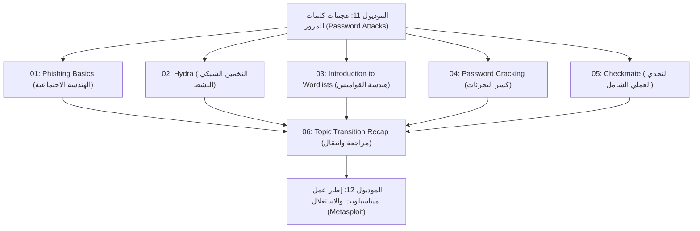

# الوحدة 11: هجمات كلمات المرور واختراق أوراق الاعتماد (Password Attacks)

---

## 1. الترويسة والبيانات الوصفية (Metadata)

- **اسم الوحدة بالإنجليزية:** Module 11: Password Attacks
- **المسار التعليمي:** Junior Penetration Tester (PT1 Aligned Curriculum)
- **المعرف الهيكلي على القرص:** `11-PASSWORD-ATTACKS`
- **عدد الغرف والتحديات:** 6 وحدات (5 غرف رئيسية ومختبرات تفاعلية + 1 اختبار مراجعة انتقالية)
- **المتطلبات السابقة:** Module 03 (Network Reconnaissance)، Module 09 (Vulnerability Knowledge)، Module 10 (OWASP Top 10 - 2025).

---

## 2. النظرة الشاملة لوحدة هجمات كلمات المرور

تُشكل كلمات المرور وأوراق الاعتماد الرقمية خط الدفاع الأول والهدف الرئيسي للمهاجمين في كافة مراحل اختبار الاختراق. تركز هذه الوحدة المتكاملة على تغطية السلسلة الهجومية الكاملة للتعامل مع آليات التوثيق والمصادقة:

1. **الهندسة الاجتماعية والتصيد (Phishing Basics):**
   فهم كيف يتم استدراج الضحايا للكشف عن كلمات المرور، وتشريح رسائل البريد الإلكتروني الاحتيالية، وتحليل ترويسات البريد ومؤشرات الاختراق.
2. **التخمين الشبكي النشط عبر الإنترنت (Online Brute-Forcing with Hydra):**
   إتقان استخدام أداة **Hydra** لشن هجمات تخمين سريعة وموجهة ضد بروتوكولات الشبكة وإدارة الخوادم (SSH, FTP, RDP) واستمارات تسجيل الدخول عبر الويب (HTTP POST/GET).
3. **هندسة وتوليد القوائم المعجمية (Wordlists):**
   تجاوز القوائم الجاهزة الثابتة (مثل rockyou.txt) عبر تعلم توليد قواميس مخصصة وموجهة للهدف باستخدام أدوات التجريف وتوليد القواعد والأنماط المعقدة.
4. **كسر التجزئات دون اتصال (Offline Password Cracking):**
   استيعاب آليات التجزئة (MD5, SHA-256, NTLM, bcrypt) واستخدام أقوى محركات الكسر المتوازية: **John the Ripper** و **Hashcat** باستخدام القواميس وهجمات الأقنعة (Mask Attacks).
5. **المختبر التحدي التطبيقي (Checkmate):**
   محاكاة سيناريو اختراق واقعي يدمج الاستطلاع واستهداف كلمات المرور والوصول الأولي وتصعيد الصلاحيات.

---

## 3. خريطة الترابط الهيكلي لغرف الموديول 11

