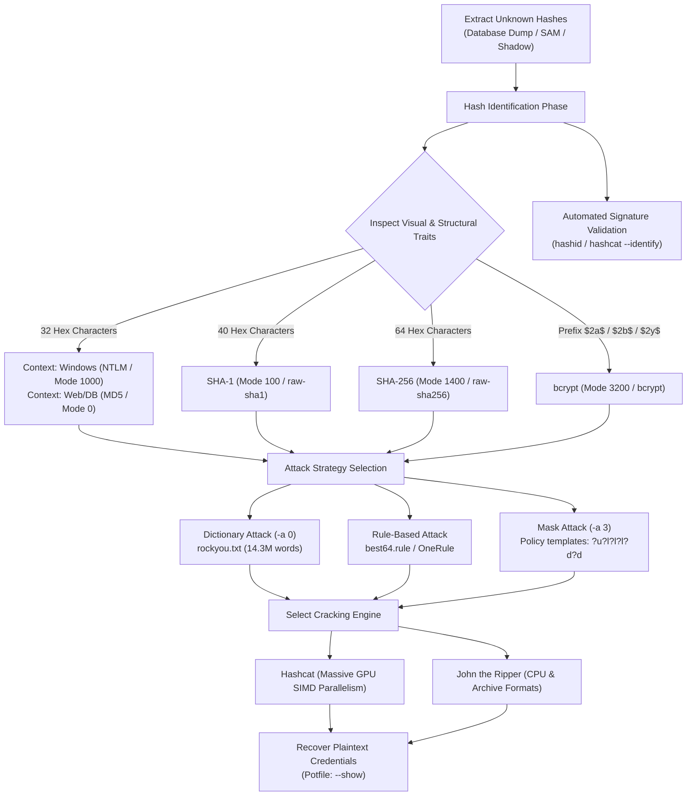

# Room Documentation: Password Cracking

---

## 1. Metadata & Overview

* **Learning Path:** Jr Penetration Tester
* **Module:** Module 11 — Password Attacks (11-PASSWORD-ATTACKS)
* **Room Name:** Password Cracking
* **Room Slug:** `passwordcracking`
* **Room URL:** [TryHackMe Password Cracking](https://tryhackme.com/room/passwordcracking)
* **Difficulty:** Easy
* **Room Type:** Walkthrough & Practical Lab
* **Total Tasks:** 7 Tasks
* **Total Questions:** 18 Questions (100% Verified)

---

## 2. Executive Summary

**Offline Password Cracking** is an essential capability in technical penetration testing and red teaming. Once credentials or cryptographic hashes are exfiltrated from compromised endpoints, database backups, or memory dumps (e.g., SAM hives, Active Directory `NTDS.dit`, `/etc/shadow`), offline password cracking enables operators to recover cleartext credentials without generating network noise or triggering lockout countermeasures.

This room covers the end-to-end cracking lifecycle: fundamental properties of one-way cryptographic hash functions, prefix and length-based hash identification, selecting optimal attack methodologies (dictionary, rule-based, and mask attacks), and executing high-throughput cracking workflows using the industry-standard suites: **John the Ripper** (CPU-focused) and **Hashcat** (GPU-accelerated).

---

## 3. Architectural & Attack Flow Diagram

The following diagram illustrates the structured, multi-stage offline password cracking workflow:



---

## 4. Prerequisites & Environment Setup

Verify tool suites and wordlist configurations on the assessment platform:

```bash
# 1. Verify John the Ripper installation and supported sub-formats
john --version

# 2. Verify Hashcat installation and hardware device detection (OpenCL/CUDA)
hashcat --version
hashcat -I

# 3. Ensure the RockYou wordlist is decompressed and accessible
if [ -f /usr/share/wordlists/rockyou.txt.gz ]; then
    sudo gzip -d /usr/share/wordlists/rockyou.txt.gz
fi
ls -lh /usr/share/wordlists/rockyou.txt

# 4. Install automated hash identification utilities
sudo apt update && sudo apt install -y hashid
```

---

## 5. Target & Hash Profiling

During the practical challenge (Task 06), four target hashes located in `/root/Rooms/PasswordCracking/` were analyzed:

| Filename | Length / Prefix | Identified Algorithm | Hashcat Mode | John Format | Recovered Plaintext |
| :--- | :--- | :--- | :---: | :---: | :--- |
| `hash1.txt` | 32 hex chars | **MD5** | `0` | `raw-md5` | `123456` |
| `hash2.txt` | 64 hex chars | **SHA-256** | `1400` | `raw-sha256` | `password` |
| `hash3.txt` | 40 hex chars | **SHA-1** | `100` | `raw-sha1` | `password` |
| `hash4.txt` | Prefix `$2y$12$` | **bcrypt** | `3200` | `bcrypt` | `hayden07` |

---

## 6. Complete Walkthrough & Methodological Stages

### Stage 1: How Passwords Are Stored
- Storing passwords in plaintext is catastrophic. Instead, modern systems store passwords through cryptographic hash functions that are strictly **one-way** (computationally irreversible).
- To prevent precomputed lookup attacks (Rainbow Tables), systems introduce a **salt**—a cryptographically random string appended/prepended to the password before hashing.
- General cryptographic hashes (MD5, SHA-1, SHA-256) were designed for fast data integrity and allow billions of guesses per second on GPUs. In contrast, purpose-built password algorithms such as **bcrypt** and **Argon2** are **deliberately slow** and incorporate configurable work factors.

### Stage 2: Identifying Hash Types
- Hexadecimal conversion: A 256-bit hash equals **64** hexadecimal characters ($256 \div 4 = 64$).
- When invoking John the Ripper against an unformatted SHA-256 hash, specify the raw format flag: `--format=raw-sha256`.

### Stage 3: Wordlists & Attack Strategies
- The standard wordlist on Linux security distributions resides at `/usr/share/wordlists/rockyou.txt`.
- An attack that applies deterministic programmatic mutations (capitalization, leetspeak, number suffixes) to a wordlist is a **rule-based** attack.
- When attacking passwords governed by strict organizational policies (e.g., uppercase letter followed by 6 lowercase letters and 2 digits), a **mask** attack provides maximum efficiency.

### Stage 4: Cracking with John the Ripper and Hashcat
- For large volumes of raw cryptographic hashes, **hashcat** is the superior choice due to mass GPU SIMD hardware acceleration.
- In Hashcat, attack mode **`3`** denotes a mask/brute-force attack (`-a 3`).
- To display previously cracked credentials stored in John the Ripper's potfile, supply the **`--show`** argument.

### Stage 5: Practical Cracking Execution
1. Inspecting `hash1.txt`: 32 hex characters $\to$ **MD5**. Cracking with `rockyou.txt` yields: `123456`.
2. Inspecting `hash2.txt`: 64 hex characters $\to$ **SHA-256**. The corresponding Hashcat mode is **`1400`**. Cracking yields: `password`.
3. Inspecting `hash3.txt`: Evaluates to the identical plaintext as `hash2.txt`: `password`.
4. Inspecting `hash4.txt`: Modular crypt prefix `$2y$` $\to$ **bcrypt**. Cracking with `rockyou.txt` recovers: `hayden07`.

---

## 7. Tools Deep Dive & Syntax Matrix

| Utility | Operational Task | Full Command Syntax |
| :--- | :--- | :--- |
| **John** | Dictionary attack on raw MD5 | `john --format=raw-md5 --wordlist=/usr/share/wordlists/rockyou.txt hash1.txt` |
| **John** | Dictionary attack on raw SHA-256 | `john --format=raw-sha256 --wordlist=/usr/share/wordlists/rockyou.txt hash2.txt` |
| **John** | Dictionary attack on bcrypt | `john --format=bcrypt --wordlist=/usr/share/wordlists/rockyou.txt hash4.txt` |
| **John** | Display cracked passwords from potfile | `john --show --format=raw-md5 hash1.txt` |
| **Hashcat** | Dictionary attack on MD5 | `hashcat -m 0 -a 0 hash1.txt /usr/share/wordlists/rockyou.txt` |
| **Hashcat** | Rule-based attack on SHA-256 | `hashcat -m 1400 -a 0 hash2.txt rockyou.txt -r /usr/share/hashcat/rules/best64.rule` |
| **Hashcat** | Mask attack on SHA-256 | `hashcat -m 1400 -a 3 hash2.txt '?u?l?l?l?l?l?l?d?d'` |
| **Hashcat** | Display cracked passwords | `hashcat -m 1400 hash2.txt --show` |

---

## 8. Cryptographic & Security Internals

### The Performance Disparity Between Hash Families:
- **Merkle–Damgård Hashes (MD5, SHA-1, SHA-256):** Feature low-complexity compression functions composed of basic 32-bit addition, XOR, and bitwise shifts. An NVIDIA RTX 4090 executes over **160 billion MD5 operations per second**.
- **Memory-Hard / Iterative KDFs (bcrypt, Argon2):** bcrypt executes the Expensive Key Schedule (Eksblowfish) across $2^{\text{cost}}$ iterations ($2^{12} = 4,096$ rounds). The same RTX 4090 achieves only **~25,000 checks per second** on bcrypt cost 12—representing a speed reduction factor exceeding **6,400,000x**.

---

## 9. Operational Security & Detection Footprint

* **Zero Network Artifacts:** Offline cracking executes entirely on tester-controlled infrastructure. Zero packets traverse client networks, and zero events appear in target SIEMs or firewalls.
* **Immunity to Lockout Thresholds:** Target operating systems, PAM modules (`pam_faillock`), and Active Directory domain controllers receive no notification of offline attempts. Testers can evaluate billions of candidate keys without locking target accounts.
* **Strict Confidentiality Mandate:** Under non-disclosure agreements, penetration testers must **NEVER** upload target client hashes to public online search databases (such as CrackStation or Hashes.com). These services log queries and expose sensitive enterprise secrets publicly.

---

## 10. Defensive Hardening & Remediation

Per **NIST SP 800-63B** and **OWASP Password Storage Guidelines**:
1. **Retire Legacy Algorithms:** Deprecate MD5, SHA-1, raw SHA-256, and NTLM immediately.
2. **Standardize on Modern Password Storage:**
   - **Argon2id:** Minimum configuration: $m = 65,536 \text{ KiB}$ (64 MiB), $t = 3$ iterations, $p = 4$ threads.
   - **bcrypt:** Minimum work factor of $12$ ($2^{12} = 4,096$ rounds) for standard applications; $14$ for administrative access.
3. **Enforce Cryptographic Salting:** Ensure a unique CSPRNG salt ($\ge 16$ bytes) is generated for every user record.
4. **Modernize Password Complexity Policies:**
   - Eliminate arbitrary periodic password expiration.
   - Enforce a minimum length of 12-16 characters.
   - Implement real-time blacklist screening against compromised password databases (HaveIBeenPwned API) during registration and credential change events.

---

## 11. Common Pitfalls & Troubleshooting

* **MD5 vs. NTLM Ambiguity:** Both produce 32 hexadecimal characters. Context determines the algorithm: Windows SAM / AD dumps indicate NTLM (`-m 1000` / `--format=nt`), while web application databases generally indicate MD5 (`-m 0` / `--format=raw-md5`).
* **Ignoring the Potfile:** If John or Hashcat reports "No hashes loaded / all hashes already cracked", retrieve the stored plaintext using the `--show` argument.
* **Windows Line Endings (CRLF):** Wordlists created or edited in Windows may contain carriage returns (`\r`), which corrupt matching on Linux cracking suites. Always strip CRLF via `tr -d '\r' < list.txt > clean.txt`.

---

## 12. Comprehensive Tasks & Solutions Index

| Task # | Task Title | Question Text | Verified Answer |
| :---: | :--- | :--- | :--- |
| **01** | Introduction | I understand the learning objectives and am ready to password-crack! | `No answer needed` |
| **02** | How Passwords Are Stored | What property of a hash function means you cannot reverse a hash? | `one-way` |
| **02** | How Passwords Are Stored | What term describes the unique random string added to a password? | `salt` |
| **02** | How Passwords Are Stored | Which hashing algorithm was designed specifically for passwords and is slow? | `bcrypt` |
| **03** | Identifying Hash Types | What is the character length of an SHA-256 hash? | `64` |
| **03** | Identifying Hash Types | What John the Ripper format would you use for an SHA-256 hash? | `raw-sha256` |
| **04** | Wordlists and Attack Strategies | What is the full path to the rockyou wordlist on the AttackBox? | `/usr/share/wordlists/rockyou.txt` |
| **04** | Wordlists and Attack Strategies | What type of attack applies transformations such as capitalisation? | `rule-based` |
| **04** | Wordlists and Attack Strategies | What attack type is best suited to cracking a known pattern hash? | `mask` |
| **05** | Cracking with John and Hashcat | Which tool is the better choice for large sets: John or Hashcat? | `hashcat` |
| **05** | Cracking with John and Hashcat | What Hashcat attack mode number is used for a mask attack? | `3` |
| **05** | Cracking with John and Hashcat | Which John flag displays previously cracked passwords from potfile? | `--show` |
| **06** | Practical | What algorithm produced the hash in hash1.txt? | `MD5` |
| **06** | Practical | What Hashcat mode would you use to crack the hash in hash2.txt? | `1400` |
| **06** | Practical | What is the plaintext password for hash1.txt? | `123456` |
| **06** | Practical | hash2.txt and hash3.txt share the same plaintext. What is it? | `password` |
| **06** | Practical | What is the plaintext password for hash4.txt? | `hayden07` |
| **07** | Conclusion | I have completed the room! | `No answer needed` |

---

## 13. Knowledge Check & Exam Review

1. **Why do rainbow tables fail against salted passwords?**  
   *Answer:* A unique salt ensures that identical passwords yield distinct hash outputs across different users. The attacker cannot reuse a single precomputed table across an entire database; they must compute a dedicated lookup table for every individual salt.

2. **What is the difference between Hashcat attack mode `-a 0` and `-a 3`?**  
   *Answer:* Mode 0 is a straight dictionary attack that reads candidate strings sequentially from a wordlist file. Mode 3 is a mask/brute-force attack that dynamically generates candidate strings on-the-fly according to structural character templates (e.g., `?u?l?l?d?d`).

3. **How does the bcrypt work factor prevent offline cracking?**  
   *Answer:* The work factor scales the internal Blowfish key schedule expansion exponentially ($2^{\text{cost}}$). Incrementing the cost factor doubles the computational time required per candidate guess, severely limiting the ability of GPUs to execute high-speed cracking.

---

## 14. References & External Documentation

* [NIST SP 800-63B: Digital Identity Guidelines](https://csrc.nist.gov/publications/detail/sp/800-63b/final)
* [OWASP Password Storage Cheat Sheet](https://cheatsheetseries.owasp.org/cheatsheets/Password_Storage_Cheat_Sheet.html)
* [Hashcat Official Documentation & Wiki](https://hashcat.net/wiki/)
* [John the Ripper Official GitHub Repository](https://github.com/openwall/john)
* [TryHackMe Password Cracking Room](https://tryhackme.com/room/passwordcracking)
