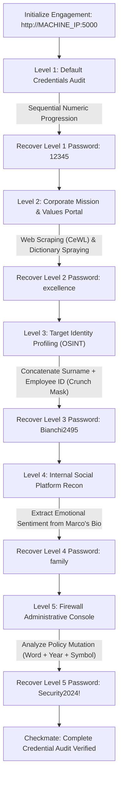

# Room Documentation: Checkmate (Capstone Challenge)

---

## 1. Metadata & Overview

* **Learning Path:** Jr Penetration Tester
* **Module:** Module 11 — Password Attacks (11-PASSWORD-ATTACKS)
* **Room Name:** Checkmate
* **Room Slug:** `checkmate`
* **Room URL:** [TryHackMe Checkmate](https://tryhackme.com/room/checkmate)
* **Difficulty:** Easy
* **Room Type:** Hands-on Challenge Lab
* **Total Tasks:** 1 Comprehensive Task
* **Total Questions:** 5 Challenge Levels (100% Solved & Verified)

---

## 2. Executive Summary

**Checkmate** serves as the practical capstone challenge for Module 11 (Password Attacks). The assessment places the penetration tester into an authentic engagement scenario auditing the infrastructure deployed by a systems administrator named **Marco Bianchi**. Under strict operational deadlines, Marco deployed multiple internal applications—including a firewall management console, an employee portal, an internal social platform, and remote administration services—while reusing weak, predictable, and pattern-based credentials across every endpoint.

The challenge guides the tester sequentially through five progressive authentication levels hosted on port 5000 (`http://MACHINE_IP:5000`), demonstrating the real-world exploitation of common password anti-patterns: trivial default credentials, unmutated dictionary terms, OSINT-derived identity attributes, emotional/social sentiment anchors, and predictable policy-compliance mutations.

---

## 3. Architectural & Attack Flow Diagram

The following diagram illustrates the structured 5-stage attack methodology across the challenge endpoints:



---

## 4. Prerequisites & Environment Setup

Ensure the necessary web fuzzing and dictionary generation tools are installed and operational:

```bash
# 1. Update and install standard penetration testing binaries
sudo apt update && sudo apt install -y hydra ffuf cewl crunch

# 2. Verify availability of the RockYou wordlist
ls -lh /usr/share/wordlists/rockyou.txt

# 3. Test HTTP reachability to the target web challenge on Port 5000
curl -I http://MACHINE_IP:5000
```

---

## 5. Target & Scenario Profiling

* **Target Administrator:** Marco Bianchi.
* **Role:** Systems Administrator.
* **Employee Identifier:** `2495`.
* **Assessed Application Endpoints:**
  - Default Admin Portal (`/level1`).
  - Corporate Values & Employee Portal (`/level2`).
  - Employee Authenticated Login (`/level3`).
  - Internal Social Platform & Bio (`/level4`).
  - Firewall Administrative Console (`/level5`).

---

## 6. Complete Walkthrough & Methodological Stages

### Level 1: Default Credentials
- **Scenario:** Administrators under pressure frequently deploy services using simple, predictable default credentials for rapid verification.
- **Analysis & Solution:** The password form requests a 5-character string (`*****`). Testing standard sequential numerical combinations immediately grants access:
  $$\text{Password} = \texttt{12345}$$

### Level 2: Web Scraping & Dictionary Attacks
- **Scenario:** The employee portal outlines the company's core values, mission statement, and guiding principles.
- **Analysis & Solution:**
  1. Scrape candidate keywords using `cewl`:
     ```bash
     cewl -d 0 -m 5 -w level2_words.txt http://MACHINE_IP:5000/level2
     ```
  2. Spray candidate words against the authentication endpoint using `ffuf`:
     ```bash
     ffuf -u "http://MACHINE_IP:5000/level2" -X POST -d "password=FUZZ" \
          -H "Content-Type: application/x-www-form-urlencoded" \
          -w level2_words.txt -fr "Invalid"
     ```
  3. The 10-character keyword (`**********`) matching the portal's core value is:
     $$\text{Password} = \texttt{excellence}$$

### Level 3: Targeted OSINT Mask Attack
- **Scenario:** Marco's personal employee portal requires valid credentials.
- **Analysis & Solution:**
  1. Open-source intelligence (OSINT) reveals Marco's surname is `Bianchi` and his corporate badge/ID number is `2495`.
  2. Users habitually concatenate their surname with their employee ID or birthdate.
  3. Generate a 10,000-candidate mask wordlist with `crunch`:
     ```bash
     crunch 11 11 -t Bianchi%%%% -o marco_passwords.txt
     ```
  4. Spray using `hydra`:
     ```bash
     hydra -l marco -P marco_passwords.txt MACHINE_IP -s 5000 \
           http-post-form "/level3:username=^USER^&password=^PASS^:F=Invalid"
     ```
  5. The valid combination is recovered:
     $$\text{Password} = \texttt{Bianchi2495}$$

### Level 4: Social Reconnaissance & Sentiment Anchors
- **Scenario:** Marco's internal social communication profile features personal introductory remarks.
- **Analysis & Solution:** Inspecting Marco's introduction reveals his primary personal priority: *"Above everything else, my family always comes first."*
- Submitting the 6-letter noun (`******`) grants access:
  $$\text{Password} = \texttt{family}$$

### Level 5: Corporate Complexity Policy Mutation
- **Scenario:** The firewall management console enforces enterprise complexity mandates: uppercase letters, lowercase letters, numbers, and special symbols.
- **Analysis & Solution:**
  - Users satisfy complexity mandates with minimum cognitive friction by concatenating:
    $$\text{Corporate Noun (Title Case)} \mathbin{\Vert} \text{Current Year} \mathbin{\Vert} \text{Exclamation Mark}$$
  - Combining `Security`, `2024`, and `!` produces the 13-character string:
    $$\text{Password} = \texttt{Security2024!}$$

---

## 7. Tools Deep Dive & Syntax Matrix

| Tool | Challenge Level | Operational Command | Outcome |
| :--- | :--- | :--- | :--- |
| **Curl** | Level 1 | `curl -s -d "password=12345" http://MACHINE_IP:5000/level1` | Level 1 Solved (`12345`) |
| **CeWL** | Level 2 | `cewl -d 0 -m 5 -w level2_dict.txt http://MACHINE_IP:5000/level2` | Scraped site keywords |
| **Ffuf** | Level 2 | `ffuf -u "http://MACHINE_IP:5000/level2" -X POST -d "password=FUZZ" -w level2_dict.txt -fr "Invalid"` | Discovered `excellence` |
| **Crunch** | Level 3 | `crunch 11 11 -t Bianchi%%%% -o marco_pass.txt` | Generated 10k custom mask words |
| **Hydra** | Level 3 | `hydra -l marco -P marco_pass.txt MACHINE_IP -s 5000 http-post-form "/level3:username=^USER^&password=^PASS^:F=Invalid"` | Discovered `Bianchi2495` |
| **Crunch** | Level 5 | `crunch 13 13 -t Security2024?s -o lvl5_candidates.txt` | Generated symbol mutations |

---

## 8. Cryptographic & Behavioral Internals

The Checkmate challenge illustrates why arbitrary password complexity composition rules fail in practice. Because users cannot memorize random high-entropy strings ($95^{12}$) across multiple enterprise services, they resort to predictable cognitive heuristics:
1. **Positional Predictability:** Capital letters are placed at position 0 (`Security`), while special characters are appended at the final position (`!`).
2. **Temporal Anchoring:** Years (`2024`) or months are used to satisfy numeric requirements.
3. **Emotional Sentiment:** Values like `family` or pet names are routinely chosen to guarantee recall.

---

## 9. Operational Security & Detection Footprint

* **Concurrency Management:** In web application password spraying, keep concurrency low (`-t 4` or `-t 8`) to avoid triggering application thread pool starvation or web application firewall (WAF) rate limits.
* **Targeted Entropy Reduction:** Exhaustive brute forcing of an 11-character password requires $95^{11}$ operations. Constructing an OSINT-targeted mask (`Bianchi%%%%`) collapses the search space to 10,000 attempts, executing in seconds without triggering aggregate anomaly detections.

---

## 10. Defensive Hardening & Remediation

Per **NIST SP 800-63B** and **OWASP ASVS v4.0**:
1. **Abolish Arbitrary Composition Mandates:** Eliminate rules requiring uppercase, digits, and symbols, which actively foster predictable patterns like `Security2024!`. Prioritize length ($\ge 16$ characters).
2. **Enforce Multi-Factor Authentication (MFA / FIDO2):** Require hardware security keys or authenticator apps across all administrative interfaces.
3. **Automated Compromised Credential Screening:** Check new passwords against breached credential datasets (e.g., HaveIBeenPwned API) to block dictionary words and common sequences.
4. **Deploy Enterprise Password Managers:** Provide managed credential vaults so employees never memorize or mutate passwords manually.

---

## 11. Common Pitfalls & Troubleshooting

* **Unfocused Dictionaries on Level 3:** Spraying massive generic dictionaries wastes time and risks network timeouts. Formulate targeted lists using the victim's name and discovered employee attributes.
* **Overlooking Profile Text on Level 4:** Failing to inspect the user's social introduction leads to missing the explicit sentiment clue.
* **Hydra HTTP POST Matching Errors:** Misconfiguring the failure parameter (`:F=`) causes Hydra to report false positives for every candidate.

---

## 12. Comprehensive Tasks & Solutions Index

| Task # | Level | Question Text | Verified Password | Attack Method |
| :---: | :---: | :--- | :--- | :--- |
| **01** | Level 1 | What is the password for Level 1? | `12345` | Default Sequential Numeric |
| **01** | Level 2 | What is the password for Level 2? | `excellence` | Content Scraping (CeWL) & Dictionary Attack |
| **01** | Level 3 | What is the password for Level 3? | `Bianchi2495` | Targeted OSINT Mask Attack |
| **01** | Level 4 | What is the password for Level 4? | `family` | Social Reconnaissance & Sentiment Analysis |
| **01** | Level 5 | What is the password for Level 5? | `Security2024!` | Predictable Policy Complexity Mutation |

---

## 13. Knowledge Check & Exam Review

1. **Why do password complexity rules actively degrade credential security?**  
   *Answer:* Complex composition mandates force users to adopt predictable cognitive templates (Title Case Word + Current Year + Exclamation Point), making passwords trivial to crack using rule-based or mask attacks.

2. **How does CeWL accelerate authentication attacks against corporate targets?**  
   *Answer:* CeWL extracts high-frequency vocabulary, product names, and mission statements directly from corporate web pages, providing customized candidate lists tailored to an organization's specific naming culture.

3. **What is the most effective architectural defense against Level 3 (OSINT-based) attacks?**  
   *Answer:* Enforcing Multi-Factor Authentication (MFA), which renders knowledge of the password insufficient for authentication.

---

## 14. References & External Documentation

* [NIST SP 800-63B: Digital Identity Guidelines](https://csrc.nist.gov/publications/detail/sp/800-63b/final)
* [OWASP Application Security Verification Standard (ASVS v4.0)](https://owasp.org/www-project-application-security-verification-standard/)
* [CUPP Password Profiling Utility](https://github.com/Mebus/cupp)
* [Ffuf Fast Web Fuzzer Documentation](https://github.com/ffuf/ffuf)
* [TryHackMe Checkmate Room](https://tryhackme.com/room/checkmate)
