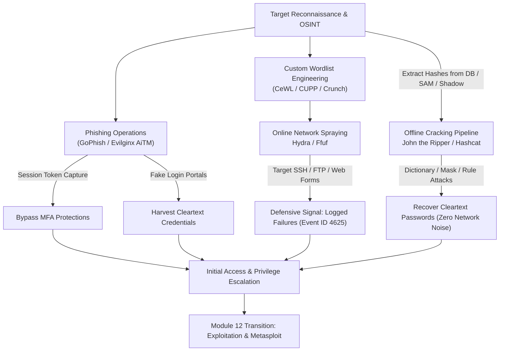

# Room Documentation: Topic Transition Recap (Password Attacks)

---

## 1. Metadata & Overview

* **Learning Path:** Jr Penetration Tester
* **Module:** Module 11 — Password Attacks (11-PASSWORD-ATTACKS)
* **Room Name:** Topic Transition Recap
* **Canonical Assessment ID:** `6afe01d5f306fc3f65928020`
* **Canonical URL:** [TryHackMe Password Attacks Recap](https://tryhackme.com/recap/6afe01d5f306fc3f65928020)
* **Difficulty:** Easy to Intermediate
* **Room Type:** Comprehensive Module Assessment & Transition
* **Total Questions:** 6 Questions
* **Total Points Earned:** 48 / 48 (100% Score Verified)

---

## 2. Executive Summary

This room represents the **culminating assessment and conceptual synthesis** for Module 11 (Password Attacks) within the Jr Penetration Tester path. It benchmarks and consolidates the core offensive techniques explored across the module's five precursor rooms:
1. **Phishing Basics (`phishingbasics`):** Social engineering psychology, adversarial-in-the-middle (AiTM / Evilginx) MFA bypasses, and campaign automation via GoPhish and SET.
2. **Hydra (`hydra`):** Protocol brute forcing across network services and web login forms (`http-get-form` vs. `http-post-form`) with rate tuning to evade lockouts.
3. **Introduction to Wordlists (`introductiontowordlists`):** Target-specific dictionary generation via CeWL and Crunch, wordlist sanitization pipelines, and mask attacks.
4. **Password Cracking (`passwordcracking`):** Offline hash cracking, cryptographic distinction between fast hashes (MD5, SHA-256) and slow key derivation functions (bcrypt, Argon2), and parallelized GPU execution via Hashcat and CPU parsing with John the Ripper.
5. **Checkmate (`checkmate`):** Applied exploitation of human behavioral anti-patterns, ranging from default PINs to predictable corporate complexity mutations.

---

## 3. Architectural & Attack Synthesis Diagram

The following diagram maps how each password attack discipline feeds into initial compromise and transitions toward exploitation:

---

## 4. Prerequisites & Environment Setup

This assessment synthesizes knowledge across multiple security utilities:
* Familiarity with Linux command-line text processing (`tr`, `grep`, `sort`, `sed`).
* Understanding of HTTP transport semantics (GET query strings vs. POST message bodies, header structures, status codes).
* Practical competency with the module toolset: `hydra`, `john`, `hashcat`, `ffuf`, `cewl`, `crunch`, and `hashid`.

---

## 5. Comprehensive Topic Synthesis: The Six Core Assessment Pillars

1. **Defensive Visibility of Online Attacks:** Every online credential guess constitutes a discrete network request recorded by the target daemon (`auth.log`, Windows Event ID 4625), triggering SIEM threshold alarms and account lockouts.
2. **Web Request Shape Identification:** Distinguishing between `GET` (query-string parameters) and `POST` (body-payload parameters) is mandatory when parameterizing online form attack modules (`http-get-form` vs. `http-post-form`).
3. **Dynamic Candidate Expansion in Ffuf (`-e`):** The extension parameter expands candidate wordlists in memory, testing the base word alongside specified extensions (`.php`, `.html`, `/`) to discover hidden endpoints.
4. **Targeted Wordlists vs. Mass Generic Dictionaries:** Large corpuses like RockYou miss organization-specific jargon, employee names, and product abbreviations; targeted scrapers (CeWL) hit active passwords with greater efficiency.
5. **Phishing Tool Ecosystem Specialization:**
   - **SET:** Clones landing pages to harvest submitted credentials locally.
   - **Evilginx:** AiTM reverse proxy relaying live sessions past MFA.
   - **GoPhish:** Campaign scheduling, recipient tracking, and telemetry.
   - **URL Shorteners:** Obfuscates destination hosts to defeat manual inspection.
6. **Rainbow Table Invalidation via Salting:** Unique cryptographic salts ensure that identical passwords produce completely unique hashes, requiring attackers to compute dedicated tables per user and rendering precomputed rainbow tables useless.

---

## 6. Complete Walkthrough & Methodological Stages

### Question 1: Online Attack Noise & Logging Impact
- **Prompt:** "A brute-force login attack against a network service generates many failed authentication log entries."
- **Analysis:** Online attacks submit candidates across the wire. Every invalid candidate triggers an authentication failure log entry on the target daemon, creating substantial forensic noise.
- **Verified Answer:** **`True`**

### Question 2: Web Form Reconnaissance Requirements
- **Prompt:** "Before brute-forcing a web login page, what must you determine about the login request?"
- **Analysis:** Transport details determine module selection: `http-get-form` for query-string parameters versus `http-post-form` for message-body parameters.
- **Verified Answer:** **`Whether it is submitted as a GET or a POST request`**

### Question 3: Ffuf Extension Parameter Operation
- **Prompt:** "In ffuf, what does `-e .php,.html,/` add to a directory discovery scan?"
- **Analysis:** `-e` instructs Ffuf to append each specified suffix to every wordlist entry in memory (e.g., testing `admin`, `admin.php`, `admin.html`, and `admin/`).
- **Verified Answer:** **`Each word is also tried with those suffixes appended`**

### Question 4: Targeted Wordlist Efficacy
- **Prompt:** "A wordlist built from words specific to the target often succeeds where a large generic list fails."
- **Analysis:** Corporate culture, brand names, and regional terminology are absent from generic leak compilations, making target-specific wordlists far more effective.
- **Verified Answer:** **`True`**

### Question 5: Phishing Capabilities Matching
- **Prompt:** "Match each phishing capability to the outcome it provides for the attacker."
- **Matched Pairs:**
  - `SET credential harvester` $\longleftrightarrow$ `Logging submitted form fields on a fake page`
  - `Evilginx` $\longleftrightarrow$ `Live capture of session tokens past MFA`
  - `GoPhish` $\longleftrightarrow$ `Campaign scheduling with open and click analytics`
  - `URL shortener` $\longleftrightarrow$ `Concealing a link's true destination`

### Question 6: Cryptographic Purpose of Salting
- **Prompt:** "What is the main security benefit of adding a unique random salt to each password before hashing?"
- **Analysis:** Salts guarantee unique hashes for identical plaintexts, eliminating the utility of global precomputed lookup structures.
- **Verified Answer:** **`Pre-computed rainbow tables become useless`**

---

## 7. Tools Deep Dive & Syntax Matrix

| Utility | Discipline | Core Capability | Example Command |
| :--- | :--- | :--- | :--- |
| **Hydra** | Online Spraying | Parallelized protocol logon cracker | `hydra -l user -P list.txt target http-post-form "/auth:u=^USER^&p=^PASS^:F=denied"` |
| **Ffuf** | Web Fuzzing | High-performance HTTP form and path discovery | `ffuf -u http://target/FUZZ -w dict.txt -e .php,.html,/ -mc 200,302` |
| **Crunch** | Wordlist Gen | Character matrix and mask wordlist generator | `crunch 11 11 -t Bianchi%%%% -o wordlist.txt` |
| **CeWL** | Web Scraping | Spidering target websites for vocabulary | `cewl -d 2 -m 5 -w scraped.txt https://target.com` |
| **John** | Offline Cracking | Format-flexible CPU password recovery suite | `john --format=raw-sha256 --wordlist=rockyou.txt hashes.txt` |
| **Hashcat** | Offline Cracking | GPU-accelerated massive hash cracking engine | `hashcat -m 1400 -a 3 hashes.txt '?u?l?l?l?l?l?d?d'` |
| **Evilginx** | AiTM Phishing | Proxy-based MFA session token harvesting | Configuration of custom phishlets and domain lures |
| **GoPhish** | Campaign Mgmt | Phishing campaign orchestration and telemetry | Enterprise template scheduling and landing page tracking |

---

## 8. Cryptographic & Security Internals

### The Mathematical Role of the Salt:
$$\text{Without Salt: } \text{Hash} = H(\text{Password}) \implies \text{Global Rainbow Table Feasible}$$
$$\text{With Salt: } \text{Hash} = H(\text{Password} \mathbin{\Vert} \text{Salt}_i) \implies \text{Rainbow Table Infeasible}$$
By introducing a high-entropy random salt ($\ge 16$ bytes), the cost of building a precomputed table must be multiplied by the total number of unique salts ($|\text{Salts}| = 2^{128}$), making rainbow tables mathematically and economically impractical.

---

## 9. Operational Security & Detection Footprint

* **Online vs. Offline Risk Profile:** Online attacks generate substantial SIEM telemetry and risk triggering account lockouts; offline attacks occur on isolated systems with zero network trace.
* **Adversary-in-the-Middle (AiTM) Evasion:** Reverse proxy phishing frameworks bypass conventional push and SMS MFA by intercepting the session token directly after the identity provider issues it.

---

## 10. Defensive Hardening & Remediation

Per **NIST SP 800-63B** and **OWASP Guidelines**:
1. **Mandate FIDO2/WebAuthn Hardware Tokens:** Physical security keys bind authentication to the verified TLS origin, defeating AiTM tools like Evilginx.
2. **Transition to Slow Memory-Hard KDFs:** Deprecate MD5 and SHA-1 in favor of **Argon2id** and **bcrypt** (work factor $\ge 12$).
3. **Deploy Enterprise Password Managers:** Remove the cognitive burden of memorization, eliminating predictable heuristics like `Security2024!`.
4. **Continuous Breach Screening:** Implement API-driven screening to block passwords appearing in known leaks.

---

## 11. Common Pitfalls & Troubleshooting

* **Misidentifying Form Submission Methods:** Choosing `http-post-form` when a form transmits via `GET` causes Hydra to fail silently.
* **Over-reliance on Generic Dictionaries:** Testing millions of generic passwords while ignoring target-specific terms harvested with CeWL.
* **Unsanitized Wordlists on Windows:** Failure to remove carriage returns (`\r`) before deploying wordlists into Linux tools leads to parsing failures.

---

## 12. Comprehensive Tasks & Solutions Index

| Question # | Focus Area | Question Format | Verified Answer | Points Awarded |
| :---: | :--- | :---: | :--- | :---: |
| **Q1** | Online Brute-Force Log Generation | Boolean | **`True`** | 8 / 8 |
| **Q2** | Web Form Method Identification | Multiple Choice | **`Whether it is submitted as a GET or a POST request`** | 8 / 8 |
| **Q3** | Ffuf `-e` Extension Expansion | Multiple Choice | **`Each word is also tried with those suffixes appended`** | 8 / 8 |
| **Q4** | Targeted Custom Wordlists | Boolean | **`True`** | 8 / 8 |
| **Q5** | Phishing Capabilities Matching | Matching | **SET / Evilginx / GoPhish / URL Shortener (Matched)** | 8 / 8 |
| **Q6** | Salting & Rainbow Table Neutralization | Multiple Choice | **`Pre-computed rainbow tables become useless`** | 8 / 8 |

---

## 13. Knowledge Check & Exam Review

1. **How do offline password attacks bypass Active Directory account lockout policies?**  
   *Answer:* Offline cracking runs on extracted hashes within tester-controlled environments; domain controllers never receive the guesses, meaning the `badPwdCount` attribute is never incremented.

2. **Why does Ffuf's `-e` parameter expand requests rather than filtering them?**  
   *Answer:* The `-e` flag dynamically appends suffixes in memory to the fuzzing wordlist, dispatching a separate request for each extension rather than filtering received responses.

3. **How does an AiTM phishing attack bypass traditional Multi-Factor Authentication?**  
   *Answer:* AiTM proxies like Evilginx relay legitimate MFA challenges to the user and forward their valid responses to the target service, capturing the authenticated session cookie/bearer token upon successful completion.

---

## 14. References & External Documentation

* [NIST SP 800-63B Digital Identity Guidelines](https://csrc.nist.gov/publications/detail/sp/800-63b/final)
* [OWASP Password Storage Cheat Sheet](https://cheatsheetseries.owasp.org/cheatsheets/Password_Storage_Cheat_Sheet.html)
* [Evilginx Official Repository](https://github.com/kgretzky/evilginx2)
* [GoPhish Framework](https://github.com/gophish/gophish)
* [TryHackMe Password Attacks Topic Transition Assessment](https://tryhackme.com/recap/6afe01d5f306fc3f65928020)
